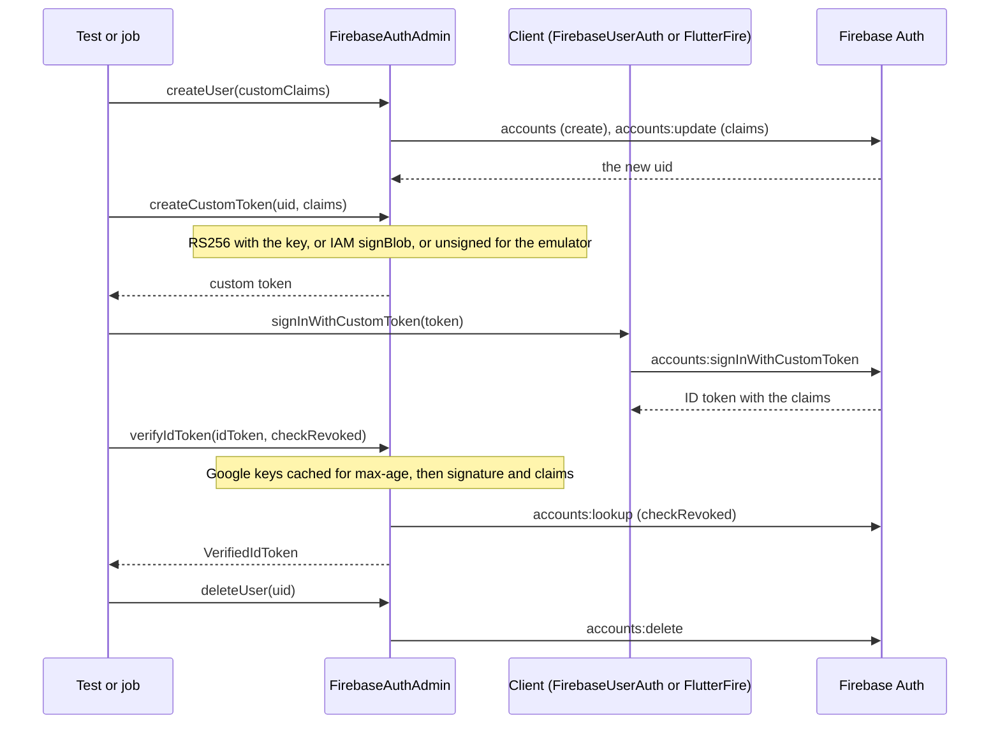

# Admin calls: firebase_admin_dart

This guide is for code that acts as an administrator of a Firebase project: a server, a command line
tool, a CI job, or an integration test that needs users on demand. After reading it you will know
when to use `firebase_admin_dart`, when to use the official Firebase Admin SDK or `googleapis`
instead, and how the usual loop works: mint a token, sign in, verify, delete.

Today the package has one admin area, Firebase Auth (`package:firebase_admin_dart/auth.dart`).
Other areas would be added as more libraries of the same package next to it, sharing the app and
the credential of `package:firebase_admin_dart/firebase_admin_dart.dart`.

**Admin credentials bypass security rules and can act as any user.** Keep them on machines you
control. Never put a service account key in an app you ship, a web page, a Flutter asset or a
repository.

## Which package

| You need | Use |
| --- | --- |
| Custom tokens, users, custom claims, revocation, ID token checks, from Dart, with few dependencies, also inside Flutter integration tests or a dart2js/wasm tool | `firebase_admin_dart` |
| Anything else of Firebase Auth admin: session cookies, `listUsers`, `getUsers`, lookups by phone or provider, user import with password hashes, email action links (password reset, verification, sign-in links), OIDC and SAML provider configs, tenants, project config, multi-factor fields | the official [`firebase_admin_sdk`](https://pub.dev/packages/firebase_admin_sdk), or an Admin SDK in another language |
| Other Firebase services as an admin (Firestore with admin rights, Cloud Messaging, Storage, Remote Config, ...) | the official `firebase_admin_sdk`; for Firestore with a service account, also `cloud_firestore_dart` with `OAuthTokenProvider` (see [Servers](server.md)) |
| A raw REST call that no SDK wraps | [`googleapis`](https://pub.dev/packages/googleapis) (`identitytoolkit/v1`, generated clients of every endpoint, no custom tokens and no token verification) |

What the official `firebase_admin_sdk` does better: the whole admin surface of the Node SDK, tenants
and project config, maintenance by Firebase, and many more users. What it costs: `dart:io` and
`dart:ffi` (no web), `googleapis`, `google_cloud_firestore`, `pointycastle` and about 38 packages,
and dependency constraints that may not resolve next to `cloud_firestore_dart`.

What `firebase_admin_dart` gives in return: pure Dart (VM, Flutter, web), five direct dependencies
that are already in the graph of the other packages of this repository, names that do not collide
with `firebase_app_dart` or FlutterFire, and the error codes of the Node Admin SDK. It is younger and
smaller. Its main path passed against one real project on 2026-11-18, keyless (see
[Checking a real project](#checking-a-real-project) for what was and was not run): run its
production check once against your own test project.

## The loop

The common case of a test or a job: create a user, mint a custom token for it, let the client sign
in with it, verify the ID token the client gets, delete the user.



In code, against the Auth emulator:

```dart admin
import 'package:firebase_admin_dart/auth.dart';
import 'package:firebase_auth_providers_dart/firebase_auth_providers_dart.dart';

Future<void> main() async {
  final FirebaseAdminApp app = FirebaseAdminApp.emulator(
    projectId: 'demo-test',
    authEmulatorHost: '127.0.0.1:9099',
  );
  final FirebaseUserAuth client = FirebaseUserAuth(
    apiKey: 'fake-api-key',
    emulatorHost: '127.0.0.1:9099',
  );

  final AdminUser user = await app.auth().createUser(
    customClaims: <String, Object?>{'role': 'tester'},
  );
  try {
    await client.signInWithCustomToken(
      await app.auth().createCustomToken(user.uid),
    );
    final String idToken = (await client.getAccessToken(forceRefresh: false)).token;
    final VerifiedIdToken verified = await app.auth().verifyIdToken(
      idToken,
      checkRevoked: true,
    );
    print(verified.claims['role']); // tester
  } finally {
    await app.auth().deleteUser(user.uid);
    await client.dispose();
    await app.close();
  }
}
```

With a real project only the app changes:

```dart admin
final FirebaseAdminApp app = FirebaseAdminApp(
  projectId: 'my-project',
  credential: AdminCredential.serviceAccount(keyJson), // a key file you loaded
);
```

On Google Cloud, without a key: `credential: applicationDefaultCredential()` from
`package:firebase_admin_dart/adc.dart`. Custom tokens are then signed by the IAM Credentials API,
which needs the API enabled and the role Service Account Token Creator on the signing account.

## Choosing the credential

| Where the code runs | Credential | Notes |
| --- | --- | --- |
| Your machine or CI, with a key file | `AdminCredential.serviceAccount(keyJson)` | You read the file; the package never does. Keep the file out of the repository |
| Cloud Run, Cloud Functions, GKE, Compute Engine | `applicationDefaultCredential()` | No key held; one IAM request per custom token |
| A person's `gcloud auth application-default login` | `applicationDefaultCredential(serviceAccountEmail: ..., quotaProjectId: ...)` | No key held; admin calls run as the person; signing as the service account needs Token Creator on it |
| The Auth emulator | `FirebaseAdminApp.emulator(...)` | No credential; unsigned tokens, accepted only in this mode |

The service account needs the role Firebase Authentication Admin (`roles/firebaseauth.admin`).

## Inside Flutter integration tests

The package has no Flutter dependency, so a test in `integration_test/` can make its own users on
the device. Pass the emulator host with `--dart-define`, or, for a real test project, the key file
from a CI secret, base64 encoded, to the test build only. A `--dart-define` value is compiled into
that binary: never pass the key to `flutter build` of an app you ship, and never keep it in
`assets/`. The README of the package has a complete test and
`example/integration_test_helper.dart` a helper to copy.

## Pitfalls

- `revokeRefreshTokens` ends sessions at their next token refresh. ID tokens already issued stay
  valid for up to an hour unless the verifier passes `checkRevoked: true` or the rules compare
  `auth_time`. The cut-off has second precision.
- New custom claims reach a client only with its next ID token: call
  `getAccessToken(forceRefresh: true)` (or `getIdToken(true)` in FlutterFire) to see them at once.
- Custom claims are at most 1000 bytes and travel in every ID token.
- `verifyIdToken` allows 10 seconds of clock skew by default (`clockSkew`, at most 5 minutes).

## Checking a real project

`example/production_check.dart` of the package runs the loop against a real project and prints
`PASS` or `FAIL`. It has two modes: keyless (`ADMIN_CHECK_PROJECT_ID`,
`ADMIN_CHECK_SERVICE_ACCOUNT` and the Web API key, after `gcloud auth application-default login`)
and with a key file (`GOOGLE_APPLICATION_CREDENTIALS` and the Web API key). The README of the
package has the gcloud setup of the keyless mode. Run it by hand once per project and after an
upgrade; nothing in CI runs it.

On 2026-11-18 the keyless mode passed against one real Firebase project, with the package at
`main` and `firebase_auth_providers_dart` 0.2.1 as the client: admin calls with a person's
Application Default Credentials, custom tokens signed by IAM `signBlob` as a service account the
person may impersonate. All seven steps passed: `createUser`; `createCustomToken` and
`signInWithCustomToken` (claims whose standard base64 would hold `+` and `/`); the claims in the ID
token; `verifyIdToken` against Google's keys with `checkRevoked`; `setCustomUserClaims`, `getUser`
and a refreshed ID token with the claims; `revokeRefreshTokens`, then `id-token-revoked` for the old
token; `deleteUser`, then `user-not-found`. The first attempt failed at `signBlob` with HTTP 403
`iam.serviceAccounts.signBlob denied` because the Token Creator role had been granted seconds
before; it passed 25 seconds later, once IAM had propagated the grant.

Not run against a real project yet: local signing with a key (`AdminCredential.serviceAccount`),
`findUserByEmail`, `updateUser`, `deleteUsers` batches, tenants, the email lookup of the default
service account on the metadata server of Google Cloud, and user credentials without a quota
project. Those rest on unit tests and the Auth emulator.
