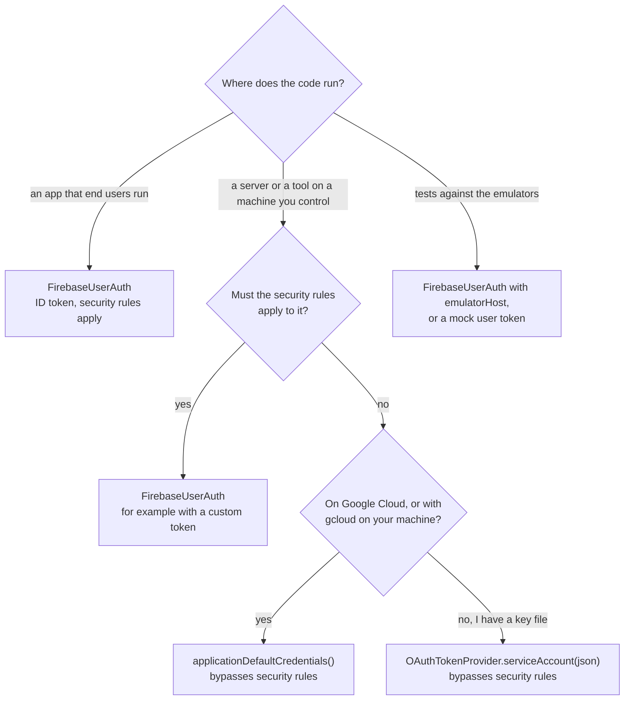
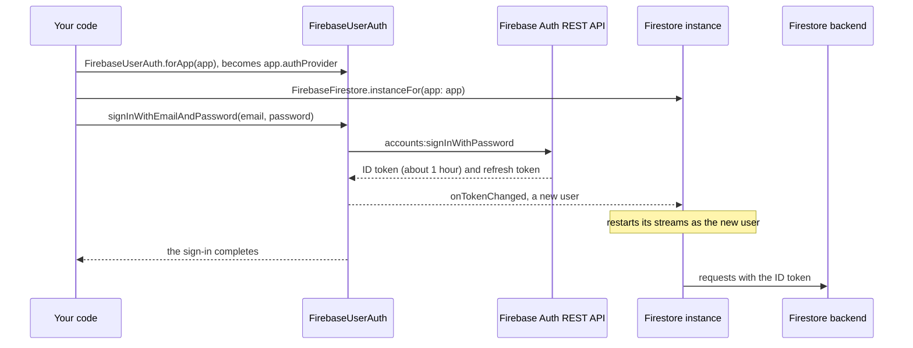
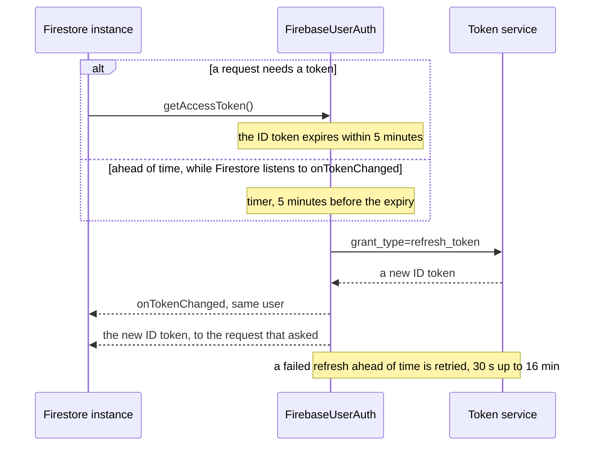
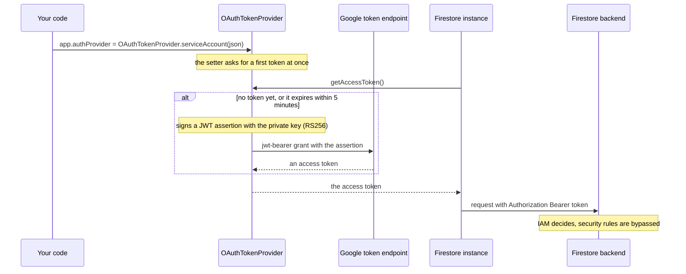

# Authentication and App Check

Without a token provider, `cloud_firestore_dart` sends its requests without credentials, and the
security rules see no user. The provider belongs to the `FirebaseApp` and must be set before the
Firestore instance is created. Ready-made providers are in the
[`firebase_auth_providers_dart`](../../firebase_auth/firebase_auth_providers_dart/README.md)
package:

| Provider | For | Token | Security rules |
| --- | --- | --- | --- |
| `FirebaseUserAuth` | applications with end users (VM, Flutter, web) | Firebase Auth ID token of the signed-in user | apply (`request.auth` is the user) |
| `OAuthTokenProvider.serviceAccount` | servers | OAuth 2.0 access token of a service account | **bypassed** |
| `applicationDefaultCredentials()` | servers, command line tools | OAuth 2.0 access token of the environment | **bypassed** |

To pick one, follow the questions from where your code runs; the last box names the provider.



This is **not** a port of the Firebase Auth SDK. `FirebaseUserAuth` covers anonymous,
email/password and custom-token sign-in, the token refresh, sign-out, and the REST-backed account
operations of the JS SDK: password reset, email verification and action codes, email, password
and profile updates, reauthentication with a password, reload and deletion (the package README
has the table). There are no federated providers (Google, Apple, ...) and no popup or redirect
flows, no phone sign-in, no email link sign-in and no multi-factor.

## With Firestore

In short:

```dart
import 'package:firebase_auth_providers_dart/firebase_auth_providers_dart.dart';

// A signed-in Firebase Auth user: the security rules see request.auth.
final auth = await FirebaseUserAuth.forApp(app);
final firestore = FirebaseFirestore.instanceFor(app: app);
await auth.signInWithEmailAndPassword(email: 'ada@example.com', password: 'the password'); // or signInAnonymously(), ...

// A server (bypasses security rules; access is decided by IAM):
//   app.authProvider = OAuthTokenProvider.serviceAccount(serviceAccountJson);
//   app.authProvider = applicationDefaultCredentials();   // package:.../adc.dart
```

A sign-in, a sign-out or a switch of users restarts the streams with the new identity, and the
pending writes of a user stay in the queue of that user, as in the official SDKs. This works the
same over gRPC, over the web transport and in Firestore Lite (`test/integration_auth`, against
the Firebase Auth emulator and a Firestore emulator whose rules require a user; nothing was run
against the real services). You can also implement `AuthTokenProvider` yourself and assign
it to `app.authProvider`.

## A signed-in user

```dart
import 'package:cloud_firestore_dart/cloud_firestore_dart.dart';
import 'package:firebase_app_dart/firebase_app_dart.dart';
import 'package:firebase_auth_providers_dart/firebase_auth_providers_dart.dart';

final app = FirebaseApp.withOptions(const FirebaseOptions(
  apiKey: '<the Web API key of the project>',
  appId: '1:1234567890:dart:example',
  projectId: 'my-project',
));

// Before the Firestore instance is created: it becomes the token provider of the app.
final auth = await FirebaseUserAuth.forApp(app);
final firestore = FirebaseFirestore.instanceFor(app: app);

await auth.signInWithEmailAndPassword(email: 'ada@example.com', password: password);
// or: auth.signInAnonymously(), auth.createUserWithEmailAndPassword(...),
//     auth.signInWithCustomToken(tokenFromYourServer)

await firestore.doc('users/${auth.uid}/notes/first').set({'text': 'hello'});

await auth.signOut();
```

The sign-in, step by step: the call completes only after Firestore has heard about the new user, so a
write issued right after it belongs to that user.



- **The token.** The ID token lives for an hour. It is refreshed with the refresh token when it
  is within five minutes of its expiry: when a token is requested, and ahead of time while
  somebody listens to `onTokenChanged` (Firestore does, so a long-lived listener never runs on an
  expired token). A failed refresh ahead of time is retried after 30 s, 1 min, ... up to 16 min.
- **A switch of users** behaves as in the official SDKs: Firestore restarts its streams with the
  new identity (a listener the new user may not read fails with `permission-denied`), and the
  writes a user made while offline stay in the queue of that user until that user is signed in
  again. `signIn...()` and `signOut()` complete after Firestore has heard about the change, so a
  write issued right after them belongs to the new user.
- **A session that ended on the backend** (account deleted or disabled, refresh token revoked)
  signs the user out at the next refresh; `userChanges` emits null.
- **Request headers** are those of the JS SDK: `X-Client-Version`
  (`Dart/DartCore/<version>/FirebaseCore-dart`), `X-Firebase-gmpid` (the application id of the
  app) and `X-Firebase-AppCheck` (the token of the app's App Check provider; a failed App Check
  request is logged and the request goes out anyway). Not sent: `X-Firebase-Client` (there is no
  heartbeat service) and `X-Firebase-Locale` (there is no language setting).
- **Errors** are `FirebaseAuthException`s with the codes of the Firebase SDKs:
  `wrong-password`, `user-not-found`, `invalid-credential`, `email-already-in-use`,
  `weak-password`, `invalid-email`, `user-disabled`, `too-many-requests`,
  `operation-not-allowed`, `invalid-custom-token`, `network-request-failed`, ...; `serverCode`
  has the code of the backend. Messages never contain a token, a password or the API key.
- **Accounts with a second factor** cannot sign in with this package yet. When the email and
  password (or the custom token) are right but the account has a second factor enrolled, the
  backend answers without tokens, and `signIn...()` and `reauthenticateWithEmailAndPassword()`
  throw a `FirebaseAuthMultiFactorException` with the code `multi-factor-auth-required` (like the
  JS SDK). Nobody new is signed in. `hints` lists the enrolled factors (`MultiFactorInfo`: id,
  name, `phone` or `totp`, masked phone number, enrolment time), so the app can tell the user what
  is needed; `pendingCredential` is what the REST endpoints `v2/accounts/mfaSignIn:start` and
  `:finalize` take, for code that finishes the sign-in itself.
- **Listening:** `auth.userChanges()` emits the `AuthUser` after every sign-in and null after a
  sign-out; `auth.currentUser` and `auth.uid` are synchronous.

The two ways a refresh starts, and what follows; both end in the same request to the token service.



### Keeping the user signed in

The session is the refresh token. It is kept in an `AuthStorage`; the default
(`InMemoryAuthStorage`) forgets it when the process ends. To keep the user signed in across
restarts, implement the two methods on top of your own storage and pass it in:

```dart
class FileAuthStorage implements AuthStorage {
  @override
  Future<String?> read(String key) async { /* ... */ return null; } // null: no value

  @override
  Future<void> write(String key, String? value) async { /* null removes the key */ }
}

final auth = await FirebaseUserAuth.forApp(app, storage: FileAuthStorage());
// auth.currentUser is the user of the last run, if there was one.
```

**The stored value is a credential.** It is the refresh token, which does not expire: whoever
reads it can act as that user until the user signs out, the account is disabled or the token is
revoked. Keep it where the platform keeps secrets, never in plain preferences or a
world-readable file:

- Flutter (iOS, Android, macOS, Windows, Linux): a secure storage plugin such as
  `flutter_secure_storage` (Keychain, Android Keystore, Windows Credential Manager, libsecret).
- Command line tools and servers: the system keychain or secret service, or a file only its
  owner can read (mode 0600, in a directory with mode 0700).
- The web: `localStorage` and IndexedDB are readable by every script of the origin (one
  cross-site scripting flaw gives the session away). Prefer the default in-memory storage or
  `sessionStorage`, with a strict Content Security Policy.

The ID token is not stored. `signOut()` removes the stored value.

### The Auth emulator

```dart
final auth = await FirebaseUserAuth.forApp(app,
    emulatorHost: FirebaseUserAuth.emulatorHostFromEnvironment); // FIREBASE_AUTH_EMULATOR_HOST
// or emulatorHost: '127.0.0.1:9099'
```

With an emulator host every request goes to the emulator, over plain HTTP: passwords, custom
tokens and refresh tokens travel unencrypted. The variable is not read implicitly: without the
argument the real service is used, so a `FIREBASE_AUTH_EMULATOR_HOST` left set on a production
machine changes nothing unless the code passes it on. On the web there is no environment, so
`emulatorHostFromEnvironment` is null there.

The host is checked like the host of the Firestore settings: `host:port`, `[ipv6]:port`, or a URL
with `http://` or `https://` as `connectAuthEmulator` of the JS SDK takes it (`https://` uses
TLS); user info, a path, a query or a bad port throw an `ArgumentError`, and so does a Google
host (`*.googleapis.com`, `*.google.com`), which is never an emulator. An emulator that is not on
the loopback interface (`localhost`, `127.x.x.x`, `[::1]`) is allowed (a container, another
machine on a test network) but logs a warning, like the JS SDK does for every emulator.

## A server: service account or Application Default Credentials

**These credentials bypass security rules.** Access is decided by IAM (for Firestore the
`Cloud Datastore User` role), `request.auth` is not a Firebase user, and whoever holds the key
can read and write everything the role allows. Use them on machines you control, never in an
application that end users run.

```dart
import 'dart:convert';
import 'dart:io';

import 'package:firebase_auth_providers_dart/adc.dart'; // needs dart:io

final app = FirebaseApp.withOptions(const FirebaseOptions(
  apiKey: '',                  // an empty key is not sent; any other key is, with each request
  appId: '1:1234567890:dart:server',
  projectId: 'my-project',
));

// Application Default Credentials: GOOGLE_APPLICATION_CREDENTIALS, gcloud, or the metadata server.
app.authProvider = applicationDefaultCredentials();

// Or a service account key (the decoded JSON of the key file, or its content as a string):
app.authProvider = OAuthTokenProvider.serviceAccount(
    jsonDecode(File(keyFilePath).readAsStringSync()));

final firestore = FirebaseFirestore.instanceFor(app: app);
```

- The access token is fetched as soon as the provider is assigned to `app.authProvider` and is
  replaced five minutes before it expires. The private key never leaves the process: it signs a short-lived assertion that is
  exchanged for the token (JWT bearer flow).
- The RS256 signature is computed in pure Dart (it also runs on the web); no vetted RSA library
  is in the dependency tree (`pointycastle` is not a dependency, and the signer of
  `googleapis_auth` is the same computation). It blinds the message and verifies every signature
  with the public key before using it, which defeats the timing and fault attacks on the CRT
  step that matter here. Dart's `BigInt` is not constant time and the key sits in ordinary
  memory: where a key needs a managed or hardware boundary, use Application Default Credentials
  (or IAM `signBlob`) instead of a key file.
- `OAuthTokenProvider.serviceAccount` is in the main library and has no `dart:io` dependency;
  `applicationDefaultCredentials()` is in `adc.dart` because the lookup reads the environment and
  files.
- The default scope is `https://www.googleapis.com/auth/datastore`; pass `scopes:` for others.
- Do not commit key files. Prefer Application Default Credentials (workload identity, the
  metadata server) over key files where you can.

How a service account key becomes the token of a request. With `applicationDefaultCredentials()` the
middle part differs: `package:googleapis_auth` gets the token from the key file, gcloud or the metadata
server.



## App Check

An `AppCheckTokenProvider` set on the `FirebaseApp` (`app.appCheckProvider`, or
`PlatformDependencies.appCheckProvider`) makes every Firestore request carry the
`x-firebase-appcheck` header, over gRPC, WebChannel, REST and Firestore Lite. These packages do
not attest a device: you supply the provider, for example one that gets tokens from your own
backend. Enforcement cannot be tested on the emulator, so it has not been tested. The design is
in `cloud_firestore/cloud_firestore_dart/docs/app_check_design.md` in the repository.

## Status of the providers

Verified with unit tests (fake HTTP client, fake clock) and against the Firebase **emulators**:
the Auth emulator for sign-in, and a Firestore emulator with security rules that require a
signed-in user for the whole path through `cloud_firestore_dart` (gRPC, the web transport and
Firestore Lite). **Nothing was run against the real Firebase Auth service or Google's token
endpoint**, and no real credential was ever used: the service account flow is tested with a key
pair generated by the test, and Application Default Credentials are not exercised at all (they
are delegated to `package:googleapis_auth`).

Platforms: the Dart VM (servers, command line tools, Flutter) and the web. On the web,
`FirebaseUserAuth` was run in Chrome (dart2js and dart2wasm) against the Auth emulator: sign-in,
token refresh, error mapping and account deletion; the requests go through the browser's
`fetch`. `applicationDefaultCredentials()` (`adc.dart`) is VM only. The SDK floor is Dart 3.8.0,
which is tested with the lowest versions of the dependencies.

It is a separate package so that `firebase_app_dart` keeps its three small dependencies. This
package needs `http`, `crypto` and `googleapis_auth` (service account keys and Application
Default Credentials); all three are already in the dependency graph of an application that uses
`cloud_firestore_dart`, through `package:grpc`.

## Testing with the Auth emulator

From `firebase_auth/firebase_auth_providers_dart` in the repository:

    dart test                                   # unit tests; the service account tests need openssl
    dart test -p chrome test/browser            # needs the Auth emulator below; skips without it
    dart test -p chrome -c dart2wasm test/browser

    # from the repository root: the Auth emulator and a Firestore emulator whose rules need auth
    tool/start_auth_emulators.sh                # needs the firebase CLI and java; prints two exports
    export FIREBASE_AUTH_EMULATOR_HOST=127.0.0.1:9197
    export FIRESTORE_AUTH_RULES_EMULATOR_HOST=127.0.0.1:8197
    dart test test/auth_emulator_test.dart                                # this package
    (cd cloud_firestore/cloud_firestore_dart && dart test test/integration_auth)   # end to end
    tool/stop_auth_emulators.sh

The emulator tests are skipped (with the reason) while the variables are not set. The browser
tests read `FIREBASE_AUTH_EMULATOR_HOST` from the environment of `dart test` too (through a hybrid
isolate on the VM) and fall back to `127.0.0.1:9197`.
