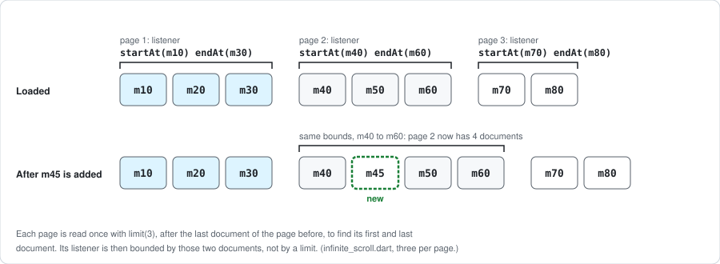
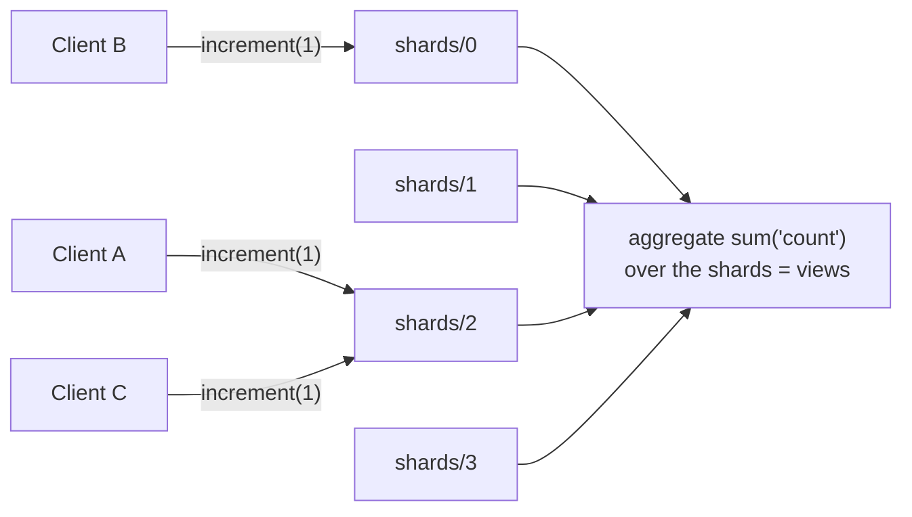
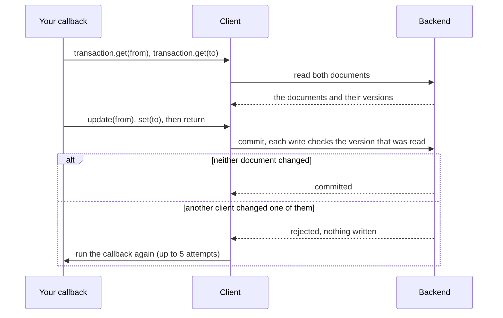

# Cookbook

Short recipes for tasks that come up in most apps: paging through results, counting without
downloading, counters, typed models, large imports and deletes, transactions, offline state and
pending writes, vector search and JSON export. Each recipe states the problem, shows the code and
says what to watch for.

Every recipe is also a complete program in
[`example/cookbook/`](../../cloud_firestore/cloud_firestore_dart/example/cookbook/). Start the
Firestore emulator (`firebase emulators:start --only firestore --project demo-example`) and run one
from `cloud_firestore/cloud_firestore_dart`:

```sh
FIRESTORE_EMULATOR_HOST=127.0.0.1:8080 dart run example/cookbook/paginate_with_cursors.dart
```

The snippets below assume a `firestore` instance in scope; [Getting started](getting_started.md)
shows how to create one. Each one was run against the Firestore emulator (Standard edition), not
against a production database.

| Recipe | Program |
|---|---|
| [Page through a large result](#page-through-a-large-result) | `paginate_with_cursors.dart` |
| [An infinite list that stays live](#an-infinite-list-that-stays-live) | `infinite_scroll.dart` |
| [Count and add up without downloading](#count-and-add-up-without-downloading) | `count_and_sum.dart` |
| [A counter](#a-counter) | `counters.dart` |
| [Add to and remove from an array](#add-to-and-remove-from-an-array) | `array_union_remove.dart` |
| [Server timestamps before the server answers](#server-timestamps-before-the-server-answers) | `server_timestamps.dart` |
| [A typed model](#a-typed-model) | `typed_model.dart` |
| [Query every subcollection with one name](#query-every-subcollection-with-one-name) | `collection_group.dart` |
| [Match one of several values](#match-one-of-several-values) | `in_and_array_contains_any.dart` |
| [OR across different fields](#or-across-different-fields) | `or_queries.dart` |
| [Import many documents](#import-many-documents) | `batch_import.dart` |
| [Move a value between two documents](#move-a-value-between-two-documents) | `move_between_documents.dart` |
| [A consistent report](#a-consistent-report) | `read_only_transaction.dart` |
| [Delete a collection](#delete-a-collection) | `delete_collection.dart` |
| [Listen to the cache only](#listen-to-the-cache-only) | `listen_to_cache_only.dart` |
| [Offline state, pending writes and a clean exit](#offline-state-pending-writes-and-a-clean-exit) | `offline_and_pending_writes.dart` |
| [Nearest neighbours](#nearest-neighbours) | `nearest_neighbours.dart` |
| [Export a query result to JSON](#export-a-query-result-to-json) | `export_to_json.dart` |

## Page through a large result

You want the documents of a query a page at a time.

```dart
final ordered = firestore.collection('posts').orderBy('day');
DocumentSnapshot<Map<String, Object?>>? last;
while (true) {
  var page = ordered.limit(20);
  if (last != null) page = page.startAfterDocument(last);
  final snapshot = await page.get();
  if (snapshot.isEmpty) break;
  // ... show snapshot.docs ...
  if (snapshot.length < 20) break; // a short page is the last one
  last = snapshot.docs.last;
}
```

A cursor makes the backend start where the last page ended, so it does not read the earlier pages
again (an offset would). A document cursor also holds the document id, so documents with the same
`day` are neither skipped nor repeated at a page boundary. Keep the snapshot of the last document,
not only its values.

Pages of four over documents ordered by `day`; look at the boundary between `d` and `e`, which share a day:


## An infinite list that stays live

You want a list that loads more as the user scrolls, and every loaded page keeps updating.

```dart
import 'dart:async';

final ordered = firestore.collection('messages').orderBy('rank');
final pages = <StreamSubscription<QuerySnapshot<Map<String, Object?>>>>[];
DocumentSnapshot<Map<String, Object?>>? end;

// Called when the user reaches the bottom of the list.
Future<void> loadNextPage() async {
  var next = ordered.limit(20);
  if (end != null) next = next.startAfterDocument(end!);
  final first = await next.get();
  if (first.isEmpty) return;
  end = first.docs.last;
  pages.add(ordered
      .startAtDocument(first.docs.first)
      .endAtDocument(first.docs.last)
      .snapshots
      .listen((snapshot) {
    // ... replace the rows of this page with snapshot.docs ...
  }));
}
```

Each page is read once to find its first and last document; its listener is then bounded by those
documents, not by a limit. A document added inside a page appears in that page, and no document
falls between two pages. A page can grow past 20; that is the price of the fixed bounds. Cancel the
subscriptions when the list goes away.

The run of `infinite_scroll.dart` (three per page): each listener covers the documents from the first
to the last of its page, so a new document inside that range joins that page:



## Count and add up without downloading

You want the number of documents, or the sum of a field, without paying to download them.

```dart
final orders = firestore.collection('orders');
final count = (await orders.count().get()).getCount();

final revenue = AggregateField.sum('total');
final average = AggregateField.average('total');
final paid = await orders
    .where('status', isEqualTo: 'paid')
    .aggregate([AggregateField.count(), revenue, average])
    .get();
print('${paid.getCount()} paid, ${paid.getInt(revenue)} in total, ${paid.getDouble(average)} each');
```

The backend computes the result and sends only the numbers. Aggregations always need the server:
they are not answered from the cache and fail when the client is offline. Read each result back
with the same `AggregateField` object you passed in, or use `aggregateWithAliases` for named
results.

## A counter

You want to count views or likes from many clients at once.

```dart
import 'dart:math';

final page = firestore.collection('pages').doc('home');
await page.update({'views': FieldValue.increment(1)});

// Distributed: one of several shard documents per write, the total from a sum.
final shards = page.collection('shards'); // shards '0' to '3' created with {'count': 0}
await shards
    .doc('${Random().nextInt(4)}')
    .update({'count': FieldValue.increment(1)});
final total = AggregateField.sum('count');
final views = (await shards.aggregate([total]).get()).getInt(total);
```

`increment` adds on the backend, so two clients that increment at the same time do not overwrite
each other, and a missing field starts at 0. The Firestore documentation recommends about one
sustained write per second to one document; above that, spread the writes over shards. An
increment whose acknowledgement is lost can be applied twice when
the client sends it again; see
[Transactions and the lifecycle](transactions_and_lifecycle.md#transactions).

The distributed counter: each write goes to one shard picked at random, and the total is a sum over the
shards:



## Add to and remove from an array

You want to add a tag or remove one without reading the document first.

```dart
final post = firestore.collection('posts').doc('hello');
await post.update({'tags': FieldValue.arrayUnion(['news', 'firestore'])});
await post.update({'tags': FieldValue.arrayRemove(['news'])});
```

`arrayUnion` appends only the elements that are not in the array yet; `arrayRemove` removes every
copy. Elements are compared whole: a map in an array is only removed by an equal map, not by part
of it. Numbers compare as the backend compares them, so `1` and `1.0` are the same element. Use an
array as a set; for an ordered list with duplicates, read and write the whole array in a
transaction.

What each call does to the array, step by step:

![arrayUnion(['news', 'firestore']) on ['dart', 'news'] gives ['dart', 'news', 'firestore']: news is already there, firestore is appended. arrayRemove(['news']) then gives ['dart', 'firestore']. arrayRemove(['news']) on ['news', 'dart', 'news'] gives ['dart']: every copy is removed. arrayUnion([1.0]) on [1, 2] leaves [1, 2]: 1 and 1.0 are the same element.](../images/readme/cookbook_arrays.svg)

## Server timestamps before the server answers

You want the server's time on a document, and something sensible to show before the server has
set it.

```dart
final note = firestore.collection('notes').doc('n1');
note.getSnapshots(MetadataChanges.include).listen((snapshot) {
  final Object? exact = snapshot['updatedAt']; // null while the write is pending
  final Object? estimate =
      snapshot.get('updatedAt', ServerTimestampBehavior.estimate); // the local clock
  final Object? previous =
      snapshot.get('updatedAt', ServerTimestampBehavior.previous); // the value before
  final bool pending = snapshot.metadata.hasPendingWrites;
});
await note.update({'text': 'second', 'updatedAt': FieldValue.serverTimestamp()});
```

The local snapshot of a write appears at once, before the server has chosen the time, and the
field reads as `null` until then. Pick `estimate` to show a time right away or `previous` to keep
the old one; `snapshot.getData(ServerTimestampBehavior.estimate)` applies the choice to every
field. A converter gets the same choice in `SnapshotOptions.serverTimestamps`.

## A typed model

You want to read and write a Dart class instead of maps.

```dart
class Product {
  const Product({required this.name, required this.price});
  factory Product.fromMap(Map<String, Object?> data) =>
      Product(name: data['name']! as String, price: (data['price']! as num).toDouble());
  final String name;
  final double price;
  Map<String, Object?> toMap() => {'name': name, 'price': price};
}
```

```dart
final products = firestore.collection('products').withConverter<Product>(
      FirestoreDataConverter<Product>.from(
        fromFirestore: (snapshot, options) => Product.fromMap(snapshot.data!),
        toFirestore: (product, options) => product.toMap(),
      ),
    );
await products.doc('pen').set(const Product(name: 'Pen', price: 1.5));
final Product pen = (await products.doc('pen').get()).data!;
final expensive = await products.where('price', isGreaterThan: 10).get();
await products.doc('pen').update({'price': 2}); // update still takes a map
```

The converter travels with the reference: queries, listeners and transactions built from
`products` return `Product`. Read numbers as `num`, because a value written as `2` by another
client comes back as an `int`. `withoutConverter()` returns the raw map view.

## Query every subcollection with one name

You want all `reviews`, whichever product document they are under.

```dart
final byAda = await firestore
    .collectionGroup('reviews')
    .where('author', isEqualTo: 'ada')
    .get();
for (final review in byAda) {
  print('${review.ref.parent.parent!.id}: ${review['stars']}'); // the product's id
}
```

A collection group covers every collection with that id in the whole database, at any depth, so
give subcollections ids that mean one thing. In production a filtered collection group query
needs an index with collection group scope; until it exists the query fails with
`failedPrecondition` and a message that links to the console. The emulator needs no index.

## Match one of several values

You want documents whose field is one of a list, or whose array holds any of a list.

```dart
final users = firestore.collection('users');
final ids = <String>[/* the document ids you want */];
final teams = await users.where('team', whereIn: ['team1', 'team2']).get();
final coders = await users.where('skills', arrayContainsAny: ['dart', 'go']).get();

// More than 30 values: one query per chunk of 30, merged by document id.
final found = <String, QueryDocumentSnapshot<Map<String, Object?>>>{};
for (var i = 0; i < ids.length; i += 30) {
  final chunk = ids.sublist(i, i + 30 > ids.length ? ids.length : i + 30);
  for (final doc in await users.where(FieldPath.documentIdField, whereIn: chunk).get()) {
    found[doc.id] = doc;
  }
}
```

The backend accepts at most 30 values in one `whereIn` or `arrayContainsAny`, and 30 terms in a
whole query once its OR filters are expanded. The client does not check the number; the request
fails with `invalidArgument`. Chunked queries lose a common order and a common limit, so sort and
cut the merged result yourself.

## OR across different fields

You want documents that match one condition or another on different fields.

```dart
final tasks = firestore.collection('tasks');
final mineOrUrgent = await tasks
    .where(Filter.or([
      Filter.equalTo('owner', 'ada'),
      Filter.greaterThanOrEqualTo('priority', 3),
    ]))
    .get();
final openOnes = await tasks
    .where(Filter.and([
      Filter.or([
        Filter.equalTo('owner', 'ada'),
        Filter.greaterThanOrEqualTo('priority', 3),
      ]),
      Filter.equalTo('done', false),
    ]))
    .get();
```

`whereIn` is enough when all the alternatives are on one field; `Filter.or` is for different
fields. The backend expands the filter into an OR of ANDs and limits that to 30 terms, so an AND
of two ORs with many values each grows quickly. In production some combinations need a composite
index; the error message links to it.

## Import many documents

You want to write thousands of documents from a file or another system.

```dart
final rows = <Map<String, Object?>>[/* from a file, an API, another database */];
final cities = firestore.collection('cities');
for (var start = 0; start < rows.length; start += 400) {
  final end = start + 400 > rows.length ? rows.length : start + 400;
  final batch = firestore.batch();
  for (final row in rows.sublist(start, end)) {
    batch.set(cities.doc(row['id']! as String), {'name': row['name'], 'population': row['pop']});
  }
  await batch.commit();
  print('written $end of ${rows.length}');
}
```

The client sets no limit on the number of writes in a batch, but one commit must stay under the
10 MiB request limit and a document takes at most 500 field transforms. Chunks of a few hundred
keep each commit small and make progress visible. Fixed document ids taken from the data make a
second run after a failure overwrite instead of duplicate.

## Move a value between two documents

You want to move stock, credit or points from one document to another without losing any.

```dart
Future<int> moveStock(DocumentReference<Map<String, Object?>> from,
    DocumentReference<Map<String, Object?>> to, int amount) {
  return firestore.runTransaction<int>((transaction) async {
    final source = await transaction.get(from); // all reads first
    final target = await transaction.get(to);
    final available = source.getInt('stock') ?? 0;
    if (available < amount) throw StateError('only $available left');
    transaction
      ..update(from, {'stock': available - amount})
      ..set(to, {'stock': (target.getInt('stock') ?? 0) + amount}, SetOptions.mergeAllFields);
    return available - amount;
  });
}
```

When another client changes either document before the commit, the callback runs again with the
new values (up to 5 attempts by default), so it must not have side effects of its own. Throwing
from the callback ends the transaction without writing. A commit whose answer is lost can be
applied twice; [Transactions](transactions_and_lifecycle.md#transactions) shows how to make it
safe to repeat.

One attempt of `moveStock`, and what happens when another client wrote in between:



## A consistent report

You want several documents, a query and a total exactly as they were at one moment.

```dart
final accounts = firestore.collection('accounts');
final orders = firestore.collection('orders');
final report = await firestore.runTransaction((transaction) async {
  final account = await transaction.get(accounts.doc('ada'));
  final list = await transaction.getQuery(orders.where('account', isEqualTo: 'ada'));
  final spent = AggregateField.sum('total');
  final sum = await transaction.getAggregate(
      orders.where('account', isEqualTo: 'ada').aggregate([spent]));
  return '${account.getInt('credit')} credit, ${list.length} orders, ${sum.getInt(spent)} spent';
}, options: TransactionOptions(readOnly: true));
```

A read-only transaction reads one point in time on the backend, takes no locks and never conflicts
with writers. Only read-only transactions allow `getQuery` and `getAggregate`; a write in one fails
with `invalidArgument`. The reads go to the server, so it fails offline. This is an extra over the
JS and Android client SDKs; [Read-only transactions](transactions_and_lifecycle.md#read-only-transactions)
has the details, including `readTime`.

## Delete a collection

You want to delete every document in a collection.

```dart
Future<int> deleteCollection(CollectionReference<Map<String, Object?>> collection) async {
  var deleted = 0;
  while (true) {
    final page = await collection.limit(200).get(Source.server);
    if (page.isEmpty) return deleted;
    final batch = collection.firestore.batch();
    for (final doc in page) {
      batch.delete(doc.ref);
    }
    await batch.commit();
    deleted += page.length;
  }
}
```

Firestore has no "delete collection" call; a client deletes the documents one page at a time.
Read from the server, because the cache may not hold every document. Subcollections of the deleted
documents stay; delete them the same way first. For a large tree, the Firebase CLI
(`firebase firestore:delete --recursive <path>`) does it outside your app.

## Listen to the cache only

You want a listener that costs no reads on the backend and never waits for the network.

```dart
final theme = firestore.collection('settings').doc('theme');
theme
    .getSnapshotsWithOptions(const SnapshotListenOptions(source: ListenSource.cache))
    .listen((snapshot) => print(snapshot['mode']));

// A one-time read that only asks the server (and fills the cache):
final fresh = await theme.get(Source.server);
```

A cache listener sees this client's own writes at once, and changes from other clients only when
something else on this client reads them from the server (another listener, or a `get`). With the
default memory cache, a document no listener needs is dropped right away, so use a persistent cache
or `MemoryCacheSettings(gcSettings: MemoryLruGcSettings())`, as the program does. There is no
server-only listener (the JS SDK has none either); `get(Source.server)` reads the server once.

## Offline state, pending writes and a clean exit

You want to show that the app is offline, mark changes that have not reached the server yet, and
make sure a command-line program does not exit before its writes are saved.

```dart
import 'dart:async';

final todos = firestore.collection('todos');
todos.getSnapshots(MetadataChanges.include).listen((snapshot) {
  final offline = snapshot.metadata.isFromCache; // offline, or not synced yet
  for (final doc in snapshot) {
    final saving = doc.metadata.hasPendingWrites; // a local change the server has not confirmed
    // ... draw doc with a "saving" mark when `saving` ...
  }
});

// Optimistic UI: do not await the write; the listener shows it at once.
unawaited(todos.doc('eggs').set({'title': 'Buy eggs'}));

// Before exiting: wait until the server has every write made so far.
await firestore.waitForPendingWrites();
await firestore.terminate();
```

Ask for `MetadataChanges.include`: going offline and a write being confirmed change only the
metadata, and without it the listener is not called. `isFromCache` is also true before the
listener's first answer from the server, so treat it as "not confirmed by the server", not
as a network test. The future of a write completes only when the server confirms it, which never
happens offline, so awaiting it would freeze an offline screen.

## Nearest neighbours

You want the documents whose embedding is closest to a query vector.

```dart
final recipes = firestore.collection('recipes');
await recipes.doc('pancakes').set({
  'meal': 'breakfast',
  'embedding': FieldValue.vector([0.9, 0.1, 0.0]), // a vector, not a plain array
});
final nearest = await recipes
    .where('meal', isEqualTo: 'breakfast') // filters apply before the search
    .findNearest('embedding', [1.0, 0.2, 0.0], 5, DistanceMeasure.cosine,
        distanceResultField: 'distance')
    .get();
for (final doc in nearest) {
  print('${doc.id}: ${doc.getDouble('distance')}');
}
```

`findNearest` runs on the server only: it fails with `unavailable` offline and is not answered
from the cache. A production database needs a vector index on the field (with the filter fields if
you filter); the emulator needs none. This is an extra over the JS client SDK, where vector search
is a pipeline stage; it follows the Android SDK.

## Export a query result to JSON

You want to save what a query returned and load it again later without asking the backend.

```dart
import 'dart:convert';
import 'dart:io';

final snapshot = await firestore.collection('events').orderBy('at').get();
await File('events.json').writeAsString(jsonEncode(snapshot.toJson()));

// Later, or in another process:
final json = jsonDecode(await File('events.json').readAsString()) as Map<String, Object?>;
final restored = QuerySnapshot<Map<String, Object?>>.fromJson(firestore, json);
```

`toJson` writes the same JSON as `toJSON` of the JS SDK, so timestamps, geo points and references come
back with their types, and the query comes with them: `firestore.querySnapshotsFromJson(json)`
resumes listening from the saved result. To hand the data to
something that is not Firestore, build plain maps instead; `Timestamp`, `GeoPoint`,
`DocumentReference`, `Blob` and `VectorValue` each have a `toJson()`.
