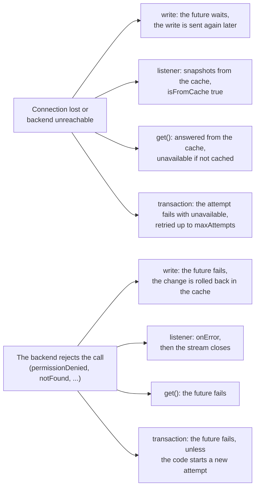
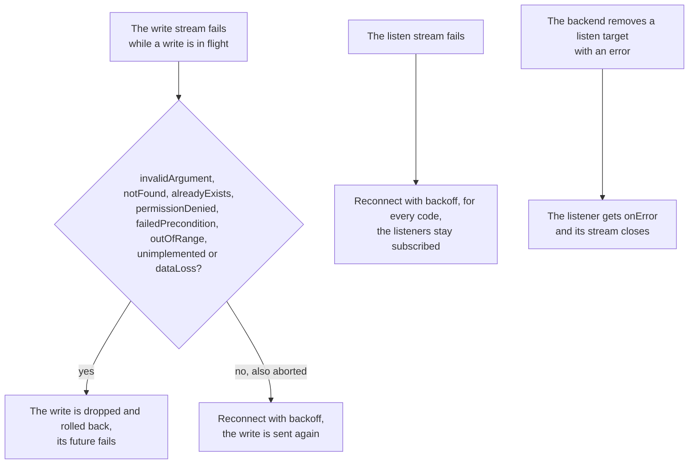
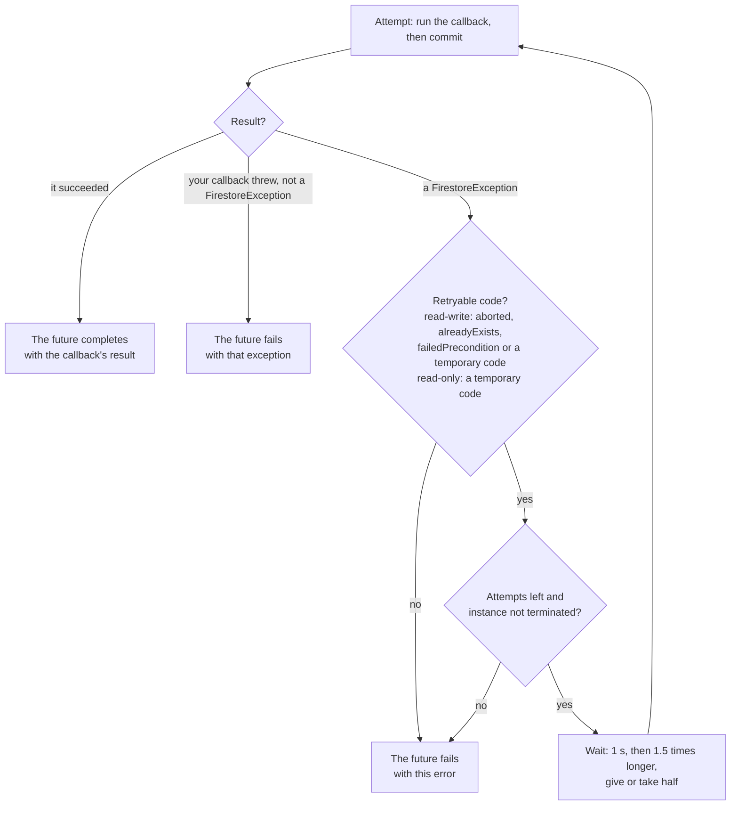

# Error handling

How `cloud_firestore_dart` reports errors, which ones the client retries by itself, and which ones
your app should handle. After reading this page you can catch and classify every error the client
throws, retry the calls that are worth retrying, and avoid the waits that look like hangs (a write
future while offline, a listener without `onError`).

`example/error_handling.dart` in the package is a runnable version of the code on this page.

## The error types

| Type | Thrown for |
|---|---|
| `FirestoreException` | everything that comes from the backend, the connection or the local cache, and a few state checks (a terminated instance, a cache in use elsewhere) |
| `ArgumentError` | invalid arguments: paths, document data, field names, query values, settings |
| `StateError` | misuse of the API, see [Misuse of the API](#misuse-of-the-api) |
| `FirebaseAuthException` | failed sign-in and token requests of `firebase_auth_providers_dart` |
| the error of your own code | an `openDatabase` that throws, an exception in a transaction callback |

`FirestoreException` (a `FirebaseException`, as in FlutterFire) has these fields:

- `errorCode`: a `FirestoreErrorCode`, one of the canonical gRPC status codes (`unavailable`,
  `permissionDenied`, ...). Compare it with the constants: `e.errorCode == FirestoreErrorCode.notFound`.
  `errorCode.value` is the numeric gRPC code. `code` is the same as a string, as in FlutterFire
  (`'not-found'`).
- `message`: the text of the backend or of the client. It is meant for logs, not for matching:
  the emulator and the production backend word their messages differently.
- `cause`: the lower-level error, when there is one (for example the parse error of a bundle).

`toString()` is `[cloud_firestore/<code>] <message>`. `FirestoreException` extends
`FirebaseException` of `firebase_app_dart`.

```dart
try {
  await firestore.doc('cities/LA').update({'visited': true});
} on FirestoreException catch (e) {
  if (e.errorCode == FirestoreErrorCode.notFound) {
    await firestore.doc('cities/LA').set({'visited': true});
  } else {
    rethrow;
  }
}
```

## Where errors arrive

The picture shows the two kinds of failure for the four common calls: a lost connection mostly does not
reach your code, a rejection by the backend does. The table below has every call.



| Call | How it fails |
|---|---|
| `set`, `update`, `delete`, `WriteBatch.commit`, `runBatch` | the future fails when the backend **rejects** the write. It does not fail while the client is offline: it waits. See [Writes while offline](#writes-while-offline). |
| `DocumentReference.get()`, `Query.get()` | the future fails; with the default source only when the backend rejects the read, or for a document that is neither on the backend nor in the cache while offline |
| `get(const GetOptions(source: Source.server))` | fails with `unavailable` when the client is offline |
| `get(const GetOptions(source: Source.cache))` | a document that is not in the cache fails with `unavailable` |
| `snapshots()`, `snapshots(...)` | the stream emits the error and then closes. See [Permission denied on a listener](#permission-denied-on-a-listener). |
| `count().get()`, `aggregate(...).get()`, `findNearest`, pipelines | one request to the backend: fails with the error of that request (`unavailable` when the connection fails), and with `unavailable` at once while the network is disabled |
| `runTransaction` | the future fails with the error of the last attempt, see [Transactions](#transactions-retries-and-the-attempt-limit) |
| `loadBundle(...)` | `task.future` fails with `invalidArgument`; the last progress event has the state `LoadBundleTaskState.error` and the `exception`, and `cause` has the parse error |
| `waitForPendingWrites()` | completes when the writes are acknowledged **or rejected**; fails with `cancelled` when the user changes while it waits |
| `snapshotsInSync()` | the stream emits the error of a terminated instance |
| the first operations of an instance whose cache cannot be opened | fail with the error your `openDatabase` threw; `set`, `update` and `delete` turn it into a `FirestoreException` with code `unknown` that quotes it |

`FirebaseFirestore.instanceFor` returns before the cache is open, so an error of `openDatabase` comes from
the first operation, not from `instanceFor`.

### The token providers

The providers of `firebase_auth_providers_dart` throw a `FirebaseAuthException` from their
own calls (`signInWithEmailAndPassword`, `OAuthTokenProvider.getAccessToken`, ...). Its `code` is
the code of the Firebase SDKs (`wrong-password`, `network-request-failed`, `too-many-requests`,
...), `serverCode` the code of the backend and `httpStatus` the HTTP status. `invalidatesSession`
is true when the user has been signed out because the session ended on the backend. See
[Authentication](authentication.md).

Firestore itself never throws these. When the token provider of the app throws while Firestore asks
it for a token, the client logs `W:FirestoreCallCredentials ... Failed to get token: <message>`
(with anything that looks like a token replaced by `<redacted>`) and the request fails with
`unauthenticated`: the listen and write streams try again with their backoff, a one-shot call
(an aggregation, a transaction attempt) fails. A provider that throws `FirebaseNoSignedInUserException`
means nobody is signed in: the request is sent without a token, and the security rules then see an
unauthenticated user. An App Check provider that throws does not fail the request: it is sent
without the App Check header and a warning is logged.

## Error codes

What each code means in this client, whether the client tries again by itself, and what your app
should do. "Streams" are the listen and write streams behind listeners and writes; they reconnect
with an exponential backoff (1 second at first, 1.5 times longer each time, give or take half of
that at random, up to 1 minute) on every error and never give up while they are needed.

| Code | What causes it here | Retried by the client | What your app should do |
|---|---|---|---|
| `cancelled` | `waitForPendingWrites()` when the user changes while it waits; a call cancelled by the backend or the connection | streams: yes; transactions: yes; `waitForPendingWrites`: no | call `waitForPendingWrites()` again if you still need it |
| `unknown` | an error without a gRPC status (for example a write on an instance whose cache could not be opened); on Windows, `clearPersistence()` while another isolate or process has the file open | streams: yes; transactions: yes | log it; for the cache, fix the opener; for `clearPersistence`, close the other client first |
| `invalidArgument` | the backend rejects the request as invalid; in a transaction: a read after a write, `getQuery` or `getAggregate` in a read-write transaction, a write in a read-only one, `update` of a document the transaction read as missing; a bundle that cannot be parsed | no | fix the code or the data |
| `deadlineExceeded` | the backend or the connection gave up on a request in time; the request may have been applied | streams: yes; transactions: yes; one-shot calls: no | retry only what gives the same result twice |
| `notFound` | `update()` of a document that does not exist | no | create the document (`set`, or `set` with `SetOptions(merge: true)`) |
| `alreadyExists` | a transaction that creates a document that another client created meanwhile | transactions: yes | nothing; a transaction that still fails after its attempts is a conflict, see below |
| `permissionDenied` | the security rules reject a read, a write or a listen | no | sign the user in, or fix the rules; a rejected write is rolled back in the cache |
| `resourceExhausted` | a quota of the project is used up; on the web, a response over 256 Mi characters | streams: yes, at the maximum backoff (1 minute); transactions: yes | wait longer before trying again; check the quotas |
| `failedPrecondition` | a query that needs a composite index (see [Troubleshooting](troubleshooting.md#a-query-fails-because-an-index-is-missing)); any call on a terminated instance; `clearPersistence()` on a running instance; the persistent cache is cleared or moved to another schema by another client; on the web, the cache is open in another tab; in a transaction, a document changed after it was read | transactions: yes; otherwise no | create the index; do not use the instance after `terminate()`; for the cache, see [Troubleshooting](troubleshooting.md) |
| `aborted` | a transaction conflict (the backend, or "Document version changed between two reads."); the write stream also gets it | transactions: yes; writes: yes | if a transaction runs out of attempts, run it again later |
| `outOfRange` | the backend (a value outside the range it accepts) | no | fix the request |
| `unimplemented` | the backend does not support the request | no | do not use the feature on this backend |
| `internal` | an error inside the backend | streams: yes; transactions: yes; one-shot calls: no | retry with a backoff; report it if it stays |
| `unavailable` | no connection or the backend is down; `get(const GetOptions(source: Source.server))` or a one-shot call while offline; a document that is neither in the cache nor reachable ("Failed to get document because the client is offline."); `get(const GetOptions(source: Source.cache))` of a document that is not in the cache; a write or a listen that could not be stored because the cache was busy for a moment (`TransientDatabaseException`); a client that is not the primary client of a shared cache runs an aggregation | streams: yes; transactions: yes; one-shot calls and cache errors: no | retry with a backoff, or read from the cache |
| `dataLoss` | the backend | no | report it |
| `unauthenticated` | the backend rejected the token, or the token provider threw | streams: yes (a stream that fails before it was healthy gets a new token first); transactions: yes; one-shot calls: no (the next call gets a new token) | check the sign-in; retry once the provider has a valid token |

The client's own rule is in `Datastore.isPermanentError` (`remote/datastore/datastore.dart`): a
listen or write stream treats every error as temporary and reconnects; a write is dropped and its
future fails only for the "permanent" codes (`invalidArgument`, `notFound`, `alreadyExists`,
`permissionDenied`, `failedPrecondition`, `outOfRange`, `unimplemented`, `dataLoss`), never for
`aborted`. A listen is rejected only when the backend removes its target with an error (permission
denied, a missing index).

The same rule as a decision tree, from the error the backend sends to what your code sees:



## Writes while offline

A write is applied to the local cache at once: listeners show it with
`metadata.hasPendingWrites == true`, and a later `get(const GetOptions(source: Source.cache))` sees it (the operations of an
instance run in the order they were called). Its future completes only when the backend has
**acknowledged** it. While the client is offline, the future does not complete and does not fail;
the client keeps the write and sends it when it is online again, for as long as the instance lives
(with a persistent cache, also after a restart).

So do not `await` a write before you update your UI or go on:

```dart
import 'dart:async';

// The change is in the cache now; the future completes when the backend has it.
unawaited(
  firestore.doc('cities/SF').set({'name': 'San Francisco'}).catchError(
    (Object e) => print('the backend rejected the write: $e'),
  ),
);

// Listeners say which snapshots hold writes that the backend has not seen yet.
firestore.doc('cities/SF').snapshots(includeMetadataChanges: true).listen(
  (DocumentSnapshot<Map<String, Object?>> snapshot) {
    print('pending: ${snapshot.metadata.hasPendingWrites}');
  },
  onError: (Object e) => print('listener failed: $e'),
);
```

- Keep an error handler on a write you do not await. A rejected write fails its future, and a
  failed future without a handler is an uncaught error (it ends a command-line program).
- `await firestore.waitForPendingWrites()` waits for every write that was pending at the call,
  when you need them on the backend (before `terminate()`, at the end of a batch job). It
  completes when they are acknowledged or rejected, and it does not complete while the network is
  disabled with `disableNetwork()`.
- A write never fails because the client is offline. It fails with `unavailable` only when the
  cache could not store it (a `TransientDatabaseException` of the opener); nothing was stored then,
  and you can try again.
- A rejected write (`permissionDenied`, `notFound`, ...) is taken out of the cache again, and
  listeners get a snapshot without it.
- A client that is not the primary client of a shared cache keeps its writes pending, and their
  futures do not complete, until it is primary again. See
  [Several clients on one cache](multiple_clients.md).
- After `terminate()`, the futures of writes that were not acknowledged never complete. See
  [Transactions and the lifecycle](transactions_and_lifecycle.md).

## Permission denied on a listener

When the backend refuses a listen (the security rules reject it, or the query needs an index), the
stream emits a `FirestoreException` with `permissionDenied` or `failedPrecondition` and then **closes**:
the client has dropped the listener. The client also logs the error as a warning
(`W:Firestore ... Listen for <query> failed: ...`). Without `onError`, the error is an uncaught
error of the zone.

```dart
import 'dart:async';

StreamSubscription<QuerySnapshot<Map<String, Object?>>> listen() {
  return users.snapshots().listen(
    (QuerySnapshot<Map<String, Object?>> snapshot) {
      print('${snapshot.docs.length} users');
    },
    onError: (Object error) {
      if (error is FirestoreException &&
          error.errorCode == FirestoreErrorCode.permissionDenied) {
        // The stream is closed. Listen again once the user may read the data,
        // for example after a sign-in.
        print('not allowed to read users');
      } else {
        print('listener failed: $error');
      }
    },
  );
}

final StreamSubscription<QuerySnapshot<Map<String, Object?>>> subscription = listen();
```

A listener does not fail because the client is offline: it gets snapshots from the cache with
`metadata.isFromCache == true`, and fresh ones once the client is online again. Connection errors
never reach the listener; turn on logging to see them (see [Troubleshooting](troubleshooting.md)).

## Transactions: retries and the attempt limit

`runTransaction` runs your callback, commits its writes and, when the attempt fails with an error
that another attempt can fix, waits (1 second at first, then 1.5 times longer, give or take half)
and runs the callback again, up to `maxAttempts` attempts in all (5 by default,
at least 1). The rule is in `core/transaction_runner.dart`:

- A read-write transaction is retried for `aborted`, `alreadyExists` and `failedPrecondition`
  (the backend's answers to a document that changed after it was read) and for every temporary
  code (`unavailable`, `unknown`, `cancelled`, `deadlineExceeded`, `internal`,
  `resourceExhausted`, `unauthenticated`).
- A read-only transaction (`readOnly: true`) has no conflicts: it is only
  retried for the temporary codes.
- An exception that your callback throws, and that is not a `FirestoreException`, ends the transaction
  at once with that exception. A `FirestoreException` with one of the codes above starts a new
  attempt.
- A transaction is not retried once its instance is terminated.
- Transactions talk to the backend directly: `disableNetwork()` does not stop them. Without a
  connection each attempt fails with `unavailable`; with the default of 5 attempts the future
  fails after the four waits in between, about 8 seconds give or take the random part (9 seconds
  in one run against a closed port).

One attempt and what decides whether another one follows:



When all attempts are used up the future fails with the error of the last one: for a conflict,
`aborted` or `failedPrecondition` (the emulator answers `failedPrecondition`). Run the transaction
again later, or with a higher limit:

```dart
final int total = await firestore.runTransaction(
  (Transaction transaction) async {
    final DocumentSnapshot<Map<String, Object?>> counter =
        await transaction.get(firestore.doc('counters/visits'));
    final int value = ((counter.data()?['value'] as int?) ?? 0) + 1;
    transaction.set(firestore.doc('counters/visits'), {'value': value});
    return value;
  },
  maxAttempts: 10,
);
```

The callback runs once per attempt, so it must not have effects of its own (no UI updates, no
writes outside the transaction). A commit whose answer is lost can be applied twice; see
[Transactions and the lifecycle](transactions_and_lifecycle.md).

## Retrying calls yourself

The client already retries listeners, writes and transactions. The calls it does not retry are the
ones answered by one request: `get(const GetOptions(source: Source.server))`, a document `get()` while offline, aggregations,
`findNearest`, pipelines, and a transaction that ran out of attempts. For those, a small helper that
retries the temporary codes with a backoff is enough:

```dart
import 'dart:math';

bool isRetryable(FirestoreException error) {
  switch (error.errorCode) {
    case FirestoreErrorCode.unavailable:
    case FirestoreErrorCode.deadlineExceeded:
    case FirestoreErrorCode.resourceExhausted:
    case FirestoreErrorCode.internal:
    case FirestoreErrorCode.aborted:
      return true;
    default:
      return false;
  }
}

Future<T> withRetry<T>(
  Future<T> Function() operation, {
  int maxAttempts = 5,
  Duration initialDelay = const Duration(seconds: 1),
}) async {
  final Random random = Random();
  Duration delay = initialDelay;
  for (int attempt = 1; ; attempt++) {
    try {
      return await operation();
    } on FirestoreException catch (error) {
      if (attempt >= maxAttempts || !isRetryable(error)) {
        rethrow;
      }
      await Future<void>.delayed(delay * (0.5 + random.nextDouble()));
      delay *= 1.5;
    }
  }
}

final AggregateQuerySnapshot count = await withRetry(() => users.count().get());
print(count.count);
```

- Do not wrap writes in it: a write future does not fail while offline, it waits.
- `deadlineExceeded` and `unknown` can mean that the backend applied the request. Retry only calls
  that give the same result when they run twice.
- `unauthenticated` is left out on purpose: a new attempt only helps once the user is signed in
  again. Add it if your token provider recovers by itself.
- For `resourceExhausted`, a longer first delay is better: the client's own streams wait a full
  minute.

## Misuse of the API

These are programming errors. Fix the code rather than catching them.

| Error | When |
|---|---|
| `StateError` | `FirebaseFirestore.instanceFor` with settings that differ from those of the instance that exists for the app and database (`terminate()` it first, or call `instanceFor` without settings) |
| `StateError` | `FirebaseFirestore.instance` before the default app exists |
| `StateError` | settings that mix `cacheSettings` with `persistenceEnabled` or `cacheSizeBytes` |
| `StateError` | a `WriteBatch` used after `commit()`; a `Transaction` used after its attempt completed (for example a write in a callback that was not awaited) |
| `StateError` | `limitToLast` without an `orderBy` |
| `StateError` | `setIndexConfigurationFromJSON` (deprecated) without a persistent cache |
| `FirestoreException` `failedPrecondition` | any call on a terminated instance ("The client has already been terminated."); calling `terminate()` again is allowed |
| `FirestoreException` `failedPrecondition` | `clearPersistence()` before `terminate()`, or while a newer instance of the same app and database runs |
| `FirestoreException` `invalidArgument` | the transaction rules above: reads after writes, `getQuery` in a read-write transaction, writes in a read-only one |
| `ArgumentError` | an empty or malformed path, a collection path with an even number of segments, field names that begin and end with `__`, unsupported values in document data, a cache size under 1 MB, `withEmulator` with the production host, `maxAttempts` below 1, a `readTime` without `readOnly: true` |

## Firestore Lite

[Firestore Lite](lite.md) has no cache and no streams: every call is one request and fails with the
error of that request. It does not retry anything except transactions, which follow the rules
above. After `terminate()` its calls fail with `failedPrecondition`.

## See also

- [Troubleshooting](troubleshooting.md): symptoms, causes and fixes, and how to turn on logging.
- [Transactions and the lifecycle](transactions_and_lifecycle.md)
- [Offline persistence and cache settings](offline_persistence.md)
