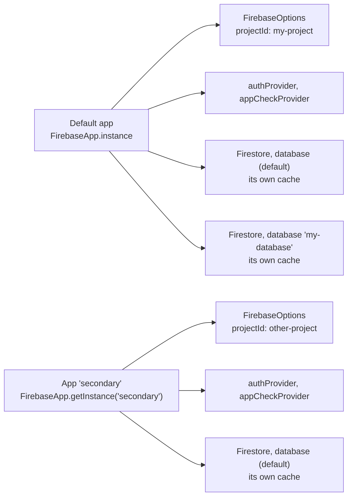

# Configuring the FirebaseApp

`firebase_app_dart` holds what every Firebase service of these packages needs: the
`FirebaseApp`, its `FirebaseOptions`, and the `PlatformDependencies` through which the app
receives storage, connectivity events and tokens from the platform it runs on.

## The options

```dart
import 'package:firebase_app_dart/firebase_app_dart.dart';

final FirebaseApp defaultApp = FirebaseApp.withOptions(
  const FirebaseOptions(
    apiKey: '<YOUR_API_KEY>',
    appId: '1:1234567890:web:0123456789abcdef',
    projectId: 'my-project',
  ),
);

// More apps, for other projects or other users, have names of their own.
final FirebaseApp secondary = FirebaseApp.withOptions(
  const FirebaseOptions(
    apiKey: '<YOUR_API_KEY>',
    appId: '1:1234567890:dart:secondary',
    projectId: 'other-project',
  ),
  name: 'secondary',
);
print(identical(FirebaseApp.instance, defaultApp)); // true
print(identical(Firebase.app('secondary'), secondary)); // true
```

- An app without a name is the default app, `FirebaseApp.instance`. Creating two apps with the
  same name is an error; `app.delete()` frees the name.
- Firestore uses `projectId`. The `apiKey` and `appId` are sent with Firebase Auth
  requests and identify the app (`appId` is also sent as `X-Firebase-gmpid`).
- `FirebaseOptions.fromJson` reads the options from a map.

What hangs off each app: its own options and token providers, and one Firestore instance per database
(`Firestore.instanceFor` keys its instances by app name and database, and the persistent cache is named
after the app, the project and the database). Deleting an app shuts its Firestore instances down.



Where the values come from:

- **The Firebase console**, *Project settings*: the project id; under *Your apps*, the API key
  and application id of a registered app. The values of a web app work on every platform.
- **An API key of your own**: in the Google Cloud console, *APIs & Services*, *Credentials*,
  *Create credentials*, *API key*. Restrict it to the APIs you use.
- **An application id for a platform Firebase does not register apps for** (desktop, servers):
  any id of the form `<n>:<project number>:<platform>:<suffix>` that is unique in the project,
  for example `1:1234567890:linux:my-tool`. The project number is on the *Project settings*
  page.

## Platform dependencies

A subclass of `PlatformDependencies` (from
`package:firebase_app_dart/platform_dependencies.dart`), passed as `dependencies:` to
`FirebaseApp.withOptions`, connects the app to its platform. Every member has a default:

| Member | What it is for | Default |
| --- | --- | --- |
| `onNetworkConnected` | emits `true` when the network is back; Firestore restarts its streams at once instead of waiting for its backoff | the built-in detector of `cloud_firestore_dart` on the VM, the browser events on the web |
| `onBackgroundChanged` | emits `true` when the app goes to the background | never in the background |
| `storage` | key/value storage that survives restarts | in memory |
| `authProvider` | the ID or access token sent with Firestore requests | none: unauthenticated |
| `appCheckProvider` | the App Check token sent in `x-firebase-appcheck` | none |
| `headersBuilder` | extra request headers | none; Firestore does not use it |

For example, connectivity events from a plugin such as `connectivity_plus`:

```dart
import 'package:firebase_app_dart/platform_dependencies.dart';
import 'package:rxdart/rxdart.dart';

class AppDependencies extends PlatformDependencies {
  final BehaviorSubject<bool> connectivity = BehaviorSubject<bool>.seeded(true);

  @override
  BehaviorSubject<bool> get onNetworkConnected => connectivity;
}

final AppDependencies dependencies = AppDependencies();
final FirebaseApp connectedApp = FirebaseApp.withOptions(
  const FirebaseOptions(
    apiKey: '<YOUR_API_KEY>',
    appId: '1:1234567890:dart:example',
    projectId: 'my-project',
  ),
  name: 'connected',
  dependencies: dependencies,
);

// From the plugin's callback:
dependencies.connectivity.add(true);
```

`authProvider` and `appCheckProvider` can also be set on the app later
(`app.authProvider = ...`), before the Firestore instance is created. The ready-made token
providers are described in [Authentication and App Check](authentication.md).

`package:firebase_app_dart/internal.dart` is shared plumbing for `cloud_firestore_dart`; it is
not public API and can change in any release.
