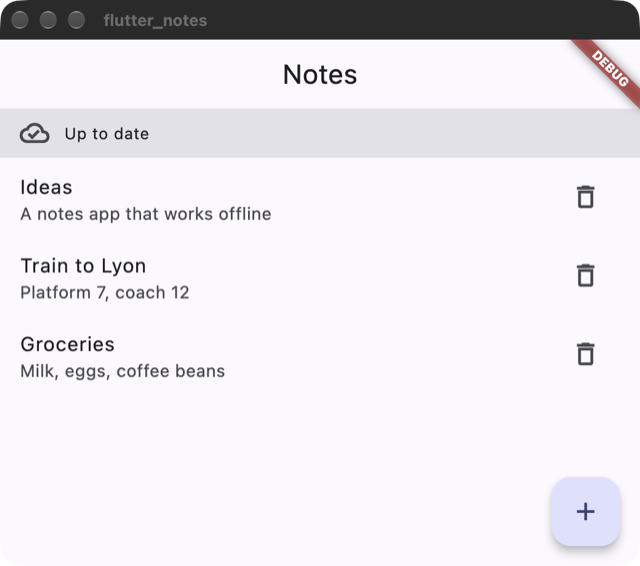
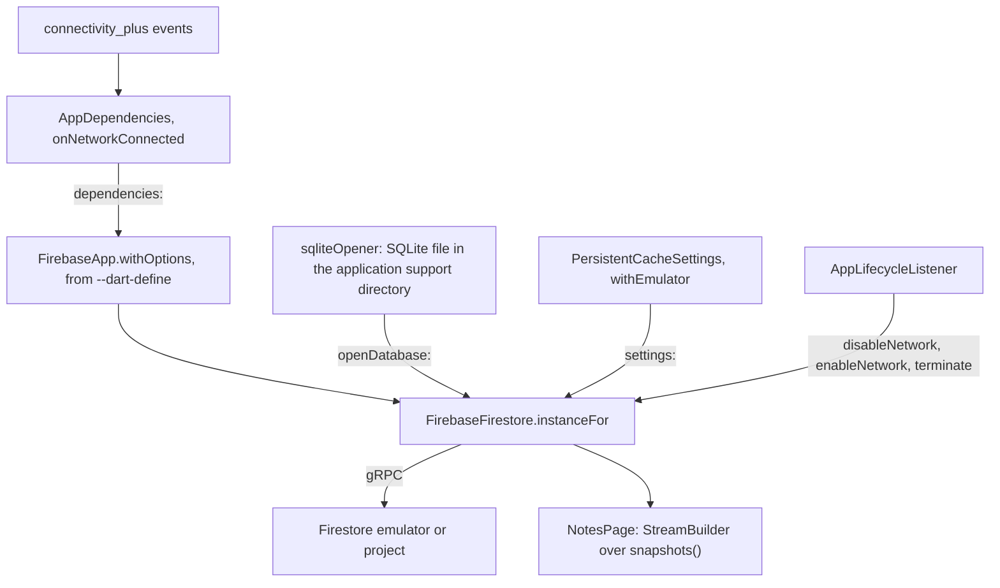
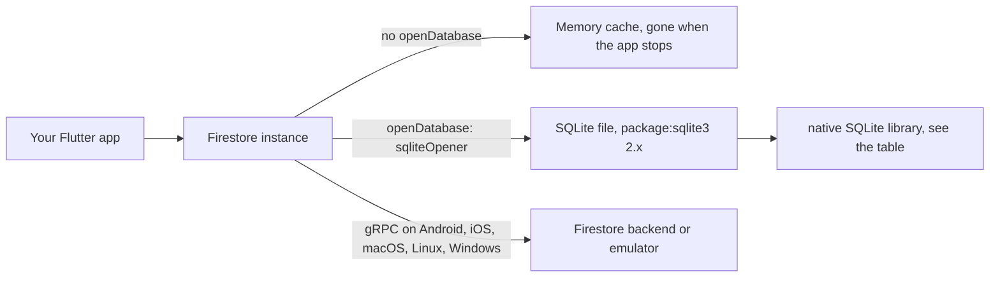

# Flutter

This guide shows how to use `cloud_firestore_dart` in a Flutter app: create the client before
`runApp`, show a query with a `StreamBuilder`, keep the cache in SQLite, feed connectivity
events to the client, and shut it down when the app quits. Every sample comes from
[`examples/flutter_notes`](../../examples/flutter_notes/README.md), a small notes app that you
can run against the emulator.

The package is plain Dart: there is no plugin to register and nothing to configure in the
native projects except network access. It talks gRPC on Android, iOS, macOS, Linux and Windows,
as on a server. The tests of this repository do not run any Flutter app; the example app was
built and run on macOS only (see [What was tried where](#what-was-tried-where)).

This is the example app on macOS against the emulator. The status line under the title comes
from the snapshot metadata ([An offline indicator from the metadata](#an-offline-indicator-from-the-metadata)):



The Dart blocks of this guide are fenced as `dart flutter`: they import Flutter or plugins, so
the snippet test of the package, which compiles the other guides, skips them. They are checked
by `flutter analyze` in `examples/flutter_notes`.

## Install

```shell
flutter pub add cloud_firestore_dart firebase_app_dart path_provider rxdart
flutter pub add sqlite3:^2.7.3 sqlite3_flutter_libs:^0.5.40   # the cache on disk
flutter pub add connectivity_plus                              # optional, see Connectivity
```

Copy [`example/sqlite_database.dart`](../../cloud_firestore/cloud_firestore_dart/example/sqlite_database.dart)
of the package into your `lib/`. It is written for `package:sqlite3` 2.x, so keep `sqlite3` on
2.x and `sqlite3_flutter_libs` on 0.5.x, which bundles the native SQLite library with the app.
`sqlite3` 3.x bundles the library itself and has a different loading API; the opener has not
been ported to it.

Two changes to the projects that `flutter create` makes:

- **macOS**: the app sandbox blocks outgoing connections. Add `com.apple.security.network.client`
  to `macos/Runner/DebugProfile.entitlements` and `macos/Runner/Release.entitlements`:

  ```xml
  <key>com.apple.security.network.client</key>
  <true/>
  ```

- **Android**: a release build needs the `INTERNET` permission in
  `android/app/src/main/AndroidManifest.xml` (debug builds get it from `src/debug`):

  ```xml
  <uses-permission android:name="android.permission.INTERNET"/>
  ```

## Create the app and the instance before `runApp`

Create the `FirebaseApp` and the `Firestore` instance once, in `main()`.
`WidgetsFlutterBinding.ensureInitialized()` comes first, because `path_provider` and
`connectivity_plus` call the platform. The code below builds this; look at what goes into
`FirebaseFirestore.instanceFor` and what uses the instance afterwards:



```dart flutter
Future<void> main() async {
  // path_provider and connectivity_plus talk to the platform: the binding
  // must exist before the app and the instance are created.
  WidgetsFlutterBinding.ensureInitialized();
  final AppDependencies dependencies = AppDependencies();
  final FirebaseFirestore firestore = await createFirestore(dependencies);
  runApp(NotesApp(firestore: firestore, dependencies: dependencies));
}
```

`createFirestore` makes the app from its options (no `firebase_options.dart`, no native
configuration file), gives the instance a SQLite cache in the application support directory, and
points it at the emulator unless told otherwise:

```dart flutter
const bool useEmulator = bool.fromEnvironment(
  'USE_EMULATOR',
  defaultValue: true,
);
const String emulatorHost = String.fromEnvironment(
  'EMULATOR_HOST',
  defaultValue: '127.0.0.1',
);
const int emulatorPort = int.fromEnvironment(
  'EMULATOR_PORT',
  defaultValue: 8080,
);
// A `demo-` project id never reaches a real project.
const String projectId = String.fromEnvironment(
  'PROJECT_ID',
  defaultValue: 'demo-notes',
);
// The emulator needs no key; an empty key is not sent.
const String apiKey = String.fromEnvironment('API_KEY');
const String applicationId = String.fromEnvironment(
  'APP_ID',
  defaultValue: '1:1234567890:web:0123456789abcdef',
);

Future<FirebaseFirestore> createFirestore(AppDependencies dependencies) async {
  final FirebaseApp app = FirebaseApp.withOptions(
    const FirebaseOptions(
      apiKey: apiKey,
      appId: applicationId,
      projectId: projectId,
    ),
    dependencies: dependencies,
  );

  final Directory directory = await getApplicationSupportDirectory();
  Settings settings = Settings(
    cacheSettings: PersistentCacheSettings(),
  );
  if (useEmulator) {
    settings = settings.withEmulator(emulatorHost, emulatorPort);
  }
  return FirebaseFirestore.instanceFor(
    app: app,
    settings: settings,
    openDatabase: sqliteOpener(Directory('${directory.path}/firestore')),
  );
}
```

- The values for a real project are those of a web app of the project (Firebase console,
  *Project settings*, *Your apps*); they work on every platform. Pass them with `--dart-define`
  (`USE_EMULATOR=false`, `PROJECT_ID`, `API_KEY`, `APP_ID`). [Configuring the
  FirebaseApp](firebase_app.md) explains each option.
- On the Android emulator the host machine is `10.0.2.2`. Nothing maps `localhost` for you, as
  FlutterFire does: pass `--dart-define=EMULATOR_HOST=10.0.2.2`.
- Pass the settings to `instanceFor`, or set `firestore.settings` (or call `useFirestoreEmulator`) before the
  first use of the instance; after it they throw.
- For signed-in users, set `app.authProvider` before `FirebaseFirestore.instanceFor`; see
  [Authentication](authentication.md). The example does not sign in.
- If the app signs users in with FlutterFire's `firebase_auth`, `FlutterFireBridge.firestore()` of
  `cloud_firestore_dart_flutterfire` creates the app and the instance with that user; see
  [Using cloud_firestore_dart with FlutterFire sign-in](flutterfire_bridge.md).

## Where to keep the instance

Keep the one instance for the life of the app and hand it down: the example passes it to its
widgets through their constructors (`NotesApp(firestore: ...)`, `NotesPage(firestore: ...)`).
An `InheritedWidget` or a top-level `final` work as well. Once `FirebaseFirestore.instanceFor(app: app)`
has created the instance of the default app, `FirebaseFirestore.instance` returns it; before that it
throws a `StateError`.

Do not create the instance in `build()` or in `initState()` of a widget that can be rebuilt or
mounted twice: a second `instanceFor` with the same settings returns the same instance, but with
different settings it throws.

Hot reload keeps the instance. Hot restart runs `main()` again in a new isolate while the old
isolate may still hold the cache file; the new client takes the cache over and nothing is needed
from you ([Several clients on one cache](multiple_clients.md)).

## Show a query with `StreamBuilder`

`snapshots()` and `snapshots(...)` start a new listener each time they are called. Create the
stream once, in the `State`, not in `build()`:

```dart flutter
class _NotesPageState extends State<NotesPage> {
  late final CollectionReference<Note> _notes = widget.firestore
      .collection('notes')
      .withConverter<Note>(const NoteConverter());

  // Created once, not in build(): each call to snapshots starts a new
  // listener. includeMetadataChanges: true also delivers the snapshots in which
  // only isFromCache or hasPendingWrites changed, so the status line and the
  // pending marks follow the connection and the acknowledgements.
  late final Stream<QuerySnapshot<Note>> _snapshots = _notes
      .orderBy('updatedAt', descending: true)
      .snapshots(includeMetadataChanges: true);
```

Then build from the latest snapshot. The listener is cancelled when the `StreamBuilder` leaves
the tree:

```dart flutter
StreamBuilder<QuerySnapshot<Note>>(
  stream: _snapshots,
  builder: (BuildContext context, AsyncSnapshot<QuerySnapshot<Note>> state) {
    if (state.hasError) {
      return Center(child: Text('Error: ${state.error}'));
    }
    final QuerySnapshot<Note>? snapshot = state.data();
    if (snapshot == null) {
      return const Center(child: CircularProgressIndicator());
    }
    return Column(
      children: <Widget>[
        _StatusLine(metadata: snapshot.metadata),
        Expanded(child: _buildList(snapshot)),
      ],
    );
  },
)
```

A `QuerySnapshot` is an `Iterable` of its documents: `snapshot.docs` is the list,
`snapshot.isEmpty` and `snapshot.length` work on it directly.

### An offline indicator from the metadata

Each snapshot says where it comes from. `metadata.isFromCache` is `true` while the client has no
confirmed answer from the backend (offline, or just started); `metadata.hasPendingWrites` is
`true` while a local write in the result has not been acknowledged. The example shows both in a
status line, and marks each document whose own `metadata.hasPendingWrites` is set:

```dart flutter
final (IconData icon, String text) = switch ((
  metadata.isFromCache,
  metadata.hasPendingWrites,
)) {
  (true, true) => (
    Icons.cloud_off,
    'Offline: changes are saved on this device and sent later',
  ),
  (true, false) => (Icons.cloud_off, 'Offline: showing the saved notes'),
  (false, true) => (Icons.cloud_upload_outlined, 'Sending changes'),
  (false, false) => (Icons.cloud_done_outlined, 'Up to date'),
};
```

Without `includeMetadataChanges: true` the listener only fires when the documents change, so the
line would stay on "Offline" after the connection is back until a document changes.

### Writes: do not await them in the UI

A write is applied to the cache and shown by the listeners at once. Its future completes only
when the backend acknowledged it, which offline can be after the next start of the app. Start
the write, and only report errors:

```dart flutter
void _write(Future<void> write) {
  unawaited(
    write.catchError((Object error) {
      if (mounted) {
        ScaffoldMessenger.of(
          context,
        ).showSnackBar(SnackBar(content: Text('Not saved: $error')));
      }
    }),
  );
}
```

```dart flutter
// doc() makes the id on the device, so this works offline too.
final DocumentReference<Note> ref = existing?.reference ?? _notes.doc();
_write(ref.set(note));
```

```dart flutter
onPressed: () => _write(doc.reference.delete()),
```

`collection.add(data)` also works offline, but its future, which gives you the reference, waits
for the backend as well; `doc()` followed by `set()` gives you the id at once.

### A typed model

A `FirestoreDataConverter` turns documents into your class and back. The example stores a server
timestamp, and reads it with `ServerTimestampBehavior.estimate` so that a note written on this
device has a time before the backend set one:

```dart flutter
class NoteConverter extends FirestoreDataConverter<Note> {
  const NoteConverter();

  @override
  Note fromFirestore(
    DocumentSnapshot<Map<String, Object?>> snapshot,
    SnapshotOptions? options,
  ) {
    // A note written on this device and not yet acknowledged has no server
    // timestamp yet: `estimate` gives the local time instead of null.
    final Map<String, Object?> data = snapshot.data(
      serverTimestamps: ServerTimestampBehavior.estimate,
    )!;
    return Note(
      title: data['title'] as String? ?? '',
      body: data['body'] as String? ?? '',
      updatedAt: (data['updatedAt'] as Timestamp?)?.toDate(),
    );
  }

  @override
  Map<String, Object?> toFirestore(Note note, SetOptions? options) =>
      <String, Object?>{
        'title': note.title,
        'body': note.body,
        'updatedAt': FieldValue.serverTimestamp(),
      };
}
```

`update()` takes raw field values even on a typed reference. See
[Queries, data and the API](queries_and_data.md#typed-data-converters) for more.

## The SQLite cache on each platform

Without `openDatabase` the cache is in memory and gone when the app stops. With the copied
`sqliteOpener` it is one SQLite file per app name, project and database, in the directory you
pass (the example uses `getApplicationSupportDirectory()` plus `/firestore`). The choices on a
native platform, cache and transport together:



Where the SQLite library comes from:

| Platform | Library that `package:sqlite3` 2.x loads |
| --- | --- |
| Android | `libsqlite3.so` bundled by `sqlite3_flutter_libs` |
| iOS, macOS | the framework bundled by `sqlite3_flutter_libs`; the system library if it is missing |
| Windows | `sqlite3.dll` bundled by `sqlite3_flutter_libs` |
| Linux | the system library: `sqliteOpener` sets `open.overrideFor(OperatingSystem.linux, ...)` to `libsqlite3.so`, then `libsqlite3.so.0`. This replaces the default of `sqlite3` 2.x, which would use the copy that `sqlite3_flutter_libs` links into the app. A desktop with SQLite installed has `libsqlite3.so.0` |

Only the macOS row was tried with this example. The application support directory is inside the
app's container on macOS (`~/Library/Containers/<bundle id>/...`) and private to the app on
Android and iOS. On Windows, `clearPersistence()` fails while another handle still has the file
open ([Platforms](platforms.md)). [Offline persistence](offline_persistence.md) covers the cache
size, protecting the files, and cache indexes.

## Connectivity

The client considers itself offline only when a stream fails, and then retries with a backoff of
up to a minute. On the VM it also watches the addresses of the network interfaces while a
stream is failing, and retries at once when one appears. In a Flutter app you can give it the
events of a plugin instead: subclass `PlatformDependencies` and override `onNetworkConnected`.
The example feeds it from `connectivity_plus`:

```dart flutter
class AppDependencies extends PlatformDependencies {
  AppDependencies() {
    _subscription = Connectivity().onConnectivityChanged.listen(
      (List<ConnectivityResult> results) => connectivity.add(
        results.any((ConnectivityResult r) => r != ConnectivityResult.none),
      ),
    );
  }

  final BehaviorSubject<bool> connectivity = BehaviorSubject<bool>.seeded(true);
  late final StreamSubscription<List<ConnectivityResult>> _subscription;

  @override
  BehaviorSubject<bool> get onNetworkConnected => connectivity;

  Future<void> dispose() async {
    await _subscription.cancel();
    await connectivity.close();
  }
}
```

Pass it as `dependencies:` to `FirebaseApp.withOptions` (see `createFirestore` above). What the
client does with it ([Connectivity](offline_persistence.md#connectivity)):

- every `true` restarts the streams at once and resets the backoff, after a 5 second debounce;
  `false` is ignored;
- the first event from the app switches the built-in detector off for that instance. The seed
  value does not count.

`connectivity_plus` reports a network interface, not a working connection: on a Wi-Fi without
internet it says `wifi`, and the client keeps failing and retrying as before. On Linux it uses
NetworkManager over D-Bus, through the packages `nm` and `dbus`, which are under the Mozilla
Public License 2.0.

## The app lifecycle

The client does not watch the lifecycle of the app: `PlatformDependencies.onBackgroundChanged`
is not read by Firestore. While the operating system lets the process run in the background,
the listeners stay connected. When the system suspends the app (iOS does so soon after the app
leaves the screen), the connection can be gone on resume; the client then learns it when the
stream fails, and reconnects after its backoff. This was not tried on a device.

The example disconnects on purpose while it is paused, and reconnects as soon as it is back:

```dart flutter
_lifecycle = AppLifecycleListener(
  // Android and iOS: no network while the app is in the background. The
  // listeners keep serving the cache, and writes wait in it. On resume
  // the client connects at once instead of finding a dead connection
  // and backing off.
  onPause: () => unawaited(widget.firestore.disableNetwork()),
  onResume: () => unawaited(widget.firestore.enableNetwork()),
  // Desktop: the user quits the app or closes its last window.
  onExitRequested: _shutdown,
);
```

The cost: a write made just before the app goes to the background waits for the next resume.
If your app must keep listening in the background, leave `disableNetwork()` out.

### Terminate

On desktop, `onExitRequested` runs when the user quits the app. Terminate the instance there: it
closes the streams and the SQLite file.

```dart flutter
Future<AppExitResponse> _shutdown() async {
  // Closes the streams and the SQLite file. Writes that the server has not
  // acknowledged stay in the cache and are sent on the next start.
  await widget.firestore.terminate();
  await widget.dependencies.dispose();
  return AppExitResponse.exit;
}
```

- A write that the backend has not acknowledged stays in the SQLite cache and is sent by the
  next instance; its future never completes. Call `waitForPendingWrites()` first only if you
  want to wait for the backend, and not while offline, where it waits until the connection is
  back. See [Lifecycle: `terminate()`](transactions_and_lifecycle.md#lifecycle-terminate).
- Android and iOS end apps without asking (`onExitRequested` is not called when the system
  kills the process). The cache file stays consistent: SQLite applies each change in a
  transaction, and pending writes are sent on the next start.
- Calls on the instance after `terminate()` fail. `FirebaseFirestore.instanceFor` then makes a new
  instance.

## Coming from FlutterFire

If your app uses FlutterFire's `cloud_firestore` today, the differences in the setup (options
instead of native configuration, settings in `instanceFor`, the cache in memory unless you pass
`openDatabase`, no `localhost` mapping on Android) and in the API (aggregations,
converters, transactions and error codes) are listed
in [Coming from FlutterFire](migrating_from_flutterfire.md), with when to stay on FlutterFire and
how to run both in one app.

## What was tried where

From [Platforms](platforms.md) and the example app:

| Platform | State |
| --- | --- |
| macOS | The package: developed and tested on the Dart VM. The example app: built with Flutter 3.44.9 and run against the emulator by hand (the listener, an edit offline and its sync, the cache across a restart, `terminate()` on Cmd-Q) |
| Linux | The package: unit and integration suites pass in CI (Ubuntu x64) and in a Debian arm64 container, on the Dart VM. A Flutter app: not built or run |
| Windows | Not tested, not built. `sqlite3.dll` must ship with the app (`sqlite3_flutter_libs` does that); `clearPersistence()` fails while another handle has the file open |
| Android, iOS | No tests run on devices or emulators, and the example was not built for them. The client runs on the Dart VM there as on a server, so they are expected to work |
| Web | Not a target of the example. The package's web support is experimental and tested in Chrome with `dart test`, not in a Flutter web app. `sqlite_database.dart` uses `dart:ffi` and does not compile for the web; use `example/sqlite_database_web.dart` there ([Offline persistence on the web](offline_persistence.md#on-the-web)) |

Nothing in this guide was tried against a real Firebase project.
