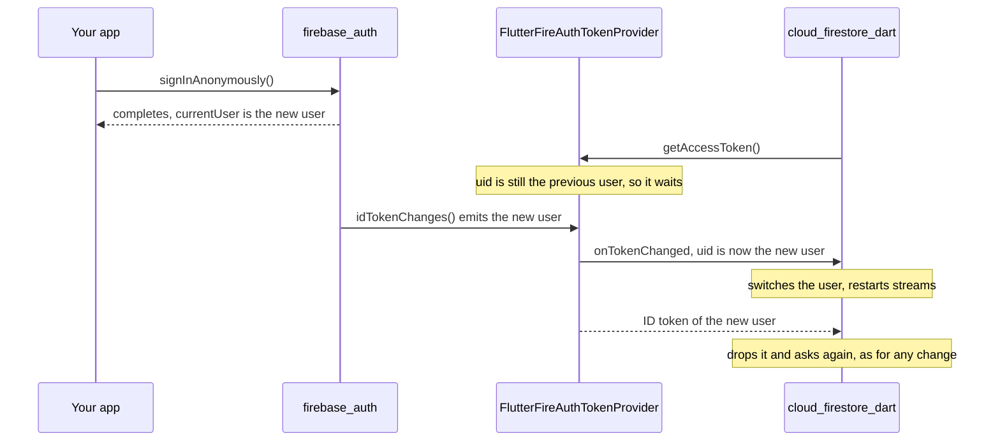

# Using `cloud_firestore_dart` with FlutterFire sign-in

`cloud_firestore_dart_flutterfire` connects the official FlutterFire plugins `firebase_core` and
`firebase_auth` to `cloud_firestore_dart`. Your app keeps initializing Firebase and signing users
in with the plugins; the bridge gives `cloud_firestore_dart` the same project options and the ID
token of the same user. Nothing in this guide was run in a Flutter app with the real plugins: the
package is covered by unit tests with fakes of the plugins (see [Limits](#limits)).

The Dart blocks of this guide are fenced as `dart flutter`: they import Flutter plugins, so the
snippet test of `cloud_firestore_dart` skips them. The same code is in the package's
`example/main.dart`, which `flutter analyze` checks.

## When to use it

Use the bridge when an app already uses `firebase_auth` and you want `cloud_firestore_dart` for
Firestore, for example to share Firestore code with a Dart backend or to keep the native
Firestore SDKs out of the build. It does not open new platforms: `firebase_auth` and the official
`cloud_firestore` plugin support the same ones (Android, iOS, macOS, web, Windows).

If you want to keep the official `cloud_firestore` API instead and only run it on
`cloud_firestore_dart`, use `cloud_firestore_dart_platform`
([The official cloud_firestore API on cloud_firestore_dart](flutterfire_platform.md)) and pass it
a `FlutterFireAuthTokenProvider` from this package.

Without the bridge you would copy the options into a `FirebaseOptions` of `firebase_app_dart` by
hand and either sign the user in a second time with `FirebaseUserAuth` or write a token provider
yourself, as [Coming from FlutterFire](migrating_from_flutterfire.md#using-both-in-one-app)
describes. If the app does not use `firebase_auth`, you do not need the bridge: use
`FirebaseUserAuth` of `firebase_auth_providers_dart` ([Authentication](authentication.md)).

## The common case

```shell
flutter pub add cloud_firestore_dart cloud_firestore_dart_flutterfire firebase_core firebase_auth
```

```dart flutter
await Firebase.initializeApp(options: DefaultFirebaseOptions.currentPlatform);
final FirebaseFirestore firestore = await FlutterFireBridge.firestore();
await FirebaseAuth.instance.signInAnonymously(); // any sign-in of firebase_auth
```

`FlutterFireBridge.firestore()` does three things on its first call for an app:

1. It creates a `firebase_app_dart` app with the name and the options of `Firebase.app()`
   (every field, with the same names; only `recaptchaSiteKey` has no counterpart).
2. It makes a `FlutterFireAuthTokenProvider` for `FirebaseAuth.instanceFor(app: ...)` the token
   provider of that app, and an App Check provider if you pass one.
3. It waits up to five seconds for the plugin to report its user, then returns
   `FirebaseFirestore.instanceFor` the app, so the instance starts with a restored session instead of
   switching to it a moment later.

Later calls return the same instance. `app:`, `auth:`, `databaseId:`, `settings:`,
`openDatabase:` (the SQLite cache of the [Flutter guide](flutter.md)) and `appCheckProvider:`
change the defaults. `firebase_core` and `firebase_app_dart` both export `Firebase`,
`FirebaseApp`, `FirebaseOptions` and `FirebaseException`: when a file needs both, import one with a
prefix.

## How user changes reach Firestore

The provider listens to `idTokenChanges()` of the plugin. When the uid changes it takes the new
user over and emits on `onTokenChanged` in the same call. Firestore reads the uid when it handles
that event, switches its local state to the new user (each user has its own queue of pending
writes) and restarts its streams, which ask the provider for a token again. A refresh of the
token of the same user is passed on as well, as `FirebaseUserAuth` does.

The plugin completes `signInWith...()` before its `idTokenChanges()` event arrives. The diagram
follows a token request that Firestore makes in that gap:



In the diagram, the provider holds the token back until the event has reached Firestore, so
Firestore never receives the token of a user it has not switched to yet. From there Firestore's
own rule applies, as with every token provider: an answer that raced a change of the token is
dropped and the token is asked for again.

A write that you issue right after `await signInWith...()` is still recorded for the previous
user (or for nobody). When it must belong to the new user, wait for the bridge first:

```dart flutter
await FirebaseAuth.instance.signInAnonymously();
await FlutterFireBridge.waitForCurrentUser();
await firestore.doc('users/${FirebaseAuth.instance.currentUser!.uid}').set(data);
```

The rest of the contract follows `FirebaseUserAuth`:

| Situation | What the provider does |
| --- | --- |
| Nobody signed in | `getAccessToken` throws `FirebaseNoSignedInUserException`; Firestore sends the request without a token |
| Firestore asks for a forced refresh (after `unauthenticated`) | `User.getIdToken(true)` |
| The user changes while a token is fetched | the token is dropped and the token of the current user is returned |
| The plugin fails (`network-request-failed`, ...) | the error is passed on; Firestore fails the request with `unauthenticated` and its streams retry |
| The session ended on the backend | the plugin signs the user out and reports it; the provider follows |
| Sign-out | `uid` becomes null and `onTokenChanged` emits an empty token |

## Wiring by hand

The pieces behind `FlutterFireBridge.firestore()` are public:

```dart flutter
final flutterfire.FirebaseApp source = flutterfire.Firebase.app();
final FlutterFireAuthTokenProvider auth =
    FlutterFireAuthTokenProvider(FirebaseAuth.instanceFor(app: source));
final FirebaseApp app =
    dartAppFor(source.name, source.options, authProvider: auth);
final FirebaseFirestore firestore = FirebaseFirestore.instanceFor(app: app);
```

`firebaseOptionsFromFlutterFire` maps the options alone. A provider given to `dartAppFor` is not
asked for a token at once; one assigned later with `app.authProvider = ...` is, with a forced
refresh, which costs a token request to Firebase Auth.

For App Check, pass the two members of `FirebaseAppCheck` to `FlutterFireAppCheckProvider`; the
bridge does not depend on `firebase_app_check`, so apps without App Check do not install it:

```dart flutter
final FirebaseAppCheck appCheck = FirebaseAppCheck.instance;
final FirebaseFirestore firestore = await FlutterFireBridge.firestore(
  appCheckProvider: FlutterFireAppCheckProvider(
    getToken: appCheck.getToken,
    onTokenChange: appCheck.onTokenChange,
  ),
);
```

## Limits

- Only the user and the options are bridged. Firestore data does not cross: a FlutterFire
  `Timestamp` or `DocumentReference` is not a `cloud_firestore_dart` one.
- If the app also uses the official `cloud_firestore` plugin, the two clients keep two caches and
  two connections, as [Coming from FlutterFire](migrating_from_flutterfire.md#using-both-in-one-app)
  explains.
- The `onTokenChanged` events of the provider carry a marker instead of the ID token for a
  signed-in user, because `firebase_auth` reports the change without the token. Firestore only
  reads the uid; call `getAccessToken` for the token.
- A deleted FlutterFire app is not followed: terminate the Firestore instance and delete the
  `firebase_app_dart` app yourself.
- The token provider interfaces of `firebase_app_dart` are not covered by a compatibility promise
  across minor versions; the bridge declares the range it was built against.
- Verified with unit tests and fakes only: the order of the plugin's events and the gap after a
  sign-in come from reading the code of `firebase_auth` 7.0.1, not from a run on a device.
