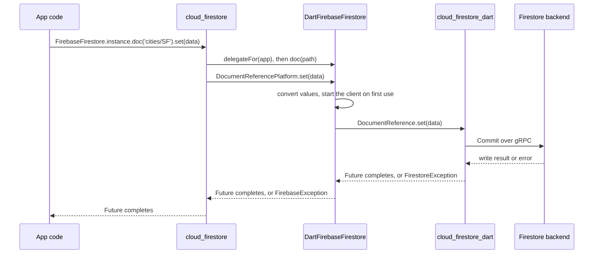

# The official cloud_firestore API on cloud_firestore_dart

`cloud_firestore_dart_platform` (in `cloud_firestore/cloud_firestore_dart_platform`, version 0.1.0 on
pub.dev) lets a Flutter app keep the official `cloud_firestore` API while `cloud_firestore_dart` does the
work. Use it on Linux, where the official plugin has no implementation, or on any platform when you want one Dart
implementation everywhere.

Tried on Debian 13 (trixie), x86_64, with Flutter 3.44.9 on 2026-11-16: the Linux desktop app
[`examples/flutterfire_on_linux`](../../examples/flutterfire_on_linux/), written only against the official API,
built in debug, registered the package with no code, and passed its integration tests against the emulator under
Xvfb, including the disk cache across a restart. Other platforms, release builds and production projects are not
tried yet.

## How the official plugin finds its implementation

`cloud_firestore` (the app-facing package) does no Firestore work itself. Each `FirebaseFirestore` asks
`FirebaseFirestorePlatform.instance` (from `cloud_firestore_platform_interface`) for the platform object of its
app and database through `delegateFor`, and every reference, query, batch and transaction it hands out wraps a
platform object made by that instance. By default the instance is the method channel implementation, which talks
to the native SDK; `cloud_firestore_web` replaces it on the web from its `registerWith`, which Flutter calls before
`main()` because the web package names a `dartPluginClass` in its pubspec.

`cloud_firestore_dart_platform` plugs in at the same place:

- On Linux its pubspec declares `implements: cloud_firestore` with `dartPluginClass: CloudFirestoreDart`, so Flutter
  calls `CloudFirestoreDart.registerWith()` before `main()`. There is no other Linux implementation, so nothing is
  replaced, and it also installs a small Dart implementation of `firebase_core`, which has none on Linux either.
- On other platforms the app calls `CloudFirestoreDart.use()` at the start of `main()`. It runs after the plugin
  registrant, so it replaces whatever was registered.

The sequence below follows one write from the app to the backend: the app talks only to `cloud_firestore`, and
the platform object turns the call into a `cloud_firestore_dart` call.



## Setting it up

```dart flutter
Future<void> main() async {
  WidgetsFlutterBinding.ensureInitialized();
  CloudFirestoreDart.use(); // not needed on Linux
  await Firebase.initializeApp(options: DefaultFirebaseOptions.currentPlatform);
  runApp(const MyApp());
}
```

`use()` takes three optional arguments: `openDatabase` for a disk cache (in memory without it), `tokenProviderFor`
for the signed-in user (a provider per FlutterFire app; requests carry no user without it), and `useDartCore` to
force or forbid the Dart `firebase_core`. Call it before the first Firestore operation.

## What to read next

The package README lists what is implemented and tested, what is not implemented (Pipelines), how it differs from
the official plugin (memory cache by default, settings fixed after the first operation, transaction timeouts that
do not cancel), and how to enforce the selection in a project.
