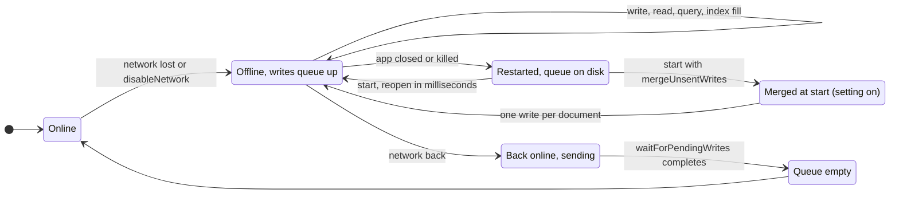

# Long offline use, measured

This page answers one question: what happens to an app on the SQLite cache that stays offline for weeks, months or a
year, and keeps writing? It says what stays cheap, what grows and how fast, which settings to turn on, and which limits
are still there. Every number was measured again on the current code with the tool that measured the same thing
before, so each table has a "before" and a "now" column. The first measurement, its method and its list of fixes are in
[the spike](../spikes/offline_forever.md); its numbers are historical.

The short version:

- **Writes, reads by key, reopening and garbage collection stay constant** from 10,000 to 10 million pending writes.
- **A query of one collection no longer reads every pending write of the user.** A collection of 10 documents among
  1 million pending writes took 246 ms before and takes 0.09 ms now.
- **A document that is edited many times offline can be kept as one pending write** with `mergeUnsentWrites`. The
  drain of 100,000 edits of one document with a `serverTimestamp` went from about 12 hours (estimated) to 344 s
  without the setting, and to 0.09 s with it. A queue that already exists when the app starts with the setting on is
  merged once at start (100,000 writes of one document in 6.5 s, while the app is usable).
- **Still true:** the cache file grows by about 1 KB per pending document and nothing removes pending writes. A
  collection group query over 100,000 small collections is still slow (8 s with 1 million pending writes).

## The life of a long offline period



A write is a pending write until the backend accepts it. While the client is offline the queue only grows, on disk.
Each state costs something different, and the sections below follow it.

## What was measured, and how

- **Tool.** `tool/bench/offline_forever_bench.dart`, the one of the spike. Modes `pending`, `hot`, `drain`, `drainhot`
  as there, and one new mode, `startmerge` (the merge of a queue that already exists when the app starts). `pending`
  and `hot` call the local store directly, because writing millions of documents through the public API holds a future
  per write in memory and is not what an app does. `drain`, `drainhot` and `startmerge` use the public API.
- **Documents.** Three fields (an integer `a` = i % 100, a random integer `order`, a 200 character string), ids of 20
  random characters. One `set` per batch, each in a collection picked at random. The remote document cache is empty:
  every document exists only as a pending write.
- **Shapes.** `c1k`: collections of 1,000 documents. `c100k`: collections of 100,000. `small`: collections of 10, all
  called `items`, below `s/p<i>` (the shape of per-user or per-item subcollections). Sizes: 10,000, 100,000,
  1,000,000 and 10,000,000 pending writes.
- **Queries.** On collection `c0` for `c1k` and `c100k`, on the collection group `items` for `small`: `a == 7` (1 % of
  the documents), `orderBy('order', descending: true).limit(10)`, the whole collection, and a whole small collection.
  The time is the median of three runs (one run when the first took more than 5 seconds).
- **Cache indexes.** Two indexes (`a` ascending, `order` descending) on the queried collection group, one fill run as
  the scheduler does it (50 documents), then the rest in runs of 1,000.
- **The mixed case** (`--ack`). Every batch is acknowledged, then one global snapshot of watch sends the documents of the
  queries and marks them current, as after one listen. Then the same reads, offline.
- **Machine.** Mac mini, Apple M4 Pro, 14 cores, 64 GB, macOS 27.2, Dart 3.12.2 compiled ahead of time
  (`dart compile exe`), SQLite with `synchronous = OFF` (as the other benchmarks; an app waits for the disk on each
  commit), the database on the internal SSD. The emulator, where one was used, was cloud-firestore-emulator 1.21.0 on
  the same machine (Java 21), so a round trip is well under a millisecond. No real Firebase project was used.
- **Runs.** One run of each case on 2026-11-18 and 2026-11-19, with up to four runs at the same time on the machine, as
  in the spike. The rows that read overlays through a cache index (the index table, the `small` group rows and the
  mixed case at 100,000 and 1,000,000) were run again on 2026-11-19 after #68, one run at a time on a quiet machine, so
  they are faster across the board, scans included; the 10,000 and 10,000,000 columns were not repeated. Single numbers can be off by tens of percent; growth over two orders of magnitude is what the numbers
  show. A difference of less than 2 times between "before" and "now" is not a finding.
- **Not run.** 10 million pending writes in `c100k` and `small` (about 10 GB and an hour each); the mixed case and a
  complete index fill at 10 million (acknowledging ten million batches takes hours); a drain of more than 100,000
  documents; the production backend; a real disk with `synchronous = FULL`; the acknowledgement of the merged write in
  the `hot` runs with `--merge` (the tool rejects the only pending write there, the drain runs measure it instead).

## What stays constant

Pending writes only, never acknowledged. "Before" is the spike, "now" is the current code.

| | Before, 10,000 to 10 million pending writes | Now, 10,000 to 10 million pending writes |
|---|---|---|
| a write, average | 0.15 to 0.22 ms | 0.15 to 0.23 ms |
| a document read by key | 18 to 35 us | 17 to 41 us |
| reopen the cache | 0.7 to 4.4 ms | 2.2 to 5.7 ms (2.4 ms at 10 million) |
| a garbage collection run | 0.2 ms, removes nothing | 0.13 to 0.5 ms, removes nothing |
| a whole small collection (10 documents) | 0.87 ms, 18 ms, 246 ms, 1.5 s | 0.09 to 0.13 ms at every size |
| an index fill run (50 documents), `c1k` and `c100k` | 2.6 ms to 287 ms | 1.9 to 4.2 ms (3.1 ms at 10 million in `c1k`) |
| an index fill run (50 documents), `small` | 95 ms, 822 ms, 6.5 s | 1.5 to 2.2 ms (to 1 million) |

The last three rows are the ones that changed. A query of a collection used to walk every pending write of the user.
Now it reads the pending writes of that collection through the primary key, and an index fill run reads only the next
pending writes of its collection group. The write path, the read by key and the reopen were never the problem.

## What grows, and how fast

| Cost | Grows with | Before | Now |
|---|---|---|---|
| file size | pending documents, never collected | 0.95 KB per document | 0.97 to 1.07 KB per document (9.9 GB for 10 million in `c1k`) |
| memory of one session | writes made in that session | 0.45 KB per write (3.5 GB after 10 million) | 0.45 KB per write (4.5 GB after 10 million), unchanged |
| a query of a collection, scan | the documents of that collection | plus every pending write of the user (1.5 s for 10 documents among 10 million) | the documents of that collection only (0.13 ms among 10 million) |
| a collection group query over small collections | the number of collections | collections times pending writes | the number of collections, see below |
| an acknowledgement | the queue, slowly | 0.3 to 0.4 ms | 0.24 ms at 10,000, 0.40 to 0.46 ms at 1 million |
| an acknowledgement with a transform on a hot document | nothing now | 77 ms (10,000 pending), 900 ms (100,000) | 0.22 ms and 0.23 ms on average; the first one of a drain takes 87 ms and 958 ms, once |
| a rejection of a hot document's write | the writes pending on that document | 65 ms and 733 ms | 65 ms and 754 ms, unchanged |
| a complete index fill | the documents to index | quadratic: up to 9.1 ms per document | 30 to 60 us per document in `c1k` and `c100k`, 36 to 71 us in `small` |
| a drain | the queue | 0.4 ms per write against the emulator | 0.34 to 0.41 ms per write |

The memory row is the one the spike listed as fixed in the library (item 4). The fix drops the keys of a batch when it
is acknowledged or rejected. A queue that is only written never does, so 1 million pending writes still cost 458 MB of
memory in the session that wrote them. It is freed by a restart (not measured again).

## Which settings to turn on

All three are off by default.

```dart
final Settings settings = Settings(
  cacheSettings: PersistentCacheSettings(
    // One pending write per document, instead of one per edit.
    mergeUnsentWrites: true,
    // Cache indexes for queries that scanned many backend documents.
    indexAutoCreation: true,
    // Fill them faster than 50 documents a minute.
    indexBackfill: IndexBackfillSettings(
      documentsPerRun: 200,
      interval: const Duration(seconds: 10),
    ),
  ),
);
```

### `mergeUnsentWrites`

Turn it on when the same documents are edited again and again offline: a counter, a draft, a position, a status. It
keeps one pending write per document. It is an opt-in extension of this package, not in the official SDKs, and it
changes what the backend sees (one write instead of many, so rules and triggers see only the last state). The conditions and what the app gives
up are in
[Merging repeated offline writes](offline_persistence.md#merging-repeated-offline-writes-opt-in-extension). It does nothing
for writes to different documents: each of those stays one pending write.

One document, set once and updated 100,000 times offline, then the network back (`drainhot`, local emulator):

| | Before, setting did not exist | Now, off | Now, on |
|---|---|---|---|
| pending writes | 100,001 | 100,001 | 1 |
| file size | 23 MB | 23 to 24 MB | 3.2 MB |
| one update, offline, local store | 0.10 ms | 0.11 ms | 0.15 ms |
| memory of the process | not measured | 239 MB | 23 MB |
| drain, plain updates | 261 s | 256 s | 0.09 s |
| drain, each update with a `serverTimestamp` | about 12 hours, estimated | 344 s | 0.09 s |
| billed writes | 100,001 | 100,001 | 1 |

With 10,000 updates: drain 5.1 s before, 3.5 s now off, 0.04 s on; with a `serverTimestamp` 493 s before, 4.1 s now
off, 0.03 s on. An update costs 0.04 to 0.05 ms more with the setting on, because each one merges into the pending
write.

A queue that already exists when the app starts with the setting on is merged once at start, in transactions of 500
writes between the app's own operations (`startmerge`, public API, no backend):

| One document, updated this many times before the start | First cache read after the start | Until one pending write is left |
|---|---|---|
| 10,000 | 59 ms | 0.84 s |
| 100,000 | 37 ms | 6.5 s |
| 100,000, with a `serverTimestamp` | 31 ms | 6.5 s |

The app is usable during the merge. No write is sent until it is done.

### Cache indexes

An index lets a query read the matching documents instead of scanning the collection. With a very long offline period
two things matter.

- **Automatic creation counts only documents that came from the backend, not pending writes.** A collection that exists
  only as pending writes never gets an automatic index. Configure one with `setIndexConfigurationFromJSON` (deprecated,
  but the only way to name an index) and let `fillIndexes` fill it. See
  [Persistent cache indexes](offline_persistence.md#persistent-cache-indexes).
- **The fill is fast again.** One scheduled run of 50 documents took up to 6.5 s with 1 million pending writes in
  small collections and now takes 2 ms. A complete fill of 1 million documents in `small` took about 106 s (it was
  extrapolated to hours before), in `c1k` and `c100k` 36 to 60 us per document.

Queries on `c0`, indexes filled, pending writes only (before / now). The 10 million column was run in `c1k` only, and its
first scan is the first query after a reopen.

| | 10,000 | 100,000 | 1,000,000 | 10,000,000 |
|---|---|---|---|---|
| `c1k`, `a == 7` (about 1,000 documents), scan | 6.3 ms / 6.1 ms | 22 ms / 4.1 ms | 258 ms / 4.2 ms | 10.9 s / 8.6 ms |
| `c1k`, `a == 7`, index | 0.22 ms / 0.60 ms | 0.24 ms / 0.29 ms | 0.60 ms / 0.65 ms | 3.8 ms / 1.5 ms |
| `c1k`, `orderBy.limit(10)`, scan | 7.7 ms / 7.2 ms | 24 ms / 4.8 ms | 256 ms / 4.8 ms | 1.6 s / 9.8 ms |
| `c1k`, `orderBy.limit(10)`, index | 13.7 ms / 0.61 ms | 12.5 ms / 0.22 ms | 18 ms / 0.61 ms | 16 ms / 1.2 ms |
| `c100k`, `a == 7` (100,000 documents), scan | 46 ms / 62 ms | 696 ms / 626 ms | 1,030 ms / 619 ms | not run |
| `c100k`, `a == 7`, index | 2.2 ms / 4.5 ms | 14 ms / 8.3 ms | 13 ms / 8.7 ms | not run |
| `c100k`, `orderBy.limit(10)`, scan | 60 ms / 72 ms | 1,042 ms / 669 ms | 1,354 ms / 694 ms | not run |
| `c100k`, `orderBy.limit(10)`, index | 229 ms / 3.5 ms (before #68) | 3,067 ms / 0.23 ms | 3,209 ms / 0.23 ms | not run |

Read it like this. A `limit` query with an index is now answered in a fraction of a millisecond (3.2 s before on
100,000 pending documents of `c100k`). A scan of a collection of 1,000 documents is flat. A scan of a collection of
100,000 documents costs what reading 100,000 documents costs, about 0.6 s. An equality query with an index on a large
collection of pending writes takes 8 to 9 ms for 1,000 matches, against 14 ms before and 13 ms before at 100,000 and 1
million: not slower any more. A first run after #58 had made it slower (150 ms and 258 ms); #68 fixed that. What is left
is the collection group query over many small collections, below.

### Progress

After a long time offline the app can show how far the sync is. `getPendingWriteCount()` is cheap with millions of
pending writes, and the stream is throttled to 4 events a second.

```dart
final int total = await firestore.getPendingWriteCount();
final StreamSubscription<int> progress = firestore.pendingWriteCounts().listen(
  (int pending) => print('sent ${total - pending} of $total'),
);
await firestore.waitForPendingWrites();
await progress.cancel();
```

It is a supported extension that the official SDKs do not have. See
[Writes waiting for the backend](offline_persistence.md#writes-waiting-for-the-backend).

## The numbers, by shape

Pending writes only unless the row says otherwise. Before / now. File sizes and memory are the same before and now.

### Collections of 1,000 (`c1k`)

| | 10,000 | 100,000 | 1,000,000 | 10,000,000 |
|---|---|---|---|---|
| all writes, total time | 2 s / 2 s | 17 s / 16 s | 185 s / 195 s | 1,989 s / 2,137 s |
| file size | 9.3 / 9.7 MB | 95 / 98 MB | 955 / 978 MB | 9.7 / 9.9 GB |
| resident memory after the writes | 42 / 42 MB | 79 / 80 MB | 459 / 458 MB | 3.5 / 4.5 GB |
| reopen | 2.2 / 2.5 ms | 4.4 / 3.8 ms | 4.1 / 4.8 ms | 3.3 / 2.4 ms |
| one document by key | 18 / 18 us | 20 / 20 us | 33 / 22 us | 22 / 41 us |
| `a == 7` on c0, scan | 6.3 / 6.1 ms | 22 / 4.8 ms | 258 / 5.6 ms | 10.9 s / 8.6 ms (first query after reopen) |
| whole `tiny` (10 documents) | 0.87 / 0.09 ms | 18 / 0.09 ms | 246 / 0.09 ms | 1.5 s / 0.13 ms |
| whole c0 | 6.6 / 6.2 ms | 22 / 5.3 ms | 257 / 5.7 ms | 1.8 s / 8.1 ms |
| index fill, one run (50 documents) | 2.6 / 2.2 ms | 5.1 / 1.9 ms | 24 / 2.1 ms | 287 / 3.1 ms |

### Collections of 100,000 (`c100k`)

| | 10,000 | 100,000 | 1,000,000 |
|---|---|---|---|
| file size | 9.3 / 11.9 MB | 94 / 97 MB | 943 / 962 MB |
| reopen | 0.65 / 2.8 ms | 2.0 / 3.7 ms | 3.4 / 5.7 ms |
| one document by key | 26 / 17 us | 30 / 27 us | 29 / 27 us |
| whole `tiny` | 0.84 / 0.10 ms | 17 / 0.10 ms | 192 / 0.13 ms |
| whole c0 (all its documents) | 93 / 73 ms | 1,050 / 892 ms | 1,355 / 1,019 ms |
| index fill, one run (50 documents) | 5.4 / 2.0 ms | 32 / 2.0 ms | 124 / 4.2 ms |
| index fill, per document | 53 / 34 us | 104 / 51 us | 182 / 60 us |

### Collections of 10 (`small`, collection group `items`)

| | 10,000 (1,000 collections) | 100,000 (10,000) | 1,000,000 (100,000) |
|---|---|---|---|
| file size | 10 / 11.6 MB | 104 / 106 MB | 1,047 / 1,068 MB |
| reopen | 0.67 / 2.2 ms | 3.7 / 4.3 ms | 1.9 / 5.6 ms |
| one document by key | 25 / 19 us | 23 / 20 us | 25 / 27 us |
| whole small collection | 1.0 / 0.10 ms | 19 / 0.09 ms | 162 ms / 0.13 ms |
| group `a == 7`, scan | 1.0 s / 91 ms | 230 s / 0.74 s | about 5 hours (estimate) / 8.3 s |
| group `orderBy.limit(10)`, scan | 1.3 s / 118 ms | 229 s / 1.0 s | not run / 13.3 s |
| group `a == 7`, index | 47 / 62 ms | 508 / 427 ms | not run / 6.6 s |
| group `orderBy.limit(10)`, index | 248 / 54 ms | 3.5 s / 409 ms | not run / 6.6 s |
| index fill, one run (50 documents) | 95 / 1.9 ms | 822 / 1.5 ms | 6.5 s / 1.5 ms |
| index fill, per document | 147 / 36 us | 902 / 58 us | not run / 71 us |
| peak memory of the process | not measured | not measured | 6.8 GB (a group query that returns 1 million documents) |

### The mixed case: acknowledged, queries in sync once, read offline

| | `c1k` 100,000 | `c1k` 1,000,000 | `c100k` 100,000 | `c100k` 1,000,000 | `small` 100,000 | `small` 1,000,000 |
|---|---|---|---|---|---|---|
| acknowledgement, average | 386 / 193 us | 346 / 214 us | 328 / 181 us | 329 / 199 us | 308 / 185 us | 330 / 393 us |
| `a == 7` | 0.28 / 0.15 ms | 0.19 / 0.14 ms | 12 / 7.7 ms | 9.2 / 8.0 ms | 451 / 324 ms | not run / 4.9 s |
| `orderBy.limit(10)` | 0.26 / 0.14 ms | 0.19 / 0.14 ms | 0.25 / 0.15 ms | 0.18 / 0.17 ms | 465 / 308 ms | not run / 4.7 s |
| whole collection c0 | 5.7 / 3.3 ms | 4.1 / 3.2 ms | 894 / 569 ms | 876 / 573 ms | | |
| garbage collection run (threshold 1 byte) | 335 ms / 291 ms | 6.5 s / 8.5 s | 82 / 81 ms | 6.2 s / 7.2 s | 122 / 115 ms | 1.2 s / 1.6 s |

The `small` columns are collection group queries. Once the documents are acknowledged and the queries were listened to,
`limit` queries on a large collection are answered in under a millisecond, and the garbage collection run costs time
linear in the cached documents (7 to 8 s at 1 million, every five minutes, on the client's queue): the normal cost of
a big cache, not of being offline.

### One document updated many times (`hot`, local store, no merge)

| | 10,000 updates | 100,000 updates | 10,000 with `serverTimestamp` | 100,000 with `serverTimestamp` |
|---|---|---|---|---|
| update, last 1,000 | 98 / 103 us | 103 / 107 us | 107 / 113 us | 111 / 132 us |
| file size | 4.6 / 4.1 MB | 23 / 23 MB | 4.9 / 4.4 MB | 24 / 24 MB |
| reopen | 0.75 / 0.79 ms | 1.4 / 1.7 ms | 0.75 / 0.74 ms | 1.6 / 1.4 ms |
| read the document | 15 / 14 us | 15 / 19 us | 17 / 16 us | 16 / 18 us |
| query its collection | 0.05 / 0.05 ms | 0.05 / 0.06 ms | 0.05 / 0.05 ms | 0.05 / 0.06 ms |
| reject the newest write | 65 / 65 ms | 733 / 754 ms | 73 / 70 ms | 749 / 825 ms |
| acknowledge one write | 0.17 / 0.16 ms | 0.17 / 0.17 ms | 77 / 0.22 ms | 900 / 0.23 ms |

### Reconnecting (public API, local emulator)

| | Writes offline, per write | Drain, before | Drain, now |
|---|---|---|---|
| 1,000 documents | 124 / 172 us | 1.9 s (includes the first connection) | 0.41 s |
| 10,000 documents | 135 / 155 us | 4.2 s | 3.4 s |
| 100,000 documents | 167 / 146 us | 40 s | 38 s |
| one document, 10,000 updates | 160 / 147 us | 5.1 s | 3.5 s |
| one document, 100,000 updates | 145 / 133 us | 261 s | 256 s |
| one document, 10,000 updates with `serverTimestamp` | 189 / 153 us | 493 s | 4.1 s |
| one document, 100,000 updates with `serverTimestamp` | not run / 178 us | about 12 hours (estimated) | 344 s |

The drain of different documents runs at about 2,600 writes a second against a local emulator. Against production the
10 batches in flight bound it by the round trip: with 50 ms, at most 200 writes a second, so 100,000 pending writes take
about 8 minutes and 1 million about 1.4 hours. The app works normally meanwhile, and the queue shrinks only at that
rate. This was not measured again. Production also limits sustained writes to one document to about one a second;
a hot document with many pending writes drains slowly there whatever the client does, which is one more reason to
merge them.

## Limits that remain

- **The file grows by about 1 KB per pending document, and nothing removes it.** Budget 1 KB plus the payload per pending
  document: 1 million documents of 200 characters take 1 GB, 10 million about 10 GB. `cacheSizeBytes` does not bound
  it, because garbage collection never removes a pending write. `mergeUnsentWrites` removes repeated writes to one
  document, not writes to different documents.
- **Memory grows by about 0.46 KB per write in the session that wrote them**, 458 MB for 1 million. A restart frees it.
- **A collection group query over many small collections reads each collection.** 10,000 collections: about 1 s.
  100,000 collections and 1 million pending writes: 8.3 s with a scan, 6.6 s with an index, 4.9 s when everything is
  acknowledged and in sync, and up to 6.8 GB of memory when the query returns every document. Before, 10,000
  collections took 230 s and now take 0.4 to 0.7 s at 100,000 pending writes, so this is much better, but an index does
  not help much: the query still reads each collection (0.4 s with an index at 10,000 collections, 100,000 documents).
  It is linear in the number of collections. Avoid
  collection group queries without a selective filter over a very large number of parents.
- **Reading a large collection reads all of it.** The whole collection of 100,000 pending documents takes about 0.6 s. A
  query with an index and a `limit` is cheap, and an equality query with an index costs 8 to 9 ms for 1,000 matches in
  such a collection.
- **A rejection recalculates from the pending writes of the document.** Rejecting the newest of 100,000 pending
  updates of one document costs 0.75 to 0.8 s. A rejection is rare, and merging leaves one write to recalculate.
- **Automatic indexes ignore pending writes.** See above.
- **A merge changes what the backend sees.** `mergeUnsentWrites` is an opt-in extension that differs from the official
  SDKs. Do not turn it on when rules or functions depend on every intermediate state or on the order of writes across
  documents.
- **Reconnecting is bounded by the backend**, not by the client (10 batches in flight, one write a second to one
  document).
- **Not measured.** A change of user (sign-in, sign-out) reads the whole queue of both users and is linear in it. A real
  disk with `synchronous = FULL` (the benchmarks use `OFF`). The first query after a reopen at 10 million pending
  writes took 8.6 ms here (11 to 13 s before), with the file in the page cache of a machine with 64 GB; a device with
  little memory would read from disk and be slower. A phone was not tried.

## What to do

1. Use the SQLite cache, not the memory cache, for anything that must survive a restart.
2. Turn `mergeUnsentWrites` on if the same documents are edited many times offline and your rules and functions allow
   it.
3. Show `pendingWriteCounts()` while the queue drains.
4. Configure cache indexes for the queries the offline screens run on large collections, and keep `limit` on them.
5. Keep collection group queries over a huge number of small collections out of offline screens, or give them a
   selective filter and an index.
6. Budget 1 KB of disk per pending document, plus its payload.

## Run it yourself

From `tool/bench/` of the repository (Dart 3.x, `dart pub get` first); the numbers above are from the compiled tool:

```shell
dart compile exe offline_forever_bench.dart -o offline_forever_bench
./offline_forever_bench pending 1000000 c1k --index --ack /path/to/a/folder
./offline_forever_bench hot 100000 --transform --merge /path/to/a/folder
./offline_forever_bench startmerge 100000 /path/to/a/folder
# against a private emulator, never a real project:
FIRESTORE_EMULATOR_HOST=127.0.0.1:8391 ./offline_forever_bench drainhot 100000 --merge /path/to/a/folder
```

A run of 10 million pending writes takes about an hour and needs 10 GB of disk. The tool refuses the shared emulator on
port 8080.
