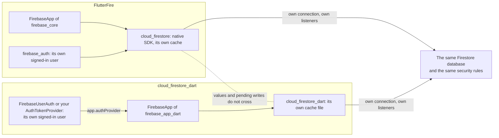

# Coming from FlutterFire's `cloud_firestore`

This guide is for Flutter developers who use the FlutterFire `cloud_firestore` plugin today and
wonder whether `cloud_firestore_dart` fits a project of theirs. It covers when to switch and when
not to, what changes in the setup, the API call by call, and how to run both in one app.

The FlutterFire names below are those of `cloud_firestore` 7.1.0, the version on pub.dev when
this guide was written, as listed in its API reference. The names of this package come from
`lib/` and from the API listings in `test/unit/api/*.golden.txt`, which the test suite keeps in
sync with the code.

## What this package is, in numbers

`cloud_firestore_dart` is an unofficial port of the Firebase Android SDK to pure Dart. It is not
a Google product and Firebase support does not cover it. The project was archived for some years
and has been revived towards a 0.1.0 release; the three packages (`cloud_firestore_dart`,
`firebase_app_dart`, `firebase_auth_providers_dart`) are at 0.2.0; 0.1.0 was their first version on
pub.dev under these names.

What the repository can show about its state (each number with where it comes from):

- **Unit tests**: 5,882 passed and 498 were skipped (`dart test test/unit` in
  `cloud_firestore/cloud_firestore_dart`, run on 2026-11-14; no backend needed).
- **Integration tests against the Firestore emulator** (`dart test test/integration`, emulator
  v1.22.0, one run per transport on 2026-11-14): over gRPC 887 passed and 21 were skipped; over
  WebChannel 882 passed and 26 were skipped; over WebChannel in long polling mode 880 passed, 26
  were skipped and 2 failed (the machine ran out of local ports in one, an event-order check in
  the other); both of those passed in three runs of their files afterwards. Every skipped test
  states its reason in the code: opt-in long soak runs, Enterprise-only cases, and tests that do
  not apply to that transport.
- **Browser tests**: in the last recorded run, 54 tests in Chrome with each of dart2js and
  dart2wasm, 56 passing and 1 skipped per compiler, against the emulator
  ([Platforms](platforms.md)).
- **Production**: a verification kit of 15 checks (`tool/verify_production`) was run once
  against a real Firestore database in Standard edition: 13 passed and 2 were skipped (one needs
  an Enterprise edition database, the other a Web API key with anonymous sign-in). Its README
  has the result of each check.

Most of the testing is against the emulator. [Features and limits](features.md) lists what is
not done and what was not verified.

## Stay on FlutterFire, or use this package?

FlutterFire is Google's official plugin, published by firebase.google.com. It wraps the
official Firebase SDKs (the native ones on Android, iOS and macOS, the JS SDK on the web); pub.dev
lists Android, iOS, macOS, web and Windows. Those SDKs are used by many production apps and are
supported by Firebase.

**Stay on FlutterFire** when:

- your app is a Flutter app on the platforms it supports and it works for you. Moving brings no
  new capability for that case, and you give up official support and much wider production use;
- you need Firebase Authentication that opens a provider's sign-in page (Google, Apple and other
  providers by popup or redirect), phone sign-in or multi-factor: this repository signs in over REST
  only, with email and password, email links, anonymous and custom tokens, and federated credentials
  whose token the app obtained itself ([Authentication](authentication.md));
- you need other Firebase products from the same SDK family (Storage, Messaging, Analytics,
  Crashlytics, Remote Config ...);
- you need a cache shared by several browser tabs (the JS SDK's multi-tab persistence), or a web
  client tested in browsers other than Chrome.

**Consider `cloud_firestore_dart`** when:

- the code runs **outside Flutter**: a server, a command line tool, a Cloud Run job, a Dart test
  that talks to the emulator without a device. FlutterFire needs Flutter; this package needs
  only the Dart SDK (`^3.8.0`);
- the target is **Linux desktop**, which FlutterFire's `cloud_firestore` does not list. This
  package's unit tests and integration suite pass on Linux (CI on Ubuntu x64, see
  [Platforms](platforms.md));
- you want **one Dart implementation on every platform**, with no native SDK, no generated
  native configuration files and no platform build steps, and that you can step through in the
  Dart debugger;
- you use features this package has and FlutterFire 7.1.0 does not list in its API reference:
  vector search (`Query.findNearest`), queries and aggregations inside a transaction
  (`Transaction.getQuery`, `Transaction.getAggregate`), read-only transactions with a read time,
  snapshots as JSON and listeners resumed from them, and the BSON value types of Enterprise
  edition databases.

**Know the gaps before you switch**: 0.1.0 is a first release with little production use; the
testing is mostly against the emulator; the web is supported in Chrome only (tested against
the emulator); the repository runs no tests on Android or iOS devices (Flutter apps can use the package as
a plain Dart package, see [Platforms](platforms.md)); two clients on one cache do not share
listeners or pending writes ([Several clients on one cache](multiple_clients.md)).

## Setup

### Dependencies

```yaml
dependencies:
  cloud_firestore_dart: ^0.2.0
  firebase_app_dart: ^0.2.0
  firebase_auth_providers_dart: ^0.2.0 # only for signed-in users or server credentials
```

There is no plugin to register, no `flutterfire configure` step, and nothing to add to the
Android, iOS or macOS projects. For a persistent cache in a Flutter app, add
`cloud_firestore_dart_sqlite` (see below).

### The app: options instead of native configuration

A FlutterFire app calls `Firebase.initializeApp(options: DefaultFirebaseOptions.currentPlatform)`,
with the `firebase_options.dart` that the FlutterFire CLI generates, and on some platforms the
native configuration files. Here the app is made from the options alone, synchronously:

```dart
import 'package:firebase_app_dart/firebase_app_dart.dart';

// The values of a web app of the project (Firebase console, Project settings,
// Your apps) work on every platform. From a generated firebase_options.dart:
// the same names: apiKey, appId, projectId.
final FirebaseApp firebaseApp = FirebaseApp.withOptions(
  const FirebaseOptions(
    apiKey: '<the apiKey of DefaultFirebaseOptions.web>',
    appId: '<the appId of DefaultFirebaseOptions.web>',
    projectId: '<the projectId>',
  ),
);
```

`firebase_app_dart`'s `FirebaseApp` and `FirebaseOptions` are its own classes, not those of
`firebase_core`. [Configuring the FirebaseApp](firebase_app.md) explains the options and how to
make an application id for desktop and servers.

### The instance and its settings

| | FlutterFire 7.1.0 | `cloud_firestore_dart` |
|---|---|---|
| Default instance | `FirebaseFirestore.instance` (creates it) | `FirebaseFirestore.instance` (creates it, with the default settings and a memory cache) |
| Instance for an app | `FirebaseFirestore.instanceFor(app: app, databaseId: 'db')` | `FirebaseFirestore.instanceFor(app: app, databaseId: 'db', settings: ..., openDatabase: ...)` |
| Settings | `FirebaseFirestore.instance.settings = Settings(...)` (a setter) | the same setter, before the first use of the instance (after it, a `FirestoreException` with `failed-precondition`), or `settings:` in the `instanceFor` call that creates the instance, which starts it at once. A later `instanceFor` without settings or with equal ones returns the instance; with different settings it throws a `StateError` |
| Class name | `FirebaseFirestore` | `FirebaseFirestore` (`Firestore` is a deprecated alias) |
| Settings class | `Settings` | `Settings` (`FirestoreSettings` is a deprecated alias); `firestore.settings` reads them back |

Settings, field by field:

| FlutterFire `Settings` | `Settings` |
|---|---|
| `persistenceEnabled`, `cacheSizeBytes`, `host`, `sslEnabled` | same names (or the newer `cacheSettings: PersistentCacheSettings(...)` / `MemoryCacheSettings(...)`) |
| `Settings.CACHE_SIZE_UNLIMITED` | `Settings.cacheSizeUnlimited` |
| `webExperimentalForceLongPolling`, `webExperimentalAutoDetectLongPolling` | same names (used by the web transport) |
| `webExperimentalLongPollingOptions` | same name, `WebExperimentalLongPollingOptions(timeoutDuration: ...)` |
| `webPersistentTabManager`, `ignoreUndefinedProperties` | not available |
| none | `port`, `grpcFlowControlWindow`, `withEmulator(...)` |

### Persistence

The native SDKs behind FlutterFire keep a disk cache on mobile by default. Here the cache is
**in memory unless you pass an `openDatabase`** function, whatever `persistenceEnabled` says.
For a disk cache in a Flutter app, add `cloud_firestore_dart_sqlite` and pass a directory from
`path_provider` (on Flutter 3.38 and later nothing else; on older ones also
`sqlite3_flutter_libs: ^0.5.0`):

```dart
import 'package:cloud_firestore_dart_sqlite/cloud_firestore_dart_sqlite.dart';

final String cacheDirectory = '<the application support directory>';
final FirebaseFirestore persistent = FirebaseFirestore.instanceFor(
  app: app,
  openDatabase: sqliteOpener(directory: cacheDirectory),
  settings: Settings(cacheSettings: PersistentCacheSettings()),
);
```

[Offline persistence](offline_persistence.md) has the details, including the web cache
(IndexedDB or OPFS) and hot restart.

On the web FlutterFire runs the official JS SDK, whose cache this package does not read. To keep
the writes a user left pending with the FlutterFire version of a web app, call the experimental
`importJsSdkCache` at start-up: see
[Switching from the official JS SDK](web.md#switching-from-the-official-js-sdk). On Android, iOS
and macOS the native SDKs' caches are not imported.

### Authentication

FlutterFire's `firebase_auth` signs the user in and the Firestore plugin picks the user up by
itself. Here the token provider belongs to the `FirebaseApp` and is set **before** the Firestore
instance is created. For end users, `FirebaseUserAuth` of `firebase_auth_providers_dart` signs in
over the Firebase Auth REST API:

```dart
import 'package:firebase_auth_providers_dart/firebase_auth_providers_dart.dart';

final FirebaseUserAuth auth = await FirebaseUserAuth.forApp(app);
final FirebaseFirestore signedIn = FirebaseFirestore.instanceFor(app: app);
await auth.signInWithEmailAndPassword(email: 'ada@example.com', password: password);
```

It covers anonymous, email/password, email link and custom-token sign-in, federated sign-in with a
token the app already has (`signInWithCredential`), linking, the token refresh and the account
operations listed in [Authentication](authentication.md). Popup and redirect flows, phone sign-in
and multi-factor are not there. Servers use a service account or Application Default
Credentials instead (these bypass the security rules).

### The emulator

| FlutterFire 7.1.0 | `cloud_firestore_dart` |
|---|---|
| `FirebaseFirestore.instance.useFirestoreEmulator('localhost', 8080)` before the first use | the same call before the first use, or `settings: Settings().withEmulator('127.0.0.1', 8080)` in the `instanceFor` call |
| maps `localhost` to `10.0.2.2` on the Android emulator (`automaticHostMapping`, on by default) | no mapping: on the Android emulator pass `10.0.2.2` yourself |
| a mock user token for the rules: not in the plugin's API | `withEmulator(host, port, mockUserToken: {'sub': 'alice'})` |

The Auth emulator: `FirebaseUserAuth.forApp(app, emulatorHost: '127.0.0.1:9099')`. See
[The emulator and testing](emulator_and_testing.md).

## The API side by side

**Same** means the name and the shape are the same in both. Everything else is a difference.

### References and documents

| What | FlutterFire 7.1.0 | `cloud_firestore_dart` | |
|---|---|---|---|
| Collection, document, group | `collection(path)`, `doc(path)`, `collectionGroup(id)` | same | same |
| New document id | `collection.doc()` | `collection.doc()` | same |
| Add | `collection.add(data)` | `collection.add(data)` | same |
| Read once | `ref.get([GetOptions(source: Source.cache)])` | same | same; `GetOptions` has only `source` |
| Set | `ref.set(data, [SetOptions(merge: true)])` | same | same |
| Merge some fields | `SetOptions(mergeFields: ['a', FieldPath(...)])` | same | same |
| Update | `ref.update(Map<Object, Object?>)` (keys `String` or `FieldPath`) | same | same |
| Delete | `ref.delete()` | `ref.delete()` | same |
| Reference fields | `id`, `path`, `parent`, `firestore` | same | same |
| Snapshot data | `snapshot.data()` (method) | same; a `Map<String, Object?>` rather than `Map<String, dynamic>` | same |
| Server timestamps not yet set | `GetOptions(serverTimestampBehavior: ...)` | `snapshot.data(serverTimestamps: ServerTimestampBehavior.estimate)`, or `get(field, serverTimestamps: ...)` | **different** |
| One field | `snapshot.get('a.b')`, `snapshot['a.b']`, also with a `FieldPath` | same; returns `Object?` rather than `dynamic`, so cast it | same |
| Typed field getters | none | none (removed in 0.2): cast the result of `get` | same |
| Snapshot fields | `exists`, `id`, `metadata`, `reference` | same | same |

### Queries and filters

| What | FlutterFire 7.1.0 | `cloud_firestore_dart` | |
|---|---|---|---|
| Filter with named arguments | `where('age', isGreaterThanOrEqualTo: 18)` (also `isEqualTo`, `isNotEqualTo`, `isLessThan`, `arrayContains`, `arrayContainsAny`, `whereIn`, `whereNotIn`, `isNull`) | `where('age', isGreaterThanOrEqualTo: 18)` with the same named arguments | same |
| One method per operator | none | none (removed in 0.2) | same |
| `Filter` objects | `Filter('age', isGreaterThan: 18)` | same | same |
| OR / AND | `Filter.or(f1, f2, ...)`, `Filter.and(...)` (up to 30 arguments) | `Filter.or([f1, f2])`, `Filter.and([...])` (a list) | **different** |
| Order | `orderBy('age', descending: true)`, also with a `FieldPath` | same | same |
| Limits | `limit(n)`, `limitToLast(n)` | same | same |
| Cursors | `startAt`, `startAfter`, `endAt`, `endBefore` (an `Iterable`), `startAtDocument`, ... | same | same |
| Field paths | `FieldPath(['a', 'b'])`, `FieldPath.fromString('a.b')`, `FieldPath.documentId` | same | same |
| Vector search | not in the API reference | `findNearest(vectorField: 'v', queryVector: vector, limit: 5, distanceMeasure: DistanceMeasure.cosine)` | only here |

### Snapshots, listeners and metadata

| What | FlutterFire 7.1.0 | `cloud_firestore_dart` | |
|---|---|---|---|
| Listen | `ref.snapshots()` (a method) | same | same |
| With metadata changes | `snapshots(includeMetadataChanges: true)` | same | same |
| From the cache only | `snapshots(source: ListenSource.cache)` | same | same |
| Query snapshot | `docs`, `docChanges`, `size`, `metadata` | same; it is also an `Iterable` of documents | same |
| Document change | `change.doc`, `type`, `oldIndex`, `newIndex` | same | same |
| Metadata | `metadata.isFromCache`, `metadata.hasPendingWrites` | same | same |
| All listeners in sync | `snapshotsInSync()` (a method) | same | same |

### Aggregations

| What | FlutterFire 7.1.0 | `cloud_firestore_dart` | |
|---|---|---|---|
| Count | `query.count().get()` then `.count` | same | same |
| Sum, average | `query.aggregate(sum('age'), average('age'))`, then `getSum('age')`, `getAverage('age')` | `query.aggregate([AggregateField.sum('age'), AggregateField.average('age')])`, then `getSum('age')`, `getAverage('age')`, `get(...)` or `data()` | **different** (a list, `AggregateField`) |
| Aliases | none | `aggregateWithAliases({'total': AggregateField.sum('age')})` | only here |
| Source | `get(source: AggregateSource.server)` | same | same |

### Transactions and batches

| What | FlutterFire 7.1.0 | `cloud_firestore_dart` | |
|---|---|---|---|
| Run | `runTransaction((tx) async {...}, timeout: ..., maxAttempts: 5)` | the same (`timeout` 30 s by default); a timed-out attempt that was committing may still take effect | same |
| Read-only, read time | none | `runTransaction(..., readOnly: true, readTime: ...)` | only here |
| Reads | `tx.get(ref)` | `tx.get(ref)`, also `tx.getQuery(query)` and `tx.getAggregate(aggregateQuery)` | more here |
| Writes | `tx.set`, `tx.update`, `tx.delete` | same | same |
| Batch | `batch()`, `set`, `update`, `delete` (return `void`), `commit()` | same names; the writes return the batch, so they chain; also `runBatch((batch) async {...})` | small difference |

### Values

| What | FlutterFire 7.1.0 | `cloud_firestore_dart` | |
|---|---|---|---|
| Sentinels | `FieldValue.serverTimestamp()`, `delete()`, `increment(n)`, `arrayUnion(list)`, `arrayRemove(list)`, `minimum(n)`, `maximum(n)` | same names | same |
| Vectors | `VectorValue([...])` | same | same |
| Timestamp | `Timestamp(seconds, nanoseconds)`, `fromDate`, `fromMillisecondsSinceEpoch`, `now`, `toDate`, `millisecondsSinceEpoch` | same, plus the microsecond twins | same |
| GeoPoint | `GeoPoint(latitude, longitude)` | same | same |
| Bytes | `Blob(Uint8List)`, `bytes` | `Blob(Uint8List)`, `bytes`; also `Blob.fromBase64String`, `toBase64()` | same |
| BSON types (Enterprise) | not in the API reference | `MinKey`, `MaxKey`, `Int32Value`, `Decimal128Value`, `BsonObjectId`, `BsonTimestamp`, `RegexValue`, `Blob.bsonBinary` | only here |

### Converters

| FlutterFire 7.1.0 | `cloud_firestore_dart` |
|---|---|
| `ref.withConverter<City>(fromFirestore: (snapshot, options) => ..., toFirestore: (city, options) => ...)` | same |
| in `fromFirestore`: `snapshot.data()!` | same |
| none | `withoutConverter()` returns to `Map<String, Object?>` |

`withConverter` exists on `DocumentReference`, `CollectionReference` and `Query` in both.
[Queries, data and the API](queries_and_data.md#typed-data-converters) has a full example.

### The instance and its lifecycle

| What | FlutterFire 7.1.0 | `cloud_firestore_dart` | |
|---|---|---|---|
| Network | `enableNetwork()`, `disableNetwork()` | same | same |
| Pending writes | `waitForPendingWrites()` | same | same |
| End, clear the cache | `terminate()`, `clearPersistence()` | same | same |
| Bundles | `loadBundle(Uint8List)` with `.stream` | `loadBundle(List<int>)` with `.stream` and `.future`; `loadBundleStream(Stream<List<int>>)` | more here |
| Named queries | `namedQueryGet(name)` | same; also `namedQuery(name)` for the `Query` | same |
| Cache indexes | `persistentCacheIndexManager()` (a method), `setIndexConfigurationFromJSON(json)` | `persistentCacheIndexManager` (a getter), `setIndexConfigurationFromJSON(json)` (deprecated) | **different**: a getter |
| Logging | `FirebaseFirestore.setLoggingEnabled(true)` | same, plus `FirebaseFirestore.setLogLevel(LogLevel.debug)` | same |
| Pipelines | `firestore.pipeline()` | `firestore.pipeline()` from `package:cloud_firestore_dart/pipelines.dart` (preview, Enterprise edition) | same name |

### Errors

FlutterFire reports a `FirebaseException` whose `code` is a string such as `'permission-denied'`.
Here a failed operation reports a `FirestoreException`, which extends `FirebaseException`: the same
string `code`, plus `errorCode`, a `FirestoreErrorCode` (`FirestoreErrorCode.permissionDenied`, ...). Invalid arguments throw an `ArgumentError` whose
message is worded after the JS SDK's (for example `Function DocumentReference.set() called with
invalid data. ...`).

### A query, translated

FlutterFire, for comparison (not compiled here):

```text
final page = await FirebaseFirestore.instance
    .collection('users')
    .where('age', isGreaterThanOrEqualTo: 18)
    .orderBy('age', descending: true)
    .limit(20)
    .get(const GetOptions(source: Source.cache));
print(page.size);
for (final change in page.docChanges) {
  print(change.doc.id);
}
```

The same with this package:

```dart
final QuerySnapshot<Map<String, Object?>> page = await firestore
    .collection('users')
    .where('age', isGreaterThanOrEqualTo: 18)
    .orderBy('age', descending: true)
    .limit(20)
    .get(const GetOptions(source: Source.cache));
print(page.length);
for (final DocumentChange<Map<String, Object?>> change in page.docChanges) {
  print(change.doc.id);
}

final AggregateQuerySnapshot totals = await users.aggregate(<AggregateField>[
  AggregateField.count(),
  AggregateField.sum('age'),
]).get();
print('${totals.count} users, ${totals.get(AggregateField.sum('age'))} years');
```

## Using both in one app

A Flutter app can use FlutterFire on the platforms it supports and this package elsewhere (for
example Linux desktop), or FlutterFire in the app and this package in a Dart backend of the same
project. Both talk to the same database, and the security rules apply to both in the same way.
The picture shows what each side keeps for itself; only the database is shared.



What to watch for:

- **Name clashes.** Both libraries export `FirebaseFirestore`, `Settings`, `Query`,
  `DocumentReference`, `Timestamp`, `GeoPoint`, `Blob`, `FieldValue` and more, and
  `firebase_core` and `firebase_app_dart` both export `FirebaseApp` and `FirebaseOptions`. Import
  at least one side with a prefix, and keep each side in its own files.
- **Values do not cross.** A `Timestamp`, `GeoPoint`, `Blob` or `DocumentReference` of one
  library is not accepted by the other; convert at the boundary (for example
  `Timestamp(t.seconds, t.nanoseconds)`, or a reference by its `path`).
- **Two caches.** Each client keeps its own cache. A write made offline by one is invisible to
  the other until it has reached the backend and come back through a read or a listener; the two
  never share pending writes. Give this package's SQLite cache a file of its own: sharing a cache
  file with the native SDKs is neither supported nor tested.
- **Two auth states.** Signing in with FlutterFire's `firebase_auth` does not sign this package's
  client in, and the reverse. Either sign the user in on both sides, or give this package a token
  provider that hands it the ID token of the FlutterFire user. Such a provider implements
  `AuthTokenProvider` of `package:firebase_app_dart/firebase_app_dart.dart`, which
  [Configuring the FirebaseApp](firebase_app.md) describes as not public API: it can change in a
  release, so pin the version if you write one. In both cases the security rules see the same
  user id only if both sides are signed in as the same Firebase user. The
  `cloud_firestore_dart_flutterfire` package is such a provider, with the options mapping and a
  one-call setup: see [Using cloud_firestore_dart with FlutterFire sign-in](flutterfire_bridge.md).
- **Two connections.** Each client opens its own connection to the backend and runs its own
  listeners. Listening to the same query on both doubles the reads that are billed.
- **One choice per platform.** The simplest structure is a small interface of your own for the
  data access, with one implementation per library, chosen at start-up by platform (or with a
  conditional import), so that the rest of the app does not depend on either library.

## Where to go next

- [Getting started](getting_started.md): a first read and write.
- [Queries, data and the API](queries_and_data.md): more of the API, compared with the JS SDK too.
- [Offline persistence](offline_persistence.md) and [Several clients on one cache](multiple_clients.md).
- [Features and limits](features.md): everything that is not done.
