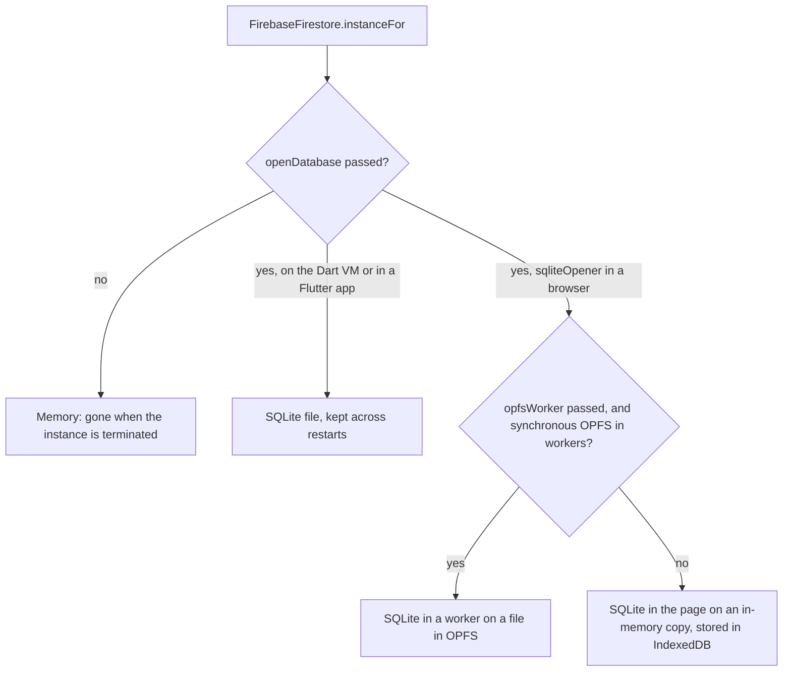
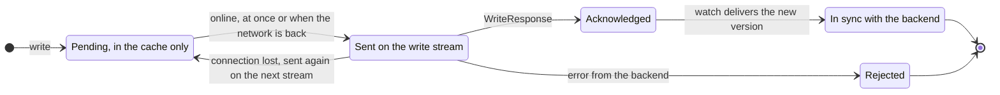

# Offline persistence and cache settings

Every `Firestore` instance keeps a local cache. Listeners and reads are answered from it while
the client is offline, writes are applied to it at once and sent when the client is online, and
queries against it use what earlier listens returned. Where the cache lives is up to you:

| You pass | The cache |
|---|---|
| no `openDatabase` | in memory, gone when the instance is terminated |
| an `openDatabase` (SQLite on the VM) | in a SQLite file, kept across restarts |
| the web `openDatabase` (web) | SQLite compiled to WebAssembly, stored in IndexedDB or OPFS |

On the web the opener picks the storage itself; follow the branches to see which one you get:



## Cache settings

`Settings.cacheSettings` chooses the kind of cache and its size:

```dart
// Persistent (needs an openDatabase): unused documents are removed once the
// cache grows beyond about 100 MB, the default.
final Settings persistent = Settings(
  cacheSettings: PersistentCacheSettings(sizeBytes: 100 * 1024 * 1024),
);

// Never removes anything.
final Settings unlimited = Settings(
  cacheSettings: PersistentCacheSettings(sizeBytes: Settings.cacheSizeUnlimited),
);

// In memory, dropping documents as soon as no listener needs them (the default
// for a memory cache)...
final Settings eager = Settings(cacheSettings: const MemoryCacheSettings());

// ...or keeping them up to a size, so that a query that was listened to before
// can be answered offline.
final Settings lru = Settings(
  cacheSettings: MemoryCacheSettings(gcSettings: MemoryLruGcSettings(sizeBytes: 40 * 1024 * 1024)),
);
```

- The size is a threshold, not a hard limit: garbage collection runs in the background and
  removes documents that no active listener uses, least recently used first. The minimum is
  1 MB; a smaller value throws an `ArgumentError`.
- Without an `openDatabase` the cache is in memory whatever the settings say.
- Pending writes are never removed by garbage collection.
- Settings are given to the `instanceFor` call that creates the instance. A later call with
  different settings throws a `StateError`; `terminate()` the instance first to change them.

## SQLite on the Dart VM

The package does not open SQLite files itself, so that you choose the binding. You pass a
function that opens a database. The companion package
[`cloud_firestore_dart_sqlite`](../../cloud_firestore/cloud_firestore_dart_sqlite/) has one on top
of `package:sqlite3`, for the VM, Flutter and the browser:

```shell
dart pub add cloud_firestore_dart_sqlite
```

```dart
import 'package:cloud_firestore_dart_sqlite/cloud_firestore_dart_sqlite.dart';

final FirebaseFirestore firestore = FirebaseFirestore.instanceFor(
  app: app,
  openDatabase: sqliteOpener(directory: '/home/ada/.local/share/my_app'),
  settings: Settings(cacheSettings: PersistentCacheSettings()),
);
```

It works with `sqlite3` 2.7.3 to 3.x, except 3.4.0 to 3.5.2 in a browser with the IndexedDB
storage, which `cloud_firestore_dart_sqlite` 0.1.2 refuses at open with a
`SqliteWebSetupException` (Flutter 3.44 resolves 3.5.2 for a web app: pin `sqlite3: 3.3.4` there,
see [Web](web.md#the-sqlite3-version)); in a browser with 3.x use 0.1.1 or later (0.1.0 could lose
writes acknowledged just before the tab died, see its CHANGELOG). With 3.x (Dart 3.10 and later) `sqlite3` bundles SQLite
itself and nothing else is needed; with 2.x a Flutter app adds `sqlite3_flutter_libs: ^0.5.0`
and a Linux server needs `libsqlite3.so`. Its README has the details per platform.

The opener receives a name that is unique per app name, project and database (for example
`firestore.[DEFAULT].my-project.(default)`) and decides where the file goes. If you write your
own opener over another binding, implement `Database` (`execute`, `query`, `delete`, `close`,
`path`) and call the callbacks in the order the opener of `cloud_firestore_dart_sqlite` does:
`onConfigure`, then `onCreate` for a new file or `onUpgrade` / `onDowngrade` when the stored
version differs, store the version, then `onOpen`. The doc comment of `OpenDatabase` has the details.

`example/offline_persistence.dart` is a runnable program: it writes online, restarts on the same
file, reads offline and writes offline.

### SQLite page cache

The client sets no page cache size, like the Android SDK (which sets none either; IndexedDB in
the JS SDK has nothing to set): the connection keeps SQLite's default, 2 MB in SQLite's own build
(`sqlite3` 3.x and `sqlite3_flutter_libs`) and 2000 pages (8 MB) in the library of macOS.
`sqliteOpener` takes `pageCacheMb` to change it:

```dart
final OpenDatabase opener = sqliteOpener(
  directory: '/home/ada/.local/share/my_app',
  pageCacheMb: 32,
);
```

Measured on a Mac with plenty of memory (`tool/bench/index_bench.dart` and
`local_store_bench.dart`, interleaved runs): between 2 and 256 MB nothing changed by more than the
run-to-run noise, at 100,000 documents (index backfill 72 to 75 us per document, every
`local_store_bench` line within about 10 %) and at 1,000,000 documents (backfill 197 to 240 us per
document; 2 MB 197, 256 MB 209 to 213). There the operating system keeps the whole database file
in its own file cache, so a page that SQLite's cache misses costs a system call, not a disk read.
A larger page cache helps when that is not the case (a 1 GB cache on a device short of memory),
and then it competes for the same memory. Recommendation: keep the default; if you profile a
large cache on such a device and see it reading from disk, try 16 to 32 MB. The cache fills as
pages are read, up to the size you set, once per open cache (one connection per `Firestore`
instance with a persistent cache).

### Reading and writing offline

```dart
// Only the cache, never the network.
final DocumentSnapshot<Map<String, Object?>> cached =
    await firestore.doc('cities/SF').get(const GetOptions(source: Source.cache));
print(cached.metadata.isFromCache); // true

// A write made offline is in the cache at once; its future completes when the
// backend has accepted it, so do not wait for it before showing the change.
final Future<void> write = firestore.doc('cities/SF').update({'visited': true});

// Listeners say whether a snapshot holds writes the backend has not seen.
firestore.doc('cities/SF').snapshots(includeMetadataChanges: true).listen(
  (DocumentSnapshot<Map<String, Object?>> snapshot) {
    print('pending: ${snapshot.metadata.hasPendingWrites}');
  },
);

// To take the client offline (or online) on purpose:
await firestore.disableNetwork();
await firestore.enableNetwork();
```

A write goes through these states; the table below gives what a listener with `includeMetadataChanges: true`
sees in each, for a document with no other pending write. Note that the future completes before
`hasPendingWrites` turns false.



| State | The write's future | `hasPendingWrites` | `isFromCache` |
|---|---|---|---|
| Pending, while offline | not completed | `true` | `true` |
| Sent | not completed | `true` | `false` once the listener has caught up with the backend |
| Acknowledged | completed | still `true`, until watch has sent the document at the commit version (skipped if it already has) | `false` |
| In sync | completed | `false` | `false` |
| Rejected | failed with the error | `false`: the change is removed from the cache | `false` |

### Writes waiting for the backend

An app that was offline for a long time can show how far the sync is. `getPendingWriteCount()`
returns the number of write batches of the signed-in user that the backend has not acknowledged
or rejected (one `set`, `update` or `delete`, or one `WriteBatch.commit`, is one batch), and
`pendingWriteCounts()` is a stream of that number. This API is experimental: the official SDKs
have no equivalent, only `waitForPendingWrites()` and `hasPendingWrites`.

```dart
final int total = await firestore.getPendingWriteCount();
final StreamSubscription<int> progress = firestore.pendingWriteCounts().listen(
  (int pending) => print('syncing ${total - pending} of $total'),
);
// ...
await progress.cancel();
```

- **Cost.** The memory cache knows the number. The SQLite cache counts the keys of the
  `mutations` primary key once (no batch is read or decoded) and then keeps the number in
  memory as writes are added and removed, so a call is cheap also with millions of pending
  writes. It counts again after another client of the cache committed.
- **Throttled.** The stream emits the count when it is listened to, and then reads it at most
  once every 250 ms after the queue changed (a write, an acknowledgement, a rejection, a
  change of user), so a drain of 100,000 writes gives at most 4 events a second; a count equal
  to the previous one is not emitted. It closes when the instance is terminated.
- **Per user.** The queue is per user: after a sign-in or sign-out the stream emits the count
  of the new user.
- **Several clients on one cache.** The count includes the batches the other clients wrote
  for the same user, but the stream emits after the changes this client makes or is told
  about; what another client writes or sends shows up at the next emission or the next
  `getPendingWriteCount()`.

`example/offline_persistence.dart` prints the progress of a small drain.

### Merging repeated offline writes (experimental)

Every write is a pending write until the backend accepts it, so an app that edits the same
documents for months offline queues one write per edit: about 1 KB of cache each, and a
reconnect that sends them all, one billed write each (see [Long offline use, measured](long_offline.md)
and `docs/spikes/offline_forever.md`).
`mergeUnsentWrites`, on `PersistentCacheSettings` or `MemoryCacheSettings`, keeps one pending
write per document instead. It is not in the official SDKs, and it is off by default.

```dart
final Settings settings = Settings(
  cacheSettings: PersistentCacheSettings(mergeUnsentWrites: true),
);
```

A new write replaces the pending write of its document when that write was never handed to the
network (the up to 10 writes handed to the write stream, sent or not, are left alone), both are
single writes (not a `WriteBatch` of several), no other client uses the cache, and the two
combine into one write with the same result on the backend:

| Pending write | New write | Becomes |
|---|---|---|
| anything | `set` without merge (`serverTimestamp` allowed), or `delete` | the new write |
| `set` (`serverTimestamp` allowed) | `update` or `set` with merge | one `set` with the new fields applied |
| `update` | `update` | one `update` of the fields of both |
| `set` with merge | `update` or `set` with merge | one `set` with merge of the fields of both |
| `delete` | `set` with merge | one `set` of the new fields |

Transforms in the two writes combine field by field:

| Pending write has | New write has, on the same field | Becomes |
|---|---|---|
| any transform | a value, a delete or `serverTimestamp` (on that field or one containing it) | the new write's |
| a value | `serverTimestamp` | `serverTimestamp` |
| a value (or the pending write is a `set` or `delete`) | `increment` | the sum as a value, if both are integers within ±(2^53 − 1) or both are doubles |
| `arrayUnion(a)` | `arrayUnion(b)` | `arrayUnion` of `a` then `b`, without repeats |
| `arrayRemove(a)` | `arrayRemove(b)` | `arrayRemove` of `a` and `b` |
| a transform | nothing on that field, on a field inside it or on one containing it | the transform, unchanged |
| nothing on that field, inside it or containing it (an `update` or `set` with merge) | a transform | the transform, unchanged |

Everything else stays queued as two writes, as without the setting. In particular `increment`
after `increment` of the same field: the backend adds the numbers one at a time, so on a field
that holds a double adding the two operands first can round differently (and integers saturate
at each step).
Also `arrayUnion` with `arrayRemove` on one field, an array transform after a `set` or `delete`,
a pending `set` with `increment` or array transforms, any other overlap of a transform with a
field of the other write, a `set` with merge after an `update`, and an `update` after a
`delete`. The merged write takes the place of the newest write in the queue, and the future of
every write that went into it completes or fails with it; `waitForPendingWrites` waits for it
too.

Until the backend confirms it, the app sees the merged document as it would see the two writes,
with one exception: a `serverTimestamp` of the pending write that stays shows the time of the
newer write as its estimate.

Writes that are already queued when an instance starts with the setting on, because an earlier
session queued them or the setting was off then, are merged once at start: each one, in the order
of the queue, is merged into the pending write of its document by the same rules and on the same
conditions, as if it had just been made. The queue ends up as the setting would have built it
from the same writes, and the documents the app sees do not change. The merge runs in
transactions of 500 writes, each an operation of the instance, so the app's first reads and
writes run between them rather than after the whole queue; a write made meanwhile is merged when
the merge reaches it. No write is sent to the backend until the merge is done. Each transaction
saves how far the queue is merged, so a merge that is interrupted (the app is closed or killed)
resumes there at the next start, and a queue that is merged is not read again at later starts.
It does not run while another client uses the cache. The queue of a user who signs in later is
merged when they sign in.

What the app gives up:

- Security rules and Cloud Functions triggers see one write, from the first state to the last,
  and never the states in between.
- A rejection rejects all the merged writes, with the same error.
- Writes to other documents made in between reach the backend before this document's earlier
  edits (which never reach it at all), so a rule that reads this document with `get()` while
  checking them sees its older state. Do not enable it when rules or functions depend on the
  order of writes across documents.
- A write replaced by a `set` or a `delete` is not checked: an `update` of a missing document
  followed by a `set` succeeds instead of failing.

For one document set once and updated 100,000 times offline (`tool/bench/offline_forever_bench.dart`,
`hot` and `drainhot`, one run on a Mac mini with an Apple M4 Pro against a local emulator 1.21.0, with other
runs going at the same time, so single numbers can be off by tens of percent; see
[Long offline use, measured](long_offline.md#what-was-measured-and-how)):

| | off | on |
|---|---|---|
| pending writes | 100,001 | 1 |
| cache file, public API | 34 MB | 3 MB (mostly the SQLite log) |
| time per offline write, public API | 133 us | 227 us |
| `enableNetwork` until `waitForPendingWrites` completes | 256 s | 0.09 s |
| billed writes | 100,001 | 1 |

For what a queue of thousands or millions of pending writes costs, with the numbers, see
[Long offline use, measured](long_offline.md).

### Protect the cache files

The cache holds every document the app has read and its pending writes, in clear text. SQLite
creates the database and its `-wal`, `-shm` and `-journal` files with mode 0644 minus the
process umask, and `Directory.createSync` creates directories with 0777 minus the umask. With
the usual umask 022 every local user can read them. On a desktop or server that other people can
log in to:

- put the database in a per-user application directory (`getApplicationSupportDirectory()` of
  `path_provider` in Flutter, `$XDG_DATA_HOME` or `~/.local/share/<app>` on Linux,
  `~/Library/Application Support/<app>` on macOS, `%LOCALAPPDATA%` on Windows), never in a
  shared location such as `/tmp`;
- make that directory private before the first file is opened (`dart:io` has no chmod), or run
  the process with `umask 077` so that the files come out 0600:

```dart
import 'dart:io';

final Directory directory = Directory('/home/ada/.local/share/my_app')
  ..createSync(recursive: true);
if (!Platform.isWindows) {
  Process.runSync('chmod', <String>['700', directory.path]);
}
```

- signing out does not delete the cache; `clearPersistence()` does (see below). Call it when a
  user signs out of a shared machine.

## On the web

The cache is in memory by default. To keep it across page loads, use the same
`cloud_firestore_dart_sqlite` package and serve the `sqlite3.wasm` file of the `sqlite3` version
your app resolves next to your page (from the
[sqlite3.dart releases](https://github.com/simolus3/sqlite3.dart/releases)). One command prints
which file and from where:

```shell
dart run cloud_firestore_dart_sqlite:setup_web web
```

```dart
import 'package:cloud_firestore_dart_sqlite/cloud_firestore_dart_sqlite.dart';

// IndexedDB: SQLite runs in the page on a copy of the whole database in memory.
final FirebaseFirestore firestore = FirebaseFirestore.instanceFor(
  app: app,
  openDatabase: sqliteOpener(), // loads sqlite3.wasm next to the page
);
```

To keep the database out of memory, pass the URL of the OPFS worker, which the same command
compiled to `web/sqlite_opfs_worker.js`. SQLite then runs in that dedicated worker on a file in
the origin private file system (OPFS) and reads what it needs. No cross-origin isolation
headers are needed; a browser without synchronous OPFS access in workers falls back to
IndexedDB, and the first OPFS open of a cache that is in IndexedDB moves it, pending writes
included.

```dart
import 'package:cloud_firestore_dart_sqlite/cloud_firestore_dart_sqlite.dart';

final FirebaseFirestore firestore = FirebaseFirestore.instanceFor(
  app: app,
  openDatabase: sqliteOpener(opfsWorker: Uri.parse('sqlite_opfs_worker.js')),
);
```

What to know (all measured in Chrome against the emulator; other browsers are untested):

- **One tab at a time.** The database is guarded by a Web Lock. A second tab (or a second
  instance in the same page) that opens the same cache waits two seconds for the lock and then
  fails: the operations of that instance fail with a `FirestoreException` whose code is
  `failedPrecondition`. Such a tab should use a memory cache. `FirebaseFirestore.instanceFor` returns
  at once and opens the cache in the background, so the error comes from the first operation:
  `openWithMemoryFallback` of `cloud_firestore_dart_sqlite` waits for a first operation that only
  reads the cache, and on `failedPrecondition` terminates that instance and creates one with a
  memory cache.
- **Crash safety.** What a write future acknowledged is stored (with
  `cloud_firestore_dart_sqlite` 0.1.1 or later; see above for the `sqlite3` versions). A tab that dies in the middle
  of a transaction loses only that transaction. A crash of the browser itself or a power cut is
  not covered.
- **Memory.** With IndexedDB the whole database is read into memory when it is opened (about
  1.4 KB per document of 1 KB; 100,000 documents take about 1 s to open and 130 MB). With OPFS
  memory stays at a few MB and the cache opens in well under 0.2 s at any size. The default
  size limit of 100 MB starts removing unused documents before 100,000 documents.
  [Platforms](platforms.md#the-web-supported-in-chrome) has the measurements.
- **Size.** The persistent cache adds about 220 KB of JavaScript (60 KB gzipped) to a small
  app, plus the `sqlite3.wasm` file (759 KB, 364 KB gzipped); the OPFS worker is 174 KB more (54 KB gzipped, built with `sqlite3` 3.9.1).
- `clearPersistence()` deletes the IndexedDB database or the OPFS directory.

## Deleting the cache

```dart
await firestore.terminate();        // the cache must not be in use by this instance
await firestore.clearPersistence(); // deletes the files (or the browser storage)
final FirebaseFirestore fresh = FirebaseFirestore.instanceFor(app: app);
```

`clearPersistence()` on an instance that is still running fails with `failedPrecondition`.
Pending writes that were not sent are lost. When another client still has the same SQLite file
open, the cache is emptied in place instead of deleted; see
[Several clients on one cache](multiple_clients.md#clearpersistence).

## Persistent cache indexes

Queries against the SQLite cache (offline, `Source.cache`, and the first results of a
listener) normally scan the cached documents of the collection, or start from the result of an
earlier listen. A persistent cache index lets them read only the matching documents. The index
only exists inside the SDK, on the device; it is not a Cloud Firestore index and it never
changes what a query returns.

```dart
final indexes = firestore.persistentCacheIndexManager; // null with a memory cache
await indexes?.enableIndexAutoCreation();
```

- **Automatic creation** (off by default, not stored: turn it on after creating the instance, or
  set `PersistentCacheSettings(indexAutoCreation: true)`, which turns it on from the start of
  every instance; that setting is not in the official SDKs).
  When a cache query was run as a collection scan that read at least 100 cached documents and
  more than twice as many as it returned, the SDK creates an index for that query. Only
  documents that came from the backend are counted, not pending writes.
- **Filling.** An index is filled in the background while the app runs: by default 50 documents
  per run, the first run 15 seconds after the instance was created and then one per minute.
  `PersistentCacheSettings(indexBackfill: IndexBackfillSettings(...))` changes the documents per
  run, the interval and the first delay, and `fillIndexes({maxDocuments})` fills the indexes now,
  in short runs between the other operations, until they are up to date (neither is in the
  official SDKs). A query uses an index as far as it is filled and reads the rest, so results are
  complete at every moment.
- `disableIndexAutoCreation()` stops creating indexes (existing ones stay in use);
  `deleteAllIndexes()` removes them all.
- `Firestore.setIndexConfigurationFromJSON(json)` (deprecated, as in the other SDKs) configures the
  indexes from a definition in the format of `firestore.indexes.json`; `queryScope` and
  `fieldOverrides` are ignored. It replaces the previous configuration.
- All query forms can be served: comparison operators, `in` / `not-in`, `array-contains(-any)`,
  `Filter.or` / `Filter.and`, `orderBy`, cursors, `limit` and `limitToLast`, also with BSON
  values. Queries with inequalities on several fields are scanned, as upstream.
- The index state is kept per signed-in user; the list of indexes is shared.

`example/cache_indexes.dart` is a runnable example. The stored index entries are not
byte-compatible with the ones of the Android SDK (they are never exchanged); the differences
are listed in `docs/ARCHITECTURE.md` in the repository.

## Connectivity

A failed stream is the only thing that makes the client consider itself offline, and it retries with an exponential backoff (up to one minute). Two things can make
it retry at once instead of waiting for the backoff:

- **Built in, on the VM** (not on the web, which uses the `online` / `offline` events of the
  browser): while a stream is failing, and only then, the client reads the addresses of the
  network interfaces every 2 seconds (`NetworkInterface.list`). When an address appears (Wi-Fi
  joined again, a cable, a VPN, a new DHCP lease), or when the clock shows that the machine
  was asleep, it restarts its streams right away. This is a hint only: it never declares the
  client offline, a wrong hint costs one connection attempt, and a client whose streams work
  has no timer. In a test, after a 16 second outage a listener received a change 40 to 140 ms
  after such a hint, and 2 to 8 seconds after the network was back without one (the rest of
  the backoff, which is random). Only tested on macOS; the hint itself was simulated.
- **From your app**: subclass `PlatformDependencies`, override `onNetworkConnected` and feed
  it from your own source (for example the `connectivity_plus` plugin in a Flutter app).
  Firestore restarts its streams, resetting the backoff, on every `true` event (after a 5
  second debounce); `false` is ignored. The first event from the app switches the built-in
  detector off for that instance, so there is nothing to configure to replace it.

Instances are independent: each `Firestore` has its own scheduler and work queue, and the
persistence lock is per database, so an instance never waits for another one.

## A cache that is busy for a moment

A `Database` reports an error that may go away on its own (SQLite busy or locked, an I/O error,
a full disk) as a `TransientDatabaseException`; the example openers do. A write or a listen that
could not be stored then fails with `unavailable` and can be tried again; a change from the
backend that could not be stored takes the client offline until the cache works again, with a
backoff. `example/database_recovery.dart` shows both with a `Database` wrapper that fails a few
times.
