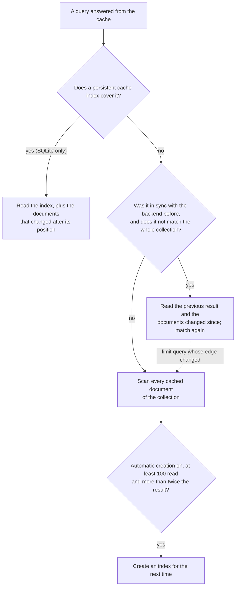

# Performance and cache tuning

This page lets you predict what a read, a listener or a write costs in `cloud_firestore_dart`, and choose the
settings that keep it small: how the client answers a query from its cache, when persistent cache indexes help,
how large the cache may grow and how garbage collection keeps it there, how listeners are shared, and when to
use counts, batches, bundles, `Source.cache` or the Lite library instead. Each section says what the client
does (from the source, file names relative to `cloud_firestore/cloud_firestore_dart/lib/src/firebase/firestore/`)
and then what to do.

The runnable examples are in
[`example/performance/`](../../cloud_firestore/cloud_firestore_dart/example/performance/):

| File | Shows |
|---|---|
| `cache_vs_server.dart` | One query timed from the server and from the cache, with each kind of cache; a second listener on the same query. |
| `cache_index_inspection.dart` | Automatic cache indexes: which plan a cache query took, when an index was created, the background fill, a configured index. |
| `cache_size_and_gc.dart` | A 1 MB cache threshold, and what the first garbage collection run removes. |
| `bundle_first_paint.dart` | A bundle made from a query snapshot, loaded into an empty cache for the first screen. |

```sh
FIRESTORE_EMULATOR_HOST=127.0.0.1:8080 dart run example/performance/cache_vs_server.dart
```

## About the numbers

Every number on this page is one measurement, not a benchmark result you can rely on: one run, on one machine,
with no repetition across days. Unless a line says otherwise it was taken on 2026-11-15 on an Apple M5 with
32 GB of memory, macOS 27.2, Dart 3.12.2 (JIT, `dart run`), with the benchmarks of `tool/bench/` in the
repository. These benchmarks call the local store directly, without a backend, and run SQLite with
`synchronous = OFF` (commits do not wait for the disk) so that runs are comparable; a real app waits for the
disk on every commit. The examples' timings come from the Firestore emulator on the same machine, which answers
far faster than a backend across the internet. Compare numbers with each other, not with your production app,
and measure your own app before you tune it.

## How a query is answered from the cache

Every query that the client answers locally goes through the query engine (`local/default_query_engine.dart`):
`get(const GetOptions(source: Source.cache))`, any `get()` while the client is offline, and the first snapshot of every listener before
the backend has answered. It tries three plans, in this order, and the result is the same with each:

1. **A persistent cache index** (SQLite cache only), if one covers the query. See the next section.
2. **The previous result of the query.** The client stores, for every query it has listened to, the keys of
   the documents the backend said match it, and the snapshot version at which the query was last in sync and
   free of unresolved documents. It reads only those documents, plus the documents of the collection that
   changed after that version, and filters them again. This is used only for queries that were in sync with
   the backend at least once; a limit query falls back to a scan when the document at the edge of its window
   changed or stopped matching.
3. **A scan of the collection**: every cached document of the collection (not of its subcollections) is read,
   decoded and matched. A limit is applied after the scan, so `orderBy('x').limit(10)` reads the whole cached
   collection.

Queries that match the whole collection (no filters, no limit, no cursors, no ordering other than by
document id) always scan; there is nothing to save.

The same order as a decision, from the first plan to the last:



When the cache is trusted and when the backend is asked:

- `get()` (the default source) listens to the query, and when the client is online waits for the backend's
  answer before it completes; offline it completes with the cache result. A `get()` therefore costs a full
  listen: a target on the listen stream, the backend's result, and then the target is released.
- A listener first raises what the cache has (`metadata.isFromCache == true`), then the backend's result.
  When it listens again to a query it listened to before, it sends the resume token it stored, and the backend
  can send only what changed since then. When the backend reports that the number of documents does not
  match (an existence filter), the client works out which cached documents were removed (with a bloom filter
  when the backend sends one) or forgets the resume token and receives the whole result again.
- Documents that the cache holds for a query but the backend no longer sends are looked up one by one
  ("limbo resolution", at most 100 at a time, `core/sync_engine.dart`).

Measured (`local_store_bench.dart 100000`: 10 collections of 10,000 documents of a few fields, 54 MB file):

| Query on the SQLite cache | Time |
|---|---|
| 1,000 of 10,000 documents, previous result | 11.5 ms |
| the same query, scan of the collection | 25.8 ms |
| the whole collection (10,000 documents) | 42.9 ms |
| one document by key (`readDocument`, average of 1,000) | 21 us |

The same three queries as bars; the previous result reads only the documents it needs:



**What to do.** Keep the queries your screens open stable, so that they have a previous result to start
from. Query narrow collections: a cache scan reads the whole collection, so one collection of 100,000
documents that every screen filters is slower to read from the cache than several smaller ones. If you read a
large collection with a limit or with filters that match few documents, from the cache, often, add a cache
index (next section).

## Persistent cache indexes

A persistent cache index is a table in the SQLite cache that maps field values to document keys. It exists
only on the device, never changes what a query returns, and does not exist for a memory cache
(`firestore.persistentCacheIndexManager` is null then). [Offline persistence](offline_persistence.md#persistent-cache-indexes)
has the API; this section is about the cost.

What the client does:

- **Automatic creation** is off by default and not stored; turn it on after every start with
  `enableIndexAutoCreation()`, or once in the settings with `PersistentCacheSettings(indexAutoCreation: true)`
  (not in the official SDKs), which turns it on before the first query of every start. After a cache query was answered by a scan, the client creates an index for it
  when the scan read at least 100 documents and more than twice as many documents as it returned.
- Because a scan returns every match before the limit is applied, a limit query without selective filters
  (for example `orderBy('total', descending: true).limit(5)` on a large collection) returns as many documents
  as it read, and never gets an index automatically. Configure one with the deprecated
  `setIndexConfigurationFromJSON` instead.
- **Filling** (`local/index_backfiller.dart`) runs in the background, on the client's queue: by default the
  first run 15 seconds after the instance was created, then one run per minute, each run indexing at most
  **50 documents** across all collections (the fixed rate of the official SDKs). A new index on a collection of
  10,000 cached documents is therefore complete after about 200 minutes of the app running. `IndexBackfillSettings`
  (`documentsPerRun` 1 to 1,000, `interval` 1 second to 1 day, `initialDelay`) changes the rate, and
  `persistentCacheIndexManager.fillIndexes()` fills the indexes at once; both are not in the official SDKs. A
  run blocks the other operations of the instance while it lasts (about 50 to 200 us per document without many
  pending writes), so a larger `documentsPerRun` means longer pauses. Until the index is complete a query uses the index for the documents it covers and reads
  the others: through the `read_time` column when fewer than 5,000 documents in the whole cache changed after
  the index's position, otherwise by a scan of the collection.
- **Cost on writes.** Writing a document does not write index entries. A document that changes (from the
  backend or from your own acknowledged write) is behind the index's position and is indexed again by a later
  fill run; until then queries read it separately. Removing a document (garbage collection, a delete from the
  backend) deletes its entries in the same transaction. So the write path is not slower, but every change
  costs one more index update later, and a collection that changes faster than the fill rate (50 documents a
  minute by default) keeps queries reading the changed documents separately.
- **Cost in space.** Every index adds one row per document that has the indexed fields (one per array element
  for `array-contains`).
- Queries with inequalities on several fields are never served by an index (scanned, as in the JS SDK).

Measured (`index_bench.dart 50000 --reps=3`: one collection of 50,000 documents, five fields; the fill was run
in a loop, not at the rate of the scheduler):

| | Scan | Index |
|---|---|---|
| `a == 7` (1 % of the documents) | 149.8 ms | 3.9 ms |
| `r` in a range (1 %) | 151.9 ms | 4.3 ms |
| `array-contains` (2 %) | 157.4 ms | 6.6 ms |
| `orderBy('order', descending).limit(10)` | 305.3 ms, resident memory +234 MB | 0.35 ms |
| `a == 7` with 10 % of the documents not yet indexed | | 26.5 ms |

Four indexes (five entries per document) took 51.5 us per document to fill and grew the file from 22.8 MB to
51.9 MB. With automatic creation, the `orderBy` + `limit` query got no index.

The table as a chart, on one scale; the index bars are the short ones next to each scan:


**The known gap.** A query served by an index can leave out a document in one rare case, described in
[Parity, known limitations](../parity.md#known-limitations) (item 15): watch sends a document in a later
snapshot at the same version as an earlier one, after the index was already brought up to date for that
version, and the document's id sorts before the documents indexed last. The document is then missing from
`get(const GetOptions(source: Source.cache))`, the first snapshot of a new listener and a refilled limit window, until it changes
again. It has not been seen against the emulator or production, the JS and Android SDKs have the same gap, and
queries that no index serves are not affected.

**What to do.**

- Turn on automatic creation if your app reads a large cached collection with selective queries offline or
  with `Source.cache`, and the cache lives across many app starts (a persistent cache on a phone or a
  desktop). The index pays off only once it is filled, which takes minutes to hours of running time at the
  default rate.
- For an app that lives offline, set `indexAutoCreation: true` in the settings rather than calling
  `enableIndexAutoCreation()`, raise the fill rate, and call `fillIndexes()` where a pause is acceptable (a
  loading screen): it runs in batches of 100 documents (about 5 to 20 ms each, other operations run in between)
  until the indexes are up to date or `maxDocuments` were indexed.
- For `orderBy` + `limit` queries on large collections, configure an index for the ordered field with
  `setIndexConfigurationFromJSON` (deprecated, as in the other SDKs; it replaces the whole configuration).
- Do not turn it on for short-lived processes or for small collections (under a few thousand documents a scan
  takes a few milliseconds, see above).
- `deleteAllIndexes()` removes them all, for example if the file has grown too large.

```dart
await firestore.persistentCacheIndexManager?.enableIndexAutoCreation();

// Or, for an app that lives offline: settings for FirebaseFirestore.instanceFor
// that turn automatic creation on from every start and fill faster,
final Settings settings = Settings(
  cacheSettings: PersistentCacheSettings(
    indexAutoCreation: true,
    indexBackfill: IndexBackfillSettings(
      documentsPerRun: 200,
      interval: const Duration(seconds: 10),
    ),
  ),
);
// and a fill now, during a loading screen (at most 20,000 documents).
await firestore.persistentCacheIndexManager?.fillIndexes(maxDocuments: 20000);

// An index for a query that automatic creation skips (deprecated API).
// ignore: deprecated_member_use
await firestore.setIndexConfigurationFromJSON('''
{
  "indexes": [
    {
      "collectionGroup": "orders",
      "queryScope": "COLLECTION",
      "fields": [{"fieldPath": "total", "order": "DESCENDING"}]
    }
  ],
  "fieldOverrides": []
}''');
```

`example/performance/cache_index_inspection.dart` raises the log level and shows the query engine's decisions:
on 2,000 cached documents the first `status == 'open'` query "scans 2000 local documents and returns 40", the
SDK creates an index, and 16 seconds later the first fill run has indexed 50 documents.

## Cache size and garbage collection

What the client does (`local/lru_garbage_collector.dart`):

- The threshold is `PersistentCacheSettings(sizeBytes: ...)` (or `MemoryLruGcSettings(sizeBytes: ...)` for a
  memory cache): **100 MB** by default, at least 1 MB, or `Settings.cacheSizeUnlimited` to never
  collect.
- The first check runs **one minute** after the instance starts, then every **five minutes**, on the primary
  client only (see [Several clients on one cache](multiple_clients.md)). There is no call that runs it.
- A check compares the size of the SQLite file (page count times page size) with the threshold. Below it,
  nothing happens. Above it, the run removes the least recently used **10 %** of the queries and of the
  documents that no query holds, **at most 1,000**, and the documents that only those queries held. Queries
  with an active listener, and documents with pending writes, are never removed.
- SQLite does not shrink the file when rows are deleted; it reuses the free pages. The size the collector
  compares is that of the file, free pages included, so once a cache has passed the threshold, every run
  removes another 10 % until the data that remains no longer needs the space it had.
- A memory cache with `MemoryLruGcSettings` computes its size by serializing every cached document, query and
  pending write at every check. The default memory cache (`MemoryEagerGcSettings`) has no checks: a document
  leaves the cache as soon as no listener and no pending write needs it.

Measured (`lru_gc_bench.dart 50000`, 27 MB file, all 50,000 documents released): one run with the default
parameters removed 1,000 documents in 46 ms; removing the other 49,000 in one run took 356 ms.
`local_store_bench.dart 100000` measured about 10 us per removed document.

**What to do.**

- Keep the default (100 MB) unless you know the size of your working set. A run removes at most 1,000 entries
  every five minutes, so set the threshold above what your app needs between two starts, not below it: a
  threshold far below the data the app reads keeps the collector removing documents that the next screen will
  download again.
- Use `cacheSizeUnlimited` only when the data the app can read is bounded.
- On the web with the IndexedDB storage, the whole database is in memory while it is open: the threshold is
  also a memory budget there (see [Offline persistence on the web](offline_persistence.md#on-the-web)).

```dart
final Settings settings = Settings(
  cacheSettings: PersistentCacheSettings(sizeBytes: 200 * 1024 * 1024),
);
```

`example/performance/cache_size_and_gc.dart` sets 1 MB, writes about 3 MB, releases 50 queries and keeps one
listener: the first run removes 5 queries and their 50 documents, and the files do not get smaller.

## Memory cache or SQLite cache

| | Memory, eager GC (default without an `openDatabase`) | Memory, LRU GC | SQLite |
|---|---|---|---|
| Survives a restart | no | no | yes |
| `get(const GetOptions(source: Source.cache))` after a `get()` | finds nothing (the documents left with the listener) | finds the documents | finds the documents |
| Offline answers for queries listened to before | only while a listener holds them | yes, up to the threshold | yes, up to the threshold |
| Cache indexes | no | no | yes |
| Cost | memory per document | memory, plus a full serialization every five minutes | a disk write per change, file on disk |

`example/performance/cache_vs_server.dart` on 1,000 documents (emulator, same machine): a query for 100
documents took 16 to 38 ms from the server and 2 to 4 ms from the cache with each kind of cache, and the eager
memory cache returned 0 documents from the cache.

**What to do.** Servers, tools and short-lived processes: the default memory cache, or [Lite](#the-lite-library).
Apps that are opened again and must work offline: SQLite. A memory cache with LRU GC only when you want reads
from the cache within one run but no file.

## Listeners

What the client does (`core/event_manager.dart`):

- All listeners of one instance share one listen stream. Each **distinct query** is one target on it, and the
  client keeps one view per query: the documents, sorted, matched against every change.
- Listeners on **equal queries** (same path, filters, orders, limits and cursors, even from different
  `Query` objects) share that target and view. A second listener gets its first snapshot from the existing
  view, without a request (`cache_vs_server.dart`: 0 ms, not from cache).
- `includeMetadataChanges: true` does not add work on the network or in the view; it delivers more events to your
  code (every change of `hasPendingWrites` and `isFromCache`).
- A listener with `ListenSource.cache` has no target on the backend: it sees local writes and what other
  listeners bring into the cache.
- When the last listener of a query is cancelled the target is released, and the stream is closed after one
  minute without targets.

**What to do.**

- Listen once per query and share the stream inside your app (a `StreamController.broadcast`, a state
  management object) instead of building a listener per widget; if you cannot, build equal queries, which
  share a target anyway.
- Cancel listeners you no longer show. Each active target costs backend reads for every change it receives.
- Use `includeMetadataChanges: true` only where you show pending or offline state.
- For views derived from data that another listener already follows, listen with `ListenSource.cache`:

```dart
final Stream<QuerySnapshot<Map<String, Object?>>> local = users
    .where('online', isEqualTo: true)
    .snapshots(source: ListenSource.cache);
```

## Limits and pagination

A large result costs on both sides: the backend sends (and bills) every document, and the client stores,
decodes, sorts and keeps it in the view. A cache query without an index still scans the whole collection, but
a limit keeps the view and the snapshot small. The `orderBy` + `limit` scan above held 234 MB more memory for
a while because it decoded 50,000 documents.

**What to do.** Show pages: a `limit` and a cursor from the last document of the previous page.

```dart
final QuerySnapshot<Map<String, Object?>> page1 =
    await users.orderBy('name').limit(25).get();
final QuerySnapshot<Map<String, Object?>> page2 = await users
    .orderBy('name')
    .startAfterDocument(page1.docs.last)
    .limit(25)
    .get();
```

## Counts and aggregations

`count()`, `sum()` and `average()` run on the backend only (`aggregate_query.dart`). The client never computes
them from its cache, does not store their result, and has no listener for them: offline the future fails with
`unavailable`. The backend sends one small result instead of the documents.

**What to do.** Use `count()` instead of reading a query to count it. Keep reading documents when you show
them anyway, or when the number must work offline (count `snapshot.length` of a listener you have).

```dart
final AggregateQuerySnapshot snapshot = await users.where('active', isEqualTo: true).count().get();
print(snapshot.count);
```

## Writes and batches

What the client does:

- Every write is applied to the cache at once (one local transaction) and sent on the write stream. Up to 10
  batches are in flight at the same time (`remote/remote_store.dart`), so separate writes do not wait for each
  other's round trip.
- A `WriteBatch` is one local transaction, one request to the backend, and atomic: all of it or none.
- The client does not limit the size of a batch. The backend limits the size of a request; a batch that is
  too large is rejected as a whole, after it was applied locally, and its local changes are rolled back.
- Everything a client does runs in order on one queue, so a large batch delays the reads and listeners of the
  same instance while it is applied.

Measured (`local_store_bench.dart 100000`, local store only, without the disk wait): 500 writes of one
document each took 104 us each; one batch of 500 took 32.3 ms (65 us per write). Acknowledging them took
177 us each, or 35.8 ms for the batch.

**What to do.** Use a batch when the writes must succeed together. For throughput alone, separate writes are
pipelined and a batch saves little on the client. Keep batches to hundreds of writes, not tens of thousands:
split a large import into batches and `await` each one, so that a failure costs one batch and the queue stays
free for the rest of the app.

## Bundles for the first screen

A bundle is a file of documents and named queries, made on a server, that `loadBundle` writes into the cache.
After it, the first screen comes from the cache without waiting for the backend, and a listener on the
bundle's named query starts from the bundle's read time, so the backend only sends what changed since. Loading
the same bundle again is skipped after reading its metadata (the cache has a bundle with that id that is as
new).

`QuerySnapshot.toJson()` writes a bundle (its `bundle` field) with the query under the name in `bundleName`;
a server SDK such as the Node.js Admin SDK builds the same format. `example/performance/bundle_first_paint.dart`
makes one from a 20-document query on a "server" instance: on an empty SQLite cache, loading it and reading the
named query from the cache took 50 to 75 ms (including opening the file), and the listener raised the bundled
result at once and the backend's update 36 to 41 ms later (emulator).

```dart
final LoadBundleTaskSnapshot progress = await firestore.loadBundle(bundleBytes).future;
final Query<Map<String, Object?>>? latest = await firestore.namedQuery('latest-stories');
final QuerySnapshot<Map<String, Object?>> firstScreen = await latest!.get(const GetOptions(source: Source.cache));
```

**What to do.** Use a bundle for data that many users read on their first start (a catalogue, the front page)
and serve it from a CDN. Not worth it for per-user data, or for apps whose cache is already warm.

## Reading from the cache only

`get(const GetOptions(source: Source.cache))` never contacts the backend: a document read is a lookup by key (21 us above), a query goes
through the plans of the first section. A document that is not in the cache fails with `unavailable`; a
document the cache knows to be missing returns a snapshot with `exists == false`. `get(const GetOptions(source: Source.server))` still
listens (one target), and fails with `unavailable` when the result could only come from the cache.

**What to do.** Use `Source.cache` for data you know a listener keeps current, or to show something at once
while the normal `get()` runs.

```dart
final DocumentSnapshot<Map<String, Object?>> cached = await users.doc('ada').get(const GetOptions(source: Source.cache));
```

## Transport

On the Dart VM and in Flutter the client uses gRPC over HTTP/2 (`remote/datastore/grpc_channel.dart`,
`keep_alive_transport.dart`):

- one gRPC channel per instance for all streams and calls;
- a keepalive ping every 30 seconds while calls are active, the connection dropped when a ping gets no
  answer within 20 seconds, so a half-dead connection is replaced; no pings while idle;
- a connection attempt times out after 15 seconds;
- the listen and write streams are closed after one minute without targets or writes;
- `Settings.grpcFlowControlWindow`, 256 KiB by default (as in the Android and JS SDKs): a larger
  window helps large reads on a connection with a long round trip, at the cost of one round trip before the
  first request of a new connection.

In the browser the client uses WebChannel for the listen and write streams and REST for one-shot calls
([Platforms](platforms.md#the-web-supported-in-chrome)). It switches a stream to long polling when the first response
does not arrive within 10 seconds (`webExperimentalAutoDetectLongPolling`, on by default), which is how a
buffering proxy shows. Long polling works on every network but makes a new request for every batch of changes.

**What to do.** Keep the defaults. Set `webExperimentalForceLongPolling: true` only for users behind a proxy that
breaks streaming, since it skips the 10 second detection; there is nothing to tune for gRPC keepalive.

## Startup with a large cache

What happens when an instance with a SQLite cache starts: the file is opened, schema migrations run if the SDK
version changed (once), and the local store loads its state. Documents are not read until a query asks for
them. Measured with `local_store_bench.dart 100000` (54 MB file, 501 pending write batches): reopening took
3.0 ms; with the one-time migration that builds pending-write overlays, 49 ms for 1,000 documents. The first
snapshot of each listener then costs one cache query (first section).

Background work starts later: the index fill after 15 seconds, garbage collection after one minute.

The first twelve minutes of an instance, with the two kinds of background work on one time line:


On the web, the IndexedDB storage reads the whole database into memory when it opens (about 1 second for
100,000 documents); the OPFS storage opens in well under 0.2 seconds at any size
([Offline persistence on the web](offline_persistence.md#on-the-web)).

**What to do.** Nothing on the VM. On the web, use OPFS for large caches, or keep the IndexedDB cache small
with the threshold.

## The Lite library

`package:cloud_firestore_dart/lite.dart` has no cache, no listeners and no sync engine: one request per call.
There is no local store to open, no queue of background work and no listen stream, and a web program that uses
only Lite is smaller ([Firestore Lite](lite.md) has the sizes). Use it in servers, tools and functions that
read and write but never listen or work offline.

## dart2js or dart2wasm in the browser

A web program can be compiled with `dart compile wasm` (dart2wasm, the default) or `dart compile js` (dart2js, the fallback); the two
builds are about the same size (see [the web guide](web.md#dart2wasm-or-dart2js)). This section measures
which one runs this client faster in Chrome.

**In short.** Every CPU-bound case ran two to five times faster with dart2wasm: serialization, queries on the
memory cache, a batch of writes with its listeners, a remote event. Queries on a SQLite cache, where part of
the time is spent in `sqlite3.wasm` and the storage, ran about twice as fast; filling the SQLite cache, which
waits for storage most, showed no difference larger than the noise. Start-up was the same within the noise on
a first load, and dart2wasm was 2 ms faster on a third. dart2wasm used 5 % less memory for 50,000 cached
documents. Nothing was slower with dart2wasm.

![Bar chart of the dart2wasm time as a share of the dart2js time. Serialization: 25 to 38 percent. Memory cache: filter on 10,000 documents 33 percent, orderBy and limit 22 percent, first snapshot 31 percent, filter on 50,000 documents 45 percent, bundle load 36 percent, 500 writes with 1 listener 25 percent and with 20 listeners 21 percent, remote event changing 1,000 documents 26 percent. SQLite cache of 10,000 documents: filter on IndexedDB 50 percent, on OPFS 54 percent. First load, script to first snapshot: 101 percent, within the spread. Third load: 63 percent, 3.9 against 6.3 ms. Memory for 50,000 documents: 95 percent, 209 against 220 MB.](../images/readme/perf_wasm_vs_js.svg)

**Method.** The benchmark is
[`tool/web_cpu_benchmark/`](../../cloud_firestore/cloud_firestore_dart/tool/web_cpu_benchmark/README.md)
(its README says what each case measures). Unlike the rest of this page, these numbers are repeated: 7 runs per
compiler, each in a new headless Chrome with an empty profile, the compilers alternating from one run to the
next; in each run every case ran once to warm up and then 5 times, and the run reports the median of those 5.
The table gives the median of the 7 runs and, in brackets, their minimum and maximum. A ratio marked "(same)"
is one where the ranges of the two compilers overlap: it is not a difference. Taken on 2026-11-18 on an Apple
M5 (10 cores, 32 GB), macOS 27.2, Chrome 157.0.8103.79 (`--headless=new`), Dart 3.12.2, both compilers at
`-O2` (the repository uses no other level), the page served with cross-origin isolation. The machine ran other
work at the same time (load average about 13); the alternation spreads that over both compilers, and it is
why some maxima are far from their medians. Every client had its network disabled: there is no backend in
these numbers. Documents in the queries have five fields, about 250 bytes; the raw reports are in
[`results/`](../../cloud_firestore/cloud_firestore_dart/tool/web_cpu_benchmark/results/).

| Case | dart2js | dart2wasm | wasm / js |
|---|---:|---:|---:|
| **Serialization (microseconds per document)** | | | |
| Small document (4 fields) to backend bytes | 9.78 (8.89–23.1) | 2.14 (2.05–2.51) | 0.22 |
| Small document from backend bytes | 5.11 (4.21–10.1) | 1.41 (1.40–1.58) | 0.28 |
| 1 KB document to backend bytes | 128 (110–148) | 31.6 (31.1–35.2) | 0.25 |
| 1 KB document from backend bytes | 60.9 (58.7–79.5) | 23.1 (22.5–24.0) | 0.38 |
| 1 KB document to cache bytes | 95.0 (86.1–158) | 23.6 (22.4–24.2) | 0.25 |
| 1 KB document from cache bytes | 60.4 (59.0–83.2) | 23.3 (21.9–25.9) | 0.39 |
| 50 KB document to backend bytes | 8,000 (7,614–10,482) | 2,227 (2,098–2,547) | 0.28 |
| 50 KB document from backend bytes | 4,401 (4,192–6,095) | 1,573 (1,481–1,811) | 0.36 |
| 50 KB document to cache bytes | 5,890 (5,429–13,685) | 1,466 (1,400–1,938) | 0.25 |
| 50 KB document from cache bytes | 4,336 (4,155–10,410) | 1,526 (1,466–1,799) | 0.35 |
| Maps nested 20 deep to backend bytes | 145 (137–189) | 34.3 (33.3–36.3) | 0.24 |
| Maps nested 20 deep from cache bytes | 69.7 (66.0–94.4) | 22.9 (21.6–28.1) | 0.33 |
| **Memory cache (milliseconds)** | | | |
| Filter, 1,000 documents | 0.62 (0.58–1.71) | 0.43 (0.40–0.56) | 0.68 |
| Filter, 10,000 documents | 5.11 (4.58–9.39) | 1.70 (1.52–2.21) | 0.33 |
| Filter, 50,000 documents | 26.7 (25.9–45.9) | 12.0 (9.65–12.6) | 0.45 |
| `orderBy` + `limit(10)`, 1,000 documents | 77.5 (74.8–108) | 18.6 (18.0–20.2) | 0.24 |
| `orderBy` + `limit(10)`, 10,000 documents | 1,126 (1,037–1,560) | 248 (233–305) | 0.22 |
| `orderBy` + `limit(10)`, 50,000 documents | 6,700 (6,214–8,466) | 1,483 (1,452–1,805) | 0.22 |
| First snapshot of a listener, 1,000 documents | 1.71 (1.60–2.55) | 0.43 (0.39–0.46) | 0.25 |
| First snapshot of a listener, 10,000 documents | 17.1 (15.8–23.4) | 5.25 (4.02–5.79) | 0.31 |
| First snapshot of a listener, 50,000 documents | 95.1 (89.4–131) | 36.3 (30.0–63.3) | 0.38 |
| Load a bundle of 10,000 documents | 472 (453–993) | 172 (166–196) | 0.36 |
| Load a bundle of 50,000 documents | 2,799 (2,479–4,916) | 965 (879–1,192) | 0.34 |
| Batch of 500 writes, until 1 listener has them | 65.1 (60.7–81.6) | 15.9 (14.9–17.3) | 0.25 |
| Batch of 500 writes, until 20 listeners have them | 262 (255–384) | 54.0 (51.9–60.0) | 0.21 |
| Remote event changing 1,000 documents, until the snapshot | 50.9 (48.8–68.8) | 13.2 (12.1–16.6) | 0.26 |
| **SQLite cache, 10,000 documents (milliseconds)** | | | |
| Filter, IndexedDB | 93.4 (83.1–104) | 47.2 (42.5–49.1) | 0.50 |
| `orderBy` + `limit(10)`, IndexedDB | 831 (788–895) | 230 (224–262) | 0.28 |
| First snapshot, IndexedDB | 100 (94.5–120) | 50.5 (49.1–60.9) | 0.51 |
| Load the bundle, IndexedDB | 905 (839–1,368) | 666 (590–887) | 0.74 (same) |
| Filter, OPFS | 91.7 (83.9–108) | 49.6 (48.0–62.8) | 0.54 |
| `orderBy` + `limit(10)`, OPFS | 807 (777–861) | 252 (230–287) | 0.31 |
| First snapshot, OPFS | 101 (97.3–133) | 57.2 (53.1–65.6) | 0.57 |
| Load the bundle, OPFS | 1,757 (1,613–2,115) | 1,430 (1,300–1,727) | 0.81 (same) |
| **Start-up (milliseconds)** | | | |
| First load: navigation to first snapshot | 151 (122–221) | 154 (119–247) | 1.02 (same) |
| First load: first script to first snapshot | 36.8 (32.8–48.4) | 37.3 (16.7–67.8) | 1.01 (same) |
| Second load (HTTP cache): navigation to first snapshot | 29.9 (15.2–59.2) | 23.6 (9.64–47.3) | 0.79 (same) |
| Second load: first script to first snapshot | 5.88 (5.61–6.97) | 5.27 (3.26–8.17) | 0.90 (same) |
| Third load (code caches): navigation to first snapshot | 20.4 (15.3–44.4) | 24.0 (16.2–39.2) | 1.18 (same) |
| Third load: first script to first snapshot | 6.27 (5.33–9.71) | 3.93 (3.34–5.12) | 0.63 |
| **Memory (MB, `measureUserAgentSpecificMemory`)** | | | |
| Page with the program loaded, before any client | 38.7 (37.2–38.9) | 31.2 (31.2–31.2) | 0.81 |
| After loading 50,000 documents into a memory cache | 259 (257–259) | 241 (241–241) | 0.93 |
| Of which the 50,000 documents | 220 (220–220) | 209 (209–209) | 0.95 |

Notes on the cases:

- **Start-up** is what the playground does: a client on a memory cache, `disableNetwork()`, one listener, its
  first (empty) snapshot. The program is 645 KB as JavaScript (197 KB gzipped) and 580 KB of WebAssembly plus
  17 KB of `.mjs` (226 + 4 KB gzipped). On a first load, dart2js took 16 ms (11–18) from the end of the
  download to `main`; dart2wasm took 19 ms (4–32) in `compileStreaming`, which overlaps the download, and
  2.5 ms to instantiate. Chrome caches the compiled code of both, so later loads spend 2 to 4 ms there. The
  navigation itself (100 ms or more on a first load in a new profile) is the same for both and larger than
  any difference between them.
- **Memory.** `performance.measureUserAgentSpecificMemory()` counts the JavaScript heap, which also holds the
  objects of a dart2wasm program (WasmGC objects live in the browser's garbage-collected heap, not in a linear
  memory), plus array buffers and WebAssembly memories, so the two builds are measured the same way. Its
  numbers vary little between runs.
- **I/O-bound work.** A write transaction on the IndexedDB storage takes about 1.4 ms with either compiler
  (`tool/web_storage_benchmark`), and filling the SQLite caches from a bundle showed no difference beyond the
  noise. The SQLite queries above still ran twice as fast with dart2wasm, because decoding and matching the
  documents read from SQLite is Dart work.
- **`orderBy` + `limit`** on a cache is a scan of the collection followed by a sort and the limit (see the first
  section), and it cost far more than a filter on the same documents: 1.1 s (dart2js) or 0.25 s (dart2wasm)
  for 10,000 documents, against 5 ms and 1.7 ms. Avoid such queries on large cached collections, or give them
  a cache index.
- **Not the same numbers.** dart2js stores a `double` with an integral value (`3.0`) as an integer, so the same
  map encodes to slightly different bytes (1,234 against 1,255 bytes for the 1 KB document), and integers
  above 2^53 lose precision under dart2js ([web guide](web.md)).
- **Other browsers** were not measured: Firefox is not installed on the measuring machine, and Safari cannot be
  driven headless without changing a system setting (`safaridriver --enable`).

**Which browsers run a dart2wasm build** (checked on 2026-11-18). The Dart documentation lists Chrome or Edge
137+, Firefox 134+ and Safari 26.2+ (macOS and iOS) for the current compiler, which uses WebAssembly garbage
collection (WasmGC), JS String Builtins and exception handling with `exnref`
([dart.dev/web/wasm](https://dart.dev/web/wasm), page dated 2026-11-10). WasmGC alone shipped in Chrome 119,
Firefox 120 ([caniuse](https://caniuse.com/wasm-gc)) and Safari 18.2
([WebKit features in Safari 18.2](https://webkit.org/blog/16301/webkit-features-in-safari-18-2/)); caniuse
still lists Safari as unsupported, which the WebKit post contradicts. The `.mjs` that dart2wasm writes falls
back to a JavaScript implementation of the string builtins when the browser lacks them. A browser without
WasmGC cannot run the build at all, so a page that must work everywhere keeps the dart2js build as a fallback.

- **Content-Security-Policy.** A page with a CSP must allow `'wasm-unsafe-eval'` in `script-src`, or the
  browser refuses to compile the module
  ([MDN](https://developer.mozilla.org/en-US/docs/Web/HTTP/Reference/Headers/Content-Security-Policy/script-src));
  `'unsafe-eval'` also allows it but allows JavaScript `eval` too.
- **Headers.** A dart2wasm build of this client needs none; the host must send `.wasm` as `application/wasm`
  for `compileStreaming`. Neither build needs cross-origin isolation for the OPFS storage (its worker uses the
  synchronous access handles of OPFS, not shared memory). Flutter web needs `Cross-Origin-Opener-Policy:
  same-origin` and `Cross-Origin-Embedder-Policy: require-corp` (or `credentialless`) only to render with
  several threads ([Flutter: Support for WebAssembly](https://docs.flutter.dev/platform-integration/web/wasm)).
- **How Flutter chooses.** `flutter build web --wasm` writes both builds; at start-up `flutter_bootstrap.js`
  tests the browser's WebAssembly features and loads the dart2js build when they are missing. Flutter 3.50
  uses the WebAssembly build by default only on Chromium 137+, and on Firefox and Safari only when the app
  opts in with `wasmAllowList` (same page, dated 2026-11-11).

**What to do.** For a browser app, load the dart2wasm build when the browser supports it and the dart2js build
otherwise, and allow `'wasm-unsafe-eval'` if the page has a CSP. The playground does exactly that
([`examples/playground/web/bootstrap.js`](../../examples/playground/web/bootstrap.js)): it runs the same
WasmGC check that dart2wasm writes to `main.support.js`, falls back to dart2js when the check fails or the
module does not compile, and keeps `?compiler=js` and `?compiler=wasm` to pick one by hand. The gain is in the
client's own work, so it matters most for large caches, large documents and many listeners; it does not make
the network or the storage faster.

## Checklist

- Persistent cache for apps that must work offline; default memory cache or Lite for servers and tools.
- One listener per query, shared; equal queries share a target anyway; cancel what you no longer show.
- `limit` and cursors instead of large results; `count()` instead of reading to count.
- Batches for atomicity, in sizes of hundreds.
- Cache indexes only for large, long-lived caches with selective queries; a configured index for `orderBy` +
  `limit` queries.
- Keep the 100 MB default unless you know your working set; never set the threshold far below it.
- A bundle for shared data on the first start.
