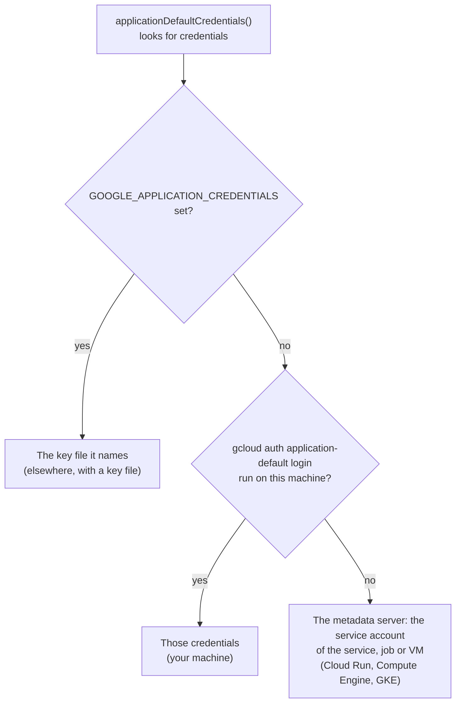
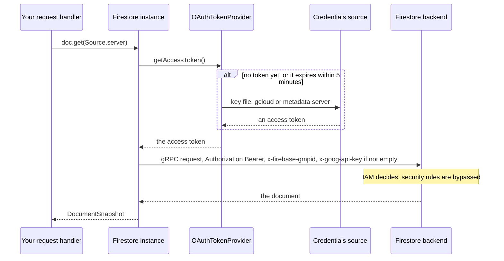

# Servers, jobs and command-line tools

This guide is for Dart programs that run on a machine you control: HTTP servers, background
workers, scheduled jobs and command-line tools. After reading it you will be able to choose the
credentials for each place the program runs, know what that identity means for security rules,
set up one `Firestore` instance per process with the right cache, use listeners and transactions
in a long-running worker, and stop the process cleanly in a container.

Read [Getting started](getting_started.md) first if you have not created a `FirebaseApp` and a
`Firestore` instance yet. Runnable programs that follow this guide are in
[`examples/`](../../examples/README.md).

## The common case

A worker on Cloud Run, Compute Engine or GKE, or on your machine after
`gcloud auth application-default login`: Application Default Credentials, the default memory
cache, one listener, and a clean stop on `SIGTERM` or Ctrl-C.

```dart
import 'dart:async';
import 'dart:io';

import 'package:cloud_firestore_dart/cloud_firestore_dart.dart';
import 'package:firebase_app_dart/firebase_app_dart.dart';
import 'package:firebase_auth_providers_dart/adc.dart'; // needs dart:io

Future<void> main() async {
  final FirebaseApp app = FirebaseApp.withOptions(
    const FirebaseOptions(
      apiKey: '', // an empty key is not sent
      appId: '1:1234567890:dart:server',
      projectId: 'my-project',
    ),
  );
  // Before the instance is created: the instance reads the provider of the app once.
  app.authProvider = applicationDefaultCredentials();
  // No openDatabase: the cache is in memory.
  final FirebaseFirestore firestore = FirebaseFirestore.instanceFor(app: app);

  final StreamSubscription<QuerySnapshot<Map<String, Object?>>> listener = firestore
      .collection('jobs')
      .where('status', isEqualTo: 'pending')
      .snapshots()
      .listen((QuerySnapshot<Map<String, Object?>> snapshot) {
        print('${snapshot.length} pending jobs');
      });

  // Wait for Ctrl-C or SIGTERM (SIGTERM cannot be watched on Windows).
  final Completer<void> stop = Completer<void>();
  final List<StreamSubscription<ProcessSignal>> signals = <StreamSubscription<ProcessSignal>>[
    ProcessSignal.sigint.watch().listen((_) => stop.isCompleted ? null : stop.complete()),
    if (!Platform.isWindows)
      ProcessSignal.sigterm.watch().listen((_) => stop.isCompleted ? null : stop.complete()),
  ];
  await stop.future;
  for (final StreamSubscription<ProcessSignal> signal in signals) {
    await signal.cancel();
  }

  await listener.cancel();
  await firestore.waitForPendingWrites().timeout(const Duration(seconds: 5));
  await firestore.terminate(); // without it the process does not exit
}
```

The rest of this page explains each choice.

## Credentials

The token provider belongs to the `FirebaseApp` and must be set before `FirebaseFirestore.instanceFor`.
The providers are in
[`firebase_auth_providers_dart`](../../firebase_auth/firebase_auth_providers_dart/README.md);
[Authentication and App Check](authentication.md) explains how each one works. Which one to use
where:

| Where the program runs | Use | How it gets a token |
| --- | --- | --- |
| Against the Firestore emulator | no provider, `Settings().withEmulator(host, port)` | none: the requests carry no credentials |
| Your machine | `applicationDefaultCredentials()` | the credentials of `gcloud auth application-default login` |
| Cloud Run, Compute Engine, GKE | `applicationDefaultCredentials()` | the metadata server, as the service account of the service, job or VM |
| Elsewhere, with a key file | `applicationDefaultCredentials()` with `GOOGLE_APPLICATION_CREDENTIALS=/path/key.json`, or `OAuthTokenProvider.serviceAccount(json)` | the key signs a short-lived assertion that is exchanged for an access token |

`applicationDefaultCredentials()` is in `package:firebase_auth_providers_dart/adc.dart`, which
needs `dart:io`. It looks for the key file named by `GOOGLE_APPLICATION_CREDENTIALS`, then the
gcloud credentials, then the metadata server (the lookup of `package:googleapis_auth`). So the
same code runs on your machine and on Google Cloud; prefer it to a key file wherever the
metadata server is available.

The lookup of `applicationDefaultCredentials()`, in order; the first source found gives the token:



One program for all three cases, switched by the environment:

```dart
import 'dart:io';

import 'package:firebase_auth_providers_dart/adc.dart'; // needs dart:io

final String? emulator = Platform.environment['FIRESTORE_EMULATOR_HOST']; // host:port
final FirebaseApp serverApp = FirebaseApp.withOptions(
  FirebaseOptions(
    apiKey: '',
    appId: '1:1234567890:dart:server',
    projectId: emulator == null ? 'my-project' : 'demo-my-project',
  ),
  name: 'server',
);
Settings settings = Settings();
if (emulator != null) {
  final int colon = emulator.lastIndexOf(':');
  settings = settings.withEmulator(
    emulator.substring(0, colon),
    int.parse(emulator.substring(colon + 1)),
  );
} else {
  serverApp.authProvider = applicationDefaultCredentials();
}
final FirebaseFirestore db = FirebaseFirestore.instanceFor(app: serverApp, settings: settings);
```

The package does not read `FIRESTORE_EMULATOR_HOST` by itself. The examples carry a fuller
version of this switch, with a named database and an optional API key, in
`lib/firestore_from_env.dart` (for example
[`examples/cli/lib/firestore_from_env.dart`](../../examples/cli/lib/firestore_from_env.dart)).

Do not put a key file in an image or a repository. On Google Cloud, give the service account of
the workload the `Cloud Datastore User` role instead.

**Status:** the service account flow is tested with a key pair generated by the tests, and
Application Default Credentials are delegated to `package:googleapis_auth` and not exercised by
the tests. Nothing was run against Google's token endpoint. See
[Status of the providers](authentication.md#status-of-the-providers).

## What the backend sees from a server

Over gRPC, the transport on the Dart VM, each request carries these headers (from
`remote/datastore/channel_options_provider.dart` and `remote/firestore_call_credentials.dart` in
the package):

- `Authorization: Bearer <token>`: the OAuth 2.0 access token of the provider. Without a
  provider, or when the provider has no token, there is no `Authorization` header.
- `x-goog-api-key`: the `apiKey` of the `FirebaseOptions`, only when it is not empty.
- `x-firebase-gmpid`: the `appId` of the `FirebaseOptions`.
- `x-firebase-appcheck`: only when the app has an App Check provider.
- `x-goog-api-client`, `google-cloud-resource-prefix` and `x-goog-request-params`: the client
  version and the database.

The path of one request in a server process, with Application Default Credentials:



What the existing documentation establishes about the identity:

- **An access token of a service account or of Application Default Credentials bypasses
  security rules.** Access is decided by IAM (for Firestore the `Cloud Datastore User` role),
  and `request.auth` is not a Firebase user. Whoever holds the credentials can read and write
  everything the role allows. This is stated in [Authentication](authentication.md) and in the
  doc comment of `OAuthTokenProvider`; it was not verified by a test against a real project.
- **There is no user.** With `OAuthTokenProvider`, `uid` is null and `onTokenChanged` never
  emits. A new access token is fetched five minutes before the old one expires and is used by
  the next request; a stream that is already open keeps the token it started with (the doc
  comment of `OAuthTokenProvider` says the backend allows this; no test has kept a stream open
  past the expiry of a real token).
- **Without credentials** (the emulator, no provider, no mock token) the requests carry no
  user, and the security rules see none. To test rules as a user against the emulator, pass a
  mock user token: see [Security rules as a user](emulator_and_testing.md#security-rules-as-a-user).
- **A server that should be subject to the rules** has to act as a Firebase Auth user:
  `FirebaseUserAuth` (email and password, anonymous, or a custom token) works on the Dart VM.
  This package cannot create custom tokens; that needs the Admin SDK or your own signer.

## One instance per process

Create the `Firestore` instance once, at startup, and pass it to the code that needs it:

- `FirebaseFirestore.instanceFor` returns the same instance for the same app name and database until
  it is terminated. A second call with different settings throws a `StateError`.
- `instanceFor` returns at once; the instance opens its cache and connects in the background,
  and every operation waits for that. Creating it at startup moves that work out of the first
  request.
- Each instance has its own connection, streams, cache, scheduler and work queue. Several
  instances in one process (different app names) work, but cost several connections and keep
  their listeners apart.

**Concurrency.** Dart runs a program's code on one thread per isolate, and the client is
asynchronous: many requests of an HTTP server can use one instance at the same time, each
awaiting its own reads, writes and transactions. Several transactions can run at once on one
instance (`testIncrementTransactionally` in `test/integration/firebase/firestore/transaction_test.dart`
runs them concurrently). A transaction that conflicts with another one runs its callback again,
so keep the callback free of side effects.

An instance belongs to the isolate that created it. If you start more isolates (for example one
per CPU core), create one instance per isolate, each with its own app name; with the memory
cache they share nothing. Two instances on one SQLite file elect one primary client and the
others stay offline, so do not give several isolates or processes the same persistent cache;
see [Several clients on one cache](multiple_clients.md).

## Memory cache or persistent cache

Without an `openDatabase` the cache is in memory. On a server it is usually the right choice:

- **Nothing to keep.** A container's disk goes away with the container, and a new instance
  starts with an empty disk anyway. The cache would only save reads within one process.
- **Memory stays small.** The default memory cache drops documents as soon as no listener
  needs them, so it holds the results of the active listeners and the pending writes, not
  everything the process ever read. `MemoryCacheSettings(gcSettings: MemoryLruGcSettings(...))`
  keeps more, up to a size, if you want repeated reads to be answered from the cache; see
  [Cache settings](offline_persistence.md#cache-settings).
- **No native library, no file locking.** The persistent cache needs SQLite (`package:sqlite3`
  loads the system's `libsqlite3`) and one process per file. Several replicas of a service, or
  several workers on one host, must not share a cache file.
- **Fresher reads.** A server should usually answer from the backend. Read with
  `get(const GetOptions(source: Source.server))` when a response must not come from the cache;
  [`examples/server_shelf`](../../examples/server_shelf/) does that for every read.

What you give up: writes that were not acknowledged when the process ends are lost (see
[Graceful shutdown](#graceful-shutdown)), and a restarted process cannot answer anything while
the backend is unreachable. A persistent cache fits a command-line tool on a laptop that has to
work offline, or a long-lived process on one machine with a disk of its own; see
[Offline persistence](offline_persistence.md).

## Listeners in a long-running worker

A listener (`snapshots()` on a query or a document) is a change stream: it delivers the current
result, then a new snapshot whenever the result changes, and `docChanges` says what changed.
In a worker that reacts to new documents, a listener replaces polling.

- **One listener per query, not per request.** Each listener is a target on the backend, and
  its documents stay in the cache while it is active. A server that sends the changes to many
  clients should keep one listener and fan the snapshots out, as
  [`examples/server_shelf/lib/change_feed.dart`](../../examples/server_shelf/lib/change_feed.dart)
  does.
- **A lost connection does not end the listener.** The client retries the stream with an
  exponential backoff (up to one minute; on the VM it retries at once when a new network
  address appears, see [Connectivity](offline_persistence.md#connectivity)) and listens to the
  same queries again, resuming them where the last snapshot left off. While it is disconnected
  the listener's snapshots come from the cache with `metadata.isFromCache == true`; once the
  backend answers, you get a snapshot with what changed in the meantime, including documents
  that were deleted (the client checks the count of documents the backend reports for each
  query, with a Bloom filter, as the other SDKs do).
- **Do not act on cache-only data.** A snapshot can be from the cache, or contain a document
  that another process changed a moment ago. Treat a listener as a signal to look, and make the
  decision in a transaction that reads the current version:
  [`examples/worker_queue`](../../examples/worker_queue/) wakes up on a listener and claims each
  job in a transaction.
- **An error ends the listener.** `permission-denied`, a query that needs an index you have not
  created (`failed-precondition`) and similar errors arrive on the stream's `onError`, and the
  stream is done. Log the error and decide: stop the process, or listen again after a delay.
- **Metadata changes.** `snapshots()` does not emit a snapshot when only the metadata changes
  (for example `isFromCache` going from `true` to `false`). Use
  `snapshots(includeMetadataChanges: true)` to see those.

## Transactions on the server

Transactions work as in the client SDKs (optimistic, run again on conflict, up to
`maxAttempts`, 5 by default); [Transactions and the
lifecycle](transactions_and_lifecycle.md) has the details. On a server, three points matter
more:

- **A transaction that claims a document** (a job, a seat, a unique name) reads it and writes
  only if it is still free. When two processes try at once, one commit succeeds and the other
  callback runs again and sees the document taken. This is how
  [`examples/worker_queue`](../../examples/worker_queue/) gives each job to one worker.
- **A commit whose answer is lost can be applied twice.** The client cannot tell a lost answer
  from a failed commit and runs the callback again. Make the transaction idempotent: write a
  value that identifies the attempt (an operation id) and check for it in the callback. The
  worker example writes a random claim id and, when it finds its own id, keeps the job.
- **Read-only transactions** (`readOnly: true`) read several documents,
  queries (`getQuery`) and aggregations (`getAggregate`) at one point in time, with no locks and
  no conflicts, and can read the database as it was at an earlier time (`readTime`). They suit
  reports and exports that must be consistent. They always go to the backend.

Transactions need the backend: they fail with `unavailable` while it cannot be reached, after
their retries.

```dart
// Claim a job once, whichever process gets there first.
final DocumentReference<Map<String, Object?>> job = firestore.doc('jobs/job-1');
final bool claimed = await firestore.runTransaction<bool>((Transaction transaction) async {
  final DocumentSnapshot<Object?> snapshot = await transaction.get(job);
  if (!snapshot.exists || snapshot['status'] != 'pending') {
    return false;
  }
  transaction.update(job, <String, Object?>{'status': 'running', 'worker': 'worker-a'});
  return true;
});
print(claimed ? 'mine' : 'taken');
```

## Request and response handlers: Firestore Lite

`package:cloud_firestore_dart/lite.dart` has no cache, no listeners and no sync engine: every call
is one request to the backend. For an HTTP handler that reads and writes but never listens, its
behaviour matches what a handler wants:

- a write completes when the backend has applied it, and fails with the backend's error (for
  example `unavailable`) instead of waiting in a queue;
- every read goes to the backend; there is no `Source` and no snapshot metadata;
- transactions, read-only transactions, batches, queries and aggregations are there.

The main library behaves differently: a write is applied to the cache at once and its future
completes when the backend acknowledges it, which, while the backend is unreachable, can take
as long as the outage. In a handler on the main library, put a timeout on awaited writes.

```dart lite
import 'dart:convert';
import 'dart:io';

final HttpServer server = await HttpServer.bind(InternetAddress.anyIPv4, 8080);
await for (final HttpRequest request in server) {
  final String id = request.uri.pathSegments.isEmpty ? '' : request.uri.pathSegments.last;
  try {
    final DocumentSnapshot<Map<String, Object?>> task =
        await firestore.collection('tasks').doc(id.isEmpty ? 'none' : id).get();
    request.response
      ..statusCode = task.exists ? HttpStatus.ok : HttpStatus.notFound
      ..write(jsonEncode(task.data() ?? <String, Object?>{}));
  } on FirestoreException catch (error) {
    request.response
      ..statusCode = HttpStatus.serviceUnavailable
      ..write('${error.code}');
  }
  await request.response.close();
}
```

Lite is **experimental** and its API may change; credentials and the emulator settings work as
in the main library. A program that needs one listener and many plain requests can use both
libraries, importing one with a prefix. See [Firestore Lite](lite.md).

## Graceful shutdown

Cloud Run, Kubernetes and `docker stop` send `SIGTERM`, wait for a grace period, then kill the
process (Kubernetes waits 30 seconds by default; check your platform). In that time:

1. Stop taking new work: close the HTTP server, stop claiming jobs.
2. Let the work in progress finish, or give it back (set a claimed job back to `pending`).
3. Cancel the listeners.
4. `await firestore.waitForPendingWrites()`: it completes when every write made so far was
   acknowledged (or rejected) by the backend. It does not complete while the backend is
   unreachable, so give it a timeout shorter than the grace period. If every write in your
   program is awaited, there is nothing to wait for and it returns at once.
5. `await firestore.terminate()`: listeners stop, the streams and the cache are closed. **A
   write that was not acknowledged by then never completes**, and with the memory cache it is
   lost. A process with an open `Firestore` instance does not exit on its own; terminate every
   instance (Firestore Lite too).

`ProcessSignal.sigterm.watch()` throws on Windows; watch `SIGINT` there. The [common
case](#the-common-case) above shows the pattern; [`examples/server_shelf`](../../examples/server_shelf/bin/server.dart)
and [`examples/worker_queue`](../../examples/worker_queue/bin/worker.dart) do it in full.

## Containers

Compile the program to a native binary with `dart compile exe`: it starts without the JIT and
needs no Dart SDK in the image. The binary of `examples/worker_queue` is about 9 MB (macOS,
arm64).

[`examples/cloud_run_job/Dockerfile`](../../examples/cloud_run_job/Dockerfile) builds in the
official `dart` image and copies the binary and the image's `/runtime/` (C library, DNS
resolver, CA certificates for TLS to `firestore.googleapis.com`) onto `scratch`. It builds from
the repository root because that example depends on the packages of the repository by path.
For a program that depends on the versions on pub.dev, its own directory is the build context:

```dockerfile
# Not built: a sketch for a program whose dependencies come from pub.dev.
FROM dart:3.12.2@sha256:5ac89dbcae4327278b257920e2786df0f22c87adc630017266b67cfcceef8348 AS build
WORKDIR /src
COPY pubspec.yaml pubspec.lock ./
RUN dart pub get --enforce-lockfile
COPY bin/ bin/
COPY lib/ lib/
RUN dart compile exe bin/worker.dart -o /src/worker

FROM scratch
COPY --from=build /runtime/ /
COPY --from=build /src/worker /app/worker
# No credentials in the image: on Cloud Run the token comes from the metadata server.
ENTRYPOINT ["/app/worker"]
```

- **No key in the image.** Use the metadata server (the service account of the service or job)
  and pass the project and other settings as environment variables.
- **SQLite only with a persistent cache.** With the memory cache the binary needs nothing
  beyond `/runtime/`. A persistent cache needs the native `libsqlite3` in the image, which
  `scratch` does not have: start from a distribution image that has it (on Debian, the
  `libsqlite3-0` package). On Linux, `package:sqlite3` looks for `libsqlite3.so`; the example
  opener (`example/sqlite_database.dart`) falls back to `libsqlite3.so.0`. This has not been
  tried in a container.
- **Neither Dockerfile has been built.** The one in `examples/cloud_run_job` follows the
  documented use of the official `dart` image; the sketch above follows it too.

## Cold start

What the first request of a new process pays for, and what helps:

- **Starting the program.** A binary from `dart compile exe` starts without compiling;
  `dart run` compiles the program first.
- **The instance.** `FirebaseFirestore.instanceFor` returns at once and opens the cache and the
  connection in the background. Create it at startup, before the first request arrives.
- **The first token.** `applicationDefaultCredentials()` looks up the credentials; the first access
  token is fetched when the provider is assigned to `app.authProvider` (on Cloud Run, from the
  metadata server). The
  token is reused until five minutes before it expires.
- **The connection.** The first call opens a gRPC connection (TLS, HTTP/2) to
  `firestore.googleapis.com`; later calls reuse it. Streams that are idle for a minute are
  closed and opened again when needed.
- **A listener's first snapshot** waits for the backend's answer: with the memory cache there
  is nothing to show from the cache in a new process.

None of these were measured on Cloud Run or another host; the numbers depend on the region and
the machine.

## What this client is not

`cloud_firestore_dart` is a port of the Firestore **client** SDK (Android, with the JS SDK as the
reference for the API), not of a Firebase Admin SDK or of the Google Cloud server libraries.
With a service account its access is decided by IAM, as theirs is, but:

- **It has none of the Admin SDK's Firestore extras.** There is no listing of collections or
  documents (`listCollections`, `listDocuments`), no `getAll` for many documents in one call, no
  `BulkWriter`, no `recursiveDelete` and no partitioned queries. None of these names is in the
  public API (`test/unit/api/public_api.golden.txt`).
- **It is not Firebase Auth admin.** `firebase_auth_providers_dart` gets tokens: it signs users
  in and gets service account and Application Default Credentials access tokens. It does not
  verify ID tokens, create custom tokens or manage user accounts; for those use a Firebase Admin
  SDK. See [Authentication](authentication.md).
- **It keeps the client behaviour.** Writes go through a local cache and a write queue, listeners
  report local writes before the backend has them, and transactions are optimistic, as in the
  client SDKs. Read-only transactions and `findNearest` are extras over the JS client SDK.
- **It has little production use.** Most testing is against the emulator; against a real
  database only a short verification kit has run. See [Known
  limitations](../parity.md#known-limitations) and [Features and limits](features.md).

## Examples

| Example | What it shows |
| --- | --- |
| [`server_shelf`](../../examples/server_shelf/) | An HTTP API with one shared listener sent to clients as server-sent events, reads with `Source.server`, shutdown on `SIGTERM`. |
| [`cli`](../../examples/cli/) | A command-line tool: batched imports, exports with `Source.server`, a watch command. |
| [`cloud_run_job`](../../examples/cloud_run_job/) | A one-shot job: an aggregation, an idempotent transaction, retries with backoff, a `Dockerfile` for a native binary. |
| [`worker_queue`](../../examples/worker_queue/) | A long-running worker: a listener to wake up, a transaction to claim each job once, a clean stop on `SIGTERM`. Two workers on one queue, with the output. |
