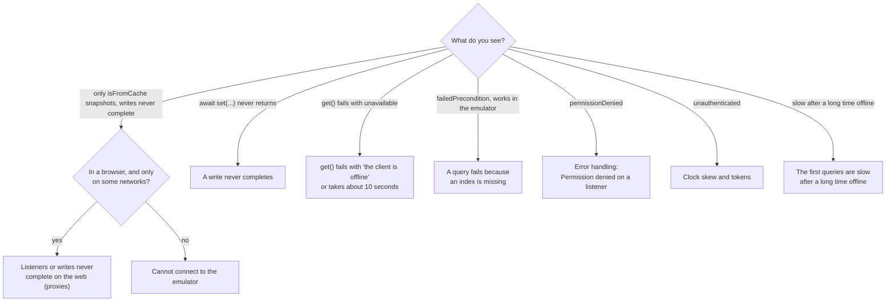
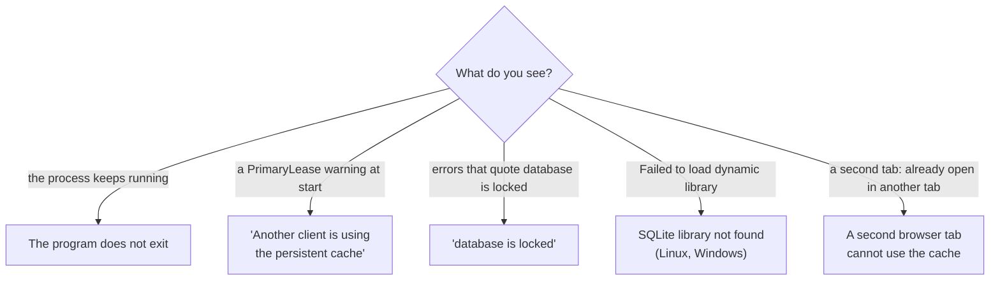

# Troubleshooting

Symptoms you may meet with `cloud_firestore_dart`, what causes them and how to fix them. Start by
turning on logging: most of the entries below tell you which log line to look for. The last
section says what to put in a bug report.

For the error codes and which of them the client retries by itself, see
[Error handling](error_handling.md).

To find the section for what you see, start from the symptom; each end box is the title of a section
below (or of a section of Error handling). The first tree covers the connection and the backend:



The second tree covers the process and the persistent cache:



## Turn on logging

```dart
FirebaseFirestore.setLogLevel(LogLevel.debug);
```

- The level is global: it applies to every instance, and to the other packages of this SDK
  (`firebase_app_dart`, `firebase_auth_providers_dart`), which share the logger. It is kept per
  isolate: set it again in a background isolate.
- The levels are those of the JS SDK: `verbose`, `debug`, `info`, `warn` (the default), `error`,
  `silent`. Today the SDK only writes debug, warning and error lines, so `verbose` shows the same as
  `debug`, and `info` the same as `warn`.
- `FirebaseFirestore.setLoggingEnabled(true)` is the older switch: `debug` when true, the
  default when false.
- Firestore Lite has the same `FirebaseFirestore.setLogLevel`.

Each line is written with `print`, on standard output (the browser console on the web):

```text
D:WatchStream                 ||(548683807) Stream closed with status: gRPC Error (code: 14, ...)
W:Firestore                   ||Listen for Query(...) failed: ...
```

That is the level (`D` debug, `W` warning, `E` error), a colon, the tag, padding, `||` and the
message. Messages longer than 4096 characters are cut. To send the lines to your own logger, run
your code in a zone that overrides `print`; `example/logging.dart` in the package does this and
parses the lines. The format is not a stable API.

**Before you share a debug log**, read it: it contains document paths and the data of your
writes and reads (`Stream sending: {...}`). The client does not log auth or App Check tokens, and
it removes anything that looks like a token from the errors of token providers.

### The tags

The tag is the class that wrote the line. The ones you are most likely to need:

| Tag | What it logs |
|---|---|
| `FirebaseFirestore` | the creation of an instance and the auth provider it uses |
| `FirestoreClient` | the start of the client and its connection state (`ConnectionState.connecting`, `idle`); `Initializing the client failed: ...` when the cache cannot be opened |
| `WatchStream`, `WriteStream` | every message sent and received on the listen and write streams, and `Stream closed with status: ...` with the error of a failed connection |
| `ExponentialBackoff` | `Backing off for ...` before a stream reconnects |
| `OnlineStateTracker` | `Could not reach Cloud Firestore backend. ...` when the client goes offline (at debug level) |
| `RemoteStore` | stream restarts for a new credential, write stream teardown, `The persistence failed, going offline` |
| `Firestore` | warnings for a rejected listen or write (`Listen for ... failed`, `Write failed at ...`) when the code is `permissionDenied` or a missing index; `Loading bundle failed` |
| `FirestoreCallCredentials`, `AppCheckTokenProvider` | `Failed to get token` and other token problems |
| `PrimaryLease`, `SQLitePersistence`, `ClientMetadataRefresher` | a persistent cache shared by several clients: the lease, a clear by another client |
| `DefaultQueryEngine`, `IndexBackfiller`, `LruGarbageCollector` | how a query was run against the cache (`Using full collection scan`), cache index backfill, garbage collection |
| `WatchChangeAggregator` | existence filters and bloom filters after a reconnect |
| `FirebaseUserAuth` | warnings of the token provider of `firebase_auth_providers_dart` |

## Cannot connect to the emulator

**Symptom.** Listeners only get snapshots with `isFromCache: true`, `get()` of a document fails with
`unavailable` ("Failed to get document because the client is offline."), and write futures never
complete. With debug logging: `WatchStream ... Stream closed with status: gRPC Error (code: 14,
codeName: UNAVAILABLE, message: Error connecting: SocketException: Connection refused ...)`,
then `OnlineStateTracker ... Could not reach Cloud Firestore backend. ...` and
`ExponentialBackoff ... Backing off for ...`. Nothing is logged at the default level.

**Causes and fixes.**

- **The settings do not name the emulator.** The client does not read `FIRESTORE_EMULATOR_HOST`;
  pass `Settings().withEmulator(host, port)` to the `instanceFor` call that creates the
  instance (see [The emulator and testing](emulator_and_testing.md)). Settings given to a later
  `instanceFor` call throw a `StateError`.
- **Wrong host or port.** The Firebase CLI prints the host and port of the Firestore emulator
  when it starts (port 8080 by default).
- **The Android emulator.** `127.0.0.1` inside the Android emulator is the emulated device itself.
  Pass `10.0.2.2`, the address of your computer as seen from the Android emulator. Unlike the
  FlutterFire plugin, this package does not map `localhost` to it for you.
- **A physical device.** Use your computer's address on the local network, and start the emulator
  so that it listens on that interface, not only on `127.0.0.1` (the `host` of the Firestore
  emulator in `firebase.json`).
- **Cleartext.** `withEmulator` turns TLS off: on the VM the client opens a plain gRPC connection
  with `dart:io`, on the web it calls `http://<host>:<port>`. A page served over `https` cannot call
  an `http` address (the browser blocks mixed content): serve the page over `http` from `localhost`
  while you use the emulator. The client was not tested on Android or iOS devices; if a platform
  network policy blocks the connection there, please report it. TLS cannot be turned off for the
  production host: such settings throw an `ArgumentError`.

## A write never completes

**Symptom.** `await doc.set(...)` (or `update`, `delete`, `batch.commit()`) does not return.

**Cause.** A write future completes when the backend acknowledges the write, not when it is stored
locally. It waits while:

- the client is offline, or `disableNetwork()` was called;
- the client is not the primary client of a shared persistent cache (another isolate or process
  took the lease, see [Several clients on one cache](multiple_clients.md));
- the instance was terminated before the acknowledgement: then it never completes.

**Fix.** Do not await a write before you go on; the change is in the cache and in your listeners
at once. Keep an error handler on the future, and await `waitForPendingWrites()` where you need
the writes on the backend (it also waits while the network is disabled). See
[Writes while offline](error_handling.md#writes-while-offline).

## `get()` fails with "the client is offline" or takes about 10 seconds

**Symptom.** `doc.get()` fails with `unavailable`: "Failed to get document because the client is
offline." (or the server-only variants: "Failed to get document from server." and "Failed to get
documents from server." for `Source.server`).

**Cause.** `get()` listens to the document until it has an answer. If the client cannot reach the
backend, it answers from the cache; a document that is not in the cache then fails with this error.
When the connection is refused, that happens at once; when the connection attempt neither succeeds
nor fails (a firewall that drops packets), the client waits up to 10 seconds before it treats itself
as offline.

**Fix.** Check the connection as under [Cannot connect to the emulator](#cannot-connect-to-the-emulator).
In the app, catch `unavailable` and retry, or read with `Source.cache` and show what you have.

## The program does not exit

**Cause.** An instance that is not terminated keeps its gRPC connection and its timers, which keep
the Dart process alive.

**Fix.** `await firestore.terminate()` at the end of a command-line program or a test. In tests,
also await every operation before the test ends: an operation still in flight when its instance is
terminated fails afterwards, and that error then fails whichever test is running.

## "Another client is using the persistent cache"

**Symptom.** A warning when an instance starts:
`W:PrimaryLease ... Another client (<id>) is using the persistent cache "<name>". This client takes
over as its primary client. ...`

**Cause.** Another live client (an isolate, a process) has the same SQLite file open: the same app
name, project and database. After a Flutter hot restart this is expected: the new isolate takes
over from the old one.

**Fix.** Nothing after a hot restart. For a background isolate or a second process that must be
online at the same time, give it its own app name (`FirebaseApp.withOptions(options, name: ...)`)
or database, and so its own file. Two clients on one cache keep it consistent but do not share
listeners or writes; the one that is not primary reports itself offline and keeps its writes
pending. See [Several clients on one cache](multiple_clients.md).

Related: an instance whose cache was cleared by another client
(`The persistent cache was cleared by another client ...`), or moved to another schema by a
different version of the SDK, fails with `failedPrecondition` and terminates itself. Create a new
instance.

## SQLite library not found (Linux, Windows)

**Symptom.** `W:FirestoreClient ... Initializing the client failed: Invalid argument(s): Failed to
load dynamic library 'libsqlite3.so' ...` (or `'sqlite3.dll'`). Reads and listeners then fail with
that `ArgumentError`, and writes with a `FirestoreException` with code `unknown` that quotes it.

**Cause.** With `sqlite3` 2.x the opener loads the system SQLite library, and it is not there under
that name (with 3.x, a program built with `dart compile exe` instead of `dart build cli` does the
same):

- **Linux:** `package:sqlite3` 2.x loads `libsqlite3.so`, which only the development package
  installs (`libsqlite3-dev` on Debian and Ubuntu). The runtime package (`libsqlite3-0`) has
  `libsqlite3.so.0`.
- **Windows:** Windows does not ship `sqlite3.dll`; `sqlite3` 2.7.5 and later fall back to
  `winsqlite3.dll`, which it does ship. Seen on Windows 11 with `sqlite3` 2.9.4 and no
  `sqlite3.dll` anywhere: it loaded `C:\Windows\System32\winsqlite3.dll` (SQLite 3.51.1), and the
  cache wrote, reopened offline and cleared. So on Windows this error needs an older `sqlite3` 2.x
  or a Windows without `winsqlite3.dll`.

**Fix.** Use `cloud_firestore_dart_sqlite` with `sqlite3` 3.x (Dart 3.10 and later), which bundles
SQLite, and build programs with `dart build cli`. With 2.x install `libsqlite3-dev`, or use the
override in the README of `cloud_firestore_dart_sqlite`, which falls back to `libsqlite3.so.0`; on
Windows put `sqlite3.dll` next to the executable or on the `PATH`; in a Flutter app,
`sqlite3_flutter_libs` bundles it. See [Platforms](platforms.md).

## A second browser tab cannot use the cache

**Symptom.** On the web, with the persistent cache of `cloud_firestore_dart_sqlite`, the first
operations of a second tab fail after two seconds with `failedPrecondition`: `The offline cache
"<name>" is already open in another tab (or in this one). It can only be used by one tab at a time:
use a memory cache in this tab.`

**Cause.** The cache can be open in one tab at a time; a Web Lock guards it. Sharing it between tabs
is not done yet.

**Fix.** Create such tabs with a memory cache. `openWithMemoryFallback` of
`cloud_firestore_dart_sqlite` tries the persistent cache and falls back to a memory cache on
this error. See [Offline persistence on the web](offline_persistence.md#on-the-web).

## A query fails because an index is missing

**Symptom.** A query works against the emulator but fails in production with `failedPrecondition`.
The listener's stream emits the error and closes, and the client logs it:
`W:Firestore ... Listen for <query> failed: ...`.

**Cause.** Production needs a composite index for queries that filter or order on several fields.
The emulator does not require indexes, so it does not show this. The backend's message says that
the query requires an index; the Firebase SDKs show a link in it that creates the index in the
Firebase console. This client passes that message through unchanged in `FirestoreException.message` and
in the log line. (This path was not run against production in this repository.)

**Fix.** Open the link from the message, or add the index to `firestore.indexes.json` and deploy it
with the Firebase CLI. Then listen again: the failed listener does not come back by itself.

## Clock skew and tokens

The token providers decide when a token is too old with the local clock:

- **`FirebaseUserAuth`** reuses an ID token until 5 minutes before the expiry written in the token.
  With a clock that is behind, it keeps sending a token that has already expired; the backend
  rejects it with `unauthenticated`. A listen or write stream that fails this way before it was
  healthy fetches a new token and reconnects (the comment in `remote/datastore/base_stream.dart`
  names a reset clock as the cause); a one-shot call fails with `unauthenticated` and the next call
  gets a new token. With a clock that is ahead, every request refreshes the token.
- **`OAuthTokenProvider.serviceAccount`** signs a token request dated 20 seconds in the past, for
  clocks slightly ahead of Google's. A clock that is further off makes Google refuse it
  (`invalid_grant`): a `FirebaseAuthException` with code `invalid-credential`, and
  Firestore logs `W:FirestoreCallCredentials ... Failed to get token: ...` and fails the requests
  with `unauthenticated`.
- **A shared persistent cache** stores lease times; after the clock is set back, the client logs
  `W:PrimaryLease ... Detected an update time that is in the future: ...` (at most once a minute)
  and treats that lease as expired.

**Fix.** Keep the system clock synchronised (NTP). Restart the app after a large clock change.

## Listeners or writes never complete on the web (proxies)

**Symptom.** In a browser on some networks, listeners never get a first snapshot from the server and
writes never complete, while the same app works elsewhere.

**Cause.** A proxy or an antivirus that buffers streamed HTTP responses. The listen and write
streams of the web transport use a streamed response; the client tries to detect a buffering proxy
by itself (`webExperimentalAutoDetectLongPolling`, on by default) and then switches to long polling.

**Fix.** Force long polling, and if the proxy also cuts long requests, shorten them (5 to 30 seconds;
the backend holds a request for 30 seconds by default):

```dart
final Settings settings = Settings(
  webExperimentalForceLongPolling: true,
  webExperimentalLongPollingOptions: const WebExperimentalLongPollingOptions(timeoutDuration: Duration(seconds: 25)),
);
```

These settings only apply on the web; on the VM the client uses gRPC and ignores them.
`webExperimentalForceLongPolling` and `webExperimentalAutoDetectLongPolling: true` together throw an
`ArgumentError`.

Against the emulator, a web query that returns more than about 10,000 documents fails with
`unavailable` (the emulator drops the stream); read such collections in pages. See
[Platforms](platforms.md).

## The first queries are slow after a long time offline

**Symptom.** After the app was offline for a long time, or not running, the first listeners take a
long time to reach `isFromCache: false`, and the client downloads more than you expect.

**Causes.** When a listener comes back, the client resumes it where it stopped, and the backend
sends only the changes. Several things make that more expensive after a long break:

- The backend also sends how many documents match. When that differs from what the cache has (for
  example, documents were deleted meanwhile) and the bloom filter the backend sends cannot tell
  which ones are gone, the client resets the query and downloads its whole result again
  (`WatchChangeAggregator`).
- Cached documents that the backend no longer returns for a query are checked one by one, with a
  listen per document, at most 100 at a time (limbo resolution, `SyncEngine`).
- The writes made offline are all sent when the client is online again.
- Before the backend answers, a query of a large cache that has no cache index scans the cached
  documents of the collection (`DefaultQueryEngine ... Using full collection scan`).

**Fix.** Keep queries narrow (filters, `limit`), so that each result is small to download again. For
large persistent caches, let the SDK create cache indexes
(`persistentCacheIndexManager?.enableIndexAutoCreation()`, see
[Persistent cache indexes](offline_persistence.md#persistent-cache-indexes)), and keep the cache
size limit reasonable so that unused documents are removed. Show the cached results
(`isFromCache: true`) while the rest arrives.

## "database is locked"

**Symptom.** With several clients (isolates, processes) on one cache, operations fail with an error
that quotes SQLite's `database is locked`. With the opener of `cloud_firestore_dart_sqlite`, which
reports SQLite's busy errors as `TransientDatabaseException`, a write or a listen fails with
`unavailable` and can be tried again.

**Cause.** Every transaction on the cache waits up to 10 seconds for SQLite's write lock. On the VM
the client switches the file to write-ahead logging so that this does not happen in normal use; a
journal mode that your opener sets is kept, and write-ahead logging needs a file system with shared
memory (not a network share).

**Fix.** Keep the cache on a local disk, do not force a rollback journal in your opener, and do not
run several active clients on one cache on purpose: give each its own app name. See
[Several clients on one cache](multiple_clients.md).

## Report a bug

Issues: <https://github.com/long1eu/firebase_dart_sdk/issues>. Include:

- the versions: `dart --version` (or `flutter --version`), and the versions of
  `cloud_firestore_dart`, `firebase_app_dart` and `firebase_auth_providers_dart` from your
  `pubspec.lock` (`dart pub deps` lists them), and of `grpc` and `sqlite3` if you use them;
- where it runs: the Dart VM or Flutter and the operating system, or the web with the browser and
  the compiler (dart2js or dart2wasm);
- the backend: the emulator (its version, Standard or Enterprise edition) or production (the
  edition, a named database or `(default)`);
- your `Settings` and cache: memory or persistent, which `OpenDatabase` (the example's or
  your own), IndexedDB or OPFS on the web, long polling;
- the full error: `FirestoreException` code and message, and the stack trace;
- a debug log of the run (`FirebaseFirestore.setLogLevel(LogLevel.debug)`), with document data you
  cannot share removed;
- the smallest program that shows the problem, ideally against the emulator. The programs in the
  package's `example/` folder are a good starting point;
- if you can check it, whether the JS or Android SDK behaves the same way.
