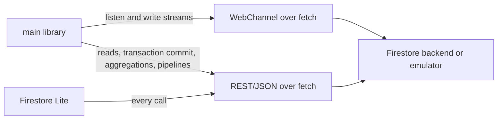
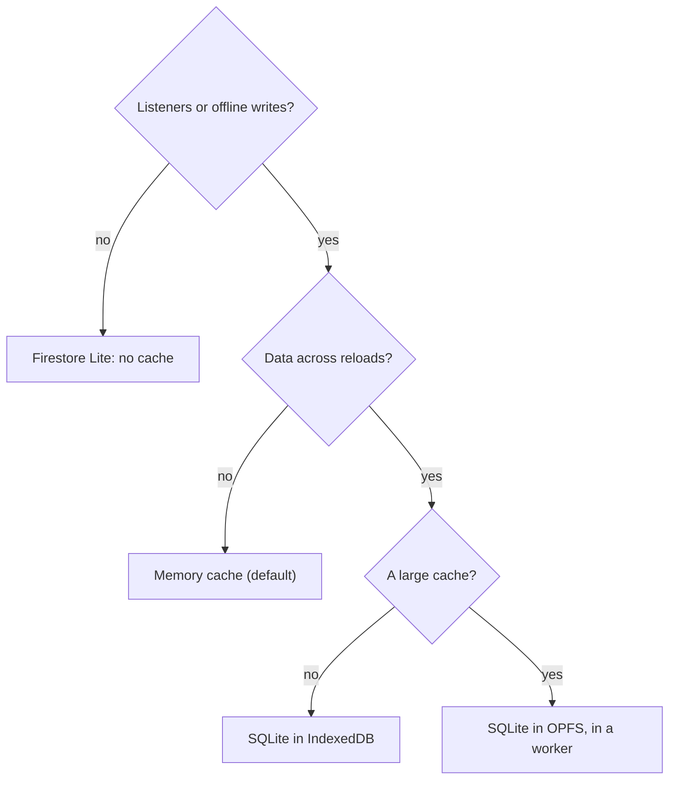

# The web

This page shows you how to use `cloud_firestore_dart` in a Dart web app (no Flutter needed):
connect, choose a cache, keep the bundle small, and pick a compiler. It also lists what does
not work in a browser yet.

**Web support is experimental.** It was tested in Chrome only, against the Firestore emulator
only, and it may change in any release. [`examples/web_app/`](../../examples/web_app/) is a
complete app you can build and open in a browser.
[`examples/playground/`](../../examples/playground/) runs the client with its network disabled on a
memory cache, so you can try queries, writes and listeners in a page that needs no backend. This is its main page in headless Chrome with
the network turned off: look at the **Sync** line and at the note marked `[not sent yet]`.

![The web_app example offline: Sync "Offline: showing the cache", an "Enable network" button, and the newest note marked "[not sent yet]" above three sent notes](../images/examples/web_app_offline.png)

## A first page

The API is the same as on the Dart VM. Depend on `cloud_firestore_dart`, `firebase_app_dart` and
`web`, and compile with `dart compile js` or `dart compile wasm`:

```dart
import 'package:cloud_firestore_dart/cloud_firestore_dart.dart';
import 'package:firebase_app_dart/firebase_app_dart.dart';
import 'package:web/web.dart' as web;

void main() {
  final FirebaseApp app = FirebaseApp.withOptions(
    const FirebaseOptions(
      apiKey: 'demo-key',
      appId: '1:1234567890:web:example',
      projectId: 'demo-example',
    ),
  );
  final FirebaseFirestore firestore = FirebaseFirestore.instanceFor(
    app: app,
    settings: Settings().withEmulator('127.0.0.1', 8080),
  );

  final web.Element list = web.document.querySelector('#notes')!;
  firestore.collection('notes').snapshots().listen((
    QuerySnapshot<Map<String, Object?>> snapshot,
  ) {
    list.textContent = '';
    for (final QueryDocumentSnapshot<Map<String, Object?>> doc in snapshot.docs) {
      list.append(web.document.createElement('li')..textContent = '${doc.data()['text']}');
    }
  });
}
```

Without an `openDatabase` the cache is in memory: writes made offline are kept while the page is
open, and lost when it is closed. [Choosing a cache](#choosing-a-cache) shows how to keep it.

## What works and what does not

What works in Chrome, with both compilers: listeners, queries, writes and offline writes,
batches, transactions, aggregations, the memory cache, the persistent cache (SQLite compiled to
WebAssembly, in IndexedDB or OPFS), `disableNetwork()` / `enableNetwork()`, `clearPersistence()`,
emulator settings, Firebase Auth and App Check tokens of the `FirebaseApp`, and
[Firestore Lite](lite.md). The whole standard integration suite also passes over the web
transport (run on the Dart VM, not in a browser); see [Parity](../parity.md).

What does not, or was not tried:

| Item | Status |
| --- | --- |
| Browsers other than Chrome | Not tested (Firefox, Safari, Edge; also not the OPFS cache). |
| The production backend from a browser | Not tested. The browser tests and the example ran against the emulator only. |
| A persistent cache in several tabs | Not supported: one tab at a time, see [One tab at a time](#one-tab-at-a-time). |
| Integers above 2^53 with dart2js | Lose precision. Use dart2wasm if you store such integers. |
| More than about 10,000 documents in one query against the emulator | Fails with `unavailable` over WebChannel (an emulator limit). Read in pages. Production not checked. |
| `-Dprotobuf.omit_field_names=true`, `-Dprotobuf.omit_enum_names=true` | Not allowed: the web transport needs the names, and refuses to start without them. |
| `grpcFlowControlWindow` | Ignored: there is no gRPC in a browser. |

## Transports

Browsers have no sockets, so the client talks to Firestore the way the JS SDK does, over
`fetch`:

- **REST/JSON** for the calls that are not streams: the reads and the commit of a transaction,
  aggregations, pipelines, and every call of Firestore Lite.
- **WebChannel** for the listen and write streams of the main library. A stream is a session of
  HTTP requests: the client posts its messages, and reads the answers from a long-lived response
  (the back channel).

Which call takes which path, for the main library and for Lite:



The client picks this transport by itself when it is compiled for the web. It listens to the
`online` and `offline` events of the browser, and restarts its streams at once when the network
comes back instead of waiting for its backoff.

### Long polling

By default the back channel is a streamed response. Some proxies and antivirus programs hold a
response until it is complete; listeners and writes then never complete. Long polling avoids
this: each back channel request returns as soon as it has data, or after a timeout, and the
client sends the next one.

- `webExperimentalAutoDetectLongPolling` is on by default. When the first back channel response of
  a stream stays silent for 10 seconds, that stream switches to long polling. Every new stream
  detects again.
- `webExperimentalForceLongPolling: true` uses long polling from the start. Use it when you know
  the network needs it; it costs more requests. It cannot be combined with
  `webExperimentalAutoDetectLongPolling: true` (an `ArgumentError`).
- `webExperimentalLongPollingOptions` sets how long the backend may hold a long-polling request
  open. The default is the backend's, 30 seconds. If a proxy cuts requests sooner, ask for less
  (5 to 30 seconds; other values throw an `ArgumentError`):

```dart
final Settings settings = Settings(
  webExperimentalForceLongPolling: true,
  webExperimentalLongPollingOptions: const WebExperimentalLongPollingOptions(timeoutDuration: Duration(seconds: 25)),
);
```

The three settings are the ones of the JS SDK, with the same names. They are ignored on the
Dart VM, which uses gRPC, and by Firestore Lite, which has no streams. The auto detection is in
the spirit of the JS SDK's, not a port of it.

## Choosing a cache

To pick a library and a cache, answer the questions from the top:



| Cache | How | When |
| --- | --- | --- |
| Memory (the default) | No `openDatabase` | Pages that do not need data across reloads. Smallest download. |
| SQLite in IndexedDB | `sqliteOpener()` | Small caches. SQLite runs in the page on a copy of the whole database in memory. |
| SQLite in OPFS | `sqliteOpener(opfsWorker: ...)` | Larger caches. SQLite runs in a worker and reads the file as it needs; memory stays at a few MB. |

The persistent caches come from the companion package
[`cloud_firestore_dart_sqlite`](../../cloud_firestore/cloud_firestore_dart_sqlite/). Add it, and
let its setup command compile the OPFS worker into your web directory and print where to get the
`sqlite3.wasm` file of the `sqlite3` version you resolve (from the
[sqlite3.dart releases](https://github.com/simolus3/sqlite3.dart/releases)):

```sh
dart pub add cloud_firestore_dart_sqlite
dart run cloud_firestore_dart_sqlite:setup_web web
```

The worker is JavaScript also when the page itself uses dart2wasm. Run the command again when
`cloud_firestore_dart_sqlite` or `sqlite3` changes version.

```dart
import 'package:cloud_firestore_dart_sqlite/cloud_firestore_dart_sqlite.dart';

final FirebaseFirestore firestore = FirebaseFirestore.instanceFor(
  app: app,
  openDatabase: sqliteOpener(opfsWorker: Uri.parse('sqlite_opfs_worker.js')),
  settings: Settings(cacheSettings: PersistentCacheSettings()),
);
```

- OPFS needs no cross-origin isolation headers. A browser without synchronous OPFS access in
  workers falls back to IndexedDB, and the first OPFS open of a cache that is in IndexedDB moves
  it, pending writes included.
- With IndexedDB, 100,000 cached documents of about 1 KB take about 1 s to open and 130 MB of
  memory; with OPFS under 0.2 s and a few MB. Reads cost about the same with both. The default
  size limit of 100 MB removes unused documents before that.
- The cache holds every document the page read, in clear text, readable by every script of the
  origin. `clearPersistence()` deletes it; call it when a user signs out of a shared computer.

### The `sqlite3` version

Two rules, both checked when the cache opens (`cloud_firestore_dart_sqlite` 0.1.2 and later), both
failing with a `SqliteWebSetupException` whose message says what to change:

- **`sqlite3.wasm` must be the build of the exact `sqlite3` version in your `pubspec.lock`.** A
  2.x file with a 3.x package, or the reverse, cannot be loaded (`wasmVersionMismatch`); a missing
  file, or the page a server sends instead of it, is `wasmMissing`. Pin `sqlite3` in your
  `pubspec.yaml` so that `pub upgrade` does not move it away from the file you serve.
- **Not `sqlite3` 3.4.0 to 3.5.2 with the IndexedDB storage** (`unsafeSqlite3`): their IndexedDB
  file system can lose a write the cache acknowledged when the tab closes a moment later. A
  Flutter app on Flutter 3.44 resolves 3.5.2 (Flutter pins `meta` 1.18, `sqlite3` 3.6.0 needs
  1.19): pin `sqlite3: 3.3.4` (or `^2.7.3`) there, `^3.6.0` on an SDK that allows `meta` 1.19, or
  use OPFS. `sqliteOpener(acceptIndexedDbWriteLoss: true)` opens anyway.

`openWithMemoryFallback` does not hide either error behind a memory cache. The
[README of `cloud_firestore_dart_sqlite`](../../cloud_firestore/cloud_firestore_dart_sqlite/README.md#which-sqlite3)
has the table of versions.

[Offline persistence on the web](offline_persistence.md#on-the-web) has the crash safety, and
[Platforms](platforms.md#the-web-experimental) the full measurements.

## One tab at a time

A Web Lock guards each persistent cache. A second tab (or a second instance in the same page)
that opens the same cache waits two seconds for the lock, then its operations fail with a
`FirestoreException` whose code is `failedPrecondition`. `FirebaseFirestore.instanceFor` returns at once,
so the error comes with the first operation. `openWithMemoryFallback` of
`cloud_firestore_dart_sqlite` waits for a first cache-only operation and falls back to a memory
cache:

```dart
import 'package:cloud_firestore_dart_sqlite/cloud_firestore_dart_sqlite.dart';

final FirebaseFirestore firestore = await openWithMemoryFallback(
  app: app,
  openDatabase: sqliteOpener(),
  settings: Settings(cacheSettings: PersistentCacheSettings()),
);
// Null with a memory cache: this tab did not get the persistent one.
final bool persistent = firestore.persistentCacheIndexManager != null;
```

Tabs do not share listeners or writes, as the JS SDK's multi-tab mode does. Because the lock is
released when a page goes away, a reloaded page knows the page before it is gone, and sends the
writes it left pending at once. [Several clients on one cache](multiple_clients.md) has the
details.

## CORS and the emulator

Your page and the backend are on different origins (for example `http://localhost:8000` and
`http://127.0.0.1:8080`), so every request is a cross-origin request. The emulator answers them
for any origin (`Access-Control-Allow-Origin` echoes the page's origin), so nothing needs to be
set up. Against production the requests go to `firestore.googleapis.com` from your page's
origin, as those of the JS SDK do; this was not tried with this client.

Connect to the emulator with `withEmulator`, which also turns TLS off:

```dart
final Settings settings = Settings().withEmulator('127.0.0.1', 8080);
```

Two things about the emulator that only show in a browser:

- **Six connections.** The emulator speaks HTTP/1.1, and Chrome allows six connections per host,
  shared by all tabs. Each page with a listener holds up to two long requests (listen and write)
  plus its one-shot calls. With several tabs open against the same emulator, requests can wait
  in the browser and time out. The production backend speaks HTTP/2, where this limit does not
  apply (not verified).
- **Threads.** The emulator starts a thread for every WebChannel session and does not end it.
  After many page loads it slows down and finally stops answering; restart it.

`tool/README.md` in the repository has the measurements behind both.

## Bundle size and Firestore Lite

Measured with Dart 3.12.2 and `dart compile js -O2`, gzipped:

| Program | JavaScript | gzipped |
| --- | ---: | ---: |
| A small app with [Firestore Lite](lite.md) | 416 KB | 128 KB |
| The same app with the main library, memory cache | 641 KB | 196 KB |
| [`examples/web_app`](../../examples/web_app/), Lite page | 398 KB | 122 KB |
| [`examples/web_app`](../../examples/web_app/), main page with the SQLite opener | 924 KB | 273 KB |
| `sqlite_opfs_worker.js` | 185 KB | 57 KB |
| `sqlite3.wasm` (loaded only when a persistent cache opens) | 731 KB | 348 KB |

Use Lite when a page only reads and writes:

```dart lite
import 'package:cloud_firestore_dart/lite.dart';

final FirebaseFirestore firestore = FirebaseFirestore.instanceFor(app: app);
final QuerySnapshot<Map<String, Object?>> notes =
    await firestore.collection('notes').limit(20).get();
```

Lite has no cache, no listeners and no offline writes: every call is one REST request, and a
write fails with `unavailable` without a connection. A program that only imports `lite.dart`
contains no sync engine, local store, SQLite layer or WebChannel. The two libraries declare
classes with the same names; import one of them with a prefix if a file needs both.

## dart2js or dart2wasm

| | dart2js (`dart compile js`) | dart2wasm (`dart compile wasm`) |
| --- | --- | --- |
| Integers | 53 bits: larger integers lose precision | 64 bits |
| Browsers | Every current browser | Needs WebAssembly garbage collection (recent Chrome, Firefox, Safari) |
| Tested | Chrome, 53 browser tests pass, 1 skipped (64-bit integers) | Chrome, 53 pass, 1 skipped (a crash test of the IndexedDB cache) |
| Example app, main page | 924 KB (273 KB gzipped) | 915 KB `.wasm` + 29 KB `.mjs` (342 KB + 6 KB gzipped) |
| Example app, Lite page | 398 KB (122 KB gzipped) | 341 KB `.wasm` + 16 KB `.mjs` (136 KB + 4 KB gzipped) |

Prefer dart2wasm when your data has large integers. Two things to know:

- `dart compile wasm` writes a `.wasm` and an `.mjs` file, and your page has to load them; see
  `web/bootstrap.js` of the example. The OPFS worker stays JavaScript.
- The `sqlite3` package calls its dart2wasm support experimental. The persistent caches pass
  the browser tests with both compilers, and the opener works around a slowness of
  `sqlite3` 2.9.4 under dart2wasm, fixed in `sqlite3` 3.8 (see [Platforms](platforms.md#the-web-experimental)); the
  crash test of the IndexedDB storage runs with dart2js only.

## Known gaps

- Chrome only; production untested from a browser.
- One tab per persistent cache; no sharing of listeners or writes between tabs, and no cache in
  a shared worker.
- A crash of the browser itself or a power cut is not covered by the crash tests of the
  persistent caches (a tab that dies is).
- The persistent caches are in the separate package `cloud_firestore_dart_sqlite` (0.1), not in
  `cloud_firestore_dart`.
- Against the emulator: queries of more than about 10,000 documents fail, and the six-connection
  limit of HTTP/1.1 applies.
- dart2js: integers above 2^53 lose precision.
