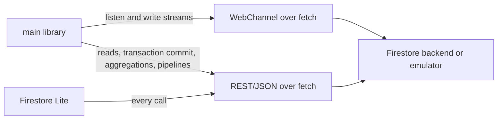
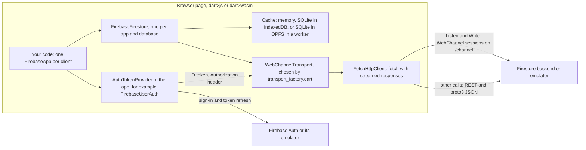
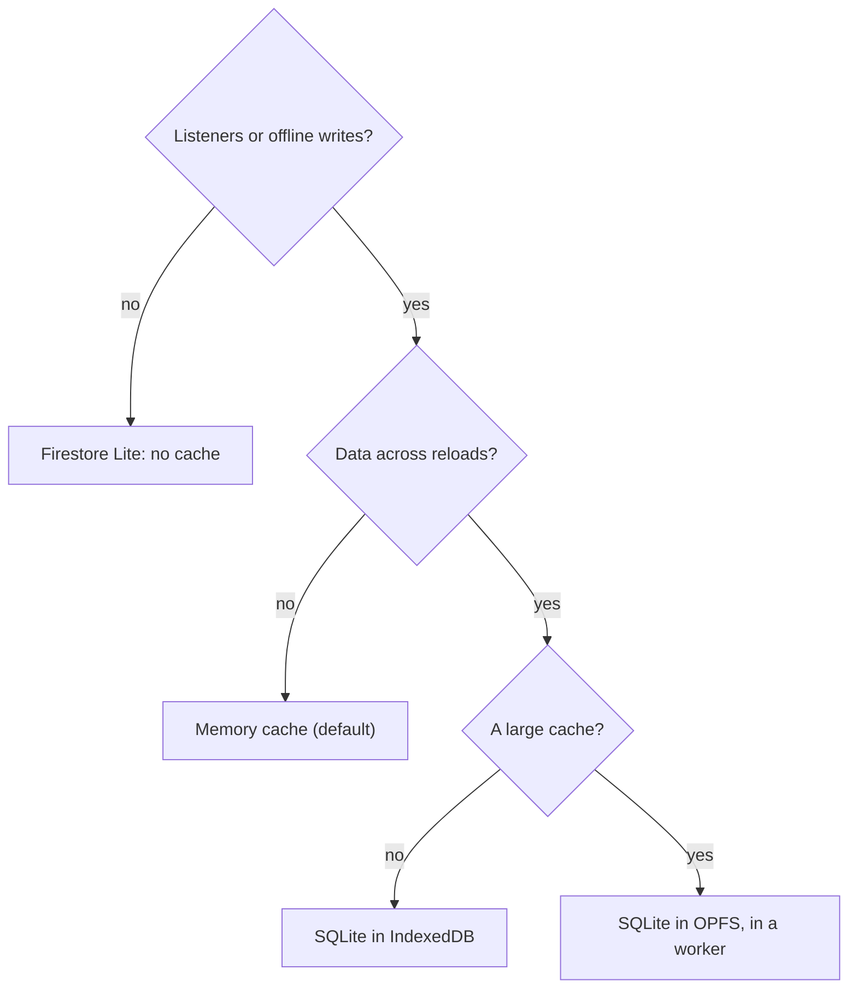

# The web

This page shows you how to use `cloud_firestore_dart` in a Dart web app or a Flutter web app:
connect, choose a cache, run several clients in one page, keep the bundle small, and pick a
compiler. It also lists what does not work in a browser yet.

**Web is supported in Chrome.** It was tested in Chrome only, against the Firestore emulator
only; Firefox, Safari and Edge are untested. [`examples/web_app/`](../../examples/web_app/) is a
complete app you can build and open in a browser, and
[`examples/flutter_web_two_users/`](../../examples/flutter_web_two_users/) a Flutter web page
with two signed-in users side by side.
[`examples/playground/`](../../examples/playground/) runs the client with its network disabled on a
memory cache, so you can try queries, writes and listeners in a page that needs no backend. This is its main page in headless Chrome with
the network turned off: look at the **Sync** line and at the note marked `[not sent yet]`.

<picture><source media="(prefers-color-scheme: dark)" srcset="../images/examples/web_app_offline_dark.png"></picture>

## A first page

The API is the same as on the Dart VM. Depend on `cloud_firestore_dart`, `firebase_app_dart` and
`web`, and compile with `dart compile wasm` (dart2wasm, the default; `dart compile js` is the
fallback, see [dart2wasm or dart2js](#dart2wasm-or-dart2js)):

```dart
import 'package:cloud_firestore_dart/cloud_firestore_dart.dart';
import 'package:firebase_app_dart/firebase_app_dart.dart';
import 'package:web/web.dart' as web;

void main() {
  final FirebaseApp app = FirebaseApp.withOptions(
    const FirebaseOptions(
      apiKey: 'demo-key',
      appId: '1:1234567890:web:example',
      projectId: 'demo-example',
    ),
  );
  final FirebaseFirestore firestore = FirebaseFirestore.instanceFor(
    app: app,
    settings: Settings().withEmulator('127.0.0.1', 8080),
  );

  final web.Element list = web.document.querySelector('#notes')!;
  firestore.collection('notes').snapshots().listen((
    QuerySnapshot<Map<String, Object?>> snapshot,
  ) {
    list.textContent = '';
    for (final QueryDocumentSnapshot<Map<String, Object?>> doc in snapshot.docs) {
      list.append(web.document.createElement('li')..textContent = '${doc.data()['text']}');
    }
  });
}
```

Without an `openDatabase` the cache is in memory: writes made offline are kept while the page is
open, and lost when it is closed. [Choosing a cache](#choosing-a-cache) shows how to keep it.

## A Flutter web app

The same packages work in a Flutter app built for the web, with `flutter build web --wasm` (dart2wasm,
which also writes a dart2js fallback) or `flutter build web` (dart2js only): there is no plugin, and the client picks the web
transport by itself. Create the app and the instance as in any Flutter app
([Flutter](flutter.md)); what differs is around them:

- Put `sqlite3.wasm` (and `sqlite_opfs_worker.js` for OPFS) in `web/`: `flutter build web` copies
  it next to the page. Pin `sqlite3` in `pubspec.yaml` to the version of that file; on Flutter
  3.44 pin `sqlite3: 3.3.4`, see [The `sqlite3` version](#the-sqlite3-version).
- `sqliteOpener()` takes no directory on the web: `sqliteOpener(directory: kIsWeb ? null : ...)`
  in an app that also builds for other platforms.
- Code that uses `dart:io` (`File`, `Directory`, `Platform`) compiles behind a conditional
  import but throws `Unsupported operation` when it runs in a page.
- Several clients in one page need one app name per client
  ([Several clients in one page](#several-clients-in-one-page)).
- Flutter's semantics tree (screen readers, and test automation that turns it on) changes how
  text fields are created; in a page with several `MaterialApp`s one report saw typing reach only
  one of them. A Flutter matter, not this package's.

[`examples/flutter_web_two_users`](../../examples/flutter_web_two_users/) is such an app: two
users signed in with `firebase_auth_providers_dart` against the Auth emulator, the rules telling
them apart, a memory or SQLite cache, and a `run.sh` that serves the build on another port than
the emulators. It was built with both compilers and driven in headless Chrome.

## What works and what does not

What works in Chrome, with both compilers: listeners, queries, writes and offline writes,
batches, transactions, aggregations, the memory cache, the persistent cache (SQLite compiled to
WebAssembly, in IndexedDB or OPFS), `disableNetwork()` / `enableNetwork()`, `clearPersistence()`,
emulator settings, Firebase Auth and App Check tokens of the `FirebaseApp`, and
[Firestore Lite](lite.md). The whole standard integration suite also passes over the web
transport (run on the Dart VM, not in a browser); see [Parity](../parity.md).

What does not, or was not tried:

| Item | Status |
| --- | --- |
| Browsers other than Chrome | Not tested (Firefox, Safari, Edge; also not the OPFS cache). |
| The production backend from a browser | Not tested. The browser tests and the example ran against the emulator only. |
| A persistent cache in several tabs | Not supported: one tab at a time, see [One tab at a time](#one-tab-at-a-time). |
| Integers above 2^53 with dart2js | Lose precision. Use dart2wasm if you store such integers. |
| More than about 10,000 documents in one query against the emulator | Fails with `unavailable` over WebChannel (an emulator limit). Read in pages. Production not checked. |
| `-Dprotobuf.omit_field_names=true`, `-Dprotobuf.omit_enum_names=true` | Not allowed: the web transport needs the names, and refuses to start without them. |
| `grpcFlowControlWindow` | Ignored: there is no gRPC in a browser. |

## Transports

Browsers have no sockets, so the client talks to Firestore the way the JS SDK does, over
`fetch`:

- **REST/JSON** for the calls that are not streams: the reads and the commit of a transaction,
  aggregations, pipelines, and every call of Firestore Lite.
- **WebChannel** for the listen and write streams of the main library. A stream is a session of
  HTTP requests: the client posts its messages, and reads the answers from a long-lived response
  (the back channel).

Which call takes which path, for the main library and for Lite:



The whole path of a request, from a page with one client per `FirebaseApp`:



The token goes through the client's credentials provider into the headers of each request, and
the cache is local to the client: nothing is shared between two clients of a page except the
browser's six connections per host.

The client picks this transport by itself when it is compiled for the web. It listens to the
`online` and `offline` events of the browser, and restarts its streams at once when the network
comes back instead of waiting for its backoff.

### Long polling

By default the back channel is a streamed response. Some proxies and antivirus programs hold a
response until it is complete; listeners and writes then never complete. Long polling avoids
this: each back channel request returns as soon as it has data, or after a timeout, and the
client sends the next one.

- `webExperimentalAutoDetectLongPolling` is on by default. When the first back channel response of
  a stream stays silent for 10 seconds, that stream switches to long polling. Every new stream
  detects again.
- `webExperimentalForceLongPolling: true` uses long polling from the start. Use it when you know
  the network needs it; it costs more requests. It cannot be combined with
  `webExperimentalAutoDetectLongPolling: true` (an `ArgumentError`).
- `webExperimentalLongPollingOptions` sets how long the backend may hold a long-polling request
  open. The default is the backend's, 30 seconds. If a proxy cuts requests sooner, ask for less
  (5 to 30 seconds; other values throw an `ArgumentError`):

```dart
final Settings settings = Settings(
  webExperimentalForceLongPolling: true,
  webExperimentalLongPollingOptions: const WebExperimentalLongPollingOptions(timeoutDuration: Duration(seconds: 25)),
);
```

The three settings are the ones of the JS SDK, with the same names. They are ignored on the
Dart VM, which uses gRPC, and by Firestore Lite, which has no streams. The auto detection is in
the spirit of the JS SDK's, not a port of it.

## Choosing a cache

To pick a library and a cache, answer the questions from the top:



| Cache | How | When |
| --- | --- | --- |
| Memory (the default) | No `openDatabase` | Pages that do not need data across reloads. Smallest download. |
| SQLite in IndexedDB | `sqliteOpener()` | Small caches. SQLite runs in the page on a copy of the whole database in memory. |
| SQLite in OPFS | `sqliteOpener(opfsWorker: ...)` | Larger caches. SQLite runs in a worker and reads the file as it needs; memory stays at a few MB. |

The persistent caches come from the companion package
[`cloud_firestore_dart_sqlite`](../../cloud_firestore/cloud_firestore_dart_sqlite/). Add it, and
let its setup command compile the OPFS worker into your web directory and print where to get the
`sqlite3.wasm` file of the `sqlite3` version you resolve (from the
[sqlite3.dart releases](https://github.com/simolus3/sqlite3.dart/releases)):

```sh
dart pub add cloud_firestore_dart_sqlite
dart run cloud_firestore_dart_sqlite:setup_web web
```

The worker is JavaScript also when the page itself uses dart2wasm. Run the command again when
`cloud_firestore_dart_sqlite` or `sqlite3` changes version.

```dart
import 'package:cloud_firestore_dart_sqlite/cloud_firestore_dart_sqlite.dart';

final FirebaseFirestore firestore = FirebaseFirestore.instanceFor(
  app: app,
  openDatabase: sqliteOpener(opfsWorker: Uri.parse('sqlite_opfs_worker.js')),
  settings: Settings(cacheSettings: PersistentCacheSettings()),
);
```

- OPFS needs no cross-origin isolation headers. A browser without synchronous OPFS access in
  workers falls back to IndexedDB, and the first OPFS open of a cache that is in IndexedDB moves
  it, pending writes included.
- With IndexedDB, 100,000 cached documents of about 1 KB take about 1 s to open and 130 MB of
  memory; with OPFS under 0.2 s and a few MB. Reads cost about the same with both. The default
  size limit of 100 MB removes unused documents before that.
- The cache holds every document the page read, in clear text, readable by every script of the
  origin. `clearPersistence()` deletes it; call it when a user signs out of a shared computer.
- **The IndexedDB database names** (and the OPFS directory names): one per app and database,
  `<storagePrefix>/firestore.<app name>.<project id>.<database id>`, each part URL-encoded, with the
  default prefix `cloud_firestore_dart`. The default app and database of the project `my-project`:
  `cloud_firestore_dart/firestore.%5BDEFAULT%5D.my-project.%28default%29`. A page with a memory
  cache creates none. Before its first IndexedDB open a page also creates and deletes
  `cloud_firestore_dart/sqlite3-flush-probe-<n>` (see the next section).

### The `sqlite3` version

Two rules, both checked when the cache opens (`cloud_firestore_dart_sqlite` 0.1.2 and later), both
failing with a `SqliteWebSetupException` whose message says what to change:

- **`sqlite3.wasm` must be the build of the exact `sqlite3` version in your `pubspec.lock`.** A
  2.x file with a 3.x package, or the reverse, cannot be loaded (`wasmVersionMismatch`); a missing
  file, or the page a server sends instead of it, is `wasmMissing`. Pin `sqlite3` in your
  `pubspec.yaml` so that `pub upgrade` does not move it away from the file you serve.
- **Not `sqlite3` 3.4.0 to 3.5.2 with the IndexedDB storage** (`unsafeSqlite3`): their IndexedDB
  file system can lose a write the cache acknowledged when the tab closes a moment later. A
  Flutter app on Flutter 3.44 resolves 3.5.2 (Flutter pins `meta` 1.18, `sqlite3` 3.6.0 needs
  1.19): pin `sqlite3: 3.3.4` (or `^2.7.3`) there, `^3.6.0` on an SDK that allows `meta` 1.19, or
  use OPFS. `sqliteOpener(acceptIndexedDbWriteLoss: true)` opens anyway.

`openWithMemoryFallback` does not hide either error behind a memory cache. The
[README of `cloud_firestore_dart_sqlite`](../../cloud_firestore/cloud_firestore_dart_sqlite/README.md#which-sqlite3)
has the table of versions.

[Offline persistence on the web](offline_persistence.md#on-the-web) has the crash safety, and
[Platforms](platforms.md#the-web-supported-in-chrome) the full measurements.

## One tab at a time

A Web Lock guards each persistent cache. A second tab (or a second instance in the same page)
that opens the same cache waits two seconds for the lock, then its operations fail with a
`FirestoreException` whose code is `failedPrecondition`. `FirebaseFirestore.instanceFor` returns at once,
so the error comes with the first operation. `openWithMemoryFallback` of
`cloud_firestore_dart_sqlite` waits for a first cache-only operation and falls back to a memory
cache:

```dart
import 'package:cloud_firestore_dart_sqlite/cloud_firestore_dart_sqlite.dart';

final FirebaseFirestore firestore = await openWithMemoryFallback(
  app: app,
  openDatabase: sqliteOpener(),
  settings: Settings(cacheSettings: PersistentCacheSettings()),
);
// Null with a memory cache: this tab did not get the persistent one.
final bool persistent = firestore.persistentCacheIndexManager != null;
```

Tabs do not share listeners or writes, as the JS SDK's multi-tab mode does. Because the lock is
released when a page goes away, a reloaded page knows the page before it is gone, and sends the
writes it left pending at once. [Several clients on one cache](multiple_clients.md) has the
details.

## Switching from the official JS SDK

**Experimental.** A web app that used the official Firebase JS SDK with persistence (directly, or
through FlutterFire on the web) has its cache in an IndexedDB database of its own,
`firestore/[DEFAULT]/<project id>/main`. This SDK does not read that database, but
`importJsSdkCache` copies it into this SDK's cache, once, so that the writes the old version of
the app left pending are not lost when the new version starts on the same browser profile:

```dart
import 'package:cloud_firestore_dart_sqlite/cloud_firestore_dart_sqlite.dart';

final FirebaseFirestore firestore = FirebaseFirestore.instanceFor(
  app: app,
  openDatabase: sqliteOpener(),
  settings: Settings(cacheSettings: PersistentCacheSettings()),
);
// At every start, before the first write.
try {
  final JsSdkCacheImportResult result = await importJsSdkCache(firestore);
  print('${result.status.name}: ${result.batches} pending writes of '
      '${result.users} users, ${result.documents} documents');
} on JsSdkCacheImportException catch (e) {
  // Nothing was imported; the next start tries again.
  print('Not imported (${e.reason.name}): ${e.message}');
}
```

What is carried over:

- **The pending writes of every user** (not only the signed-in one), in their order and with their
  local write times. The app's local reads include them at once, and they are sent when the client
  is online. Each one is then removed from the JS database. A write the JS SDK had sent but whose
  acknowledgement it never received is sent again, as the JS SDK itself would have done.
- **The cached documents** (unless `includeDocuments: false`), with their versions and read times,
  the first time only, so that the first start offline still shows data. A document this cache
  holds in a newer version is kept.

What is not: targets, resume tokens, the index configuration, bundles and named queries.
Listeners read their results from the backend again, as on a first start.

How it behaves:

- **Call it at every start, right after creating the instance and before any write.** It runs on
  the client's queue like every operation. It refuses (`pendingWritesInCache`) when this cache
  already holds pending writes of a user who also has some in the JS database: the JS writes are
  older and would be sent after the newer ones. When there is nothing left to import it costs one
  IndexedDB open; when there is no JS database it returns `noJsDatabase`; off the web it returns
  `notOnWeb`.
- **Exactly once.** The cache records what it imported in the transaction that adds the writes,
  and the next call finishes their removal from the JS database if the page closed in between. A
  crash at any point loses no pending write and imports none twice.
- **A persistent cache, or an explicit opt-in.** A memory cache would lose the imported writes at
  the next reload, while the JS database no longer has them. With a memory cache the import
  refuses (`memoryCache`) when the JS database has pending writes, unless you pass
  `allowMemoryCache: true`; documents alone are imported without it.
- **The JS database is never deleted.** `deleteJsSdkCache(firestore)` deletes it when the app is
  sure it no longer needs it; it refuses while the database holds writes that were not imported
  (unless `discardPendingWrites: true`).
- **Schema versions 5 to 18** of the JS database are read (the pending writes have the same shape
  since version 5); the cached documents from version 13 on. A database written by a newer JS SDK
  is refused (`unsupportedSchemaVersion`).

**No JS tab may be open.** A JS tab and a page of this SDK can not share the cache: the import
refuses (`jsClientActive`) while the JS SDK's primary lease is less than 5 seconds old, or while
one of its clients refreshed its metadata less than 30 minutes ago and did not mark itself as
closed (the JS SDK's own windows). A JS tab that closes normally marks itself; one that crashed
counts as open for 30 minutes. Deploy the new version so that no tab keeps running the old one
(a service worker that serves the old bundle, for example), and after the switch do not open the
old version again on the same profile: its writes would land in the JS database and wait for the
next import.

## Several clients in one page

A page can hold several whole clients, each with its own `FirebaseApp`, user and
`FirebaseFirestore`: a support tool that shows two accounts, a test page, a demo of what two users
see. They share nothing but the page.

- **Name each app after the client, not after the user.** App names are global in the page: two
  clients of the same user named after the user collide (`FirebaseApp name ... already exists`).
  The app name also names the client's cache database, so two clients with different names never
  compete for one cache.
- Each app has its own token provider (`FirebaseUserAuth.forApp(app)` stores its session under the
  app name), and each client refreshes its own token.
- Against the emulator, which speaks HTTP/1.1, every client holds up to two long requests:
  Chrome's six connections per host are shared by all of them (see below).

```dart
import 'package:firebase_auth_providers_dart/firebase_auth_providers_dart.dart';

// One client of the page: `client` names its app ('client-left', 'client-right').
Future<FirebaseFirestore> startClient(String client, String email) async {
  final FirebaseApp clientApp = FirebaseApp.withOptions(app.options, name: client);
  final FirebaseUserAuth auth = await FirebaseUserAuth.forApp(clientApp);
  await auth.signInWithEmailAndPassword(email: email, password: password);
  return FirebaseFirestore.instanceFor(app: clientApp);
}
```

## CORS and the emulator

Your page and the backend are on different origins (for example `http://localhost:8000` and
`http://127.0.0.1:8080`), so every request is a cross-origin request. The emulator answers them
for any origin (`Access-Control-Allow-Origin` echoes the page's origin), so nothing needs to be
set up. Against production the requests go to `firestore.googleapis.com` from your page's
origin, as those of the JS SDK do; this was not tried with this client.

**Your own endpoints need CORS too.** Google's endpoints and the emulators answer cross-origin
requests; a server of your own that the page calls next to Firestore (a function, an API, a
proxy) must answer them as well, for the page's origin, the `OPTIONS` preflight included.
Otherwise the browser blocks the request before your code sees a response. In development a
loopback proxy that adds the headers for the page's origin is enough.

Connect to the emulator with `withEmulator`, which also turns TLS off:

```dart
final Settings settings = Settings().withEmulator('127.0.0.1', 8080);
```

Two things about the emulator that only show in a browser:

- **Six connections.** The emulator speaks HTTP/1.1, and Chrome allows six connections per host,
  shared by all tabs. Each page with a listener holds up to two long requests (listen and write)
  plus its one-shot calls. With several tabs open against the same emulator, requests can wait
  in the browser and time out. The production backend speaks HTTP/2, where this limit does not
  apply (not verified).
- **Threads.** The emulator starts a thread for every WebChannel session and does not end it.
  After many page loads it slows down and finally stops answering; restart it.

`tool/README.md` in the repository has the measurements behind both.

## Bundle size and Firestore Lite

Measured with Dart 3.12.2 and `dart compile js -O2`, gzipped:

| Program | JavaScript | gzipped |
| --- | ---: | ---: |
| A small app with [Firestore Lite](lite.md) | 416 KB | 128 KB |
| The same app with the main library, memory cache | 641 KB | 196 KB |
| [`examples/web_app`](../../examples/web_app/), Lite page | 398 KB | 122 KB |
| [`examples/web_app`](../../examples/web_app/), main page with the SQLite opener | 924 KB | 273 KB |
| `sqlite_opfs_worker.js` (`sqlite3` 2.9.4, as in the example app; 174 KB and 54 KB with 3.9.1) | 185 KB | 58 KB |
| `sqlite3.wasm` (loaded only when a persistent cache opens) | 759 KB | 364 KB |

Use Lite when a page only reads and writes:

```dart lite
import 'package:cloud_firestore_dart/lite.dart';

final FirebaseFirestore firestore = FirebaseFirestore.instanceFor(app: app);
final QuerySnapshot<Map<String, Object?>> notes =
    await firestore.collection('notes').limit(20).get();
```

Lite has no cache, no listeners and no offline writes: every call is one REST request, and a
write fails with `unavailable` without a connection. A program that only imports `lite.dart`
contains no sync engine, local store, SQLite layer or WebChannel. The two libraries declare
classes with the same names; import one of them with a prefix if a file needs both.

## dart2wasm or dart2js

Build with dart2wasm first, and keep dart2js as the fallback. A page that loads the dart2wasm
build and falls back to dart2js is what [`examples/web_app/`](../../examples/web_app/) and
[`examples/playground/`](../../examples/playground/) do (`web/bootstrap.js`, the same file in
both). [Build and serve a web app](cookbook.md#build-and-serve-a-web-app-with-dart2wasm) in the
cookbook has the commands.

| | dart2wasm (`dart compile wasm`) | dart2js (`dart compile js`) |
| --- | --- | --- |
| Integers | 64 bits | 53 bits: larger integers lose precision |
| Browsers | Needs WebAssembly garbage collection (recent Chrome, Firefox, Safari) | Every current browser |
| Tested | Chrome, 56 pass, 1 skipped (a crash test of the IndexedDB cache) | Chrome, 56 browser tests pass, 1 skipped (64-bit integers) |
| Example app, main page | 915 KB `.wasm` + 29 KB `.mjs` (342 KB + 6 KB gzipped) | 924 KB (273 KB gzipped) |
| Example app, Lite page | 341 KB `.wasm` + 16 KB `.mjs` (136 KB + 4 KB gzipped) | 398 KB (122 KB gzipped) |

Use dart2js when the browser has no WebAssembly garbage collection, or when a dependency of
your app does not compile to wasm. Three things to know:

- Under dart2js shifts are 32-bit: `1 << 32` is `0`, so `Random.secure().nextInt(1 << 32)`, valid
  on the VM, throws a `RangeError` (`max must be in range 0 < max ≤ 2^32, was 0`). Write
  `0x100000000`, or ask for a smaller range. Code shared with the VM is worth a search for such
  expressions.
- `dart compile wasm` writes a `.wasm` and an `.mjs` file, and your page has to load them; see
  `web/bootstrap.js` of the example. The server must send `.wasm` as `application/wasm`, and a
  Content-Security-Policy needs `'wasm-unsafe-eval'` in `script-src`. The OPFS worker stays
  JavaScript.
- The `sqlite3` package calls its dart2wasm support experimental. The persistent caches pass
  the browser tests with both compilers, and the opener works around a slowness of
  `sqlite3` 2.9.4 under dart2wasm, fixed in `sqlite3` 3.8 (see [Platforms](platforms.md#the-web-supported-in-chrome)); the
  crash test of the IndexedDB storage runs with dart2js only.

## Known gaps

- Chrome only; production untested from a browser.
- One tab per persistent cache; no sharing of listeners or writes between tabs, and no cache in
  a shared worker.
- A crash of the browser itself or a power cut is not covered by the crash tests of the
  persistent caches (a tab that dies is).
- The persistent caches are in the separate package `cloud_firestore_dart_sqlite` (0.1), not in
  `cloud_firestore_dart`.
- Against the emulator: queries of more than about 10,000 documents fail, and the six-connection
  limit of HTTP/1.1 applies.
- dart2js (the fallback build): integers above 2^53 lose precision.
