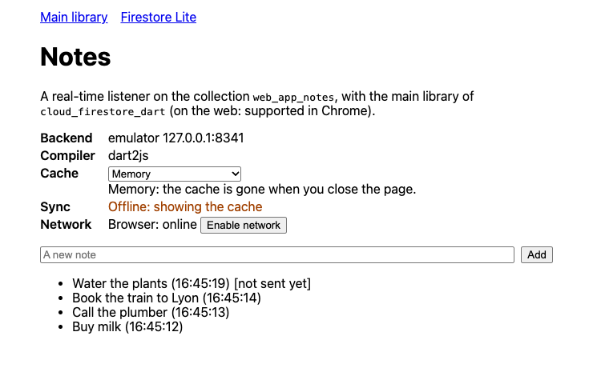
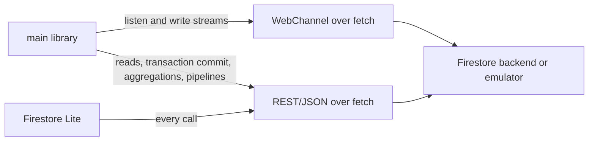
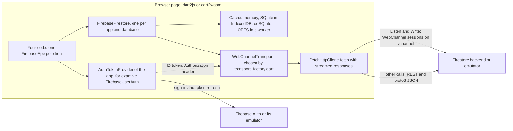
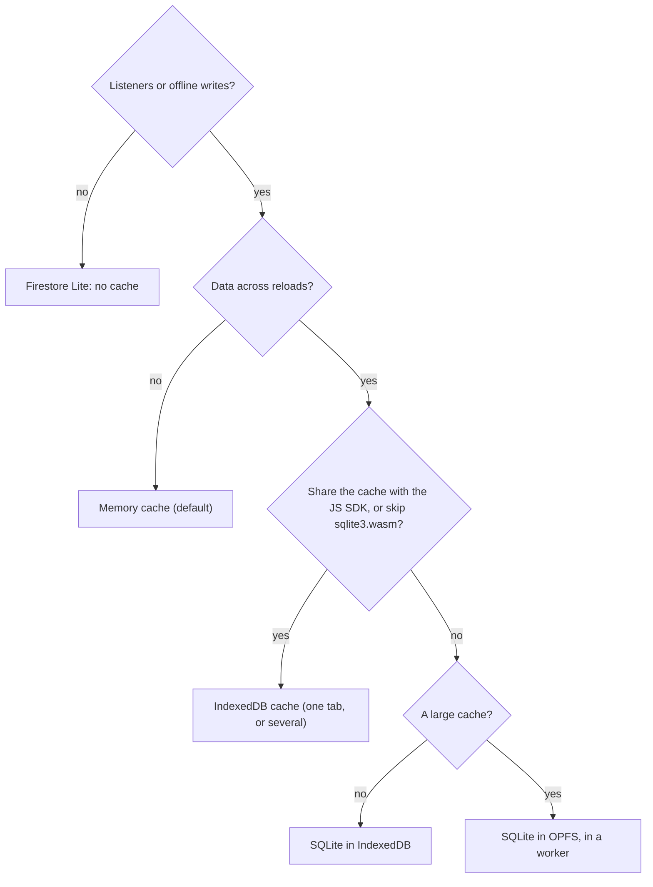

# The web

This page shows you how to use `cloud_firestore_dart` in a Dart web app or a Flutter web app:
connect, choose a cache, run several clients in one page, keep the bundle small, and pick a
compiler. It also lists what does not work in a browser yet.

**Web is supported in Chrome.** It is tested in Chrome, against the Firestore emulator
only. Firefox passed the browser test suite (dart2js and dart2wasm, 2026-11-21, not in CI); a Safari run (dart2js) had timeouts that are not explained yet; Edge is untested. [`examples/web_app/`](../../examples/web_app/) is a
complete app you can build and open in a browser, and
[`examples/flutter_web_two_users/`](../../examples/flutter_web_two_users/) a Flutter web page
with two signed-in users side by side.
[`examples/playground/`](../../examples/playground/) runs the client with its network disabled on a
memory cache, so you can try queries, writes and listeners in a page that needs no backend. This is its main page in headless Chrome with
the network turned off: look at the **Sync** line and at the note marked `[not sent yet]`.

<picture><source media="(prefers-color-scheme: dark)" srcset="../images/examples/web_app_offline_dark.png"></picture>

## A first page

The API is the same as on the Dart VM. Depend on `cloud_firestore_dart`, `firebase_app_dart` and
`web`, and compile with `dart compile wasm` (dart2wasm, the default; `dart compile js` is the
fallback, see [dart2wasm or dart2js](#dart2wasm-or-dart2js)):

```dart
import 'package:cloud_firestore_dart/cloud_firestore_dart.dart';
import 'package:firebase_app_dart/firebase_app_dart.dart';
import 'package:web/web.dart' as web;

void main() {
  final FirebaseApp app = FirebaseApp.withOptions(
    const FirebaseOptions(
      apiKey: 'demo-key',
      appId: '1:1234567890:web:example',
      projectId: 'demo-example',
    ),
  );
  final FirebaseFirestore firestore = FirebaseFirestore.instanceFor(
    app: app,
    settings: Settings().withEmulator('127.0.0.1', 8080),
  );

  final web.Element list = web.document.querySelector('#notes')!;
  firestore.collection('notes').snapshots().listen((
    QuerySnapshot<Map<String, Object?>> snapshot,
  ) {
    list.textContent = '';
    for (final QueryDocumentSnapshot<Map<String, Object?>> doc in snapshot.docs) {
      list.append(web.document.createElement('li')..textContent = '${doc.data()['text']}');
    }
  });
}
```

Without an `openDatabase` the cache is in memory: writes made offline are kept while the page is
open, and lost when it is closed. [Choosing a cache](#choosing-a-cache) shows how to keep it.

## A Flutter web app

The same packages work in a Flutter app built for the web, with `flutter build web --wasm` (dart2wasm,
which also writes a dart2js fallback) or `flutter build web` (dart2js only): there is no plugin, and the client picks the web
transport by itself. Create the app and the instance as in any Flutter app
([Flutter](flutter.md)); what differs is around them:

- Put `sqlite3.wasm` (and `sqlite_opfs_worker.js` for OPFS) in `web/`: `flutter build web` copies
  it next to the page. Pin `sqlite3` in `pubspec.yaml` to the version of that file; on Flutter
  3.44 pin `sqlite3: 3.3.4`, see [The `sqlite3` version](#the-sqlite3-version).
- `sqliteOpener()` takes no directory on the web: `sqliteOpener(directory: kIsWeb ? null : ...)`
  in an app that also builds for other platforms.
- Code that uses `dart:io` (`File`, `Directory`, `Platform`) compiles behind a conditional
  import but throws `Unsupported operation` when it runs in a page.
- Several clients in one page need one app name per client
  ([Several clients in one page](#several-clients-in-one-page)).
- Flutter's semantics tree (screen readers, and test automation that turns it on) changes how
  text fields are created; in a page with several `MaterialApp`s one report saw typing reach only
  one of them. A Flutter matter, not this package's.

[`examples/flutter_web_two_users`](../../examples/flutter_web_two_users/) is such an app: two
users signed in with `firebase_auth_providers_dart` against the Auth emulator, the rules telling
them apart, a memory or SQLite cache, and a `run.sh` that serves the build on another port than
the emulators. It was built with both compilers and driven in headless Chrome.

## What works and what does not

What works in Chrome, with both compilers: listeners, queries, writes and offline writes,
batches, transactions, aggregations, the memory cache, the persistent cache (SQLite compiled to
WebAssembly, in IndexedDB or OPFS), `disableNetwork()` / `enableNetwork()`, `clearPersistence()`,
emulator settings, Firebase Auth and App Check tokens of the `FirebaseApp`, and
[Firestore Lite](lite.md). The whole standard integration suite also passes over the web
transport (run on the Dart VM, not in a browser); see [Parity](../parity.md).

What does not, or was not tried:

| Item | Status |
| --- | --- |
| Browsers other than Chrome | Firefox passed the browser test suite (dart2js and dart2wasm, 2026-11-21, not in CI); a Safari run (dart2js) had timeouts that are not explained yet; Edge is untested. |
| The production backend from a browser | Not tested. The browser tests and the example ran against the emulator only. |
| A persistent cache in several tabs | Only the IndexedDB cache with `multiTab: true` (preview, Chrome only), see [Multi-tab mode](#multi-tab-mode-preview). The SQLite caches: one tab at a time, see [One tab at a time](#one-tab-at-a-time). |
| Integers above 2^53 with dart2js | Lose precision. Use dart2wasm if you store such integers. |
| More than about 10,000 documents in one query against the emulator | Fails with `unavailable` over WebChannel (an emulator limit). Read in pages. Production not checked. |
| `-Dprotobuf.omit_field_names=true`, `-Dprotobuf.omit_enum_names=true` | Not allowed: the web transport needs the names, and refuses to start without them. |
| `grpcFlowControlWindow` | Ignored: there is no gRPC in a browser. |

## Transports

Browsers have no sockets, so the client talks to Firestore the way the JS SDK does, over
`fetch`:

- **REST/JSON** for the calls that are not streams: the reads and the commit of a transaction,
  aggregations, pipelines, and every call of Firestore Lite.
- **WebChannel** for the listen and write streams of the main library. A stream is a session of
  HTTP requests: the client posts its messages, and reads the answers from a long-lived response
  (the back channel).

Which call takes which path, for the main library and for Lite:



The whole path of a request, from a page with one client per `FirebaseApp`:



The token goes through the client's credentials provider into the headers of each request, and
the cache is local to the client: nothing is shared between two clients of a page except the
browser's six connections per host.

The client picks this transport by itself when it is compiled for the web. It listens to the
`online` and `offline` events of the browser, and restarts its streams at once when the network
comes back instead of waiting for its backoff.

### Long polling

By default the back channel is a streamed response. Some proxies and antivirus programs hold a
response until it is complete; listeners and writes then never complete. Long polling avoids
this: each back channel request returns as soon as it has data, or after a timeout, and the
client sends the next one.

- `webExperimentalAutoDetectLongPolling` is on by default. When the first back channel response of
  a stream stays silent for 10 seconds, that stream switches to long polling. Every new stream
  detects again.
- `webExperimentalForceLongPolling: true` uses long polling from the start. Use it when you know
  the network needs it; it costs more requests. It cannot be combined with
  `webExperimentalAutoDetectLongPolling: true` (an `ArgumentError`).
- `webExperimentalLongPollingOptions` sets how long the backend may hold a long-polling request
  open. The default is the backend's, 30 seconds. If a proxy cuts requests sooner, ask for less
  (5 to 30 seconds; other values throw an `ArgumentError`):

```dart
final Settings settings = Settings(
  webExperimentalForceLongPolling: true,
  webExperimentalLongPollingOptions: const WebExperimentalLongPollingOptions(timeoutDuration: Duration(seconds: 25)),
);
```

The three settings are the ones of the JS SDK, with the same names. They are supported: the word
"Experimental" in the names comes from the JS SDK and is kept for compatibility with it and with
FlutterFire. They are ignored on the
Dart VM, which uses gRPC, and by Firestore Lite, which has no streams. The auto detection is in
the spirit of the JS SDK's, not a port of it.

## Choosing a cache

To pick a library and a cache, answer the questions from the top:



| Cache | How | When |
| --- | --- | --- |
| Memory (the default) | No `openDatabase` | Pages that do not need data across reloads. Smallest download. |
| SQLite in IndexedDB | `sqliteOpener()` | Small caches. SQLite runs in the page on a copy of the whole database in memory. |
| SQLite in OPFS | `sqliteOpener(opfsWorker: ...)` | Larger caches. SQLite runs in a worker and reads the file as it needs; memory stays at a few MB. |
| IndexedDB cache | `indexedDbCacheSettings()` of `indexeddb_cache.dart` | No `sqlite3.wasm`, no extra package, and the cache is the JS SDK's own database: an app can switch between the two SDKs, see [The IndexedDB cache](#the-indexeddb-cache). |

The persistent caches come from the companion package
[`cloud_firestore_dart_sqlite`](../../cloud_firestore/cloud_firestore_dart_sqlite/). Add it, and
let its setup command compile the OPFS worker into your web directory and print where to get the
`sqlite3.wasm` file of the `sqlite3` version you resolve (from the
[sqlite3.dart releases](https://github.com/simolus3/sqlite3.dart/releases)):

```sh
dart pub add cloud_firestore_dart_sqlite
dart run cloud_firestore_dart_sqlite:setup_web web
```

The worker is JavaScript also when the page itself uses dart2wasm. Run the command again when
`cloud_firestore_dart_sqlite` or `sqlite3` changes version.

```dart
import 'package:cloud_firestore_dart_sqlite/cloud_firestore_dart_sqlite.dart';

final FirebaseFirestore firestore = FirebaseFirestore.instanceFor(
  app: app,
  openDatabase: sqliteOpener(opfsWorker: Uri.parse('sqlite_opfs_worker.js')),
  settings: Settings(cacheSettings: PersistentCacheSettings()),
);
```

- OPFS needs no cross-origin isolation headers. A browser without synchronous OPFS access in
  workers falls back to IndexedDB, and the first OPFS open of a cache that is in IndexedDB moves
  it, pending writes included.
- With IndexedDB, 100,000 cached documents of about 1 KB take about 1 s to open and 130 MB of
  memory; with OPFS under 0.2 s and a few MB. Reads cost about the same with both. The default
  size limit of 100 MB removes unused documents before that.
- The cache holds every document the page read, in clear text, readable by every script of the
  origin. `clearPersistence()` deletes it; call it when a user signs out of a shared computer.
- **The IndexedDB database names** (and the OPFS directory names): one per app and database,
  `<storagePrefix>/firestore.<app name>.<project id>.<database id>`, each part URL-encoded, with the
  default prefix `cloud_firestore_dart`. The default app and database of the project `my-project`:
  `cloud_firestore_dart/firestore.%5BDEFAULT%5D.my-project.%28default%29`. A page with a memory
  cache creates none. Before its first IndexedDB open a page also creates and deletes
  `cloud_firestore_dart/sqlite3-flush-probe-<n>` (see the next section).

### The `sqlite3` version

Two rules, both checked when the cache opens (`cloud_firestore_dart_sqlite` 0.1.2 and later), both
failing with a `SqliteWebSetupException` whose message says what to change:

- **`sqlite3.wasm` must be the build of the exact `sqlite3` version in your `pubspec.lock`.** A
  2.x file with a 3.x package, or the reverse, cannot be loaded (`wasmVersionMismatch`); a missing
  file, or the page a server sends instead of it, is `wasmMissing`. Pin `sqlite3` in your
  `pubspec.yaml` so that `pub upgrade` does not move it away from the file you serve.
- **Not `sqlite3` 3.4.0 to 3.5.2 with the IndexedDB storage** (`unsafeSqlite3`): their IndexedDB
  file system can lose a write the cache acknowledged when the tab closes a moment later. A
  Flutter app on Flutter 3.44 resolves 3.5.2 (Flutter pins `meta` 1.18, `sqlite3` 3.6.0 needs
  1.19): pin `sqlite3: 3.3.4` (or `^2.7.3`) there, `^3.6.0` on an SDK that allows `meta` 1.19, or
  use OPFS. `sqliteOpener(acceptIndexedDbWriteLoss: true)` opens anyway.

`openWithMemoryFallback` does not hide either error behind a memory cache. The
[README of `cloud_firestore_dart_sqlite`](../../cloud_firestore/cloud_firestore_dart_sqlite/README.md#which-sqlite3)
has the table of versions.

[Offline persistence on the web](offline_persistence.md#on-the-web) has the crash safety, and
[Platforms](platforms.md#the-web-supported-in-chrome) the full measurements.

## One tab at a time

With the SQLite caches, a Web Lock guards each persistent cache. (The IndexedDB cache has a
[multi-tab mode](#multi-tab-mode-preview).) A second tab (or a second instance in the same page)
that opens the same cache waits two seconds for the lock, then its operations fail with a
`FirestoreException` whose code is `failedPrecondition`. `FirebaseFirestore.instanceFor` returns at once,
so the error comes with the first operation. `openWithMemoryFallback` of
`cloud_firestore_dart_sqlite` waits for a first cache-only operation and falls back to a memory
cache:

```dart
import 'package:cloud_firestore_dart_sqlite/cloud_firestore_dart_sqlite.dart';

final FirebaseFirestore firestore = await openWithMemoryFallback(
  app: app,
  openDatabase: sqliteOpener(),
  settings: Settings(cacheSettings: PersistentCacheSettings()),
);
// Null with a memory cache: this tab did not get the persistent one.
final bool persistent = firestore.persistentCacheIndexManager != null;
```

Tabs of a SQLite cache do not share listeners or writes. Because the lock is
released when a page goes away, a reloaded page knows the page before it is gone, and sends the
writes it left pending at once. [Several clients on one cache](multiple_clients.md) has the
details.

## Switching from the official JS SDK

A web app that used the official Firebase JS SDK with persistence (directly, or
through FlutterFire on the web) has its cache in an IndexedDB database of its own,
`firestore/[DEFAULT]/<project id>/main`. This SDK does not read that database, but
`importJsSdkCache` copies it into this SDK's cache, once, so that the writes the old version of
the app left pending are not lost when the new version starts on the same browser profile:

```dart
import 'package:cloud_firestore_dart_sqlite/cloud_firestore_dart_sqlite.dart';

final FirebaseFirestore firestore = FirebaseFirestore.instanceFor(
  app: app,
  openDatabase: sqliteOpener(),
  settings: Settings(cacheSettings: PersistentCacheSettings()),
);
// At every start, before the first write.
try {
  final JsSdkCacheImportResult result = await importJsSdkCache(firestore);
  print('${result.status.name}: ${result.batches} pending writes of '
      '${result.users} users, ${result.documents} documents');
} on JsSdkCacheImportException catch (e) {
  // Nothing was imported; the next start tries again.
  print('Not imported (${e.reason.name}): ${e.message}');
}
```

What is carried over:

- **The pending writes of every user** (not only the signed-in one), in their order and with their
  local write times. The app's local reads include them at once, and they are sent when the client
  is online. Each one is then removed from the JS database. A write the JS SDK had sent but whose
  acknowledgement it never received is sent again, as the JS SDK itself would have done.
- **The cached documents** (unless `includeDocuments: false`), with their versions and read times,
  the first time only, so that the first start offline still shows data. A document this cache
  holds in a newer version is kept.

What is not: targets, resume tokens, the index configuration, bundles and named queries.
Listeners read their results from the backend again, as on a first start.

How it behaves:

- **Call it at every start, right after creating the instance and before any write.** It runs on
  the client's queue like every operation. It refuses (`pendingWritesInCache`) when this cache
  already holds pending writes of a user who also has some in the JS database: the JS writes are
  older and would be sent after the newer ones. When there is nothing left to import it costs one
  IndexedDB open; when there is no JS database it returns `noJsDatabase`; off the web it returns
  `notOnWeb`.
- **Exactly once.** The cache records what it imported in the transaction that adds the writes,
  and the next call finishes their removal from the JS database if the page closed in between. A
  crash at any point loses no pending write and imports none twice.
- **A persistent cache, or an explicit opt-in.** A memory cache would lose the imported writes at
  the next reload, while the JS database no longer has them. With a memory cache the import
  refuses (`memoryCache`) when the JS database has pending writes, unless you pass
  `allowMemoryCache: true`; documents alone are imported without it.
- **The JS database is never deleted.** `deleteJsSdkCache(firestore)` deletes it when the app is
  sure it no longer needs it; it refuses while the database holds writes that were not imported
  (unless `discardPendingWrites: true`).
- **Schema versions 5 to 18** of the JS database are read (the pending writes have the same shape
  since version 5); the cached documents from version 13 on. A database written by a newer JS SDK
  is refused (`unsupportedSchemaVersion`).

**Destinations.** The SQLite cache (in IndexedDB or in OPFS), the key-value cache
(`keyValueCacheSettings`) and the memory cache (with `allowMemoryCache`) take the import. So does
the IndexedDB cache (`indexedDbCacheSettings()`) of an app whose name differs from the JS app's
(pass `jsAppName`); on an instance whose IndexedDB cache *is* the JS database (same app name) there
is nothing to import (`nothingToImport`) and `deleteJsSdkCache` deletes nothing, because that
cache already reads the JS SDK's writes as its own. Two known faults of the IndexedDB cache's own
storage apply to imported writes as to any other: it can not read back an empty `Bytes` value, and
with dart2js it stores a timestamp less than half a millisecond before a whole second one second
late.

**No JS tab may be open.** A JS tab and a page of this SDK can not share the cache: the import
refuses (`jsClientActive`) while the JS SDK's primary lease is less than 5 seconds old, or while
one of its clients refreshed its metadata less than 30 minutes ago and did not mark itself as
closed (the JS SDK's own windows). A JS tab that closes normally marks itself; one that crashed
counts as open for 30 minutes. Deploy the new version so that no tab keeps running the old one
(a service worker that serves the old bundle, for example), and after the switch do not open the
old version again on the same profile: its writes would land in the JS database and wait for the
next import. The check reads the rows the JS SDK keeps for that (its `owner` lease and its
`clientMetadata`) and the `firestore_zombie_...` key it sets in LocalStorage when a page goes away;
it can not see a JS tab of another browser profile, which has its own database anyway.

What is tested (`test/browser/web_js_sdk_cache_import_*_test.dart`, Chrome, dart2wasm and dart2js,
against the emulator):

- **The same backend result as the JS SDK.** The fixtures are databases the real JS SDK (13.3.0,
  schema 18) wrote offline (`tool/bench/web_idb/js_import/fixtures.sh`); the generator also sends
  the same writes with the JS SDK itself, and the tests compare the backend after the import with
  that, document by document: `set`, `set` with `merge` and `mergeFields`, `update` with nested
  and dotted field paths and `deleteField`, `delete`, every transform (`serverTimestamp`,
  `increment` of integers and doubles, `arrayUnion`, `arrayRemove`), batches, updates of missing
  documents (rejected, as with the JS SDK, a failing batch as a whole), subcollections, and every
  value type (bytes, geopoint, reference, timestamp, vector, nested maps and arrays, NaN,
  infinities, the largest safe integers).
- **Users.** Writes of two signed-in users and the signed-out user, interleaved, are each sent
  only while that user is signed in, in their order; against rules that check `request.auth`
  too.
- **Every schema version from 5 to 18** (versions 5 to 17 built by hand from the history of the
  JS schema), rows of older JS SDKs (a transform stored as its own write), 64-bit integers (with
  dart2wasm; with dart2js an integer outside ±2^53 is rounded, as everywhere on the web, but the JS
  SDK never writes one).
  Versions below 5 and above 18 are refused and the database is left as it was.
- **Exactly once.** The import stopped at every step of its protocol and run again after a
  reload (a new client on the same cache) sends every write once; the removal from the JS database is all or nothing; a JS
  database deleted or made again in between loses nothing and is not touched wrongly.
- **Every destination** above, and **size**: 5,000 pending writes and 20,000 documents import in
  9 to 12 seconds into the SQLite cache in headless Chrome on an Apple laptop (the JS heap peaks at
  about 600 MB with dart2wasm, 350 MB with dart2js), and the 5,000 writes then reach the emulator
  in about a minute. The documents go 2,000 at a time; the pending writes go in one transaction,
  which is what makes the import all or nothing.

What it does not do, by design: it does not import targets, resume tokens, cache indexes or
bundles; it does not read a database of schema version 19 or later (a JS SDK newer than this
SDK knows); it can not take writes queued after a write of this SDK for the same user
(`pendingWritesInCache`); and a write imported into a memory cache is lost if the page closes
before the backend acknowledged it.

## Several clients in one page

A page can hold several whole clients, each with its own `FirebaseApp`, user and
`FirebaseFirestore`: a support tool that shows two accounts, a test page, a demo of what two users
see. They share nothing but the page.

- **Name each app after the client, not after the user.** App names are global in the page: two
  clients of the same user named after the user collide (`FirebaseApp name ... already exists`).
  The app name also names the client's cache database, so two clients with different names never
  compete for one cache.
- Each app has its own token provider (`FirebaseUserAuth.forApp(app)` stores its session under the
  app name), and each client refreshes its own token.
- Against the emulator, which speaks HTTP/1.1, every client holds up to two long requests:
  Chrome's six connections per host are shared by all of them (see below).

```dart
import 'package:firebase_auth_providers_dart/firebase_auth_providers_dart.dart';

// One client of the page: `client` names its app ('client-left', 'client-right').
Future<FirebaseFirestore> startClient(String client, String email) async {
  final FirebaseApp clientApp = FirebaseApp.withOptions(app.options, name: client);
  final FirebaseUserAuth auth = await FirebaseUserAuth.forApp(clientApp);
  await auth.signInWithEmailAndPassword(email: email, password: password);
  return FirebaseFirestore.instanceFor(app: clientApp);
}
```

## CORS and the emulator

Your page and the backend are on different origins (for example `http://localhost:8000` and
`http://127.0.0.1:8080`), so every request is a cross-origin request. The emulator answers them
for any origin (`Access-Control-Allow-Origin` echoes the page's origin), so nothing needs to be
set up. Against production the requests go to `firestore.googleapis.com` from your page's
origin, as those of the JS SDK do; this was not tried with this client.

**Your own endpoints need CORS too.** Google's endpoints and the emulators answer cross-origin
requests; a server of your own that the page calls next to Firestore (a function, an API, a
proxy) must answer them as well, for the page's origin, the `OPTIONS` preflight included.
Otherwise the browser blocks the request before your code sees a response. In development a
loopback proxy that adds the headers for the page's origin is enough.

Connect to the emulator with `withEmulator`, which also turns TLS off:

```dart
final Settings settings = Settings().withEmulator('127.0.0.1', 8080);
```

Two things about the emulator that only show in a browser:

- **Six connections.** The emulator speaks HTTP/1.1, and Chrome allows six connections per host,
  shared by all tabs. Each page with a listener holds up to two long requests (listen and write)
  plus its one-shot calls. With several tabs open against the same emulator, requests can wait
  in the browser and time out. The production backend speaks HTTP/2, where this limit does not
  apply (not verified).
- **Threads.** The emulator starts a thread for every WebChannel session and does not end it.
  After many page loads it slows down and finally stops answering; restart it.

`tool/README.md` in the repository has the measurements behind both.

## Bundle size and Firestore Lite

Measured with Dart 3.12.2 and `dart compile js -O2`, gzipped:

| Program | JavaScript | gzipped |
| --- | ---: | ---: |
| A small app with [Firestore Lite](lite.md) | 416 KB | 128 KB |
| The same app with the main library, memory cache | 641 KB | 196 KB |
| [`examples/web_app`](../../examples/web_app/), Lite page | 398 KB | 122 KB |
| [`examples/web_app`](../../examples/web_app/), main page with the SQLite opener | 924 KB | 273 KB |
| `sqlite_opfs_worker.js` (`sqlite3` 2.9.4, as in the example app; 174 KB and 54 KB with 3.9.1) | 185 KB | 58 KB |
| `sqlite3.wasm` (loaded only when a persistent cache opens) | 759 KB | 364 KB |

Use Lite when a page only reads and writes:

```dart lite
import 'package:cloud_firestore_dart/lite.dart';

final FirebaseFirestore firestore = FirebaseFirestore.instanceFor(app: app);
final QuerySnapshot<Map<String, Object?>> notes =
    await firestore.collection('notes').limit(20).get();
```

Lite has no cache, no listeners and no offline writes: every call is one REST request, and a
write fails with `unavailable` without a connection. A program that only imports `lite.dart`
contains no sync engine, local store, SQLite layer or WebChannel. The two libraries declare
classes with the same names; import one of them with a prefix if a file needs both.

## dart2wasm or dart2js

Build with dart2wasm first, and keep dart2js as the fallback. A page that loads the dart2wasm
build and falls back to dart2js is what [`examples/web_app/`](../../examples/web_app/) and
[`examples/playground/`](../../examples/playground/) do (`web/bootstrap.js`, the same file in
both). [Build and serve a web app](cookbook.md#build-and-serve-a-web-app-with-dart2wasm) in the
cookbook has the commands.

| | dart2wasm (`dart compile wasm`) | dart2js (`dart compile js`) |
| --- | --- | --- |
| Integers | 64 bits | 53 bits: larger integers lose precision |
| Browsers | Needs WebAssembly garbage collection (recent Chrome, Firefox, Safari) | Every current browser |
| Tested | Chrome, 56 pass, 1 skipped (a crash test of the IndexedDB cache) | Chrome, 56 browser tests pass, 1 skipped (64-bit integers) |
| Example app, main page | 915 KB `.wasm` + 29 KB `.mjs` (342 KB + 6 KB gzipped) | 924 KB (273 KB gzipped) |
| Example app, Lite page | 341 KB `.wasm` + 16 KB `.mjs` (136 KB + 4 KB gzipped) | 398 KB (122 KB gzipped) |

Use dart2js when the browser has no WebAssembly garbage collection, or when a dependency of
your app does not compile to wasm. Three things to know:

- Under dart2js shifts are 32-bit: `1 << 32` is `0`, so `Random.secure().nextInt(1 << 32)`, valid
  on the VM, throws a `RangeError` (`max must be in range 0 < max ≤ 2^32, was 0`). Write
  `0x100000000`, or ask for a smaller range. Code shared with the VM is worth a search for such
  expressions.
- `dart compile wasm` writes a `.wasm` and an `.mjs` file, and your page has to load them; see
  `web/bootstrap.js` of the example. The server must send `.wasm` as `application/wasm`, and a
  Content-Security-Policy needs `'wasm-unsafe-eval'` in `script-src`. The OPFS worker stays
  JavaScript.
- The `sqlite3` package calls its dart2wasm support experimental. The persistent caches pass
  the browser tests with both compilers, and the opener works around a slowness of
  `sqlite3` 2.9.4 under dart2wasm, fixed in `sqlite3` 3.8 (see [Platforms](platforms.md#the-web-supported-in-chrome)); the
  crash test of the IndexedDB storage runs with dart2js only.

## The IndexedDB cache

A third persistent cache that stores the cache in IndexedDB in the database and format
of the official Firebase JS SDK (`firestore/<app>/<project>[.<database>]/main`, schema version 18),
without SQLite. It is a library of its own, so pass its settings and nothing else:

```dart
import 'package:cloud_firestore_dart/cloud_firestore_dart.dart';
import 'package:cloud_firestore_dart/indexeddb_cache.dart';

final FirebaseFirestore firestore = FirebaseFirestore.instanceFor(
  app: app,
  settings: Settings(
    cacheSettings: indexedDbCacheSettings(
      sizeBytes: 40 * 1024 * 1024,
      indexAutoCreation: true,
    ),
  ),
);
```

`sizeBytes`, `indexAutoCreation`, `indexBackfill` and `mergeUnsentWrites` are those of
`PersistentCacheSettings`; there is no `openDatabase` and no `cloud_firestore_dart_sqlite`.

Why use it:

- **No `sqlite3.wasm`** (759 KB, 364 KB gzipped) and no extra package to add and keep in step.
- **Both ways with the JS SDK.** An app can switch between the official JS SDK (or FlutterFire on the
  web) and this SDK on the same browser profile, in either direction, one after the other. The
  documents, the pending writes of every user, the cache indexes, bundles and named queries are
  carried over because both SDKs read and write the same database: there is no import step.
  [`importJsSdkCache`](#switching-from-the-official-js-sdk) goes one way only (JS to this SDK), into
  another cache, and carries over the pending writes and the documents, not the indexes or bundles.
  On an instance whose IndexedDB cache is the JS database itself it, and `deleteJsSdkCache`, do
  nothing.

Several tabs can share it: see [Multi-tab mode](#multi-tab-mode-preview) below.

What it costs: about 121 KB more JavaScript (about 34 KB gzipped, dart2js `-O2`, against the same small
app with the memory cache), only in an app that imports `indexeddb_cache.dart`; an app that does not
carries none of it.

How fast it is: [section 8 of the spike](../spikes/indexeddb_cache.md#8-the-engine-against-the-sqlite-caches-reads-over-a-large-cache-added-2026-11-18)
has the numbers against both SQLite caches. In short, it opens fastest and grows least with the size of
the cache (62 to 80 ms against 145 to 311 ms for SQLite in IndexedDB at 20,000 documents). Whole
collection and limit queries take about the same time, and filtered reads are slower: `group == x`
1.5 to 3 times, a collection group 1.4 to 2.3 times, and large batches of writes 1.1 to 1.6 times. That
measurement was taken on an earlier version of the engine, without the index manager or garbage
collection, and with every document a pending write; it was not repeated with a cache filled from the
backend or with field indexes.

Limits:

- **One tab at a time by default, and no JS SDK tab beside it.** (With `multiTab: true` several tabs
  share the cache, see [Multi-tab mode](#multi-tab-mode-preview); a JS SDK tab beside it was not
  tried.) The engine takes the JS SDK's primary lease. While
  another client (a tab of the JS SDK, or another instance of this SDK) holds a live lease, it refuses to
  open and its operations fail with `failedPrecondition`. If another client takes the lease while this
  one is in the background (its lease lapsed), the instance stops at its next transaction or lease
  refresh: it writes nothing more, its listeners get a `failedPrecondition` error that says it lost the
  primary lease, and every later call throws that error. Create a new instance; it reads the cache again
  (what the other client changed included). Close the old version of the app before the new one starts,
  as in [One tab at a time](#one-tab-at-a-time).
- **Schema version 18 only.** A JS database of an older version is refused (open the app once with a
  JS SDK that upgrades it, or clear the cache), and so is a newer one; the error names the version and
  the database is left as it is. A new database is created as the JS SDK creates it. The format
  belongs to the JS SDK: a new JS schema version needs a new release of this package, which then
  migrates or opens it.
- **Queries by a map value do not use a cache index.** The JS SDK's index entry of a map follows the
  order in which the app wrote its keys; this SDK writes maps in one sorted order. So a query whose
  filter (or cursor) value holds a map of two or more keys is not served from a cache index: it reads
  the collection, and finds the documents whatever order their keys were written in. Queries on the
  fields inside a map use indexes as usual. Left: `orderBy` on a map field with a `limit`, served from
  an index that the JS SDK filled for maps written in unsorted key order, can order those maps
  differently from the query (the JS SDK has the same dependence on its own).
- **Web only.** `indexedDbCacheSettings()` throws `UnsupportedError` on the Dart VM and in Flutter on
  other platforms.

How it is tested, in Chrome with dart2js and dart2wasm against the emulator:

- The persistence suites of the SQLite, memory and key-value caches run on it
  (`test/browser/web_indexeddb_*_test.dart`, about 600 tests): the mutation queue, remote documents,
  targets, overlays, bundles, globals, the index managers, the local store, garbage collection, the
  query engine and the index backfiller, and the upstream spec tests with restarts (the multi-client
  specs are skipped there). The numbers, and what running them fixed, are in
  [section 9 of the spike](../spikes/indexeddb_cache.md#9-verification-of-the-engine-added-2026-11-20).
- `tool/bench/web_idb/js_import/interop_check.sh` runs the official JS SDK (`firebase` 12.19.0 from
  npm) and this engine on one database in headless Chrome, both ways: documents, pending writes of
  two users, indexes, bundles and garbage collection from each SDK to the other, the lease handover,
  and index entries per value kind. CI runs it when the engine changes.

Not checked: Firefox and Safari (the engine's speed was measured in both, see the spike, but not
its tests or the interop), and the production backend.

## Multi-tab mode (preview)

New in 0.3.2. It is a *preview*: the API may change in any release (see the
[package README](../../cloud_firestore/cloud_firestore_dart/README.md)).

`indexedDbCacheSettings(multiTab: true)` lets several tabs of an app open one IndexedDB cache:

```dart
final FirebaseFirestore firestore = FirebaseFirestore.instanceFor(
  app: app,
  settings: Settings(cacheSettings: indexedDbCacheSettings(multiTab: true)),
);
```

How it works:

- One tab is the *primary* and uses the network. The other tabs are *secondary*: their listeners get
  their results, and their writes are acknowledged, through the primary.
- When the primary closes, or its lease lapses, another tab takes over. The lease lasts 5 s and the
  primary refreshes it every 4 s.
- A visible tab takes the lease from a primary that is hidden (a background tab), as in the JS SDK.
  The hidden tab becomes a secondary and keeps working.
- The lease, the rows and the `localStorage` keys are those of `persistentMultipleTabManager` of the
  JS SDK.

Limits:

- It is off by default. A one-tab instance and a multi-tab instance on the same cache refuse each
  other, as in the JS SDK.
- It needs `window.localStorage`. Without it (a worker, or blocked storage) the instance fails at
  start with `unimplemented`.
- Only the IndexedDB cache. The SQLite caches (IndexedDB, OPFS) stay at one tab. On the Dart VM,
  clients on one SQLite file still do not share state through the public API.
- Tested in Chrome, with dart2js and dart2wasm against the emulator (the same tests passed in Firefox on 2026-11-21). The automated tests run
  in headless Chrome, where no tab is hidden.
- Tried on 2026-11-20 in a visible Chrome 157 window on macOS with two tabs of the
  [web example](../../examples/web_app), seven runs (three dart2wasm, four dart2js), driven by a
  script and not part of the automated tests. A write from each tab reached the other. The visible
  secondary took the lease from the hidden primary after 12 s to 36 s. When the visible primary
  closed, the hidden tab took over within 13 s (at once in three runs). A third tab joined as a
  secondary and had every note. In one more dart2js run the visible tab stopped answering the
  script while the lease moved; that did not happen again and its cause is not known.

Two differences from the JS SDK:

- A secondary takes the lease at once when it hears a closing tab remove its state. The JS SDK waits
  for its next refresh.
- A page restored from the back/forward cache comes back with a terminated client.

Not done (not tested):

- A JS SDK tab that shares the cache with a tab of this SDK.
- A tab hidden for more than a few minutes, when Chrome slows its timers to one a minute, and a
  minimised or occluded window.
- Different users signed in in the tabs.
- Browsers other than Chrome.

## Known gaps

- Chrome only; production untested from a browser.
- One tab per persistent cache, except the IndexedDB cache with `multiTab: true` (preview); no
  sharing of listeners or writes between tabs of a SQLite cache, and no cache in a shared worker.
- A crash of the browser itself or a power cut is not covered by the crash tests of the
  persistent caches (a tab that dies is).
- The SQLite caches are in the separate package `cloud_firestore_dart_sqlite` (0.1), not in
  `cloud_firestore_dart`; the [IndexedDB cache](#the-indexeddb-cache) is in
  `cloud_firestore_dart`.
- Against the emulator: queries of more than about 10,000 documents fail, and the six-connection
  limit of HTTP/1.1 applies.
- dart2js (the fallback build): integers above 2^53 lose precision.
