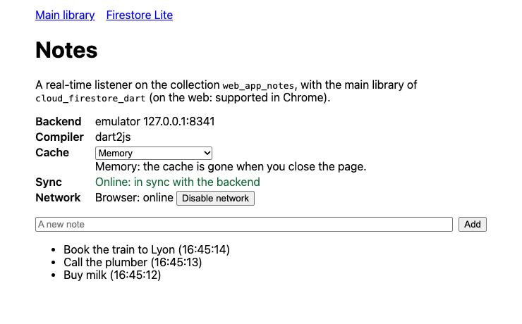

# Figures

The `.svg` files in this folder are written by hand: real text, a `viewBox`, `<title>` and
`<desc>`, the system font stack, no scripts and no external references. The `.png` files are
screenshots of real apps: see [Screenshots](#screenshots).

## Light and dark

Each figure is one file that draws itself in the reader's colour scheme. A `<style
id="figure-theme">` block right after `<desc>` holds the palette as CSS variables, the same names
and values in every file, with a second set inside `@media (prefers-color-scheme: dark)`. Below
the variables, one rule per colour the figure uses maps the colour to a variable:

```css
[fill="#1f2328"] { fill: var(--fig-fg); }
[stroke="#d0d7de"] { stroke: var(--fig-border); }
```

The shapes keep the light colours as plain `fill` and `stroke` attributes. A viewer that ignores
CSS (some previews, some converters) still draws the light figure, which is the same picture as
the light mode in a browser.

Where a figure shows up:

- GitHub. GitHub sets the CSS `color-scheme` of the page from the theme picked in the reader's
  settings, and Chrome evaluates `prefers-color-scheme` inside an SVG shown through `` against
  that `color-scheme` (checked with Chrome 157). So the figure follows the GitHub theme, not only
  the OS. A browser that uses the OS setting instead shows the figure in the OS scheme, which is
  readable either way. The Markdown needs no `<picture>` element.
- pub.dev. Its light/dark switch only changes a class on the page and does not set
  `color-scheme`, so the figure follows the OS or browser setting. When the two disagree, the
  figure is a dark card on a light page or a light card on a dark page: still readable, because
  every figure draws its own background.
- Local Markdown previews, IDEs and Quick Look: the OS setting, or the light figure without CSS.

## Palette

| Variable | Light | Dark | Used for |
| --- | --- | --- | --- |
| `--fig-bg` | `#ffffff` | `#0d1117` | figure background (always drawn, never transparent) |
| `--fig-panel` | `#f6f8fa` | `#151b23` | boxes, table stripes |
| `--fig-panel-strong` | `#eaeef2` | `#212830` | the backend box |
| `--fig-border` | `#d0d7de` | `#3d444d` | frame, box borders, chart gridlines |
| `--fig-grid` | `#eaeef2` | `#2a313c` | timeline tracks |
| `--fig-fg` | `#1f2328` | `#f0f6fc` | text, strong lines |
| `--fig-fg-muted` | `#57606a` | `#9198a1` | secondary text, arrows |
| `--fig-faint` | `#818b98` | `#7d8590` | "not applicable" marks, light rules |
| `--fig-bar` | `#6e7781` | `#6e7781` | neutral bars that carry a white label |
| `--fig-on-bar` | `#ffffff` | `#ffffff` | the label inside such a bar (`text[fill="#ffffff"]`) |
| `--fig-on-accent` | `#ffffff` | `#0d1117` | check or cross inside a coloured circle (`stroke="#ffffff"`) |
| `--fig-accent` / `-bg` | `#0969da` / `#ddf4ff` | `#4493f8` / `#12294a` | the SDK's own code, highlights |
| `--fig-success` / `-bg` | `#1a7f37` / `#dafbe1` | `#3fb950` / `#132a1c` | works, supported |
| `--fig-danger` | `#cf222e` | `#f85149` | fails, not supported |
| `--fig-attention` | `#9a6700` | `#d29922` | partial, warnings |
| `--fig-severe` / `-bg` | `#bc4c00` / `#fff1e5` | `#db6d28` / `#2b1c12` | network layer, fakes |
| `--fig-done` / `-bg` | `#8250df` / `#fbefff` | `#ab7df8` / `#231c38` | event and sync layer |

The light values are GitHub's Primer light colours, the dark ones its dark theme, so a figure sits
on a GitHub page (`#0d1117`, or `#212830` in dark dimmed) like the page's own boxes.

## Rules for a new or changed figure

- Draw only with the colours in the table, as `fill`/`stroke` attributes, and copy the
  `figure-theme` block from a figure that uses the same colours (add a mapping rule for any colour
  the block does not map yet).
- Start with a background `<rect>` over the whole `viewBox` with `fill="#ffffff"`.
- Never carry meaning by colour alone: a label, an icon or the line style (solid, dashed) says it
  too, and a chart keeps its legend.
- Text on a coloured shape needs its own role (as `--fig-on-bar` and `--fig-on-accent` do), since
  `#ffffff` otherwise means the background.
- Reference figures with a plain `` image. READMEs that pub.dev shows use the absolute
  `https://raw.githubusercontent.com/long1eu/firebase_dart_sdk/main/docs/images/...` URL.

## Screenshots

A screenshot of an app comes as two captures of the same state at the same size: a light one,
`<name>.png`, and a dark one, `<name>_dark.png` (the playground: `playground-desktop-light.png`
and `playground-desktop-dark.png`). The dark one shows the app's own dark theme (Flutter's
`darkTheme`, or the page's `prefers-color-scheme` CSS), never a colour filter of the browser such
as `--force-dark-mode`. The Markdown shows the pair with a `<picture>` element, which GitHub
switches with the reader's theme:

```html
<picture><source media="(prefers-color-scheme: dark)" srcset="examples/web_app_online_dark.png"></picture>
```

A viewer without `<picture>` support shows the light capture. Each example's README says how its
screenshots were taken. Web pages: headless Chrome with
`--blink-settings=preferredColorScheme=0` for the dark capture (`=1` for light). The macOS app:
the system in dark appearance, `screencapture -o -l <window id>`.

## Checks

- `dart tool/check_figures.dart` from the repository root: every figure has the same palette,
  every colour it draws with is mapped, no scripts or external references, and the text colours
  reach 4.5:1 (marks and bars 3:1) on their backgrounds in both modes.
- Look at it in both modes through ``, as GitHub shows it: a page with
  `<html style="color-scheme:dark">`, a `#0d1117` background and ``,
  screenshotted with headless Chrome
  (`--headless=new --blink-settings=preferredColorScheme=0 --screenshot=out.png`; `=1` for light).
  `qlmanage -t -s 900 figure.svg` shows the Quick Look rendering in the current macOS appearance.
