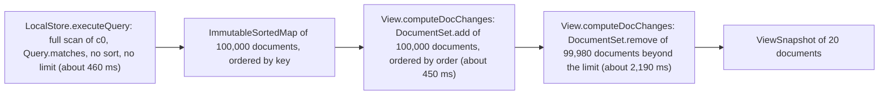

# Spike: where the time of a cache read goes

> **Status.** Measured on 2026-11-19 on branch `wave/cache-read-profile` (from `origin/main` at 47e4ef05). The tool is
> `tool/bench/cache_read_profile_bench.dart`. The four fixes of "After the fixes" below were then made on the same
> branch; the tables keep the measurement before them and add an "after" column (same machine, same method).

## After the fixes

The hot spots named below were fixed in four commits, each measured with the bench (ahead of time compiled, medians;
the "before" column is a new run of the original code on the same day, files and machine, 7 runs; "after" is 15 runs).
Totals, milliseconds (a: microseconds per document):

| Case | acked before | acked after | pending before | pending after |
| --- | ---: | ---: | ---: | ---: |
| a. one document by key (us) | 11.8 | 8.0 | 8.8 | 6.4 |
| b. whole collection | 742.2 | 401.0 | 885.0 | 486.2 |
| c. `a == 7`, no index | 195.3 | 170.2 | 406.0 | 396.5 |
| d. `orderBy(order desc).limit(20)`, no index | 2,714.3 | 370.6 | 3,348.2 | 432.8 |
| e. `a == 7`, index | 7.7 | 5.3 | 8.3 | 6.4 |
| e. `order desc, limit 20`, index | 0.414 | 0.331 | 0.301 | 0.217 |

After each step (7 runs each, so a few percent of noise between columns):

| Case, acked / pending | before | 1. limit first | 2. bulk build | 3. key from row | 4. statement cache |
| --- | ---: | ---: | ---: | ---: | ---: |
| a. one document (us) | 11.8 / 8.8 | 12.1 / 8.6 | 12.0 / 8.7 | 11.4 / 8.3 | 8.0 / 6.4 |
| b. whole collection | 742 / 885 | 729 / 874 | 447 / 481 | 402 / 478 | 401 / 486 |
| c. `a == 7` | 195 / 406 | 196 / 396 | 193 / 388 | 171 / 384 | 170 / 397 |
| d. `orderBy.limit(20)` | 2,714 / 3,348 | 468 / 512 | 416 / 413 | 374 / 411 | 371 / 433 |

1. **Limit first** (`View.computeDocChanges`, `DocumentSet.remove`, `OrderBy`, `BasePath.==`). The first snapshot of
   a limit query selects the documents within the limit with a bounded heap (in the order of the document set) and
   adds only those, instead of adding all 100,000 and removing 99,980 one at a time; the changes, mutated keys and
   documents awaiting a sync come out as before. `DocumentSet.remove` no longer removes twice, `OrderBy` decides once
   whether it orders by key, and `BasePath.==` compares the segments directly.
2. **Bulk build** (`DocumentSet.addAll`, `ImmutableSortedMap.fromSortedLists`, `ImmutableSortedSet.fromSortedList`,
   `RBTreeSortedMap.fromMap`, `View.applyChanges`, `LocalDocumentsView`). The first snapshot builds the two trees of
   the `DocumentSet` and the mutated keys in linear time from sorted lists (input already in order is not sorted again);
   `applyChanges` does not sort changes that are already in order; `fromMap` reads the entries once instead of looking
   every key up; a collection with at least as many overlays as matching cached documents merges them at once.
3. **Key from the row** (`SQLiteRemoteDocumentCache`, `LocalSerializer.decodeMaybeDocument`). A scan builds the key
   from the collection and the id at the end of the `path` column; a read by key uses the key it was asked for. The
   overlays of a collection scan still parse their name: passing the key there needed one more column and gained 5 % of
   `a == 7` on pending writes, so it was left out; the read of one overlay by key passes it.
4. **Statement cache** (`SqliteDatabase` of `cloud_firestore_dart_sqlite`, Dart VM and Flutter only; the web adapter is
   a different class). The prepared statements of the last 64 distinct queries are kept and finalized on close. The
   bench adapter does the same (`--no-statement-cache` prepares one per call, as before); it is what moves a and e.

What is left in b, c and d is the store part (decode and the scan), now 80 to 99 % of the time; the view of d is 18 to
24 ms. Pending `a == 7` changed little: its cost is the overlay decode (`RemoteSerializer.decodeMutation`,
`_mapOverlayValues`), which these steps do not touch.

## Overlay decode

Measured on 2026-11-20, branch `wave/overlay-decode`. The machine was loaded by other work for most of the session
(load average 4 to 20 during the final runs, up to 160 during a backup), so the absolute times are higher than in the
tables above (the acknowledged whole collection takes about 500 ms here against 401 above) and only the columns of one
table compare with each other. Each binary ran 3 times, interleaved with the others, 9 warm runs each: medians of the 27
runs, ahead of time compiled. The bench also prints the CPU time of the process now (all threads, so it includes the
parallel garbage collector), which the loaded machine disturbed as much as the wall time; the wall time is given.

Pending writes (milliseconds; a: microseconds per document):

| Case | before | 1. key from row | 2. no rebuild | 3. key view (all) | change |
| --- | ---: | ---: | ---: | ---: | ---: |
| a. one document by key (us) | 7.2 | 7.4 | 7.2 | 7.3 | 0 |
| b. whole collection | 566.9 | 587.2 | 544.4 | 541.7 | -4 % |
| c. `a == 7`, no index | 464.3 | 455.2 | 436.8 | 390.4 | -16 % |
| d. `orderBy(order desc).limit(20)`, no index | 502.5 | 493.8 | 463.1 | 428.1 | -15 % |

Acknowledged documents, before and after all steps: a 9.0 and 9.3 us, b 501.1 and 509.9 ms, c 201.1 and 198.6 ms, d 480.9
and 465.5 ms (no change beyond the noise; none of the steps is on that path).

1. **Key from the row** (`SQLiteDocumentOverlayCache.getOverlaysForCollection`, `overlaysOfCollectionSql`,
   `newOverlaysOfCollectionSql`). The two statements also read `document_id`, and the key is the collection plus the
   id instead of the name in the stored write. The plan is unchanged (`sqlite_overlay_query_plan_test.dart` passes as
   it is: the primary key, or the batch id index for the few new overlays).
2. **No rebuild of values without server timestamps** (`LocalSerializer._decodeServerTimestamps`, `_mapOverlayValues`,
   `ObjectValue.hasNoKeyOrder`). Every map and array of an overlay was built a second time to look for stored server
   timestamps; now one without any is kept (a map that came with the key order of its proto still drops it, as the
   rebuild did, so the IndexedDB cache's index encoding sees the same value), and the mutation is kept when its value
   did not change.
3. **The overlay keys as a view** (`LocalDocumentsView._getDocumentsMatchingCollectionQuery`): `MapKeySet(overlays)`
   instead of `overlays.keys.toSet()`, which hashed and copied 100,000 keys for the scan of the remote documents.

Each step alone is within or close to the noise (2 to 11 %); together they take 15 to 16 % off c and d.

Tried and left out: **decoding set overlays lazily**, as cached documents are (a `SetMutation` that keeps the proto
fields of its write and writes a `Document` that decodes a field when it is read). The decode leaves the profile
(`_decodeOverlay` 214 to 118 ms sampled per run of c), but the compiled run was not faster (c 436 against 408 ms in the
same series) and used more CPU (733 against 573 ms): the 100,000 overlays are all held at once, now with their proto
messages, and each document builds its own field cache when the filter reads it, so the collector has more to do. It
also needed care to read the same values as before (server timestamps, vectors and BSON values inside maps).

What is left between pending and acknowledged `a == 7` (390 against 199 ms) is not the model decode any more but the
shape of the read: the remote document cache parses and filters a page of 1,000 rows at a time and keeps only the
matches, while the overlays of a collection are all parsed (`Write.fromBuffer`, the largest item left), turned into
mutations and kept in one map of 100,000 entries before `LocalDocumentsView` applies and filters them. Closing that gap
means filtering the overlays while they are read: a set overlay does not depend on the remote document, so the overlay
cache could apply and match it row by row and return only the matching documents and the keys of the others (or a
streaming variant of `getOverlaysForCollection`). That is a change of the internal `DocumentOverlayCache` interface
and of its three implementations, not of the schema; it was not done here.

The question: when the SQLite cache serves a read, how is the time split between SQLite itself, decoding the stored
bytes into the model, the query work above the store, and the rest? The decision it feeds: whether a faster storage
engine (libmdbx, for example) could matter, or whether the time is above the store.

**The answer.** The time is above the store. SQLite itself (prepare, step, copy the columns out) is 4 to 7 % of a read
of a large collection, 7 to 18 % of an equality query that scans, 1 to 2 % of an `orderBy.limit` query that scans, and
58 to 68 % of a read of one document by key (which takes 9 to 12 microseconds). A store that cost nothing would save at
most those shares. What costs the time is:

- decoding the stored bytes (protobuf parse, then the model): 62 % of `a == 7` on acknowledged documents, 29 to 34 % of
  a whole collection;
- the view that raises the snapshot (`View.computeDocChanges`): 43 to 47 % of a whole collection read, 83 to 86 % of
  `orderBy(order desc).limit(20)`;
- for documents that exist only as pending writes, decoding the overlays (their model decode is 2 to 3 times that of a
  cached document) and the bookkeeping of overlays in `LocalDocumentsView`.

A new engine that returns the same protobuf bytes does not change any of those. Only a different stored format would
change the decode share, and that is a separate decision from the engine.

## What was measured, and how

- **Machine.** MacBook with an Apple M5 (10 cores), 32 GB, macOS 27.2, internal SSD. Other agents were running, the load
  average was about 2.3. This Mac only; the Mac mini was offline.
- **Software.** Dart 3.12.2. Timings are ahead of time compiled (`dart compile exe`). `package:sqlite3` 2.9.4 on the
  system SQLite 3.54.0, page size 4096, the default page cache of 2,000 pages (8 MB, smaller than the 30 MB a scan
  reads), `synchronous` left at its default (reads only; it is off only while the files are filled). The database
  adapter is the one of the other benchmarks (a statement prepared for every call, the rows copied into maps); for the
  "after" columns it keeps prepared statements as `cloud_firestore_dart_sqlite` now does (`--no-statement-cache` for
  the old behaviour).
- **The cache.** 100,000 documents of the usual shape in one collection `c0` (`a` = i % 100, `order` a random integer, a
  200 character string) and 1,000 small collections of 10 documents (`m<n>`, written first, so that the cache index of
  `c0` has no later documents behind it). Two shapes: `acked`, delivered by remote events (remote document cache, no
  pending writes, 61.6 MB), and `pending`, written with `writeLocally`, one set per batch (overlays only, empty remote
  document cache, 96.2 MB). The indexed copies have a cache index on `a` (ascending) and on `order` (descending), fully
  backfilled (81.8 MB and 116.4 MB). In the `acked` file one target (a query the cases do not run) refers to every
  document.
- **The path that is timed.** What `getDocuments(source: cache)` does inside the library: `LocalStore.executeQuery`,
  then `View(query, remoteKeys).computeDocChanges(...)` and `applyChanges(...).snapshot`
  (`FirestoreClient.getDocumentsFromLocalCache`). The public wrapper types (`QuerySnapshot`, `DocumentSnapshot`) are not
  included. A point read is `LocalStore.readDocument`, 1,000 random documents of the small collections per run.
- **Warm timings.** One process, one run dropped, then the median of 7 runs (15 for the indexed cases, which are small
  and noisy). Inside the run the adapter times its `select` call (prepare, step, copy the columns to Dart) and its copy
  of each row into a map apart from everything else.
- **Direct timing of the layers** (`raw` mode), on the same file: the raw statements of the store through
  `package:sqlite3` with nothing decoded (SQL alone); then the blobs in memory, a page of 1,000 at a time as the store
  reads them, each step timed alone (protobuf parse, model decode, `Query.matches`, building the result map); then the
  view alone on the documents the store returns.
- **CPU profile** (`profile` mode). The Dart VM CPU profiler, read in process through the VM service, at 250 us. It
  needs the JIT (`dartaotruntime` has no VM service), so absolute times differ from the compiled ones (the tables give
  the compiled ones); percentages are shares of the samples. 5 runs per case after 3 warm-up runs (30 for the indexed
  cases). Each sample is given to the layer of the frame closest to the leaf that belongs to one: the `sqlite3` package,
  protobuf, the serializers and model, the query, view and sorted collections, the glue of the two SQLite caches
  (row access, paging), and the rest. Comparing and hashing of keys, paths and values counts as query work wherever
  the method lives. The sampler sees 63 to 77 % of the wall time of a run for the cases that take less than a second
  and 30 to 42 % for the ordered limit queries (the rest is not sampled, the reason is not known; GC pauses are part
  of it); the shares still match the direct ones (the view is 83 and 86 % direct, 85 and 92 % profile). The garbage
  collector time was measured apart with `--verbose-gc` (see "Garbage collection").
- **Cold.** A fresh process per measurement: open the file, start the persistence and the local store, then the first
  read. 5 processes per case, median. The operating system file cache is warm (purging it needs root); see the note
  under the cold table.

The two methods agree: the direct and the profile shares are within about 10 points in all but one cell (the `a == 7`
query on pending writes, below). The tables give both.

In the tables, **direct** means: SQLite is the time of the adapter's `select` in the real run; decode is the parse and
model decode of the layer replay; query work is `Query.matches`, building the result map and the view; other is what is
left of the total (it includes the row to map copy of the adapter, paging and async overhead, garbage collection and
the retention of the results). **Profile** is the same four groups from the CPU profile, as a share of the samples
(other is the adapter copy, async, glue and the rest).

## Results, per case

Times are milliseconds of a compiled run, except case a (microseconds per document).

### a. One document by key, warm (microseconds per document)

| | acked us | acked % | acked profile % | pending us | pending % | pending profile % | acked after us | pending after us |
| --- | ---: | ---: | ---: | ---: | ---: | ---: | ---: | ---: |
| 1 SQLite (prepare, step, copy) | 8.4 | 68 | 75 | 5.2 | 58 | 61 | 4.9 | 3.0 |
| 2 decode (parse, model) | 1.2 | 10 | 13 | 2.0 | 22 | 22 | | |
| 3 query work | 0 | 0 | 2 | 0 | 0 | 7 | | |
| 4 other (async, adapter, glue) | 2.7 | 22 | 11 | 1.8 | 20 | 10 | | |
| **total** | **12.3** | | | **9.0** | | | **8.0** | **6.4** |

In the "after" columns of a to d only the rows that the real run times directly are filled: SQLite (the adapter's
`select`), the view and the total. The decode rows come from the layer replay, which decodes without the key from the
row (step 3) and so would not show the change.

An acknowledged read runs two statements (the overlay lookup that finds nothing, then the document); a pending read
runs one (a set overlay needs no base document). The raw statements alone take 9.5 and 5.5 us when prepared for every
call as the store does, and 5.6 and 3.6 us when prepared once: 35 to 40 % of the SQLite time is preparing statements,
which a statement cache removes without changing the engine.

### b. A whole collection (100,000 documents)

| | acked ms | acked % | acked profile % | pending ms | pending % | pending profile % | acked after ms | pending after ms |
| --- | ---: | ---: | ---: | ---: | ---: | ---: | ---: | ---: |
| 1 SQLite (select; raw SQL alone: 54.6 and 36.9) | 51.2 | 6.8 | 9 | 34.0 | 3.8 | 5 | 50.7 | 37.8 |
| 2 decode: protobuf parse | 180.9 | 24.1 | 20 | 87.0 | 9.8 | 14 | | |
| 2 decode: model | 70.9 | 9.4 | 6 | 167.7 + 2.2 | 19.1 | 9 | | |
| 3 query work: matches and result map | 99.3 | 13.2 | | 93.0 | 10.5 | | | |
| 3 query work: view (`computeDocChanges`) | 321.1 | 42.7 | 56 | 416.5 | 46.9 | 67 | 70.5 | 84.8 |
| 4 other (residual) | 28.4 | 3.8 | 9 | 88.1 | 9.9 | 6 | | |
| **total (store 420.1 + view 331.8; store 471.9 + view 416.5; after: store 330.5 + view 70.5; store 401.4 + view 84.8)** | **751.8** | | | **888.5** | | | **401.0** | **486.2** |

The model decode of a pending document is twice the acknowledged one because the overlay path builds every field value
(`RemoteSerializer.decodeMutation`) and then maps the server timestamps (`LocalSerializer._mapOverlayValues`), while an
acknowledged `Document` keeps its fields as protobuf until a filter reads one. A collection that has been listened to
also reads the 110,000 keys of its target: 819.7 ms instead of 751.8 (store 503.3 instead of 420.1; the extra 83 ms are
the keys: 19 ms of SQLite, 13 ms of row copy, the rest decoding them).

### c. `a == 7`, no index (1 % match, 1,000 documents)

| | acked ms | acked % | acked profile % | pending ms | pending % | pending profile % | acked after ms | pending after ms |
| --- | ---: | ---: | ---: | ---: | ---: | ---: | ---: | ---: |
| 1 SQLite (raw SQL alone: 54.6 and 36.9) | 35.6 | 18.2 | 23 | 30.3 | 7.4 | 8 | 35.1 | 32.6 |
| 2 decode: protobuf parse | 89.2 | 45.5 | 44 | 72.0 | 17.7 | 28 | | |
| 2 decode: model | 32.3 | 16.5 | 16 | 129.5 + 1.5 | 32.2 | 20 | | |
| 3 query work: matches (reads the one field) and map | 17.0 | 8.7 | 7 | 8.8 | 2.2 | 32 | | |
| 3 query work: view | 1.7 | 0.9 | | 2.7 | 0.7 | | 0.349 | 0.849 |
| 4 other (residual) | 20.1 | 10.3 | 10 | 162.5 | 39.9 | 12 | | |
| **total** | **195.9** | | | **407.3** | | | **170.2** | **396.5** |

The one cell where the methods disagree: on pending writes the replay has 40 % "other" and the profile 12 %. The replay
leaves out the overlay bookkeeping of `LocalDocumentsView._getDocumentsMatchingCollectionQuery` (a map of 100,000
overlays keyed by `DocumentKey`, `overlays.keys.toSet()`, and for every overlay that does not match a
`RBTreeSortedMap.remove` and a `containsKey`), which the profile counts as query work, and the pauses of the garbage
collector (11 % of the run).

### d. `orderBy(order desc).limit(20)`, no index

| | acked ms | acked % | acked profile % | pending ms | pending % | pending profile % | acked after ms | pending after ms |
| --- | ---: | ---: | ---: | ---: | ---: | ---: | ---: | ---: |
| 1 SQLite (raw SQL alone: 54.6 and 36.9) | 60.2 | 2.2 | 2 | 41.8 | 1.2 | 3 | 61.9 | 34.8 |
| 2 decode: protobuf parse | 184.4 | 6.7 | 4 | 92.8 | 2.7 | 1 | | |
| 2 decode: model | 73.1 | 2.7 | 7 | 155.1 + 3.3 | 4.7 | 3 | | |
| 3 query work: matches and result map | 135.3 | 4.9 | | 104.0 | 3.1 | | | |
| 3 query work: view | 2,276.5 | 83.2 | 85 | 2,905.8 | 85.7 | 92 | 18.0 | 24.0 |
| 4 other (residual) | 6.5 | 0.2 | 2 | 89.1 | 2.6 | 1 | | |
| **total (store 459.5 + view 2,276.5; store 486.1 + view 2,905.8; after: store 352.5 + view 18.0; store 408.8 + view 24.0)** | **2,736.0** | | | **3,391.9** | | | **370.6** | **432.8** |

### e. The same two queries with a cache index

| | acked `a == 7` | acked `order desc, limit 20` | pending `a == 7` | pending `order desc, limit 20` |
| --- | ---: | ---: | ---: | ---: |
| total ms | 7.3 | 0.404 | 8.9 | 0.330 |
| store ms | 5.6 | 0.353 | 6.6 | 0.264 |
| view ms | 1.7 | 0.051 | 2.3 | 0.066 |
| 1 SQLite ms (direct) | 1.6 | 0.249 | 1.7 | 0.137 |
| after: total ms | 5.3 | 0.331 | 6.4 | 0.217 |
| after: store ms | 4.9 | 0.315 | 5.9 | 0.199 |
| after: view ms | 0.361 | 0.016 | 0.430 | 0.018 |
| after: 1 SQLite ms (direct) | 1.4 | 0.225 | 1.3 | 0.086 |
| 1 SQLite % (direct) | 22 | 62 | 19 | 42 |
| 1 SQLite % (profile) | 27 | 35 | 23 | 30 |
| 2 decode % (profile) | 22 | 24 | 21 | 28 |
| 3 query work % (profile) | 45 | 29 | 50 | 35 |
| 4 other % (profile) | 7 | 12 | 6 | 8 |

With an index the work is 9 statements and about 2,000 rows (a 1,000 match query) or 7 to 9 statements and about 40
rows (the 20 documents), so the statement preparation weighs on the 0.3 to 0.4 ms cases. The two methods disagree on
the share of the tiny `order desc` cases (JIT code that has not warmed up in 1.6 ms runs); the direct one is the
compiled run. The queries are 27 to 46 times faster than the scan for `a == 7` and thousands of times faster for
`order desc, limit 20`, and what is left is spread over all layers; the biggest single item is again the view and the sorted set (`RBTreeSortedMap.insert` 24 to 25 % of the
`a == 7` samples).

### f. Cold: the first read after opening the cache

Median of 5 fresh processes; "open" is opening the SQLite file, starting the persistence and the local store.

| | acked | pending | acked after | pending after |
| --- | ---: | ---: | ---: | ---: |
| open, ms | 2.4 | 2.2 | 2.6 | 2.0 |
| a. first read of a document, us (SQLite part) | 83 (30) | 82 (20) | 81 (30) | 85 (21) |
| a. second read, another document, us | 22 | 18 | 15 | 14 |
| a. warm, us | 12.3 | 9.0 | 8.0 | 6.4 |
| b. whole collection, store + view = total, ms (SQLite) | 402.1 (46.0) + 331.5 = 734.7 | 455.7 (29.7) + 425.4 = 880.7 | 312.5 (52.1) + 74.8 = 388.7 | 383.1 (29.7) + 84.7 = 469.7 |
| c. `a == 7`, total ms | 198.7 | 408.5 | 173.0 | 382.1 |
| d. `orderBy.limit`, store + view = total, ms | 420.2 + 2,248.1 = 2,663.9 | 474.3 + 2,845.7 = 3,343.8 | 357.0 + 19.0 = 376.7 | 385.0 + 26.6 = 411.6 |
| e. `a == 7` with index, total ms (warm before 7.3 / 8.9, after 5.3 / 6.4) | 10.6 | 11.6 | 9.5 | 9.6 |
| e. `orderBy.limit` with index, total ms (warm before 0.404 / 0.330, after 0.331 / 0.217) | 0.832 | 0.650 | 0.716 | 0.554 |

The first read of a document is not faster after the statement cache: the first use of a statement still prepares it.

A new process adds about 70 us to the first read of a document and about 3 ms to an indexed query (first use of
statements and pages); the scans do not change (their page cache is smaller than what they read, warm or not). A cold
read does not shift the split.

Note on the operating system file cache. The first process of each series ran with parts of the file not in the file
cache (I could not purge it without root), and those runs show the cost of real reads: a whole collection 514 ms store
instead of 402 (SQLite 148 ms instead of 46), the pending one 553.6 instead of 455.7 (123 instead of 30), the first
indexed `a == 7` 118 to 124 ms instead of 9 (SQLite 112 to 118 ms), the first indexed `order desc` 3.5 ms instead of
0.8, a point read 0.6 ms instead of 0.08. So the SQLite share does grow when the pages come from the disk (to 29 % of
the store time of a whole collection read, 94 % of a first indexed query), but these are the first queries after a restart, and they
vary with the disk, not with the engine's code.

## What a store that costs nothing would save

The strict bound is the time of the adapter's `select` call: preparing the statement, stepping it, copying the columns
out. The generous bound adds the adapter's copy of every row into a `Map` (a different engine would not need it).
Garbage collection and decoding are not counted: they stay whatever the engine is, as long as it hands over the same
protobuf bytes.

| Case | acked: strict ms | strict % | generous % | pending: strict ms | strict % | generous % | after, acked: strict ms (%) | after, pending: strict ms (%) |
| --- | ---: | ---: | ---: | ---: | ---: | ---: | ---: | ---: |
| a. one document (us) | 8.4 | 68 | 68 | 5.2 | 58 | 58 | 4.9 (61) | 3.0 (47) |
| b. whole collection | 51.2 | 6.8 | 10.9 | 34.0 | 3.8 | 6.0 | 50.7 (12.6) | 37.8 (7.8) |
| c. `a == 7`, no index | 35.6 | 18.2 | 27.6 | 30.3 | 7.4 | 11.9 | 35.1 (20.6) | 32.6 (8.2) |
| d. `order desc limit 20`, no index | 60.2 | 2.2 | 3.2 | 41.8 | 1.2 | 2.0 | 61.9 (16.7) | 34.8 (8.0) |
| e. `a == 7`, index | 1.6 | 22 | 25 | 1.7 | 19 | 21 | 1.4 (26) | 1.3 (20) |
| e. `order desc limit 20`, index | 0.249 | 62 | 63 | 0.137 | 42 | 43 | 0.225 (68) | 0.086 (40) |
| f. first read of a document, cold (us) | 30 | 36 | | 20 | 24 | | 30 (37) | 21 (25) |

After the fixes the view no longer dominates b and d, so the share of SQLite grows (it is the same time in a
smaller total), but it stays at most 8 to 21 % of the scans.

The cases where the store share is large are the ones that are already fast (a point read in 9 to 12 us, an indexed
query in 0.3 to 8 ms); a point read would go from 12 to about 4 us, and about 40 % of that is available with a
statement cache in the current engine. In the cases a user waits for (b, c, d) the share is at most 3 to 28 %.

## Why `orderBy(order desc).limit(20)` costs about 3.7 times a whole collection read

(Before the fixes; step 1 of "After the fixes" removes the removal loop, and the view of this case is now 18 to 24 ms.)

Acknowledged: 2,736 ms against 751.8 ms (3.6 times); pending: 3,392 ms against 888.5 ms (3.8 times). The store part is
the same as for the whole collection (459.5 against 420.1 ms and 486.1 against 471.9 ms); the whole difference is in
the view (2,276.5 against 331.8 ms and 2,905.8 against 416.5 ms). The limit is applied only there.



The code path:

1. `FirestoreClient.getDocumentsFromLocalCache` calls `LocalStore.executeQuery(query, true)`. The query has no target and
   no index, so `DefaultQueryEngine.getDocumentsMatchingQuery` falls through `_performQueryUsingIndex` and
   `_performQueryUsingRemoteKeys` (both return null) to `_executeFullCollectionScan` ->
   `LocalDocumentsView.getDocumentsMatchingQuery` -> `SQLiteRemoteDocumentCache.getAllDocumentsMatchingQuery`, which
   pages through `c0` by path and keeps every row that `Query.matches` accepts. Every document has an `order` field, so
   all 100,000 are kept, in key order. The store neither sorts nor applies the limit. (On pending writes the same
   happens in `_getDocumentsMatchingCollectionQuery`, document by document through `results.insert`.)
2. `View.computeDocChanges` (`core/view.dart`) walks the 100,000 documents. For each one it calls `query.matches` again,
   adds an `added` change to the `DocumentViewChangeSet` and `DocumentSet.add`, which inserts into two persistent
   red-black trees: the key index and the `sortedSet`, ordered by `query.comparator`. Cost: 449 ms for the adds with the
   `order` comparator, 214 ms for the whole collection (whose comparator is the key).
3. Only after that does the loop "Drop documents out to meet limitToFirst/limitToLast requirement" run: for each of the
   99,980 documents beyond the limit it takes `newDocumentSet.getLastDocument()`, calls `DocumentSet.remove`, and records
   a `removed` change that cancels the `added` one. This loop is 2,189 ms (acknowledged) and 1,750 ms (pending, same
   loop) of the compiled run: 70 % of the profile (`DocumentSet.remove` 70.8 % acknowledged, 63.9 % pending).
4. Why each removal is expensive. `DocumentSet.remove` (`model/document_set.dart`) removes from the key index and from
   `sortedSet`, and its first two statements do it a first time and throw the result away (`_keyIndex.remove(key);
   sortedSet.remove(document);` before the same two calls whose result is kept); both structures are persistent, so
   the first pair is work for nothing (`RBTreeSortedMap.remove` is 62 % of the samples, so about half of that is the
   discarded pair; not measured apart). Each tree step calls the comparator, `OrderBy.compare` (45 % of the samples),
   whose first line is `field == FieldPath.keyPath`: for the field `order` that goes through `BasePath.==`, which
   compares `runtimeType` and runs a `DeepCollectionEquality` over the segments (28 % of the samples, `Object.runtimeType`
   alone is 20 % self in the profile); then two `Document.getField` calls, each a lookup in the document's own
   `_fieldValueCache` map keyed by `FieldPath` (hashed with `ListEquality`), and `IntegerValue.compareTo`. For the key
   order of a whole collection `field == keyPath` is the `identical` shortcut and no field is read.

So `d` is not a store cost at all: the store part of `d` (460 ms) equals that of `b`, and a store engine that is
10 times faster leaves 2.7 seconds.

## The three largest costs above the store, per case

Shares are those of the CPU profile (inclusive, a function and everything it calls); the same function can be inside
another.

| Case | 1 | 2 | 3 |
| --- | --- | --- | --- |
| a. one document, acked | `parseStoredProto` -> `MaybeDocument.fromBuffer` (10 %) | `LocalSerializer.decodeMaybeDocument` (6 %) | the adapter's row copy and the async frames (about 5 to 8 % together) |
| a. one document, pending | `SQLiteDocumentOverlayCache._decodeOverlay` (21 %): `LocalSerializer.decodeOverlayMutation` (12 %) -> `RemoteSerializer.decodeMutation` (10 %) | `parseStoredProto` -> `Write.fromBuffer` (8 %) | the adapter's row copy and the async frames (about 8 % together) |
| b. whole, acked | `View.computeDocChanges` -> `DocumentSet.add` -> `RBTreeSortedMap.insert` / `BasePath.compareTo` (35 %, `DocumentSet.add` 28 %) | `parseStoredProto` -> `MaybeDocument.fromBuffer` (21 %) | `ImmutableSortedMap.fromMap` (`RBTreeSortedMapBuilder.buildFrom`, 9 %) |
| b. whole, pending | `View.computeDocChanges` -> `DocumentSet.add` (39 %, `DocumentSet.add` 24 %) | `SQLiteDocumentOverlayCache.getOverlaysForCollection` -> `LocalSerializer.decodeOverlayMutation` -> `RemoteSerializer.decodeMutation` (19 % and 17 %) | the overlay loop of `LocalDocumentsView._getDocumentsMatchingCollectionQuery` (12 %): `applyToLocalView`, `Query.matches` and one `ImmutableSortedMap.insert` per overlay |
| c. `a == 7`, acked | `parseStoredProto` -> `MaybeDocument.fromBuffer` -> `_mergeFromCodedBufferReader` (45 %) | `LocalSerializer.decodeMaybeDocument` (14 %) of which `RemoteSerializer.decodeKey` -> `ResourcePath.fromString` (12 %): the key of every document is parsed from its stored name | `Query.matches` -> `FieldFilter.matches` -> `Document.getField` (6 %) |
| c. `a == 7`, pending | `LocalSerializer.decodeOverlayMutation` (35 %): `RemoteSerializer.decodeMutation` (23 %) and `_mapOverlayValues` -> `_decodeServerTimestamps` (11 %) | `Write.fromBuffer` (26 %) | `LocalDocumentsView._getDocumentsMatchingCollectionQuery` (14 %): `RBTreeSortedMap.remove` and `containsKey` for every overlay (6 % each) |
| d. ordered limit, acked | `View.computeDocChanges` -> `DocumentSet.remove` -> `RBTreeSortedMap.remove` (71 %) | `OrderBy.compare` -> `BasePath.==` and `Document.getField` (45 %, of which 28 % and 12 %) | `DocumentSet.add` -> `RBTreeSortedMap.insert` (15 %) |
| d. ordered limit, pending | the same: `DocumentSet.remove` (64 %) | `OrderBy.compare` (44 %, `BasePath.==` 23 %, `Document.getField` 15 %) | `DocumentSet.add` (15 %) |
| e. `a == 7`, index | `RBTreeSortedMap.insert` in `DocumentSet.add` (24 %, view 18 %) | `parseStoredProto` (13 %) | `OrderBy.compare` (7 %) |
| e. ordered limit, index | the statements (35 %), then decode and `View.computeDocChanges` | | |

(e is from 1 to 4 ms of CPU per run, so these shares are rough.)

## Garbage collection

The profile misses the collector's pauses. Measured with `--verbose-gc` (JIT, the total of the pauses of 5 runs more
against 0 more runs, divided by 5):

| | acked | pending |
| --- | ---: | ---: |
| b. whole collection | 111 ms (15 % of the run) | 116 ms (13 %) |
| c. `a == 7` | 5 ms (2 %) | 52 ms (11 %) |
| d. `orderBy.limit` | 166 ms (4.5 %) | 195 ms (4.6 %) |

These pauses come from the 100,000 decoded overlays or documents that are held until the result map is built; they sit
in the "other" rows of the tables.

## What follows

- **A faster engine can matter only for point reads and for small indexed queries, and there it saves microseconds.**
  A point read is 9 to 12 us, about two thirds of it SQLite, and 40 % of that is statement preparation that a
  statement cache removes in the current engine. For b, c, d the store share is at most 3 to 28 %, even if the engine
  cost nothing and the adapter copy is counted.
- **The time is above the store, in three places:** decoding (protobuf parse, key parsing, the model of overlays),
  the view and the sorted collections (`DocumentSet`, `RBTreeSortedMap`, `ImmutableSortedMap`), and the overlay
  bookkeeping. These are in the library, the same for every engine.
- **Cheap things that this measurement points at (done since, see "After the fixes", except the keys of a listened
  collection):** the discarded first
  pair of removals in `DocumentSet.remove`; `OrderBy.compare` comparing `field == FieldPath.keyPath` through
  `BasePath.==` (`runtimeType` and `DeepCollectionEquality`) for every comparison; applying the limit before building
  a sorted set of every candidate (a bounded insertion, or `executeQuery` sorting and cutting a limit query that has
  no index); a statement cache in the database adapter; reading the 110,000 keys of a listened collection when the
  query matches all documents (`_performQueryUsingRemoteKeys` is skipped for such a query, but `executeQuery` reads the
  keys first).
- **A different stored format** (not the engine) would act on the decode share (33 to 62 % of b and c on acknowledged
  documents, 20 to 50 % on pending ones), for instance values kept in a form that does not need a protobuf parse and a
  key stored as segments.

## Not measured, and limits

- The profile is JIT (the VM service is not in `dartaotruntime`), the timings are ahead of time compiled. The
  allocation behaviour and inlining differ, so the profile shares of the very small runs (e) are rough, and
  `Object.runtimeType` (20 % self in d) may weigh less ahead of time.
- The cold runs have the file cache warm except for the first process of each series (see the note under f).
- The public wrapper types of the snapshot (`QuerySnapshot`, `DocumentSnapshot` building) are not timed.
- One cache, one collection of 100,000 documents of about 300 bytes; the documents of an app are often larger (more
  protobuf to parse, a bigger share for the copy of the bytes out of SQLite and the parse).
- Results of other engines were not measured: "every engine" in the earlier comparison of `orderBy.limit` is consistent
  with this, since the cost is not in the store.

## Reproducing

```
cd tool/bench && dart pub get
dart compile exe cache_read_profile_bench.dart -o /tmp/crp
/tmp/crp fill acked /tmp/p/acked.db
/tmp/crp fill pending /tmp/p/pending.db
/tmp/crp index /tmp/p/acked.db /tmp/p/acked_idx.db
/tmp/crp index /tmp/p/pending.db /tmp/p/pending_idx.db
/tmp/crp time acked /tmp/p/acked.db /tmp/p/acked_idx.db --reps=15
/tmp/crp time acked /tmp/p/acked.db /tmp/p/acked_idx.db --reps=15 --no-statement-cache
/tmp/crp raw acked /tmp/p/acked.db
for i in 1 2 3 4 5; do /tmp/crp cold acked /tmp/p/acked.db whole; done
dart --enable-vm-service=0 --disable-service-auth-codes --profiler --profile-period=250 \
  cache_read_profile_bench.dart profile acked /tmp/p/acked.db ord 5
```

`fill --listened` makes the target of `c0` itself refer to the documents (the listened collection of b). The cases of
`profile` and `cold` are `point`, `whole`, `eq` and `ord`.
