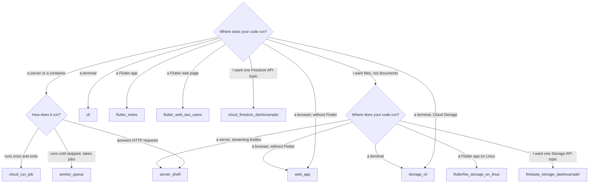

# Examples

Small, complete programs that use `cloud_firestore_dart` and `firebase_storage_dart`: servers and tools, a worker, a Flutter
app and a browser app. Each directory is a package of its own with a `pubspec.yaml` and a README.

| Directory | What it is |
| --- | --- |
| [`server_shelf/`](server_shelf/) | Two HTTP APIs on `package:shelf`: tasks in Firestore, with the changes of one real-time listener sent to every client as server-sent events; and files in Cloud Storage, with the request body streamed into a resumable upload and the object streamed to the response (ranges included). |
| [`cli/`](cli/) | A command-line tool on `package:args`: imports a JSON file with batched writes, exports a query to JSON, watches a query. |
| [`storage_cli/`](storage_cli/) | A command-line tool on `package:args` and `firebase_storage_dart`: `ls`, `put` (resumable, with a progress line), `get` (streamed to a file), `cat`, `stat`, `rm`, `url`; optional email/password sign-in so rules with `request.auth` pass. Run against the Storage emulator. |
| [`cloud_run_job/`](cloud_run_job/) | A one-shot job: an aggregation query, a transaction that writes once per execution, retries with backoff, and a `Dockerfile` for a native binary. |
| [`worker_queue/`](worker_queue/) | A long-running worker: a listener to wake up, a transaction that claims each job once, results in a batch, a clean stop on `SIGTERM`. |
| [`flutter_notes/`](flutter_notes/) | A Flutter notes app: a real-time list, offline edits in a SQLite cache, an offline indicator, connectivity events and a clean shutdown. Built and run on macOS, and on Windows from an SSH session (no window drawn). |
| [`flutterfire_on_linux/`](flutterfire_on_linux/) | A Flutter Linux desktop app written only against the official `cloud_firestore` and `firebase_core` API; `cloud_firestore_dart_platform` registers itself, with no code: a live list, add/edit/delete, a batch, a transaction, a query, an optional SQLite cache, and integration tests. Run on Debian 13 x86_64 and, in release, in an Ubuntu 24.04 arm64 container, against the emulator. |
| [`flutterfire_storage_on_linux/`](flutterfire_storage_on_linux/) | A Flutter Linux desktop app written only against the official `firebase_storage` and `firebase_core` API; `firebase_storage_dart_platform` registers itself, with no code: an upload of a generated image with a progress bar and pause, resume and cancel, a folder listing, images by download URL, delete, and an integration test. Against the Storage emulator; **not yet built or run on Linux**. |
| [`flutterfire_on_windows/`](flutterfire_on_windows/) | A Flutter Windows app on the official `cloud_firestore` API, with `cloud_firestore_dart` selected by `CloudFirestoreDart.use()` instead of the native plugin: a live list, add/edit/delete, a batch, a transaction, a query, a sum and average aggregation, an optional SQLite cache, and integration tests. Run on Windows 11 against the emulator. |
| [`web_app/`](web_app/) | A browser app in plain Dart (`package:web`): a real-time list, offline writes, a memory or SQLite (IndexedDB/OPFS) cache, and a Firestore Lite page to compare sizes, and a Storage page: a file picker, an upload with a progress bar and pause, resume and cancel, a folder listing and images by download URL. Supported in Chrome, untested elsewhere. |
| [`flutter_web_two_users/`](flutter_web_two_users/) | A Flutter web page with two signed-in users side by side (Auth emulator), each with its own `FirebaseApp` and Firestore client: each sees the other's writes, the security rules refuse the guest what the owner may do, and a SQLite cache in IndexedDB answers before the network after a reload. `run.sh` starts the emulators and serves the build on another port. Built with dart2js and dart2wasm, tried in Chrome. |
| [`playground/`](playground/) | A browser playground with no backend: the client runs with its network disabled on a memory cache, and the page shows each snapshot event, the writes waiting for a server and a timeline. Static files only, ready for any static host. Supported in Chrome, untested elsewhere. |

To pick one, start from where your code runs and follow the arrows:



For the API one topic at a time, see
the programs in [`cloud_firestore/cloud_firestore_dart/example/`](../cloud_firestore/cloud_firestore_dart/example/README.md)
and, for Cloud Storage, those in
[`firebase_storage/firebase_storage_dart/example/`](../firebase_storage/firebase_storage_dart/example/README.md).

## Running them

`server_shelf`, `cli`, `cloud_run_job` and `worker_queue` read the backend from the environment,
through the same `lib/firestore_from_env.dart` (`flutter_notes` and `web_app` have their own
READMEs):

- `FIRESTORE_EMULATOR_HOST=host:port`: the Firestore emulator. No credentials; the project
  is `demo-example` unless `FIREBASE_PROJECT_ID` says otherwise.
- Otherwise `FIREBASE_PROJECT_ID` (required), `FIRESTORE_DATABASE` (optional) and Application
  Default Credentials (`GOOGLE_APPLICATION_CREDENTIALS`, `gcloud auth application-default
  login`, or the metadata server on Google Cloud). These credentials bypass security rules.

No project id, key or token is in any file. The first three have tests; start an emulator, then,
in the example's directory:

```sh
dart pub get
FIRESTORE_EMULATOR_HOST=127.0.0.1:8080 dart test
```

## Status

- Run against the Firestore emulator (v1.22.0) on macOS with Dart 3.12.2, by their tests and
  by hand.
- **Not run against a real Firebase project.** The Docker image of `cloud_run_job/` has not
  been built.
- `server_shelf`, `cli` and `cloud_run_job` take the three packages from this repository, with
  path dependencies and `dependency_overrides` in their `pubspec.yaml`, so they run against the
  code next to them. To use one outside the repository, replace both with the versions on pub.dev
  (`^0.2.0`). `worker_queue`, `flutter_notes`, `web_app` and `playground` depend on the versions on
  pub.dev (`^0.2.0`, and `cloud_firestore_dart_sqlite` `^0.1.0` for the SQLite cache of
  `flutter_notes` and `web_app`) and can be copied out as they are; they have no tests, except
  `playground`, which has a smoke test that needs no emulator.
- `firestore_from_env.dart` is copied, not shared, so that each directory can be copied out on
  its own.
