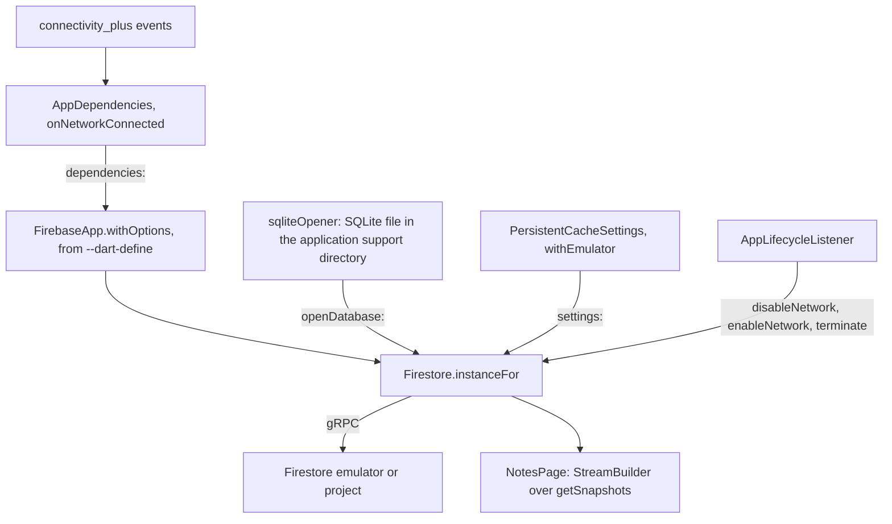
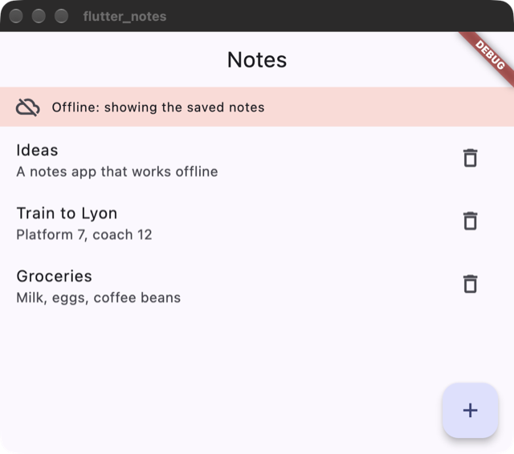

# flutter_notes

A small Flutter notes app on `cloud_firestore_dart` and `firebase_app_dart` from pub.dev. It keeps
its cache in SQLite, so the notes are there without a network, and edits made offline are sent
when the connection is back.

What it shows:

| What | Where |
| --- | --- |
| The `FirebaseApp` and the `Firestore` instance created in `main()` before `runApp`, from `--dart-define` values | `lib/firestore_setup.dart`, `lib/main.dart` |
| The persistent cache: a SQLite file in the application support directory, opened with `package:sqlite3`; `sqlite3_flutter_libs` bundles the native library | `lib/sqlite_database.dart` (a copy of the package's `example/sqlite_database.dart`), `lib/firestore_setup.dart` |
| Connectivity events of `connectivity_plus` fed to `PlatformDependencies.onNetworkConnected` | `AppDependencies` in `lib/firestore_setup.dart` |
| A real-time listener in a `StreamBuilder`, with `MetadataChanges.include` | `lib/notes_page.dart` |
| An offline indicator from `isFromCache` and `hasPendingWrites` of the snapshot metadata, and a mark on each note that is not on the server yet | `_StatusLine` and `_buildList` in `lib/notes_page.dart` |
| Add, edit and delete without awaiting the write (the future completes only when the server acknowledged it) | `_write` in `lib/notes_page.dart` |
| A typed model with a `FirestoreDataConverter` and a server timestamp | `lib/note.dart` |
| The app lifecycle: `disableNetwork()` on pause and `enableNetwork()` on resume (Android, iOS), `terminate()` when a desktop app is asked to quit | `lib/main.dart` |

The state is plain Flutter: `StatefulWidget`s and a `StreamBuilder`, no state management package.
The notes are in the collection `notes`, as `{title, body, updatedAt}`.

This is the app on macOS against a private emulator, with three notes. Look at the status line
under the title:


How `main()` wires the pieces together before `runApp`, and what the widgets use afterwards:



## Run it against the Firestore emulator on macOS

Needs Flutter (3.32 or later for Dart 3.8; built with 3.44.9), Xcode, and the Firebase CLI. From
this directory:

```sh
firebase emulators:start --only firestore --project demo-notes    # in another terminal

flutter pub get
flutter run -d macos
```

The app talks to the emulator on `127.0.0.1:8080` with the project `demo-notes`. To change it:

```sh
flutter run -d macos --dart-define=EMULATOR_HOST=127.0.0.1 --dart-define=EMULATOR_PORT=8104
```

To see the offline behaviour, stop the emulator while the app runs: the status line turns to
"Offline: showing the saved notes", and a note you add or edit is shown at once with an upload mark.

This is the same window about 20 seconds after the emulator was stopped. Look at the status line:
the notes stay, served from the SQLite cache.



Start the emulator again: within a few seconds (up to a minute, the client's backoff) the write
is sent and the line says "Up to date". The emulator keeps its data in memory, so after a restart
it has only what the app sent again. Quit with Cmd-Q and start the app with the emulator stopped:
the notes come from the SQLite file.

On the Android emulator the host machine is `10.0.2.2`, not `127.0.0.1`:
`--dart-define=EMULATOR_HOST=10.0.2.2`.

## Point it at a real project

Pass the values of a web app of your project (Firebase console, *Project settings*, *Your apps*;
they work on every platform):

```sh
flutter run -d macos \
  --dart-define=USE_EMULATOR=false \
  --dart-define=PROJECT_ID=my-project \
  --dart-define=API_KEY=<YOUR_API_KEY> \
  --dart-define=APP_ID=1:1234567890:web:0123456789abcdef
```

The app does not sign in, so its requests are unauthenticated: the security rules of the database
must allow reads and writes of `notes` without a user, which is only acceptable for a test
project. To add sign-in, see [Authentication](../../docs/guides/authentication.md). The ordering by
`updatedAt` needs no composite index. This app has not been run against a real project.

## Platforms

| Platform | Status |
| --- | --- |
| macOS | Built (`flutter build macos --debug`) and run against the emulator by hand: the listener, an edit offline, the sync when the emulator came back, the cache across a restart, and `terminate()` on Cmd-Q |
| macOS, screenshots | `flutter build macos --debug --dart-define=EMULATOR_PORT=8141`, the built app run against a private emulator with three notes written through the emulator's REST API, captured with `screencapture -l` |
| Android, iOS, Linux, Windows | Not built and not run. The platform folders are those of `flutter create` with the changes below |

Changes to the generated platform projects:

- macOS: `com.apple.security.network.client` in `macos/Runner/DebugProfile.entitlements` and
  `Release.entitlements`. Without it the sandbox blocks the connection to Firestore. The
  deployment target is 12.0 (the template's 10.15 is below what current Xcode builds).
- Android: the `INTERNET` permission in `android/app/src/main/AndroidManifest.xml` (debug builds
  get it from `src/debug`, release builds need it here).

## Notes

- `sqlite_database.dart` is written for `package:sqlite3` 2.x (`package:sqlite3/open.dart`), so
  the app pins `sqlite3: ^2.7.3` and `sqlite3_flutter_libs: ^0.5.40`. `sqlite3` 3.x bundles the
  library itself and `sqlite3_flutter_libs` 0.6 is an empty end-of-life release; the opener has
  not been ported to 3.x.
- `connectivity_plus` uses the packages `nm` and `dbus` on Linux, which are under the Mozilla
  Public License 2.0. Every other dependency is under MIT, BSD or Apache-2.0.
- The guide [Flutter](../../docs/guides/flutter.md) explains the code of this app step by step.
