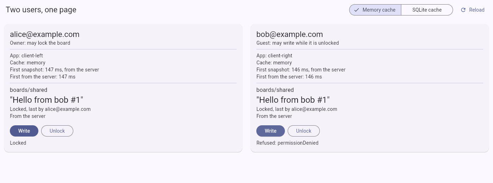
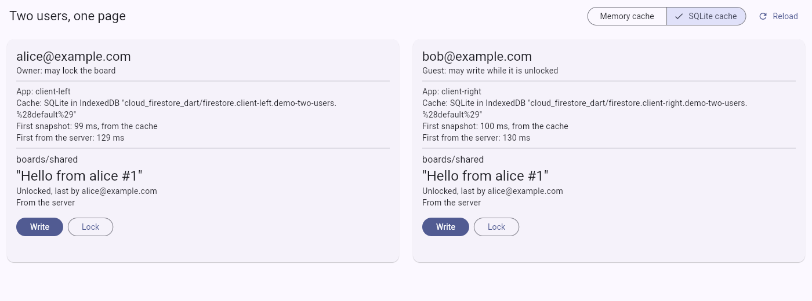

# flutter_web_two_users

A Flutter web page with two signed-in users side by side. Each column is a whole client: its own
`FirebaseApp`, its own user signed in with `firebase_auth_providers_dart` against the Auth
emulator, and its own `FirebaseFirestore`. Both show the document `boards/shared` and write to it;
the other column updates. The security rules tell the two users apart: only the owner may lock the
board, and the guest's attempt is refused. A switch picks a memory cache or a SQLite cache
(`cloud_firestore_dart_sqlite`, in IndexedDB); with SQLite, a reload shows the document from the
cache before the network answers.

The packages come from pub.dev (`cloud_firestore_dart` 0.2.0, `cloud_firestore_dart_sqlite` 0.1.1,
`firebase_app_dart` 0.2.0, `firebase_auth_providers_dart` 0.2.1). On the web,
`cloud_firestore_dart` is **supported in Chrome**; see the [web guide](../../docs/guides/web.md).

The guest (right) was refused the lock, the owner (left) locked the board, and the guest's write
to the locked board was refused too:



After a reload with the SQLite cache: the first snapshot of each client came from its cache (about
100 ms after `main()`), the first one from the server about 30 ms later:



## Run it

Needs Flutter (tried with 3.44.9), Java and the Firebase CLI (`npm install -g firebase-tools`, or
the copy that [`tool/README.md`](../../tool/README.md) installs in `.emulator/`). From this
directory:

```sh
flutter pub get
./run.sh            # dart2js
./run.sh --wasm     # dart2wasm
```

`run.sh` starts the Auth and Firestore emulators for the project `demo-two-users` with the rules of
[`firestore.rules`](firestore.rules) (Auth on 9201, Firestore on 8202), downloads the
`sqlite3.wasm` of `sqlite3` 3.3.4 into `web/` (checked against its sha256), builds the page with
the emulator addresses as `--dart-define`s, and serves `build/web` on 8203 with
[`tool/serve.dart`](tool/serve.dart). Open <http://127.0.0.1:8203/>. `AUTH_PORT`,
`FIRESTORE_PORT` and `WEB_PORT` move it; Ctrl-C stops everything it started.

What to try:

- **Write** in one column: the other shows it at once, marked "From the server".
- **Lock** as bob (right): refused with `permissionDenied`. Lock as alice (left), then **Write** as
  bob: refused. The local change is rolled back in bob's column.
- **SQLite cache**, write, then **Reload**: "First snapshot: ... from the cache" comes before
  "First from the server". The users stay signed in across the reload (their sessions are in
  `sessionStorage`, see `lib/session_storage.dart`).

## Files

| File | What it is |
| --- | --- |
| `lib/main.dart` | The page: `Client.start` (app, sign-in, Firestore instance) and one `ClientColumn` per user. |
| `lib/session_storage.dart` | An `AuthStorage` on the tab's `sessionStorage`. |
| `firestore.rules` | The rules: both users write `boards/<board>`, only `alice@example.com` locks it. |
| `run.sh` | Emulators, build and file server. |
| `tool/serve.dart` | A static file server on the loopback interface that sends `.wasm` as `application/wasm`. |

## What differs from the Dart VM

The code is the code of a VM program; what changes is around it.

- **Transport.** No gRPC in a browser: the listen and write streams go over WebChannel, every
  other call over REST, both on `fetch`. Every request of this page is a cross-origin request
  (the page is on 8203, the emulators on 8202 and 9201); the emulators answer CORS for any origin.
  The client picks this transport by itself; nothing to configure.
- **Caches.** Without `openDatabase` the cache is in memory and gone at the next load. With
  `sqliteOpener()` it is SQLite compiled to WebAssembly (`sqlite3.wasm`, fetched on the first
  open) with its database in IndexedDB, one database per app and database:
  `cloud_firestore_dart/firestore.<app name>.<project>.%28default%29`. With the memory cache the
  page has no IndexedDB database at all.
- **One tab per database.** A Web Lock guards each SQLite database: a second tab with the same
  app name waits two seconds and fails with `failedPrecondition` (`openWithMemoryFallback` gives it
  a memory cache instead). The two columns here have different app names, so different
  databases, and do not compete.
- **App names per client, not per user.** App names are global in the page. Name each
  `FirebaseApp` after the client that uses it (`client-left`, `client-right`), not after the
  user: the same user signed in in two clients of one page would otherwise collide
  (`FirebaseApp name ... already exists`). The name also names the cache database.
- **`sqlite3.wasm` must be the build of the `sqlite3` version in `pubspec.lock`.** A 2.x file
  with a 3.x package, or the reverse, cannot be loaded. `pubspec.yaml` pins `sqlite3: 3.3.4`:
  Flutter 3.44 would otherwise resolve 3.5.2, whose IndexedDB file system can lose writes the
  cache acknowledged when the tab closes a moment later. `cloud_firestore_dart_sqlite` 0.1.2
  refuses 3.4.0 to 3.5.2 for IndexedDB, and names a wrong `sqlite3.wasm`, with a
  `SqliteWebSetupException` (0.1.1, which this example resolves today, does neither: the pin is
  what keeps it safe). On a Flutter that allows `meta` 1.19, `sqlite3: ^3.6.0` works too.
- **CORS for your own endpoints.** Google's endpoints and the emulators answer CORS; your own
  server (a function, a backend the page calls next to Firestore) must too, for the origin of
  the page, preflight (`OPTIONS`) included.
- **Integers under dart2js.** Numbers are JavaScript numbers: shifts are 32-bit, so
  `1 << 32` is `0`, and `Random.secure().nextInt(1 << 32)`, valid on the VM, throws a
  `RangeError` (`max must be in range 0 < max ≤ 2^32, was 0`). Write `0x100000000`, or a smaller
  range. Integers above 2^53 lose precision; dart2wasm has 64-bit integers.
- **`dart:io` throws at run time.** `File` and `Directory` compile behind a conditional import
  but throw `Unsupported operation` in a page: keep file access behind a seam.

## How it was tried

On macOS with Flutter 3.44.9 and headless Chrome, against the Firebase CLI's Auth emulator and
Firestore emulator v1.22.0 (2026-11-17). `flutter build web` and `flutter build web --wasm` both
build (CI builds both, in the `flutter` job). A throwaway script drove each build over the
DevTools protocol: it turned on Flutter's semantics tree to find the buttons, clicked them with
`Input.dispatchMouseEvent`, and read the state each column publishes as `window.twoUsers`. It
checked, with both builds:

- each column sees the other's write within the 100 ms the script polls at;
- bob's lock and bob's write to the locked board are refused (`permissionDenied`), alice's are
  not;
- with the SQLite cache, `indexedDB.databases()` lists the two databases named above (none with
  the memory cache), and after a reload both first snapshots come from the cache (80 to 180 ms
  after `main()`), the server's 15 to 30 ms later;
- the page frozen with `Page.setWebLifecycleState` for three minutes, while another client wrote
  the document through the emulator's REST API: both columns showed the write within 105 ms of
  the thaw (dart2wasm build). Not tried: hours in the background, a laptop asleep.

The screenshots are from the dart2wasm build. Only Chrome was tried.

With a temporary `pubspec_overrides.yaml` on the `cloud_firestore_dart_sqlite` 0.1.2 of the
repository (not published yet when this was written): with the pinned `sqlite3` 3.3.4 the SQLite
cache opened as before; with `sqlite3` 3.5.2 (and its `sqlite3.wasm`) each column showed the
`SqliteWebSetupException` that names the pin to use, and the memory cache was unaffected.
