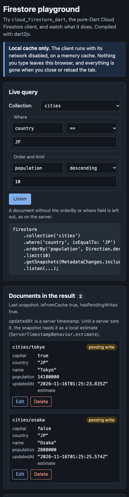
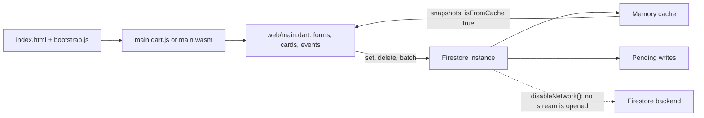

# playground

A browser page where you can try `cloud_firestore_dart` and see what the client does, with no
backend and no Firebase project. It is plain Dart (`package:web`, no Flutter), compiled to
JavaScript or WebAssembly, and it is only static files: any static host can serve it. Web
support of the library is **experimental**: see the [web guide](../../docs/guides/web.md).

The client runs with its network disabled, on a memory cache. Nothing you type leaves the
browser, and everything is gone when you close or reload the tab.

What you can do:

- Add, edit and delete documents in two collections, `cities` and `tasks`, or add sample data
  in one batch.
- Build a query (a collection, one where clause, one orderBy, a limit) and listen to it. The
  page shows the Dart code of the listener.
- Watch each snapshot arrive: the documents it added, modified or removed, and its
  `isFromCache` and `hasPendingWrites` flags.
- See the writes that wait for a server. There is none, so every write stays in that queue and
  its `Future` never completes: this is what an app sees while it is offline.
- Press **Reset** to start again with an empty cache.

The screenshot below is the page after the sample data, an edit, a new document, a delete and a
where clause: look at the queue of five writes on the left and the snapshot events on the right.


On a phone the panels stack in one column, here in the dark theme:



## How it works

The diagram shows what runs in the page and what it never reaches. Follow the solid arrows: a
write from the form goes into the local cache and the queue of pending writes, and the listener
reads from the cache. The dashed arrow is the network, which stays off.



`lib/playground.dart` opens the instance (`openOffline`):

1. `Firestore.instanceFor` with `MemoryCacheSettings`. The client starts its network on its own
   queue, but it opens a stream only for a listener or a pending write, and there is none yet.
2. `disableNetwork()`, queued right behind the start. Every listener and write of the page is
   queued after it, so no stream is ever opened.

**Why a memory cache.** A persistent cache would keep the writes of an earlier visit, and the
client starts its write stream for them as soon as it starts, before `disableNetwork()` runs. A memory
cache starts empty every time, needs no `sqlite3.wasm` (about 730 KB), stores nothing on the
visitor's device, and makes **Reset** simple: the page terminates the instance, which drops its
cache and its pending writes, and opens a new one.

The page also has a Content-Security-Policy in a `<meta>` tag: it may load only its own files
and connect only to its own origin (`'wasm-unsafe-eval'` lets the dart2wasm build compile). A
request to Google would be blocked by the browser even if the client made one.

## Build and run

Needs the Dart SDK (3.8 or later; the numbers below are from 3.12.2) and a browser. No emulator.
From this directory:

```sh
./build.sh                    # dart pub get, dart compile js and wasm, copies the page
dart run bin/serve.dart 8000  # serves build/web on http://localhost:8000/
```

`build.sh` writes the whole site to `build/web`:

```sh
dart compile js -O2 --no-source-maps -o build/web/main.dart.js web/main.dart
dart compile wasm -O2 --no-source-maps -o build/web/main.wasm web/main.dart
cp web/index.html web/styles.css web/bootstrap.js web/favicon.svg build/web/
```

Open <http://localhost:8000/> for the dart2js build and <http://localhost:8000/?compiler=wasm>
for the dart2wasm one (the browser needs WebAssembly garbage collection: a recent Chrome, Firefox
or Safari). `bin/serve.dart` serves only `build/web`, on the loopback interface, so you test
exactly what you publish. To try a sub-path as GitHub Pages uses, pass it:
`dart run bin/serve.dart 8000 /firebase_dart_sdk/`.

`test/playground_test.dart` is a smoke test on the Dart VM (no browser, no backend):
`dart test`.

## Publishing

Copy `build/web` to any static host, at the root or under a sub-path: every URL in the page is
relative. No special headers are needed; the host must send `.wasm` files as `application/wasm`
for the dart2wasm build (GitHub Pages does).

The workflow [`.github/workflows/playground-pages.yml`](../../.github/workflows/playground-pages.yml)
builds the page and deploys it to the GitHub Pages site of the repository. It runs only when
started by hand. To turn it on:

1. In the repository on GitHub, open **Settings**, then **Pages**, and under **Build and
   deployment** set **Source** to **GitHub Actions**.
2. Open **Actions**, pick **Playground on GitHub Pages**, and press **Run workflow** on `main`.

The page is then at `https://<owner>.github.io/<repository>/`. Run the workflow again to publish
a newer build.

## Files

| File | What it is |
| --- | --- |
| `web/main.dart` | The program of the page. |
| `lib/playground.dart` | What does not touch the page: `openOffline`, the query of the form (`QuerySpec`), the sample data. |
| `web/index.html`, `web/styles.css`, `web/favicon.svg` | The page, light and dark through `prefers-color-scheme`. |
| `web/bootstrap.js` | Starts `main.dart.js`, or `main.mjs` and `main.wasm` with `?compiler=wasm`. |
| `build.sh` | Builds `build/web`. |
| `bin/serve.dart` | The local static file server. |
| `test/playground_test.dart` | The smoke test. |

## Sizes

Measured with Dart 3.12.2 and `-O2`; gzipped with `gzip -9`.

| File | Bytes | Gzipped |
| --- | ---: | ---: |
| `main.dart.js` | 680,865 | 207,234 |
| `main.wasm` + `main.mjs` | 631,009 + 17,411 | 244,953 + 4,554 |
| `index.html` + `styles.css` + `bootstrap.js` + `favicon.svg` | 15,754 | 5,323 |

## Status

- Built with Dart 3.12.2 on macOS, with `dart compile js` and `dart compile wasm`.
- Run in headless Chrome through the DevTools protocol with both builds, served under a
  sub-path: sample data, an edit, a new document, a delete, a where clause, an invalid field
  path, and **Reset**. The network log showed only the page's own files, and the console stayed
  empty, also for 8 seconds after the last action.
- Not tried in other browsers, and not yet published anywhere.

## Dependencies

| Package | Licence |
| --- | --- |
| `cloud_firestore_dart`, `firebase_app_dart` | Apache 2.0 |
| `web`, `lints` (dev), `test` (dev) | BSD 3-Clause |
