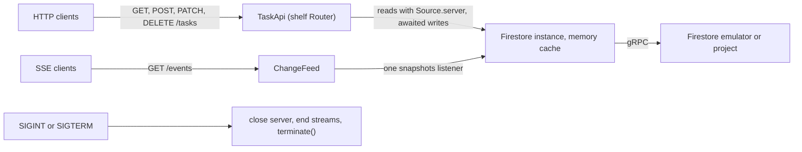
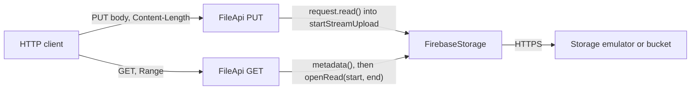

# server_shelf

A small task API on [`package:shelf`](https://pub.dev/packages/shelf) that reads and writes
Firestore with `cloud_firestore_dart`, and keeps one real-time listener on the collection whose
changes it sends to every connected client as [server-sent events][sse].

| Route | What it does |
| --- | --- |
| `GET /tasks` | All tasks, ordered by `createdAt`. `?done=true` or `?done=false` filters (unordered). |
| `POST /tasks` `{"title": "..."}` | Creates a task with a server timestamp; `201 {"id": "..."}`. |
| `GET /tasks/<id>` | One task, or `404`. |
| `PATCH /tasks/<id>` `{"done": true}` | Marks it done or open; `404` for a missing task. |
| `DELETE /tasks/<id>` | Deletes it; `204`. |
| `GET /events` | `text/event-stream`: a `snapshot` event with the current tasks, then `added`, `modified` and `removed` events, and a `: ping` comment every 15 s. |
| `GET /healthz` | `ok` |

What it shows:

- One `Firestore` instance for the process, created at startup from environment variables
  (`lib/firestore_from_env.dart`) and terminated on `SIGINT` / `SIGTERM`, so the process exits
  cleanly on Cloud Run and in containers.
- No cache on disk: the default memory cache.
- Reads with `Source.server`, so a response is never served from a stale cache. Writes are
  awaited, so a `201` means the backend accepted the write.
- One listener shared by every client (`lib/change_feed.dart`) instead of one per HTTP
  connection. A task created through the API shows up as `added` with the local estimate of its
  server timestamp, then as `modified` once the backend has filled the timestamp in.
- Firestore errors mapped to HTTP statuses (`not-found` 404, `permission-denied` 403,
  `unavailable` 503, ...).

[sse]: https://html.spec.whatwg.org/multipage/server-sent-events.html

Look at the two paths into the one `Firestore` instance: the routes call it per request, and
the event streams all hang off one listener in `ChangeFeed`:



A second program in the same package, `bin/file_server.dart`, keeps files in Cloud Storage; see
[Files](#files-with-cloud-storage) below.

## Run it against the Firestore emulator

Needs the Dart SDK (3.8 or later) and a Firestore emulator. From this directory:

```sh
# In one terminal: an emulator (firebase CLI), or the emulator JAR directly:
#   java -jar cloud-firestore-emulator-v1.22.0.jar --host 127.0.0.1 --port 8080
firebase emulators:start --only firestore --project demo-example

# In another:
dart pub get
FIRESTORE_EMULATOR_HOST=127.0.0.1:8080 PORT=8000 dart run bin/server.dart
```

Then:

```sh
curl -N localhost:8000/events &                            # watch the changes
curl -X POST -d '{"title":"Write the docs"}' localhost:8000/tasks
curl localhost:8000/tasks
curl -X PATCH -d '{"done":true}' localhost:8000/tasks/<id>
curl -X DELETE localhost:8000/tasks/<id>
```

This is a real session, with the emulator on port 8141 and the server on `PORT=8142` (Firestore
emulator v1.22.0, Dart 3.12.2, macOS). In the event stream, look at the `added` event: it
carries the local estimate of `createdAt`, and the `modified` event right after it carries the
time the backend set.

```text
$ curl -X POST -d '{"title":"Write the docs"}' localhost:8142/tasks
{"id":"CbDxzMFV7zXwDFjs55Po"}
$ curl localhost:8142/tasks
[{"id":"CbDxzMFV7zXwDFjs55Po","createdAt":"2026-11-16T01:18:40.222Z","done":false,"title":"Write the docs"}]
$ curl -i -X PATCH -d '{"done":true}' localhost:8142/tasks/CbDxzMFV7zXwDFjs55Po
HTTP/1.1 200 OK
$ curl -i -X DELETE localhost:8142/tasks/CbDxzMFV7zXwDFjs55Po
HTTP/1.1 204 No Content

$ curl -N localhost:8142/events      # started before the POST
event: snapshot
data: {"documents":[]}

event: added
data: {"id":"CbDxzMFV7zXwDFjs55Po","createdAt":"2026-11-16T01:18:40.204Z","done":false,"title":"Write the docs"}

event: modified
data: {"id":"CbDxzMFV7zXwDFjs55Po","createdAt":"2026-11-16T01:18:40.222Z","done":false,"title":"Write the docs"}

event: modified
data: {"id":"CbDxzMFV7zXwDFjs55Po","createdAt":"2026-11-16T01:18:40.222Z","done":true,"title":"Write the docs"}

event: removed
data: {"id":"CbDxzMFV7zXwDFjs55Po","createdAt":"2026-11-16T01:18:40.222Z","done":true,"title":"Write the docs"}
```

The headers of the `PATCH` and `DELETE` answers are trimmed to the status line. The server
logged one line per request and printed `Stopped` on `SIGTERM`.

The tests run the same API in-process against the emulator (skipped without it):

```sh
FIRESTORE_EMULATOR_HOST=127.0.0.1:8080 dart test
```

## Point it at a real project

Nothing about the project is in the files; everything comes from the environment:

| Variable | Meaning |
| --- | --- |
| `FIREBASE_PROJECT_ID` | The project id. Required when `FIRESTORE_EMULATOR_HOST` is not set. |
| `FIRESTORE_DATABASE` | A named database (default `(default)`). |
| `FIREBASE_API_KEY` | Optional: the Web API key of the project, sent with each request. Unset, no key is sent. |
| `GOOGLE_APPLICATION_CREDENTIALS` | A service account key file, if you use one (see below). |
| `TASKS_COLLECTION` | The collection (default `tasks`). |
| `PORT` | The HTTP port (default `8000`; Cloud Run sets it). |

```sh
unset FIRESTORE_EMULATOR_HOST
gcloud auth application-default login         # or GOOGLE_APPLICATION_CREDENTIALS=/path/key.json
FIREBASE_PROJECT_ID=<your project> dart run bin/server.dart
```

The requests carry Application Default Credentials (on Cloud Run, the service account of the
service). **These credentials bypass Firestore security rules**: access is decided by IAM (the
`Cloud Datastore User` role). Add your own authentication in front of the API before you expose
it. Do not commit key files.

This program has been run against the emulator only, not against a real project. The
credential path it uses is the one of `firebase_auth_providers_dart`, whose own status is in
[docs/guides/authentication.md](../../docs/guides/authentication.md).

## Files with Cloud Storage

`bin/file_server.dart` serves `lib/file_api.dart`, a file API on `firebase_storage_dart` that holds
no file in memory:

| Route | What it does |
| --- | --- |
| `PUT /files/<path>` | Streams the request body into a resumable upload (`startStreamUpload`); the `Content-Type` header becomes the content type of the object. `201` with the path, size and content type; `411` without a `Content-Length`. |
| `GET /files/<path>` | Streams the object to the response (`openRead`). `Range: bytes=a-b`, `bytes=a-` and `bytes=-n` give `206` with the matching `Content-Range`. `404` for a missing object. |
| `DELETE /files/<path>` | Deletes it; `204`. |
| `GET /healthz` | `ok` |

The request is not read into a `Uint8List`: the upload takes `request.read()` and sends it chunk by
chunk, which is why it needs the length first (the resumable upload declares the size when it
starts). A Storage error becomes a status: `object-not-found` 404, `unauthenticated` 401,
`unauthorized` 403, `quota-exceeded` 507, anything else 502.



Start a Storage emulator from the root of the repository (it needs Java and the Firebase CLI in
`.emulator/`, see `tool/README.md`), then, in this directory:

```sh
./tool/start_storage_emulator.sh 9199        # in the repository root: bucket demo-test.appspot.com
dart pub get
FIREBASE_STORAGE_EMULATOR_HOST=127.0.0.1:9199 PORT=8001 dart run bin/file_server.dart
```

```sh
head -c 3000000 /dev/urandom > big.bin
curl -X PUT -H 'Content-Type: application/octet-stream' --data-binary @big.bin localhost:8001/files/demo/big.bin
curl -s localhost:8001/files/demo/big.bin | cmp - big.bin && echo identical
curl -s -H 'Range: bytes=0-9' localhost:8001/files/demo/big.bin | wc -c
curl -X DELETE localhost:8001/files/demo/big.bin
```

The environment is read by `lib/storage_from_env.dart`: `FIREBASE_STORAGE_EMULATOR_HOST` for the
emulator (project `demo-test`, bucket `<project>.appspot.com`, or `STORAGE_BUCKET`), otherwise
`FIREBASE_PROJECT_ID` and Application Default Credentials, which bypass the Storage security
rules. Add authentication in front of the API before you expose it. Run against the emulator only.

The test runs the API in-process against the Storage emulator and is skipped without it:

```sh
FIREBASE_STORAGE_EMULATOR_HOST=127.0.0.1:9199 dart test test/file_api_test.dart
```

## Notes

- `pubspec.yaml` takes the three packages from this repository (path dependencies and
  `dependency_overrides`), so the example runs against the code next to it. Outside the
  repository, replace both with the versions on pub.dev (`^0.1.0`).
- [dart_frog](https://dartfrog.vgv.dev) would also work; it needs its own CLI (`dart_frog_cli`)
  to generate the server, so this example sticks to plain shelf, which runs with `dart run`.
