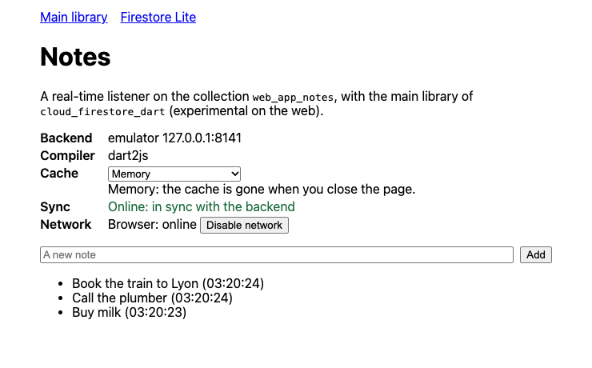
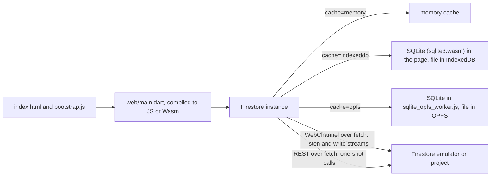
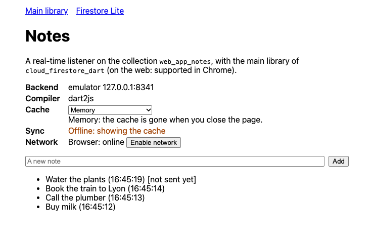

# web_app

A browser app in plain Dart (`package:web`, no Flutter) on `cloud_firestore_dart`. Web is
**supported in Chrome**: see the [web guide](../../docs/guides/web.md).

Two pages share one collection, `web_app_notes`:

| Page | What it shows |
| --- | --- |
| `index.html` (`web/main.dart`) | The main library. A real-time listener on the 50 newest notes, a form that adds one, an online/offline indicator (`metadata.isFromCache`), a button that calls `disableNetwork()` / `enableNetwork()`, and a choice of cache: memory, SQLite in IndexedDB, or SQLite in OPFS. |
| `lite.html` (`web/lite.dart`) | The same list and form with `package:cloud_firestore_dart/lite.dart`: no cache, no listener, a Refresh button. Compare the size of the two compiled programs below. |

This is the main page in headless Chrome against a private emulator, after three notes were
added. Look at the **Sync** line: the list comes from the backend.

<picture><source media="(prefers-color-scheme: dark)" srcset="../../docs/images/examples/web_app_online_dark.png"></picture>

The pieces of the main page, and where each request goes:



What to try:

- Add a note, press **Disable network**, add another: it shows at once, marked `[not sent yet]`,
  and the indicator says the list comes from the cache. Press **Enable network** and it is
  sent. The page then looked like this, with the button already showing **Enable network**:

  <picture><source media="(prefers-color-scheme: dark)" srcset="../../docs/images/examples/web_app_offline_dark.png"></picture>

- Pick **SQLite in IndexedDB** or **SQLite in OPFS**, then reload: the notes are on the page
  before the backend answers, also with the emulator stopped. A note written offline is sent
  when the page is opened again with a connection.
- Open the persistent page in a second tab: only one tab can have the persistent cache, so the
  second one says so and uses a memory cache (`openWithMemoryFallback`).
- On the Lite page, stop the emulator and add a note: the write fails with `unavailable`. Lite
  has no cache and does not queue writes.

## Build and run

Needs the Dart SDK (3.8 or later; the numbers below are from 3.12.2), a Firestore emulator and
a browser. From this directory:

```sh
firebase emulators:start --only firestore --project demo-example    # in another terminal

dart pub get

# The pages, compiled to WebAssembly (dart2wasm).
dart compile wasm -O2 -o build/web/main.wasm web/main.dart
dart compile wasm -O2 -o build/web/lite.wasm web/lite.dart

# The same pages compiled to JavaScript (dart2js), the fallback for a browser without
# WebAssembly garbage collection.
dart compile js -O2 -o build/web/main.dart.js web/main.dart
dart compile js -O2 -o build/web/lite.dart.js web/lite.dart

# The worker of the OPFS cache (always JavaScript, also for a dart2wasm page). The tool of
# cloud_firestore_dart_sqlite compiles it with this app's dependencies, and prints the URL of
# the sqlite3.wasm that goes with the resolved sqlite3 version.
dart run cloud_firestore_dart_sqlite:setup_web build/web

# SQLite compiled to WebAssembly, of the exact sqlite3 version in pubspec.lock (2.9.4).
curl -fL -o build/web/sqlite3.wasm \
  https://github.com/simolus3/sqlite3.dart/releases/download/sqlite3-2.9.4/sqlite3.wasm
shasum -a 256 build/web/sqlite3.wasm
# 922a76b182b6af69b030c8e2fdd3283ecc8e827248b20e4b1f3f3db170b52117

dart run bin/serve.dart 8000
```

Open <http://localhost:8000/>. The pages connect to the emulator on `127.0.0.1:8080`; to use
another one, add `?emulator=127.0.0.1:8090` to the address. The links between the two pages keep
the query string.

### Which compiler

Build with dart2wasm first: the client's own work ran 2 to 5 times faster with it in our
measurements (see [Performance](../../docs/guides/performance.md#dart2js-or-dart2wasm-in-the-browser)),
and its integers are exact 64-bit. A browser without WebAssembly garbage collection cannot run
that build and needs the dart2js build.

Each `dart compile wasm` command writes a `.wasm` and a `.mjs` file. Open
<http://localhost:8000/?compiler=wasm>: `web/bootstrap.js` then loads `main.mjs` and `main.wasm`
instead of `main.dart.js`. The OPFS worker stays JavaScript. Only Chrome was tried.

`bin/serve.dart` is a small static file server on `dart:io`, on the loopback interface only. It
serves `build/web` first, then `web`, and sends `.wasm` files as `application/wasm` (which
`WebAssembly.compileStreaming` needs). Use your own server or hosting for anything else; no
special headers are needed (the OPFS cache does not need cross-origin isolation).

## Files

| File | What it is |
| --- | --- |
| `web/main.dart`, `web/lite.dart` | The two programs. |
| `web/index.html`, `web/lite.html`, `web/styles.css` | The pages, light and dark through `prefers-color-scheme`. |
| `web/bootstrap.js` | Starts `<app>.dart.js`, or `<app>.mjs` and `<app>.wasm` with `?compiler=wasm`. |
| `lib/app_config.dart` | The `FirebaseOptions`, and the settings read from the address (`emulator`, `cache`). It imports neither Firestore library, so the Lite page stays small. |
| `bin/serve.dart` | The static file server. |

The persistent caches come from the package
[`cloud_firestore_dart_sqlite`](https://pub.dev/packages/cloud_firestore_dart_sqlite):
`sqliteOpener(sqlite3Wasm: ..., opfsWorker: ...)` is the `openDatabase` of the instance, and
`openWithMemoryFallback` gives a memory cache to a second tab. Its OPFS worker is compiled by
`setup_web` into `build/web/sqlite_opfs_worker.js`; run that command again when the package or
`sqlite3` changes version.

## `sqlite3.wasm`

The persistent caches load `sqlite3.wasm`: SQLite compiled to WebAssembly by the
[`sqlite3`](https://pub.dev/packages/sqlite3) package, published as an asset of each release
of [simolus3/sqlite3.dart](https://github.com/simolus3/sqlite3.dart/releases) (release
`sqlite3-2.9.4` here). It must be the build of the `sqlite3` version that your app resolves,
which is why `pubspec.yaml` pins `sqlite3: 2.9.4`, the version the browser storage of
`cloud_firestore_dart_sqlite` was tested with (its README advises against 3.4.0 to 3.5.2 in a
browser). The checksum above is the one this
repository's browser tests pin (`tool/build_web_test_assets.sh`).

Licences: the `sqlite3` package, and the code it adds around SQLite in that file, are under the
MIT licence (Copyright (c) 2020 Simon Binder); SQLite itself is in the public domain. Ship the
MIT notice of the package with your app.

The file is only fetched when a persistent cache is opened; the memory cache and the Lite page
never load it.

## Sizes

Measured with Dart 3.12.2 and `-O2`, with `cloud_firestore_dart` 0.2.0 and
`cloud_firestore_dart_sqlite` 0.1.0; gzipped with `gzip -9`.

| File | Bytes | Gzipped |
| --- | ---: | ---: |
| `main.dart.js` (main library) | 923,999 | 273,496 |
| `lite.dart.js` (Lite) | 397,741 | 122,129 |
| `main.wasm` + `main.mjs` | 914,774 + 29,105 | 342,322 + 6,438 |
| `lite.wasm` + `lite.mjs` | 340,612 + 15,890 | 135,659 + 4,165 |
| `sqlite_opfs_worker.js` | 185,379 | 57,400 |
| `sqlite3.wasm` | 730,989 | 347,931 |

The main page contains the SQLite opener whatever cache you pick, since it imports it. A page
that only uses the memory cache is smaller: the [Firestore Lite guide](../../docs/guides/lite.md#size)
has the numbers of a program without the opener.

## Status

- Built with Dart 3.12.2 on macOS, with `dart compile js` and `dart compile wasm`.
- Run in headless Chrome 157 against the Firestore emulator, with both compilers: the listener,
  adding a note, an offline write sent after `enableNetwork()`, the three caches, a reload with
  the backend unreachable (OPFS), a second tab falling back to the memory cache (IndexedDB and
  OPFS), and the Lite page.
- Run again the same way with version 0.2.0 of the packages and `cloud_firestore_dart_sqlite`
  0.1.0 (Chrome 157, dart2js and dart2wasm, driven over the DevTools protocol): the same steps,
  and a reload with the backend unreachable for IndexedDB as well as OPFS. On the Lite page with
  the backend unreachable, the read and the write fail with
  `unavailable: Request failed with error: TypeError: Failed to fetch`.
- Not run against a real Firebase project, and not in other browsers.
- The screenshots above, light and dark (2026-11-18, with 0.2.0): built with
  `dart compile js -O2` as described, served by `bin/serve.dart`, opened in headless Chrome
  with `?emulator=127.0.0.1:8341` against a private emulator (`tool/start_private_emulator.sh
  8341`) and driven over the Chrome DevTools protocol (memory cache, Dart 3.12.2, Firestore
  emulator v1.22.0). Each state was captured twice from the same page, with
  `prefers-color-scheme` emulated as light and as dark: the dark one shows the page's own dark
  colours from `styles.css`.

## A real project

Put the web app options of your project in `lib/app_config.dart` and open the pages with
`?emulator=none`. Requests then carry no user: your security rules must allow them, or add
Firebase Auth (`firebase_auth_providers_dart`). Never commit keys you do not want public; the
Web API key of a Firebase project is not a secret, but your rules are what protect the data.
This has not been tried.

## Dependencies

| Package | Licence |
| --- | --- |
| `cloud_firestore_dart`, `firebase_app_dart`, `cloud_firestore_dart_sqlite` | Apache 2.0 |
| `sqlite3` | MIT |
| `web`, `path`, `lints` (dev) | BSD 3-Clause |
