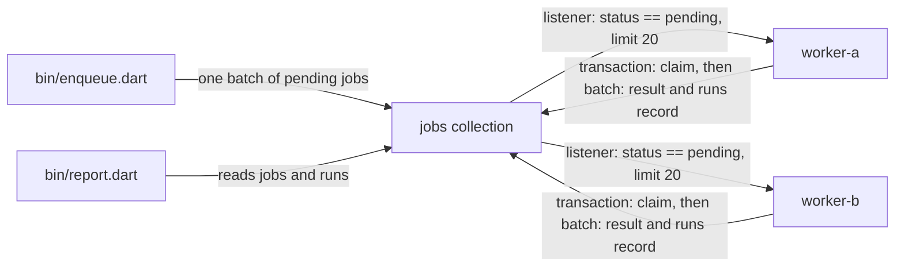
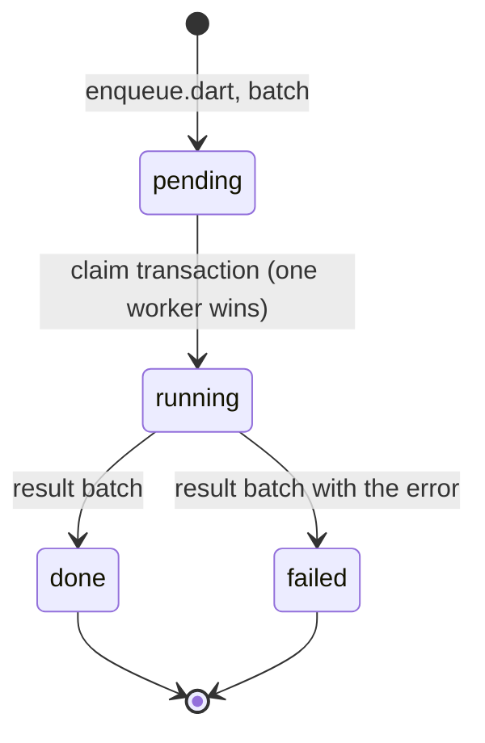

# worker_queue

A long-running worker that takes jobs from a Firestore collection with `cloud_firestore_dart`.
Run as many copies as you like: a job is claimed by one of them.

| Program | What it does |
| --- | --- |
| `bin/worker.dart` | Waits for pending jobs, claims one at a time, runs it, writes the result, until `SIGINT` or `SIGTERM`. |
| `bin/enqueue.dart [count]` | Adds `count` jobs (default 20) in one batch: `{status: 'pending', n: <i>, createdAt: <server time>}`. |
| `bin/report.dart` | Counts the jobs by status and the runs by worker, and exits with `1` if a job ran more than once. |

All three programs talk to the same collection; the workers never talk to each other. Look at
the arrows into `jobs`: the claim is a transaction, so two workers can race for a job and only
one wins.



A job moves from `pending` to `running` to `done` (or `failed`):

1. **A listener wakes the worker up.** The worker listens to
   `where('status', isEqualTo: 'pending').limit(20)` and keeps the ids of the latest snapshot.
   With nothing to do it waits for the next snapshot; it never polls.
2. **A transaction claims the job.** `runTransaction` reads the job and, only if it is still
   `pending`, sets `status: 'running'`, `worker`, a random `claim` id and `claimedAt`. When two
   workers claim the same job, the backend accepts one commit; the transaction of the other is
   run again, reads `running` and gives up, and the worker tries the next id. A transaction
   whose commit answer was lost is run again too
   ([Transactions](../../docs/guides/transactions_and_lifecycle.md#transactions)); it then finds
   its own `claim` id and keeps the job instead of dropping it.
3. **One batch writes the result.** `status: 'done'` with `result` and `finishedAt`, and a record
   of the run in the job's `runs` subcollection, in one `WriteBatch`. A job that ran twice would
   have two records; `bin/report.dart` checks that none has.
4. **Shutdown.** On `SIGINT` (Ctrl-C) or `SIGTERM` (Cloud Run, Kubernetes, `docker stop`) the
   worker takes no new job, lets the job in progress finish, cancels the listener, calls
   `waitForPendingWrites()` (with a 5 s timeout, since it does not complete while the backend is
   unreachable) and `terminate()`, and exits with `0`.

The states of one job, and which step moves it on. Note that nothing leads out of `running`
except the result batch: see [What it does not do](#what-it-does-not-do) for a worker that dies
there.



The worker uses the default memory cache: nothing is written to disk. Exit codes: `0` after a
clean stop, `1` when the listener failed (for example `permission-denied`) or writes were still
pending at shutdown, `78` when no backend is configured.

## Run it against the Firestore emulator

Needs the Dart SDK (3.8 or later) and a Firestore emulator. From this directory:

```sh
firebase emulators:start --only firestore --project demo-example    # in another terminal

dart pub get
export FIRESTORE_EMULATOR_HOST=127.0.0.1:8080
WORKER_ID=worker-a dart run bin/worker.dart     # in a second terminal
WORKER_ID=worker-b dart run bin/worker.dart     # in a third terminal
dart run bin/enqueue.dart 20
dart run bin/report.dart                        # once the workers are idle
```

Stop the workers with Ctrl-C. For a long-running process, compile it:
`dart compile exe bin/worker.dart -o worker`.

## Two workers, twenty jobs

This is the output of one run with version 0.2.0 of the packages against a private emulator
(Firestore emulator v1.22.0, Dart 3.12.2, macOS): two workers started first, then
`enqueue.dart 20`, then `SIGTERM` to both once the queue was empty, then `report.dart`. The
lines of the two workers are shown one after the other.

```text
enqueued 20 jobs
worker-a: waiting for jobs
worker-a: ran VQODfAnk1UgQaE8LjHiN -> {square: 36}
worker-a: ran dEIIosYqAbYyW57IYys4 -> {square: 361}
worker-a: ran gBX0J4tgdQQ4ep8MhzRq -> {square: 196}
worker-a: ran m0fdpEcgaI1h7Ovhedd8 -> {square: 256}
worker-a: ran o0r9TTt0Q3IEZrGA0NlB -> {square: 289}
worker-a: ran sPwgywWXUXZ6WMaKh81t -> {square: 324}
worker-a: ran thOMT4RAno4NhT8JKx07 -> {square: 81}
worker-a: stopped after 7 jobs (6 claims lost to another worker)
worker-b: waiting for jobs
worker-b: ran 769DMQX1iZWvOiLFJVpL -> {square: 400}
worker-b: ran 8N9iAuBzU3wyIl3QkSqq -> {square: 144}
worker-b: ran C7iNLqyK9vKXAr0vrDXj -> {square: 225}
worker-b: ran FTykYO03FkJjAjo6hoiX -> {square: 4}
worker-b: ran HqELmKCiNIMTcylTz3Ti -> {square: 64}
worker-b: ran Il5zMgRfB4VWIB7CezuQ -> {square: 1}
worker-b: ran WFm5LILNiMgoW1FG7f3S -> {square: 9}
worker-b: ran dG47rnafZsNl3YD2iPEu -> {square: 100}
worker-b: ran lWv9gkrsmpxZez4IG7fu -> {square: 25}
worker-b: ran ntiXGcYZWBRyqPCWJ0MQ -> {square: 16}
worker-b: ran rEkOS5Qn7RrAhvKwEfFS -> {square: 121}
worker-b: ran ta3JiAA9E3MsFvTx0yCZ -> {square: 49}
worker-b: ran wzRkcGpwhkuZbbHRDxgZ -> {square: 169}
worker-b: stopped after 13 jobs (1 claims lost to another worker)

$ dart run bin/report.dart
jobs: 20 {done: 20}
runs per worker: {worker-b: 13, worker-a: 7}
no job ran more than once
```

The 7 and 13 jobs add up to 20, every job id appears once, and every job has one run record.
Six of the claim transactions of `worker-a` and one of `worker-b` found the job already taken by
the other worker (`claims lost` counts them). A second run, with
one worker and `SIGTERM` one second after the jobs were added, stopped after 5 jobs and left
the queue at `{done: 5, pending: 15}`: no job was left `running`.

This shows the claim working for two workers on one emulator, in one run. It is not a load
test, and it has not been run against a real project.

## Point it at a real project

Nothing about the project is in the files; everything comes from the environment:

| Variable | Meaning |
| --- | --- |
| `FIREBASE_PROJECT_ID` | The project id. Required when `FIRESTORE_EMULATOR_HOST` is not set. |
| `FIRESTORE_DATABASE` | A named database (default `(default)`). |
| `FIREBASE_API_KEY` | Optional: the Web API key of the project, sent with each request. Unset, no key is sent. |
| `GOOGLE_APPLICATION_CREDENTIALS` | A service account key file, if you use one. |
| `JOBS_COLLECTION` | The collection of the jobs (default `jobs`). |
| `WORKER_ID` | The name written into claimed jobs (default `<host name>-<pid>`). |

```sh
unset FIRESTORE_EMULATOR_HOST
gcloud auth application-default login         # or GOOGLE_APPLICATION_CREDENTIALS=/path/key.json
FIREBASE_PROJECT_ID=<your project> dart run bin/worker.dart
```

The requests carry Application Default Credentials, which **bypass Firestore security rules**
(access is decided by IAM, the `Cloud Datastore User` role). The query filters on `status` only,
so it needs no composite index. Each claim is a transaction (one read and one write, more when
two workers collide), and each job costs a few more writes.

For a container, see [Containers](../../docs/guides/server.md#containers) in the server guide:
since this example takes its packages from pub.dev, its own directory is the whole build
context. No image of this example has been built.

## What it does not do

- **A crashed worker leaves its job `running`.** There is no lease: a job whose worker was
  killed (`SIGKILL`, out of memory, a lost machine) is not taken again. Set it back to `pending`
  by hand, or add a lease (`claimedAt` plus a timeout) and a query for expired ones; a query on
  `status` and `claimedAt` needs a composite index.
- **No order.** The jobs come in the order of their document ids, not of `createdAt`. Ordering by
  `createdAt` with the `status` filter needs a composite index.
- **One job at a time per worker.** Run more workers for more throughput.
- **With a lease, a job can run twice.** A worker can die after the work and before its result
  batch is committed; the job is then taken again when the lease expires. Make the work safe to
  repeat before you add one.

## Notes

- `pubspec.yaml` depends on the versions on pub.dev (`^0.2.0`), unlike the other examples in
  `examples/`, which use the packages of this repository by path. `pubspec.lock` records the
  versions it was run with.
- `lib/firestore_from_env.dart` is the same file as in the other examples.
- No tests: the run above was done by hand.
